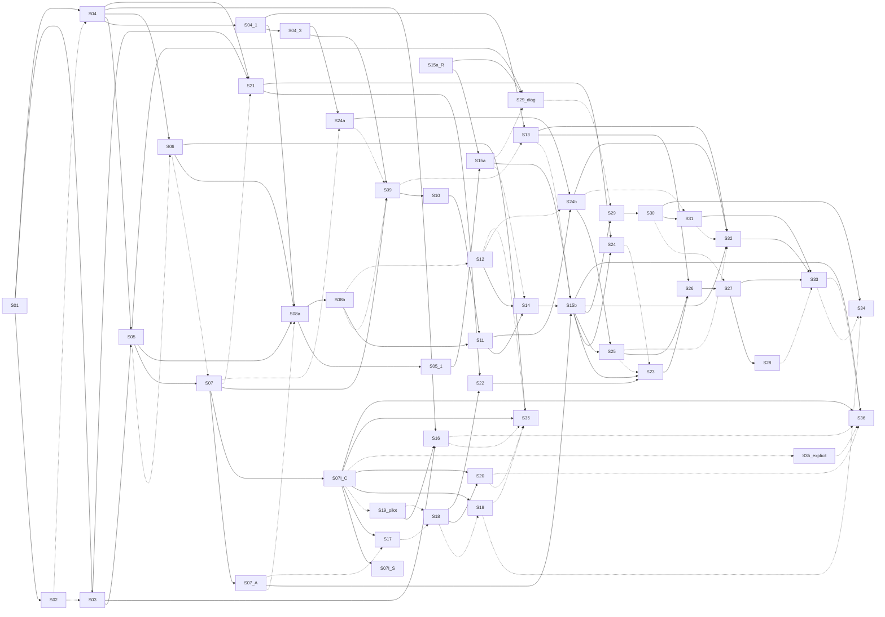

# CulinaryState — Definitive 36-Step Execution Plan v2

**Status:** PENDING HUMAN REVIEW. Reconciled 2026-10-26 under decision **D-027**. **STEP 08 NOT STARTED.**
**Review pass (2026-10-26):** revised after an independent governance review (laws, rulings) and an independent methods/DAG review. Items that the review added to the plan are marked "added in v2 review; needs human approval" and carry their own CHG rows; none of them starts Step 08 or weakens a gate.
**Governing spine:** the original 36-step CulinaryState execution spine (approved by Kush), with numbering preserved.
**Amendment layer:** Master Plan Research & Architecture Audit v2 (`reports/master_plan/master_plan_research_audit_v2.md`). It is adopted **only** where rulings R-01..R-20 adopt it. Every other audit proposal stays PROPOSED and is listed per step under "Audit v2 proposals NOT adopted".
**Companion files:**
- `docs/plan/CulinaryState_36_Step_Execution_Plan_v2_changelog.md` (exact change log)
- `registry/execution_spine_v2.csv` (machine-readable steps, dependencies, gates, hours)
- `reports/master_plan/ssot_change_requests_v2.md` (all PROPOSED_ONLY)

> **Source limitation (stated once, applies everywhere).** The *original 36-step plan document* (Master Execution Plan v1 step cards) is **not on this server**; only its 36 step titles are known, second-hand, via the human brief (§9) as quoted in the PROPOSED Audit v2 working notes; no repo document stores them. The "Original" column of every reconciliation table therefore uses the step title plus what the repo records of Steps 01–07 (WORKLOG, DECISIONS, reports, freeze manifests). If the original card text differs from what is reconstructed here, the original wins for scope, and a delta pass is needed. The same applies to Max Prompt v3.0 and Parv's DELTA/LANE plans, which are also absent.

## 0. Binding human rulings (D-027)

| ID | Ruling |
|---|---|
| R-01 | Preserve all 36 top-level steps and their numbering. |
| R-02 | Steps 01–07 are completed historical work. They are not marked failed or reopened. New requirements become additive v1.1 contracts / substeps. |
| R-03 | Step-04 lineage extension: SRC → DOC → STUDY → SEXP → SMP → OBS → AGG/DRV, with typed lineage edges and separate `study_id`, `lineage_root_id` and `split_group_id`. |
| R-04 | Kinetic/trajectory schema exists **before** Steps 09/11. Time series are never flattened into endpoint-only EVD rows. |
| R-05 | 07-DEP: the Step-07 human condition audit is a **SOFT** dependency of Step 08. It is a **HARD** gate before condition-dependent scientific use: Steps 15, 23, 26d/27 and 29–33. |
| R-06 | The Step-07 gate is unchanged: pooled Cohen's κ ≥ 0.80 **and** no systematic critical-field failure, where "systematic critical-field failure" is defined exactly as in the preregistered protocol (`reports/step07/condition_audit_protocol.md`) and implemented by `tools/step07_agreement.py`, both unchanged. PABAK, AC1 and the other added statistics are diagnostics only (the raw-agreement and prevalence tests inside the tool's own critical-field flag rule stay part of the gate and are not re-labelled). There is no per-field κ ≥ 0.80 gate. |
| R-07 | The frozen v4 audit packet is not altered. Any content change requires a new version. |
| R-08 | 07I-C identity calibration and a separate recall-oriented `split_group_id` are adopted. No destructive merge of source recipes. Thresholds are never chosen to hit a corpus size. |
| R-09 | Step 08 is split into 08a (lineage for the existing 17,978 EVD rows) and 08b (reusable lineage/dedup library for Steps 11–14). |
| R-10 | Steps 12, 13, 21 and 35 (explicit baselines) run in parallel **where their input artifacts already exist**. |
| R-11 | Step 25 stays a numbered step. It may be implemented inside a 24/25 FORM/PARAM/compatibility package. |
| R-12 | Step 29 may move earlier **only** as a diagnostic on frozen bootstrap data. It is never the paper-grade benchmark. |
| R-13 | Step 28 (E7 synthetic prior) is deferred until a simulator passes real held-out validation (27). |
| R-14 | SIM-AA-1 (ascorbic acid) is the leading candidate, not frozen. Chlorophyll is the preregistered fallback. The final choice comes from Step 10/11 kinetic-series evidence. |
| R-15 | Applicability is three-valued: APPLICABLE / NOT_APPLICABLE / UNKNOWN. UNKNOWN never silently becomes SIMULATE. |
| R-16 | Step 35 is explicit-first: fingerprints/descriptors/set/IDF before learned representations. Nine similarity notions stay distinct: structural, chemical, compositional, sensory, functional, nutritional, cultural, procedural, process-response. |
| R-17 | Only the design/pilot portion of Deep Gold moves earlier, as a small independent pilot measuring time, IAA and schema problems. No 150–375 h/reviewer programme yet. |
| R-18 | No breaking Step-36 schema migrations. Runtime claim/evidence-compiler changes stay designs. |
| R-19 | All negative experimental findings are preserved (e.g. DEL-2 cold-split collapse, NER closure, retrieval results, Gold-oracle results). |
| R-20 | Core laws are absolute: UNKNOWN≠0; recipes≠chemistry truth; simulation≠measured evidence; Silver≠Gold; structural≠sensory similarity; attention≠causality; source data immutable; no unsupported SOTA claims; no post-hoc gate weakening; no complexity without demonstrated gain. |

**Project direction (human-stated goals, recorded without overclaiming):**
- USP: a **process-awareness track**, i.e. state- and process-conditioned reasoning, with simulation outputs attached to recipes as SIMULATION-memory, never as evidence.
- **Separated "smart memories"**: source / evidence / state / model / simulation (as stated by the human; a separate recipe-semantic plane is a plan proposal, not part of the stated direction).
- An optional **local LLM runtime via Ollama**.
- Targets: a later paper, and a Foodoscope symposium presentation. Course presentation is 25–26 Nov 2026 (WORKLOG header), and a human-stated ~1-week demo milestone comes first. Novelty must be verified against literature before it is claimed (R-20).

## 1. Final four-way reconciliation (Original 36-step plan vs SSOT v15 vs Final Master Plan v4.0 vs Audit v2)

| Layer | Role in v2 | What it contributed / where it lost |
|---|---|---|
| **Original 36-step spine** | GOVERNING | Defines the 36 steps, their order and their titles. Steps 01–07 were executed under it (WORKLOG S001–S134; D-001..D-025). Card text is unavailable here (see limitation above). |
| **SSOT v15** | Laws and definitions (highest scientific authority) | Supplies anchors for every step (per-step tables). Already contained the key laws the audit leaned on: lineage law §232.6, study-disjoint Split 6, G15 gates, §257A.15 split order, §264.8 no universal identity threshold. No SSOT text is changed; 65 change requests stay PROPOSED_ONLY (§6). |
| **Final Master Plan v4.0** | Approved programme decisions and implementation detail | Supplies the ID tables (H1), acquisition hierarchy, human gates H1–H8 and agent roles. Where its wording conflicts with the SSOT (e.g. "FAM- via MinHash ≥ 0.8"), the SSOT wins (already ruled in D-025). |
| **Audit v2** | PROPOSED amendment layer | Adopted through R-03, R-04, R-05 (with the original gate kept, R-06), R-08, R-09, R-10, R-12, R-13, R-15, R-16 and parts of R-17. **Not adopted:** the per-field κ gate, the packet-v4.1 changes, "MODIFY/failed" framing for Steps 03/04, "MERGE" for Step 25, freezing SIM-AA-1, an immediate Deep Gold programme, breaking Step-36 migrations, and E7 use before Step 27 passes. Parallelisation beyond R-10 (26a–c, 36A/B, 16–18, 22a, 24a, early 30/31a/34a) stays pending human review. |

**Result:** v2 has 36 top-level steps and adds or removes none. Counts by v2 decision (each step counted once, from `registry/execution_spine_v2.csv`):

| v2 decision | Steps |
|---|---|
| KEEP+CLARIFY (9) | 01, 02, 03, 05, 06, 14, 18, 19*, 33 |
| MODIFY (additive) (20) | 04, 07, 08, 09, 10, 11, 15, 16, 17, 20, 22, 23, 24, 26, 27, 30, 31, 32, 34, 36 |
| PARALLELIZE (4) | 12, 13, 21, 35 |
| MOVE EARLIER, diagnostic/pilot only (1) | 29 (29-diag) |
| IMPLEMENT-INSIDE 24 package (1) | 25 |
| DEFER (1) | 28 |

\*Step 19 stays in place. Only its design/pilot substeps (19-D, 19-pilot) move earlier (R-17).

**Substep naming map** (Phase A–B names are authoritative; the other phase sections use aliases):

| Canonical | Aliases |
|---|---|
| 04.1 (lineage contract v1.1) | 04-LIN, 04.L, 04.1-v1.1 |
| 04.3 (kinetic/trajectory contract) | 04-KIN, 04.K, R04-kinetic-schema |
| 07.A (Step-07 human audit on frozen v4 packet) | 07.gate, 07-condition-audit-valid-pass, 07-audit |
| 05.1 (EVD export v2) | EVD export v2 |
| 06.1 (H2 decisions #1/#3/#4, a gate for Steps 10 and 13) | H2#1/#3/#4 |
| 15b (paper-grade freeze, gated on 07.A) | 15, where the Step-07-gated freeze is meant |
| 07I-C (identity calibration) | — |
| 07I-S (recall-oriented split groups) | 19-S where used for Gold selection |

## 2. The plan (per-phase sections, written to the binding rulings)
Each step has a contract table (status, rulings applied, goal, substeps, inputs, outputs, dependencies, method/MODEL ARCHITECTURE, data & licence, metrics & leakage, preregistered pass gate, fail action, human gate & hours, compute, changes, audit proposals not adopted). Each phase ends with its change table, its four-way reconciliation table and its STEPDATA block. Long-form rationale and literature are in the Audit v2 Part E cards and `reports/master_plan/working_notes/`.

---

# CulinaryState Execution Plan v2 — Phases A and B (Steps 01–09)

Drafter: phase_AB · 2026-10-26 · plan-only. No repo file modified, no pipeline run, Step 08 NOT started. Sources: rulings.md (binding), format.md, ctx.md, audit cards G_A/G_B (+json), M0_data_planes, I1_evidence_model, repo DECISIONS/WORKLOG/gate JSONs/protocol/MP-1, reader notes gov/impl. Repo facts re-checked read-only on this machine (ledger counts, schema enums, gate JSONs, SSOT/MP line anchors).

## Reading conventions and open conflicts

- **Authority.** Rulings R-01…R-20 (recorded as D-027) bind. The Research & Architecture Audit v2 is PROPOSED only. The original *Master Execution Plan v1* step cards are NOT on this machine: all card content below is reconstructed from SSOT v15, Master Plan v4.0 (MP) and repo artifacts; nothing is quoted from the missing plan.
- **Substep tags.** [R] = mandated by a named ruling. [D] = derived prerequisite without which a ruled item cannot run safely (still needs human approval; H4 where an ID scheme, enum or schema changes). [P] = audit proposal NOT adopted (listed only in the last row of each step table). Substep ids follow the audit drafts (G_A/G_B) for traceability; "03.1" in R-02 is an example only (the audit's 03.1 is [P]).
- **Thresholds** marked PROPOSED_PILOT are design proposals, not literature constants. A human pre-registers them in `registry/preregistered_thresholds_v1.csv` (01.6) BEFORE the relevant data are touched (R-08, R-20).
- **Decision ids.** "DEC-n" = a proposed new DECISIONS entry; real id = next free after D-027 (D-026 is occupied on the Mac copy; D-027 = the 2026-10-26 rulings). D-027 (`DECISIONS.md`) and S135 (`WORKLOG.md`) were appended on branch plan/v2-reconciliation (uncommitted at review time); nothing else in those files changed.
- **Planes.** Step 07 numbering holds two lanes (R-01 keeps numbering): EVIDENCE plane (07, 07.A) and RECIPE plane (07H-R, 07I-R, 07I-C, 07I-S).
- **Conflicts I could not resolve (human to decide):**
  1. *D-id collision:* the audit proposed D-026 (authority order) and D-027 (MP-1 status); D-026 is occupied on the Mac copy and D-027 is the rulings record. New DECISIONS entries need ids assigned by the human.
  2. *`split_group_id` homonym:* R-03 uses it for evidence-plane lineage components, R-08 for recipe-plane recall-oriented groups. Plan: one column name, two planes, plane-qualified id values (`SPLITGRP-EVD-…`, `SPLITGRP-REC-…`), no cross-plane join (04.6-min, 04.9-min). Needs H4 ratification.
  3. *07.A tooling:* `tools/step07_agreement.py` hard-codes its output to `reports/step07/step07h_human_gate_result.json`, the retained v3 NOT_COUNTED result (R-19); the v3 `provenance_check` block was written by hand, not by script. Plan: archive v3 first; add a separate provenance/diagnostics script; leave the gate computation unchanged.
  4. *R-08 vs giant-component guard:* a sub-blocking rule for a giant recipe split group could be read as tuning to obtain usable sizes. Plan constrains it (07I-S); humans must confirm.
  5. *Overlapping ownership in the audit:* censor-kind / value-origin additions appear in 03.2, 04.2, 05.4 and 07.D. v2 consolidates them in 04.2-min.
  6. *R-04 ownership:* kinetic/trajectory CONTRACT is owned by 04.3 (with clock tags in 03.3); Step 09 owns the extraction MACHINERY; Step 11 consumes. A Phase-C author who expects Step 09 to own the schema must be reconciled to this.
  7. *R-05 settles the dependency, not the authorisation:* Step 08 stays unauthorised until the preconditions in Step 08 are met and Kush authorises it.
  8. *MP-1 status label:* header "DRAFT FOR REVIEW" vs authority map FROZEN_CONTRACT vs S129 "frozen". v2 treats MP-1 v1 as in force for the fields ES-1.1 consumed and C2–C8 as OPEN; human to confirm the label.
  9. *Cross-phase note for Step 29 (R-12):* a diagnostic bootstrap may run before 07.A passes only if condition-derived features are excluded or labelled UNAUDITED; final claims need 07.A (R-05).

---

## PHASE A — Foundation (Steps 01–04)

Purpose: fix the rules of the game (authority, status truth, state semantics, evidence/provenance/similarity contracts) before evidence work. Status as of 2026-10-26: Steps 01–04 are completed historical work (R-02) and are NOT reopened or marked failed. Two new requirements land as additive v1.1 addenda: the lineage extension SRC → DOC → STUDY → SEXP → SMP → OBS → AGG/DRV with typed edges and separate `study_id` / `lineage_root_id` / `split_group_id` (R-03), and the kinetic/trajectory schema contract that must exist before Steps 09/11 (R-04). A few cheap [D] registries (namespaces, pre-registered thresholds, plane rules, split enum) make those two rulings safe to execute. Everything else the audit proposed for 01–04 stays PROPOSED.

### STEP 01 — Freeze project authority
| Field | Content |
|---|---|
| Status (2026-10-26) | DONE (historical, R-02). Evidence: `registry/plan_authority_map_v1.csv` (28 rows, S134), `reports/step07i/plan_authority_inventory.md` (precedence 1–8), `reports/step07i/max_plan_consensus.md`. No explicit Step-01 gate artifact exists. The rulings are recorded as D-027 (appended to this clone's `DECISIONS.md`, uncommitted). Map has stale fields (says D-001..D-024, S001..S133, "15 types"; actual D-025/S134, 21 similarity rows). |
| Rulings applied | R-01, R-02, R-06 (gate preserved), R-08 and R-20 (no post-hoc thresholds), D-027 |
| Goal | One machine-readable authority record: what governs what and in which order, which authoritative documents are ABSENT, what overloaded labels and ID prefixes mean, and where numeric gate thresholds are pre-registered so no gate is weakened post hoc. |
| Substeps | **01.1-min [D]** append `registry/plan_authority_map_v1_1.csv` (v1 untouched): D-027 rulings (rank 3); the Audit v2 (PROPOSED, NOT APPROVED); this Execution Plan v2 (pending approval); ABSENT rows for Master Execution Plan v1, Claude Max v3.0, Recipe_Compiler FINAL_MERGED v1.2 (presence unverified), Parv's DELTA/LANE/ACQUISITION/COVERAGE plans (second-hand only); stale fields corrected; sealed sets (NER TEST manifest, linker 441/850 sets, 400-pair key) listed SEALED with access-log rule.<br>**01.3-min [D]** `registry/namespace_registry_v1.csv`: reserve DOC-, SEXP-, SMP-, OBS-, LIN-, AGG-, DRV-, KIN-, KINPT-, XTR-, ADJ-, SPLITGRP-EVD-, SPLITGRP-REC-; keep MEAS- = method and EXP- = ML run (never reused); record the `split_group_id` homonym rule.<br>**01.6 [D]** `registry/preregistered_thresholds_v1.csv` (gate_id, step_id, metric, threshold, CI_rule, unit_of_independence, n_min, registered_by, registered_at, commit, data_seen_before_registration). Rule: a gate may run only if its row exists with data_seen_before_registration = N; loosening needs a new DECISIONS entry and the old result is kept. First rows: 07.A (verbatim from the existing protocol), 07I-C, 07I-S, 08a, 08b, 09. |
| Inputs | `registry/plan_authority_map_v1.csv`; `reports/step07i/plan_authority_inventory.md`; `DECISIONS.md` (D-001..D-025); `WORKLOG.md` (S001..S134); `docs/plan/*`; rulings (D-027) |
| Outputs | `registry/plan_authority_map_v1_1.csv`; `registry/namespace_registry_v1.csv`; `registry/preregistered_thresholds_v1.csv`; DEC-A entry recording the three registries; D-027 appended to `DECISIONS.md` by an authorised writer |
| Dependencies | HARD: none · SOFT: 02 (stale-fact list) · PARALLEL with: 02, 03.3, 04 addenda, 07.A, 07I-C |
| Method / architecture | Governance only, append-only. Baseline: status quo (identity-scoped map). Strong: v1.1 map + namespace registry + threshold registry. Optional advanced (DEFER): CI check that every gate_id cited in a report has an earlier-commit registry row. |
| Data & licence | None (documents only). |
| Metrics & leakage controls | # authoritative docs referenced but unregistered (target 0); # stale rows (0); # reserved-prefix collisions (0); # gates in reports without a pre-registered row (0 from Step 08 on). Pre-registration IS the leakage control (thresholds fixed before data are seen). |
| Pass gate (pre-registered) | (1) v1 map byte-identical and v1.1 lists every document cited as authoritative in DECISIONS/WORKLOG/MP, with ABSENT rows; (2) D-027 present in `DECISIONS.md`; (3) reserved prefixes collide with no existing ledger/registry prefix; (4) a threshold row (data_seen_before_registration = N) exists for each of 07.A, 07I-C, 07I-S, 08a, 08b, 09 before that step starts. No original Step-01 gate exists to weaken. |
| Fail action / fallback | Registries not approved: Step 08a, 07I-C and 09 stay unauthorised (no gate may run without its threshold row); keep precedence 1–8 (PAI L3) and D-027. If the missing 36-step plan surfaces: diff it against these reconstructed cards; its card text overrides unless it contradicts an SSOT law (then raise an SSOT change request). |
| Human gate & hours | Kush ~1 h, Parv ~0.5 h, expert 0 (estimates UNVERIFIED). Decide: approve 01.1-min/01.3-min/01.6 (H4: ID scheme); assign real DECISIONS ids; later sign the PROPOSED_PILOT values. |
| Compute | Trivial CPU; no GPU. |
| Changes vs original | CHG-01-1, CHG-01-2, CHG-01-3 |
| Audit v2 proposals NOT adopted | 01.2 programme authority order (audit D-026/D-027) — pending human review; id clash with D-026 on Mac. 01.4 human-gate registry and filled H3 compute threshold (MP L137 placeholder still unfilled; Step 09 treats H3 as an open gate) — pending. 01.5 open-human-decisions registry — pending. 01.7 SSOT change-request log `ssot_change_requests_v2.md` — pending. 01.8 WORKLOG back-fill of the 2026-10-21 gap — pending (human-approved write). Audit status "DONE_RETROFIT_PARTIAL / MODIFY" — replaced by R-02 (historical DONE, additive only). |

### STEP 02 — Audit implementation state
| Field | Content |
|---|---|
| Status (2026-10-26) | DONE (historical, R-02), stale. Evidence: MP-0 `reports/h_state/ssot15_state_program_inventory.md` (commits 5e8faae, 763e51a), `reports/ssot15/data_foundation_audit.md` (d0ce5f5), `registry/ssot15_state_experiment_map.csv` (123 rows). Counts pre-date 07H-R/07I-R (REC 89,565 vs recipe base 612,782); no WORKLOG entry; `STATUS.md` body stale since S083. |
| Rulings applied | R-02, R-09 (counts for 08a must be unambiguous), R-19, R-20 |
| Goal | Truthful, per-component status that keeps negative results first-class (R-19) and removes count ambiguity before Step 08 is authorised. |
| Substeps | **02.4 [R]** `registry/negative_results_register_v1.csv` (append-only): claim, data version, split, metric+CI, source report path, consequence. Seed from gov consolidated table: DEL-2 cold-split collapse (USDA, Phenol-Explorer), study-disjoint impossible for USDA/Bognár, Bognár degenerate CI [0.0096, 0.0096], rerankers −0.056/−0.091 MRR, LLM generator B5 prompting ignores the precision cap (the v1 UCR 0.71 was mostly checker error and is superseded, `reports/del5/generator_c16_v1.md`; keep both the original number and the supersession note), NER-block rejections S125–S127 (K-TS, RoBERTa-large, ING-format, reranker, fusion, G1/G2/M7; v3-large no TEST gain), DEL-2 D7≡D1 anomaly, conformal-90 coverage 0.72–0.87 on cold splits, hierarchy-sibling retrieval worse, compiler state-field acc 0.10–0.14 with no oracle gain, linker human κ 0.13–0.50 (0.317 pre-adjudication), condition-audit v1–v3 NOT_COUNTED (v3 pooled κ 0.998, provenance invalid), H_STATE max 14 supported pairs vs ≥40, FDC pairs circular vs R6, USDA↔Bognár conflict.<br>**02.6-min [D]** `reports/step02/count_definitions_v1.md`: EVD 17,978 ACTIVE / 18,156 ids / 57,280 lines; REC 89,565 ids / 107,760 lines vs recipe base 612,782; families 611,700 (REC family_id) vs 605,476 (PROVISIONAL_STAR_V1) vs 611,714 exact reps; similarity 21 rows; ING 2,110 ids / 5,387 lines.<br>**02.R-min [D]** one-page presence/environment record before 08a authorisation: which inputs are PRESENT_HERE / MAC_ONLY / REGENERABLE (e.g. `exports/evd/evd_export_v1.jsonl` absent here but regenerable, sha e61d7db4…; pandas/pyarrow absent on this server; `ledgers/recipe_semantics/`, packets v1–v4, Gold JSONs absent) and where 08a/08b/07I-S run. Nothing is installed. |
| Inputs | MP-0 inventory; data-foundation audit; experiment map; `ledgers/data/*.jsonl`; freeze manifests (`reports/step07/step07hr_freeze_manifest.json`, `exports/evd/evd_export_v1.manifest.json`); gate JSONs; `WORKLOG.md` |
| Outputs | `registry/negative_results_register_v1.csv`; `reports/step02/count_definitions_v1.md`; `reports/step02/presence_environment_record_v1.md` |
| Dependencies | HARD: 01 (namespaces for ids) · SOFT: none · PARALLEL with: 01, 03.3, 04 addenda; 02.R-min is HARD for authorising 08a/08b |
| Method / architecture | Standing audit with a one-off refresh. Baseline: MP-0 manual inventory. Strong: scripted stdlib JSON/CSV counts + hash check against freeze manifests. Optional advanced (DEFER): CI rebuild on each commit. |
| Data & licence | Read-only on ledgers and manifests; sealed sets touched only via hashes. Carry usage class where a dataset appears (only 73,955 Gutenberg recipes `training_allowed = YES`). |
| Metrics & leakage controls | % register rows with a source path (100%); # unreconciled counts (0); # artifacts without presence class (0). No sealed content read. |
| Pass gate (pre-registered) | 02.4 contains every negative result named above with a source path and is never edited in place; 02.6-min reconciles the listed counts; 02.R-min classifies every 08a/08b input and names the execution machine. |
| Fail action / fallback | A frozen artifact cannot be verified anywhere: its consumers are BLOCKED_ENV and are not started; environment choice goes to humans. Fallback: use the `impl` note §0 table as the interim record. |
| Human gate & hours | Kush ~0.5–1 h, Parv ~0.25 h, expert 0. Decide: execution environment for 08a/08b/07I-S (Mac vs an approved environment). |
| Compute | CPU seconds, stdlib only; parquet checks need the Mac. |
| Changes vs original | CHG-02-1, CHG-02-2 |
| Audit v2 proposals NOT adopted | 02.1 `implementation_status_v2.csv`; 02.2 full hash-verified presence manifest; 02.3 full environment manifest for Steps 29–35; 02.5 `gate_status_v1.csv`; 02.7 regenerate `STATUS.md`; 02.8 ticket for the deselected `test_transition` hang (suite not fully green); recurring 02.R at every phase boundary — all pending human review. |

### STEP 03 — Freeze state semantics
| Field | Content |
|---|---|
| Status (2026-10-26) | DONE (historical, R-02). Evidence: `reports/h_state/state_representation_contract_v1.md` §1–5 (commit 084df7e), `registry/state_variable_registry_v1.csv` (254 rows: ACTIVE 59, PROVISIONAL 73, MISSING_EVIDENCE 81, DUPLICATE 11, FUTURE 30). EVT/STATE/ENTITY/REF/ALLOC/GRAPH schemas exist with 0 rows. Conflicts C2–C8 (MP-1 §10) have no recorded ruling; C1 ruled in D-018. Not marked failed. |
| Rulings applied | R-02, R-04 (time semantics side), R-20 (simulation ≠ evidence; UNKNOWN ≠ 0) |
| Goal | Keep the frozen state vocabulary; add only the time/clock semantics the kinetic contract needs and remove one wording that contradicts a core law. |
| Substeps | **03.3 [D, R-04]** clock and time semantics addendum: `registry/clock_registry_v1.csv` + section in new `reports/h_state/state_representation_contract_v1_1.md` (v1 untouched). Clocks: PROCESS_TAU (elapsed process time, s–h), EVENT_INDEX, TEXT_ORDER vs DEPENDS_ON (recipe plane), OBSERVED_AT (sessions only), HISTORICAL_T (years; L13E only; never inside a state vector, SSOT L43001–43008). Rule: a field named time/timestamp without a clock tag is rejected. Condition trajectories already require strictly increasing time + stated location (`registry/value_type_registry_v1.csv` VT-003).<br>**03.9 [D, R-20]** MP-1 §1.G lists `SIM-` among "Evidence" ids; v1.1 clause: simulation outputs belong to the model/simulation plane and are never evidence (SSOT §232.3, §233.7). |
| Inputs | MP-1 contract; SVAR registry; `registry/value_type_registry_v1.csv`; `registry/measurement_location_registry_v1.csv`; SSOT §106, §141, §198.1, §232.3, §257A.4 |
| Outputs | `reports/h_state/state_representation_contract_v1_1.md`; `registry/clock_registry_v1.csv` |
| Dependencies | HARD: 01.3-min (namespaces) · SOFT: 02 · PARALLEL with: 04.1, 04.3 (03.3 feeds 04.3), 08a, 07.A, 07I-C. Must close before 04.3 is approved. |
| Method / architecture | Additive contract text and one registry; validator rules checked on scratch fixtures with stdlib. No ledger touched. |
| Data & licence | None. |
| Metrics & leakage controls | Ledgers byte-identical (0 diff); 3 negative controls caught in a scratch copy (untagged `time` field; HISTORICAL_T inside a state vector; SIMULATED value in an observed slot). Time semantics prevent endpoint-phrase and clock-mixing leakage. |
| Pass gate (pre-registered) | H4 approval recorded; v1 contract file byte-identical; 3/3 negative controls rejected; 0-byte ledger diff. Original MP-1 gate: none recorded (rulings only for C1). |
| Fail action / fallback | Not approved: 04.3 carries its own clock field list (PROCESS_TAU only) and Step 09 may not freeze KIN/KINPT until the clock vocabulary is settled. Step 08 is unaffected. |
| Human gate & hours | Kush ~0.5–1 h, Parv ~0.5 h (bundled with the Step 04 H4 review), expert 0. Decide: confirm the MP-1 status label (see conflict 8). |
| Compute | Trivial CPU. |
| Changes vs original | CHG-03-1, CHG-03-2 |
| Audit v2 proposals NOT adopted | 03.1 field-status / provenance / claim-route trichotomy (+ SSOT CR); 03.2 missingness-code superset at state level (the evidence-side codes TRUE_ZERO/ROUNDED_INTERVAL/RANGE_ONLY are in 04.2-min); 03.4 entity / version / lifecycle; 03.5 event kind / modality / alternatives; 03.6 SVAR v1.1 columns (delta_semantics, observability, target_rung, history_dependent, compartment); 03.7 state key and PST- vocabulary; 03.8 belief-to-plane mapping and evidence_cutoff; 03.10 SSOT-view crosswalk; DECISIONS rulings C2–C8 (C2 "E3 = unverified bootstrap, never Gold" is recommended before any Step-29 diagnostic run) — all pending human review. Audit decision "MODIFY / PARTIAL_DRAFT" — replaced by R-02. |

### STEP 04 — Freeze evidence / provenance / similarity contracts
| Field | Content |
|---|---|
| Status (2026-10-26) | DONE (historical, R-02); additive v1.1 addenda PENDING. Evidence: `registry/evidence_tier_provenance_map_v1.csv` (E1–E7), `provenance_class_registry_v1.csv` (8), `value_origin_registry_v1.csv` (6), `evd_contract_v1.csv` (27 fields), `simulated_state_changes_schema_v1.csv` (19), `ssot15_similarity_registry.csv` (21 rows, FROZEN, never human-reviewed), `human_verification_queue.csv` (HV-001..010), `transition_bootstrap_v0_contract.md`; ruling C1 = D-018; C2/C5/C7/C8 open. Verified gaps R-03/R-04 fill: STUDY 125 stubs all `design=UNKNOWN`; MEAS 3 rows; EVD export v1 has 64 properties and no `independence_group`; SPLIT.strategy has 8 values and 0 rows; no evidence-level trajectory schema. |
| Rulings applied | R-02, R-03, R-04, R-08 (recipe `split_group_id`), R-18 (confidence vocabulary stays a design), R-20 |
| Goal | Define, additively, what an evidence record IS below STUDY, how independence is keyed, how time series are stored so they are never flattened to endpoints, and which planes/IDs/splits those records may touch. |
| Substeps | **04.1 [R-03] lineage contract v1.1.** Chain SRC → DOC → STUDY → SEXP → SMP → OBS → AGG/DRV (existing SRC-, SNAP-, STUDY-, MEAS- = method, COND- keep meaning). Typed LIN edges — merging: SAME_STUDY_AS, QUOTES_VALUES_FROM, ALTERNATE_OF, REVISION_OF, SHARES_SAMPLES_WITH, PRIMARY_SOURCE (when membership known); grouping-only: SAME_LAB_AS, SHARES_REFERENCE_SAMPLE (PROVISIONAL); non-merging: CITES. Edge fields: type, detection_method, score, status (PROVISIONAL/HUMAN_CONFIRMED/REJECTED), reviewer, rule_version. Three separate keys: `study_id` (campaign; NOT_IDENTIFIABLE allowed, never fabricated), `lineage_root_id` (component over merging edges; statistical unit; counts "k independent lineages"), `split_group_id` (lineage components + parent-union of DRV records + source-family node for non-identifiable aggregates; evaluation unit). Plus `independence_resolution` ∈ {STUDY, PUBLICATION_ONLY, SOURCE_FAMILY_ONLY, UNKNOWN}; UNKNOWN rows may train, never test. Nesting: study ⊆ lineage_root ⊆ split_group. Giant-component rule (MP AM3): if the largest group exceeds a pre-registered share of a target family's rows (PROPOSED_PILOT 40%), report it and label the evaluation "publication-component CV" / leave-one-source-family-out, never "study-disjoint". EVD stays the consumer view; AGG/DRV = `evidence_level` + `parent_ids[]` on export-v2 rows (prefixes reserved; separate ledgers are a human option).<br>**04.2-min [D]** minimal OBS value documentation: dispersion_type, n_biological/n_technical or NOT_REPORTED, statistic, basis, `retention_definition` ∈ {TRUE, APPARENT, YIELD_ADJUSTED, TR_OR_AR_UNDISCLOSED, UNKNOWN}, method_indicator, `method_id` per OBS, per-row licence_status; censor kinds = CS-001..007 + ROUNDED_INTERVAL, RANGE_ONLY, TRUE_ZERO (GT_CAP alias of ABOVE_CAP) in `registry/censoring_registry_v1_1.csv`; value origins + DIGITIZED, ESTIMATED_FROM_SUMMARY in `registry/value_origin_registry_v1_1.csv`. Single owner of the additions the audit duplicated in 03.2/05.4/07.D.<br>**04.3 [R-04] kinetic/trajectory schema v1.1** (schema only; fills at Steps 09–14): see Method.<br>**04.6-min [D]** `registry/data_plane_registry_v1.csv` rows + rules for EVD, DOC/LIN/SEXP/SMP/OBS, KIN/KINPT, recipe identity and split groups: FW-09 (tier / provenance / verification / design stay four fields, D-018; E5–E7 and IMPUTED never test/calibration), FW-11 (split assignment from identity/lineage keys before any test metric; UNKNOWN never in test), FW-12 (namespaces), FW-15 (trajectories stored as series), plus the plane-qualification rule for `split_group_id`.<br>**04.8-min [D]** additive diff proposal (not applied) for SPLIT.strategy: LINEAGE_COMPONENT_DISJOINT, SPLIT_GROUP_DISJOINT, DUPLICATE_GROUP_DISJOINT, PUBLICATION_COMPONENT_CV; partition roles TRAIN/VAL/CALIBRATION/TEST; `claim_id`, `feasibility_status` ∈ {FEASIBLE, DIAGNOSTIC_ONLY, NEED_DATA}, `unit_of_independence`, `assignment_sha256`; "never move examples after looking at final test performance" (SSOT L28338). Due before Step 15 and before any recipe-level test freeze.<br>**04.9-min [D]** reserve the namespaces of 01.3-min (no schemas). |
| Inputs | Registries above; `ledgers/schemas/{EVD,STUDY,MEAS,SRC,SNAP,COND,SPLIT}.schema.json`; `registry/schemas/evd_export_v1.schema.json`; `registry/censoring_registry_v1.csv`; `registry/value_origin_registry_v1.csv`; `registry/measurement_location_registry_v1.csv`; SSOT §210.28–210.29, §211.48, §211.50, §216.2, §232.2–232.6, §257A.15; MP AH1/AM3/W4/W5/W12 |
| Outputs | `reports/h_state/evidence_provenance_contract_v1_1.md`; `registry/evidence_entity_model_v1.csv`; `registry/lineage_edge_type_registry_v1.csv`; `registry/independence_key_contract_v1.csv`; `registry/censoring_registry_v1_1.csv`; `registry/value_origin_registry_v1_1.csv`; `registry/kinetic_series_schema_v1.csv`; `registry/schemas/{DOC,LIN,SEXP,SMP,OBS,KIN,KINPT}.schema.json` (contract drafts owned by 04.1 / 04.3; added in v2 review; needs human approval; CHG-04-7); `registry/data_plane_registry_v1.csv`; `reports/step04/schema_diff_proposal_v1.md` (EVD/STUDY/SPLIT additive diffs, not applied) |
| Dependencies | HARD: 01.3-min, 01.6 (for the 08a threshold rows), 03.3 (for 04.3) · SOFT: 02, 03.9 · PARALLEL with: 07.A, 07I-C, 08a after 04.1 approval. 04.3 is HARD for Step 09 schema freeze and Steps 10/11. 04.8-min is due before Step 15. |
| Method / architecture | Contract design, no model. **04.3 field list** (unifies SSOT §210.29 L19111–19136, §211.50 L19808–19826, §216.2 L22800–22824): KIN = one series: kinetic_experiment_id (= sexp_id), target (SVAR), food_matrix, process, initial_conditions, temperature_schedule T(τ) with location tag (setpoint / medium / surface / core / UNSPECIFIED), `condition_grid_id`, `k_level` K0–K4 (SSOT §210.28 L19087–19110), candidate_model_family, fitted parameters + units + uncertainty + fit diagnostics AS REPORTED, `fit_origin` ∈ {AUTHOR_REPORTED, PROJECT_FIT}, effective_or_mechanistic, identifiability_status, source, evidence_tier. KINPT = one (series, τ, replicate): clock tag, τ + unit, obs_id (value, unit, basis, censoring, dispersion, n), digitized flag + uncertainty. Rules: raw timepoints are stored separately and never discarded (SSOT L22824); an endpoint or retention EVD row derived from a series is a DRV with the series as parent and never replaces it; no kinetic or Arrhenius parameter is derived from food + process + RF aggregates lacking time/temperature (SSOT §211.48); DIGITIZED values carry tool/version/uncertainty and are never silently merged with tabular values; analyte basis (e.g. AA vs AA+DHA) recorded; optional context fields (water:food ratio, cooking-water assay, lid, start mode, O2/headspace) default NOT_REPORTED. Baseline: v1 contracts. Strong: v1.1 addenda + dry-run + negative controls. Optional advanced (DEFER to Step 15): PROV-JSON export. |
| Data & licence | No new data. Dry-run over EVD 17,978 ACTIVE, STUDY 125, SRC 609 lines, MEAS 3, COND 4,746 lines (stdlib, feasible on Linux). Per-row licence_status field added; Phenol-Explorer redistribution needs permission; USDA/Bognár licence ASSUMED/DERIVED_ONLY. |
| Metrics & leakage controls | Dry-run completeness: 100% of rows get a value or explicit status for each new pointer field, 0 value changes; negative-control catch rate 100% (scratch copy only: UNKNOWN-independence row in a test split; DRV whose parents span two split groups; series stored only as one endpoint; SIMULATED row in an observed table; EXTERNAL_VERIFIED on a DATABASE_AGGREGATE row); 0 prefix collisions. Unit of independence defined before any split (study / lineage / split group). |
| Pass gate (pre-registered) | (1) H4 approval for 04.1, 04.2-min, 04.3, 04.6-min, 04.9-min; (2) dry-run 100% populated with byte-identical ledgers; (3) negative controls 100% caught; (4) namespace scan 0 collisions; (5) Step-08 thresholds (giant-component share, edge-precision Wilson lower bound, seeded-copy recall) registered with data_seen_before_registration = N before any lineage computation; (6) 04.3 approved before Step 09 freezes any KIN/KINPT schema file. 04.8-min passes separately before Step 15. Original Step-04 gate: none recorded beyond ruling C1 (D-018). |
| Fail action / fallback | 04.1 not approved: Step 08a stays unauthorised (no computing lineage without a definition). 04.3 not approved before Step 09: Step 09 extracts endpoints only, stores raw timepoint tables as DOC-attached files, and Steps 24/26/27/32 are NEED_DATA — never silent flattening. Minimum set to unblock 08a: 04.1 + 04.2-min + 04.6-min (EVD/lineage rows) + 04.9-min + 08a threshold rows. |
| Human gate & hours | Kush ~3–4 h, Parv ~2 h, expert 0–2 h optional (food-composition data specialist for 04.2/04.3); estimates UNVERIFIED (scaled from the audit's 5/3/3 h for 11 substeps). Decide: H4 approval; whether AGG/DRV get their own ledgers (default no); plane-qualified `split_group_id`; the PROPOSED_PILOT values. |
| Compute | CPU, minutes. No GPU. |
| Changes vs original | CHG-04-1 … CHG-04-6 |
| Audit v2 proposals NOT adopted | 04.4 tier crosswalk (`TIER-E#`, E7 SIMULATED CR); 04.5 provenance v1.1 (EXTERNAL_VERIFIED meaning, MODEL_ASSISTED_HUMAN_REVIEWED, HISTORICAL_CULTURAL/SYNTHETIC_HISTORY; an H4 enum change); remaining firewall rules FW-01..08, 10, 13, 14, 16 of 04.6; 04.7 similarity registry v1.1 (SIMTYPE re-key, COMPOSITIONAL/PROCEDURAL/PROCESS_RESPONSE, fingerprint spec) — belongs with Step 35 (R-16); remaining split strategies (FAMILY_/CONDITION_OOD/PLATFORM_/MATRIX_OOD/BOTH_NEW/CUISINE_HOLDOUT/SCAFFOLD) — add only when a claim needs them; namespace fixes for SIM-/MODEL-/CLM- (SIMTYPE-, FMOD-, RCLM-, SIMRUN-) — Phase E/F authors; 04.10 annotation-independence and experiment-record contract (may be needed before the R-17 Deep-Gold pilot); 04.11 confidence/applicability vocabulary (R-15 supplies APPLICABLE/NOT_APPLICABLE/UNKNOWN; R-18 keeps runtime designs only); audit decision "MODIFY / PARTIAL, declared complete too early" — replaced by R-02; fixed numeric thresholds 40% / 0.90 / 0.95 stay PROPOSED_PILOT. |

---

## PHASE B — Evidence infrastructure (Steps 05–09)

Purpose: normalise and bound the evidence that exists, resolve who counts as an independent source, normalise conditions, and build the machinery that turns lawful documents into verified evidence. Status as of 2026-10-26: 05, 06 and the automated part of 07 are DONE; the Step-07 human sub-gate (07.A) is PENDING on packet v4 with 0 judgements (v1–v3 NOT_COUNTED); Step 08 is NOT STARTED and NOT AUTHORISED; Step 09 is PARTIAL (pre-spine prototypes only). Rulings reshape the DAG: 07.A is SOFT for Step 08 and HARD before final condition-dependent use (R-05); Step 08 splits into 08a and 08b (R-09); Steps 12, 13 and 21 may run in parallel where their inputs exist (R-10).

### STEP 05 — Normalize EVD
| Field | Content |
|---|---|
| Status (2026-10-26) | DONE (historical, R-02). ES-1.1 gate PASS 2026-10-22 (S129, D-018): `reports/es1/es1_1_audit.md`; 17,978 → 17,978 rows, 0 schema failures, canonical ledgers byte-identical, two rebuilds identical; gate = 7 conditions (rows accounted, no value invented, lineage preserved, duplicate mapping reversible, derivations reproducible, schema validates, canonical rows unchanged). Export sha256 e61d7db4dc70… is git-ignored and absent on this machine (regenerable). All rows E3 / EXPLICIT_SOURCE / 0 human-verified; LOD/LOQ null; censoring = GT_CAP only. |
| Rulings applied | R-02, R-03 (lineage keys reach the consumer view), R-04 (series pointers), R-09 (built by 08a), R-19, R-20 |
| Goal | Keep the non-destructive EVD export; add, as a NEW additive v2 file, the lineage keys, value-documentation status fields and trajectory pointers that Steps 08/15/29 need. |
| Substeps | **05.1 [D]** EVD export v2 (additive; built inside 08a.7). v1 fields byte-identical, plus: `independence_group` (copied from the ledger), `study_id`, `study_id_status`, `publication_id`, `lineage_root_id`, `split_group_id`, `independence_resolution`, `parent_split_groups[]`, `evidence_level` ∈ {OBSERVATION, AGGREGATE, DERIVED}, `parent_ids[]`, `aggregation_method`, `method_indicator`, `dispersion_type` and `n_*_status` (NOT_REPORTED_BY_SOURCE_ROW today), censor kind incl. ROUNDED_INTERVAL, `retention_definition`, `regime`, `doi` / `table_or_figure`, and nullable `kin_id` / `series_id`, `timepoint_index`, `clock` (NOT_APPLICABLE for all current endpoint rows). Trajectory rows are therefore never representable as endpoint-only (R-04). |
| Inputs | `ledgers/data/EVD.jsonl`; SVAR, COND, PROC, ING, SRC; `registry/schemas/evd_export_v1.schema.json`; `registry/evd_contract_v1.csv`; 04.1/04.2-min contracts; 08a independence registry |
| Outputs | `exports/evd/evd_export_v2.jsonl` + manifest; `registry/schemas/evd_export_v2.schema.json`; fallback `registry/independence_registry_v1.csv` (side table joined by `evd_id`) |
| Dependencies | HARD: 03, 04 (done), 04.1, 04.2-min · SOFT: 02.R-min · PARALLEL with: 06, 07.A, 07I-C. Produced inside 08a. |
| Method / architecture | Deterministic export builder, no model. Baseline: v1 export as regression reference. Strong: v2 + independent validator re-derivation. No new scientific value is created; all new fields are pointers or explicit statuses. |
| Data & licence | Existing ledgers only. Export stays git-ignored and local; Phenol-Explorer redistribution needs authors' permission. |
| Metrics & leakage controls | Row accounting 17,978 → 17,978; # changed v1 fields (0); counts per `independence_resolution` and `retention_definition`. v2 adds grouping keys only, no target-derived features. |
| Pass gate (pre-registered) | Original ES-1.1 conditions stay in force, plus: v1 fields field-wise identical in v2; every new field holds a value or explicit status; independent validator PASS; two rebuilds byte-identical; canonical ledgers byte-identical; an injected v1-field mutation in a scratch copy fails validation. |
| Fail action / fallback | Keep v1 as sole consumer view; ship the side table; Step 15 is blocked until the keys are joinable from a single documented view (no ad-hoc joins by consumers). |
| Human gate & hours | Kush ~1 h (v2 contract review, bundled with the 04 H4 review), Parv 0–0.5 h, expert 0 (estimates UNVERIFIED). |
| Compute | CPU seconds. Rebuild where the 02.R-min record says the inputs live (Mac by project convention); pandas/pyarrow absent on this server. |
| Changes vs original | CHG-05-1 |
| Audit v2 proposals NOT adopted | 05.2 cap-semantics audit record (USDA ">100" stored as GT_CAP 97.5, Bognár 1.00 as 0.995; justification UNVERIFIED; 5,894 censored rows; DEL-2 trained at the bound) — recommended before any Step-29 run, pending review. 05.3 expert review of the 7 EQUIVALENT_CANDIDATE SVARs (the 278 PE retention discrepancies stay a retained diagnostic). 05.4 registry additions — moved to 04.2-min. 05.5 dataset-card stub — Step 15 owns it. Audit decision KEEP+CLARIFY is adopted. |

### STEP 06 — Freeze source acquisition manifest
| Field | Content |
|---|---|
| Status (2026-10-26) | AUTOMATED-COMPLETE, HUMAN-PENDING. ES-1.2 (S130, D-019): `registry/data_source_acquisition_manifest.csv` (64 sources, 62 columns), `source_claim_capability_matrix.csv`, `evidence_query_matrix_v1.csv` (30 templates), `reports/h_state/es_1_2_priority_cell_source_coverage.csv` (16 cells), `reports/h_state/es_1_2_h2_approval_queue.md` (21 items, none decided), `es_1_2_source_census.md`. Verified: `time_series_available = no` for all 64; 58 of 64 `study_lineage_available` are UNKNOWN; DS-006 (USDA Cooking Yields R2) lists `replicate_information = no` although the local CSV has `n` and `SD` columns (manifest error). Census review not recorded. |
| Rulings applied | R-02, R-09 (08a needs lineage recoverability), R-10 (Step 13 parallel only after H2), R-20 (no inferred licence) |
| Goal | Keep the licence-explicit source inventory; record the human H2 decisions that gate acquisition; add the two columns Step 08a and acquisition targeting need. |
| Substeps | **06.1 (existing open items, now a gate)** human census review + H2 decisions #1 (Europe PMC full-text capture), #3 (NCBI E-utilities registration), #4 (Unpaywall/CORE terms), recorded in DECISIONS; required before the first request to a new source and before Steps 10/13.<br>**06.3-min [D]** additive columns (new file `registry/data_source_acquisition_manifest_v1_1.csv`, v1 untouched): `member_lineage_recoverable` ∈ {YES_PER_RECORD, BIBLIOGRAPHY_ONLY, NO, UNKNOWN} (read by 08a to know which sources can yield PRIMARY_SOURCE edges) and `k_level_capability` ∈ {K0..K4, UNKNOWN} (complements `time_series_available`; targets R-04 acquisition). UNKNOWN stays UNKNOWN; nothing inferred. |
| Inputs | Manifest, capability matrix, query matrix, H2 queue, census; local `data/` inventories; EVD origins (USDA R6 7,018; Bognár 7,090; Phenol-Explorer 3,870 / 125 papers) |
| Outputs | `registry/data_source_acquisition_manifest_v1_1.csv`; DECISIONS entries for H2 #1/#3/#4 |
| Dependencies | HARD: 01, 04 (done) · SOFT: 05 · PARALLEL with: 05.1, 07.A, 08a, 09, 12 (local sources). HARD for Steps 10 and 13 (H2). |
| Method / architecture | Metadata inventory, no model. Baseline: v1 manifest. Strong: v1.1 with lineage and K-level columns and re-verified 2026 API/licence facts at execution time (MP AH15). |
| Data & licence | Metadata only. Do not acquire, scrape or register API keys on the user's behalf (OpenAlex key must be created by the user). Several 2026 API and licence facts are partly UNVERIFIED (Europe PMC limits, CORE terms, Unpaywall data licence, post-Aug-2026 PMC state). |
| Metrics & leakage controls | # H2 items decided (of 21); # sources with `member_lineage_recoverable` known; % manifest cells UNKNOWN (34% by design, D-019). N/A for leakage. |
| Pass gate (pre-registered) | 06.1 decisions recorded (else 10/13 stay BLOCKED_EXTERNAL); v1.1 columns exist for all 64 rows with explicit UNKNOWN allowed and no licence or lineage value inferred; v1 file byte-identical. Original S130 self-check (7 items) stays in force. |
| Fail action / fallback | H2 not decided: Steps 10 and 13 stay BLOCKED_EXTERNAL; Step 12 proceeds only on sources whose licence status is already recorded in the manifest. Fallback for Step 10: open-access CC-BY articles only (DS-040 per-article licence), spans stored, no full text. |
| Human gate & hours | Kush ~3–4 h (including H1 emails), Parv ~1 h, expert 0. Decide: H2 #1/#3/#4; Food.com/TASTEset registration items (existing H2, D-024). |
| Compute | Trivial CPU. |
| Changes vs original | CHG-06-1 |
| Audit v2 proposals NOT adopted | 06.2 manifest corrections and new rows (DS-006 replicate_information fix — recommended error correction; OpenAlex metering; PMC route change; Abertay/Scheijen/eBASIS/VCF/Zenodo occurrence rows with `evidence_plane = OCCURRENCE`; Choi–Okos as a Step-24 candidate) — pending. 06.3 remaining columns (`regime`, `analytical_platform(s)`, `per_article_licence_route`, `source_domain_template_id`, `full_text_capture_permission`) — pending. 06.4 SRC/SNAP registration of unregistered local files and 06.5 licence-ruling queue (TASTEset MIT vs unverified, FlavorDB2, PE redistribution email, CoSyLab written confirmation) — these remain the existing open H1/H2 items, not new work. 06.E1 OA-fraction re-measurement — Step 10. |

### STEP 07 — Condition & measurement normalization
| Field | Content |
|---|---|
| Status (2026-10-26) | Automated part DONE and FROZEN: 07 (S131), 07H G1–G10 PASS (freeze 4e7db13), 07H-R G1–G7 PASS (combined fingerprint e7d58913; recipe base 612,782). 07I-R computational PASS, scientifically PROVISIONAL (611,714 exact reps; 8,639,518 candidate pairs; 744,615 kept; 6,589 provisional edges; 605,476 families `calibrated=false`; 46,697 dish candidates; `reports/step07i/step07ir_gate_result.json`). **Human sub-gate 07.A PENDING:** packet v4 (fingerprint e7d589136275) has 0 judgements; v1/v2 not accepted (D-021); v3 result `NOT_COUNTED_PROVENANCE_INVALID` (`reports/step07/step07h_human_gate_result.json`: pooled κ 0.998 retained as a record, files written 11 s apart, critical-field flags basis / retention_type / censoring at prevalence 1.00). **07I-C PENDING:** 400-pair packet `labels_filled = 0`, sha256 1cc5ded6… (stratum S08 absent; S11 cultural = 20). |
| Rulings applied | R-02, R-05, R-06, R-07, R-08, R-19, R-20 |
| Goal | Finish validation of the frozen condition normaliser with the ORIGINAL gate; re-type its dependencies; calibrate recipe identity and give leakage protection a separate recall-oriented recipe `split_group_id`, without destroying source recipes. |
| Substeps | **07.A [R-05/06/07] human condition audit on packet v4.** (1) Verify the freeze (`python tools/step07hr_freeze.py --verify`); use packet v4 unchanged — no edits, no hidden attention checks (any content change = new packet version, R-07). (2) Kush and Parv work alone, blind, with the existing codes (CORRECT / WRONG_TYPE / WRONG_VALUE / WRONG_LOCATION / INFERRED / SHOULD_BE_AMBIGUOUS / N/A). (3) Gate computed by `tools/step07_agreement.py`, computation unchanged. (4) Before the run, archive the v3 result as an immutable copy (sha256 recorded); after the run, move the tool's output (it writes to the old hard-coded path) to a new versioned v4 file. (5) Provenance validity recorded by script (files not identical, mtimes, identical-cell and code-distribution tests, how each file was produced) → `counts_as_human_gate`; a false value means NOT_COUNTED, not a normaliser failure. (6) DIAGNOSTICS annex (the gate's own critical-field flags are NOT re-labelled or weakened by it): raw agreement, dominant-code prevalence, PABAK, Gwet AC1, positive/negative specific agreement, per-field κ, per-stratum and per-status agreement, disagreement matrix → separate file `reports/step07/step07_human_gate_diagnostics_v4.json`. (7) Joint adjudication; adjudicated file frozen with hashes; normaliser untouched until κ and adjudication are recorded (protocol L13).<br>**07-DEP [R-05]** Step 08 depends on 07.A only SOFTLY (supersedes WORKLOG S133/S134 "Step 08 only after the gate"; WORKLOG is not edited). 07.A remains a HARD gate before final condition-dependent scientific use: Steps 15, 23, 26d/27 and 29–33.<br>**07I-C [R-08] recipe identity calibration (recipe plane).** (1) Pre-register the label mapping (SAME_RECIPE_COPY / SAME_RECIPE_MINOR_VARIANT / SAME_DISH_DIFFERENT_RECIPE / RELATED / DISTINCT / UNCERTAIN → Y_copy, Y_dish, UNCERTAIN handling) and the operating-point selection rule before any label exists. (2) Two blind reviewers label the 400-pair packet v1 (unchanged; sealed key kept separately); report κ with Gwet AC1 and raw agreement as diagnostics; adjudicate. (3) Fit a low-capacity, stratum-weighted calibrator with grouped CV on the development set; choose OP-MERGE (precision-oriented, non-transitive, never destructive) and OP-SPLIT (recall-oriented) by the pre-registered rule — never by resulting corpus or test-set size (R-08). (4) Build a SEALED v2 packet (~300–400 pairs) with recall probes (pairs from the ~791,511 LSH-skipped memberships, sub-4-ingredient recipes, score < 0.5 pairs, random base-rate pairs), ≥ 30 scaled-variant and ≥ 60 cultural pairs; read once with an access log; unsealing needs H5 sign-off.<br>**07I-S [R-08] recall-oriented recipe `split_group_id` (SPLITGRP-REC-).** Connected components over exact groups + mirrored copies + candidate pairs at OP-SPLIT; distinct from `duplicate_group_id` (exact) and from FAMILY (precision). Reports giant-component share and a cross-split residual-similarity diagnostic; never coalesces or deletes source recipes.<br>**07R (clarification, no artifact):** 07H-R/07I-R/07I-C/07I-S are recipe-plane work kept under Step 07 numbering. |
| Inputs | Packet v4 (`annotation/condition_audit/condition_audit_packet_100_v4_{Kush,Parv}.csv`, Mac-only, git-ignored); `reports/step07/condition_audit_protocol.md`; `reports/step07/step07hr_freeze_manifest.json`; `tools/step07_agreement.py`; `ledgers/recipe_identity/*` (12 parquets); `reports/step07i/duplicate_calibration_packet_manifest.json`; `reports/step07i/preregistration_v1.md`; `ledgers/recipe_identity/gold_firewall_v1.parquet` |
| Outputs | `reports/step07/step07h_human_gate_result_v3_NOT_COUNTED.json` (archive copy); `reports/step07/step07_human_gate_result_v4.json` (with `counts_as_human_gate` + provenance block); `reports/step07/step07_human_gate_diagnostics_v4.json`; `reports/step07i/identity_calibration_v1.md`; `reports/step07i/step07ic_gate_result.json`; sealed `annotation/identity/duplicate_calibration_packet_v2_sealed/*` (hash-committed); `ledgers/recipe_identity/recipe_split_groups_v1.parquet`; `reports/step07i/split_group_report_v1.md`; `gold_firewall_v2` as a NEW file keyed on `split_group_id` (v1 untouched) |
| Dependencies | **07.A** HARD: 07 automated freeze + verified packet v4 + 01.6 row; downstream HARD gate for 15, 23, 26d/27, 29–33; SOFT for 08, 09. **07I-C** HARD: 07I-R outputs + 01.6 rows; downstream HARD for any recipe-level test split (Step 15 recipe plane, 16–20 sampling frames and Gold firewall, 35, 36); NOT a dependency of Step 08. **07I-S** HARD: 07I-C OP-SPLIT. PARALLEL with: 08a, 08b, 09, 06.1. |
| Method / architecture | 07.A: human audit against raw strings; statistic = pooled Cohen's κ. 07I-C baseline ladder: exact hashes (B0) → provisional star family (B1) → calibrated two-operating-point rule (B2); optional advanced (DEFER, only if labels suffice): learned pair classifier. 07I-S: union-find over exact + mirrored + OP-SPLIT pairs; sub-blocking of a giant group is allowed ONLY if the pre-registered recall target on labelled probes is still met, otherwise the giant group stays one train-only block and is reported. Uncertainty: Wilson CIs with stratum inverse-probability weights. |
| Data & licence | Existing only. Food.com is LOCAL research use only (S116 Gate 1); BBC A1 is RESTRICTED: packets and recipe text never leave the machine; no external service sees packet content. |
| Metrics & leakage controls | 07.A: pooled κ (gate); critical-field flags exactly as implemented in `tools/step07_agreement.py` (gate, adjudication-forcing; the five critical fields are temperature location, pressure, basis, retention type, censoring); PABAK, AC1, specific agreement and the per-status / per-stratum tables are DIAGNOSTIC_ONLY. 07I-C: κ, AC1, precision / recall per operating point with Wilson CIs. 07I-S: giant-component share; residual max IDF-Jaccard test→train; Gold-twin check (the 7 of 40 Gold recipes with a bulk-corpus exact-title twin must share a split group with it). Unit of independence for recipes = `split_group_id`, not FAMILY. Controls: normaliser frozen before review; sealed v2 read once; Gold firewall uses `split_group_id`. |
| Pass gate (pre-registered) | **07.A (original rule preserved unchanged; two provenance preconditions added that do not change the κ / critical-field rule):** pooled Cohen's κ ≥ 0.80 AND no systematic disagreement on a critical field (temperature location, pressure reference, basis, retention type, censoring), where "systematic" is exactly the flag rule of the preregistered protocol and `tools/step07_agreement.py` (per critical field: κ < 0.8 while dominant-code prevalence < 0.95, or exact agreement < 0.9, or ≥ 3 disagreements with the same code pair; a dominant-code prevalence ≥ 0.95 also raises a flag that forces adjudication); a flagged critical field forces adjudication even if κ passes. Added provenance preconditions (not part of the original text): the two files are not identical and `counts_as_human_gate = true`. PABAK / AC1 / specific agreement are diagnostics only (R-06); raw agreement and prevalence act only through the unchanged critical-field flag rule above, which is not a new or weaker pass/fail rule.<br>**07I-C (PROPOSED_PILOT, to be pre-registered before labels; humans approve):** binary κ ≥ 0.70 AND OP-MERGE precision Wilson LB ≥ 0.90; OP-SPLIT recall reported with CI against a pre-registered target (proposal 0.95).<br>**07I-S (PROPOSED_PILOT):** giant-component share is REPORTED against a pre-registered 30% reference; exceeding it triggers the sub-blocking rule above only if the pre-registered recall target stays met, otherwise the giant group stays one train-only block; no threshold is chosen to change group sizes or corpus size (R-08). |
| Fail action / fallback | 07.A provenance-invalid: re-issue under technical controls, no partial credit. κ < 0.80 or a critical-field failure: adjudicate, repair the normaliser as a NEW version (07H.v2) with full regression, issue a NEW packet (v5); condition rows stay UNKNOWN-for-science and 15/23/26d/27/29–33 cannot claim condition effects. Fallback if two independent reviewers are unavailable: one reviewer + second reviewer on the critical-field subset, labelled SINGLE_REVIEWER_WITH_CRITICAL_SUBSET_DOUBLE; never counts as the κ gate. 07I-C fail: exact groups only as split locks; recipe-level claims restricted to source-disjoint splits and labelled "near-duplicate leakage not controlled". |
| Human gate & hours | 07.A: Kush 2–3 h + Parv 2–3 h + adjudication 0.5–1 h. 07I-C: v1 2 × (2–7 h), v2 2 × (2–6 h) + adjudication 1–2 h. Expert 1–3 h (cuisine stratum; condition critical fields). Totals Kush 6–14 h, Parv 6–14 h, expert 1–3 h (UNVERIFIED; 20–60 s per pair). Humans decide: (a) before any v4 label exists, record in DECISIONS how prevalence-only critical flags are discharged (the existing rule: adjudicate every flagged field; κ stays computed on the original independent labels) — a clarification, not a gate change; (b) 07I-C numeric pilot thresholds; (c) H5 for unsealing v2. |
| Compute | CPU only (Mac for packets and parquet). 07I-R peak was 1.9 GB. No GPU; no A100. |
| Changes vs original | CHG-07-1, CHG-07-2, CHG-07-3, CHG-07-4 |
| Audit v2 proposals NOT adopted | Per-field κ ≥ 0.8 as the Step-07 gate ("Gate: per-field κ ≥ 0.8 with valid provenance", Audit Part W action 2) — contradicts R-06. Protocol amendment "v4.1" with hidden attention checks (5 known-wrong normalisations) — changes the packet, R-07. 07.B COND v1.1 axes (water:food ratio, lid, start mode, geometry class / thickness, O2 / headspace, tissue vs medium pH, product-T series id, per-axis provenance, endpoint_cue_flag; `condition_grid_id` moved to 04.1/04.3) — pending; interface: Step 09 SEXP optional context fields capture them for new evidence. 07.C MEAS v1.1 platform vocabulary (SPME_GC_MS, extraction technique, instrument settings, LOD/LOQ per method) — pending. 07.D censoring/value-origin additions — moved to 04.2-min. Formal DECISIONS home-declaration entry for 07R — pending. Numeric 07I-C/07I-S thresholds stay PROPOSED_PILOT. |

### STEP 08 — Scientific source lineage
| Field | Content |
|---|---|
| Status (2026-10-26) | NOT STARTED; NOT AUTHORISED. **Do not start in this reconciliation run.** Evidence: WORKLOG S131 L904, S133 L918, S134 L925; D-025. R-05 supersedes the S133 "only after the gate" rule. Verified inputs: STUDY 125 rows (all `design=UNKNOWN`), SRC 609 lines / 488 ACTIVE, MEAS 3, SNAP 347, EVD `independence_group` 127 values (USDA 1, Bognár 1, Phenol-Explorer 125; median 13 rows, max 251 within the 125 PE groups; USDA = 7,018 and Bognár = 7,090 rows in one group each), `study_id_status` NOT_IDENTIFIABLE 14,108 / PRESENT 3,870. Preconditions before authorisation: (i) 04.1 + 04.2-min + 04.6-min + 04.9-min approved (H4); (ii) 08a.0 pre-registration signed and its thresholds in the 01.6 registry; (iii) 02.R-min names the execution environment; (iv) Kush's explicit authorisation. |
| Rulings applied | R-03, R-05, R-09, R-10, R-04 (series pointers), R-19, R-20 |
| Goal | Determine, for each existing evidence row, its study, report(s), lineage component and leakage-safe evaluation group (08a); package the same detector and registry as a reusable library so Steps 11–14 link duplicates at discovery time (08b). Extract no new scientific values. |
| Substeps | **08a — lineage resolution for the existing 17,978 ACTIVE EVD rows (USDA R6 7,018; Bognár 7,090; Phenol-Explorer 3,870 over 125 papers):**<br>08a.0 pre-registration `reports/step08/step08_preregistration_v1.md` before any component is computed (edge types and detection rules; giant-component threshold; edge-audit sample design stratified by edge type × detector; pass thresholds; fallback naming).<br>08a.1 DOC records for every SRC actually read (local files, sha256) and for PE publications (metadata from existing `doi_resolve` results); no downloads.<br>08a.2 STUDY appended versions (origin_type, report_doc_ids; design UNKNOWN unless stated); new STUDY/SRC nodes for PE yield-source publications (MP-1 C5: 103 distinct yield records, to be verified).<br>08a.3 duplicate / re-use detector B0–B3 and typed LIN edges; PRIMARY_SOURCE edges only where R6/Bognár/PE bibliographies list primaries (local availability UNVERIFIED).<br>08a.4 USDA↔Bognár overlap verdict ∈ {OVERLAP_FOUND, NO_OVERLAP_FOUND_IN_BIBLIOGRAPHY, NOT_DETERMINABLE} recorded before `reports/del2/cross_source_v1.md` agreement (67 L1 / 249 L2 overlap cells) is reused as independent.<br>08a.5 independence registry with the three keys + DRV parent-union merge (PE retention × yield factor from another publication) + `registry/derivation_formula_registry_v1.csv`.<br>08a.6 component-feasibility report per regime (D-A/D-B/D-C) × target family × (matrix-family × process-family) cell: # components, size distribution, giant share, # independent split groups; verdict FEASIBLE / DIAGNOSTIC_ONLY / NEED_DATA for lineage-disjoint, publication-component CV, source-held-out, lab-disjoint.<br>08a.7 EVD export v2 (= 05.1).<br>08a.8 human edge audit (two reviewers, provenance-validated as in 07.A) + seeded-copy recall test in scratch.<br>08a.9 freeze manifest + gate JSON.<br>**08b — reusable lineage / dedup library** `src/culinarystate/lineage/` + `tests/unit/test_lineage_*.py`: API register_document, propose_edges, assign_keys, check_disjointness; hashed `rule_version` stamped on every output; offline, deterministic, bounded memory. Same detector code as 08a. **08b-v0** (library API + seeded fixture, no precision/recall claim; HARD 04.1; added in v2 review; needs human approval; CHG-08-4) may be released before 08a evidence so that Step 10 and 13a-1..5 do not wait for 08a; **08b v1** is released once 08a has produced detector precision/recall evidence. Consumers: 11–14 (link a discovered paper to existing DOC/lineage BEFORE extraction; count coverage in independent lineage components, not rows); later 24–27 (assign `lineage_root_id` to every parameter / calibration source). |
| Inputs | `ledgers/data/{SRC,STUDY,MEAS,SNAP,EVD,COND}.jsonl`; `exports/evd/evd_export_v1.*` (regenerable); `reports/del2/cross_source_v1.md`; PE yield-source strings (e.g. EVD-007019 `BERGSTROM 1994_GAINS-AND-LOSSES`); `registry/evidence/verification_queue_ranked_v1.csv` (634 rows, PE lineage-duplicate flag); `registry/data_source_acquisition_manifest_v1_1.csv`; local `data/raw/{usda_r6,bognar,phenol_explorer,doi_resolve}`; 04.1 contracts; 01.6 rows |
| Outputs | `ledgers/schemas/{DOC,LIN,SEXP,SMP,OBS}.schema.json` (copied from the approved 04.1 drafts); `ledgers/data/DOC.jsonl`, `LIN.jsonl`, `STUDY.jsonl` (new versions), `{SEXP,SMP,OBS}.jsonl` (only PE-derivable subset, e.g. before/after → two OBS on two SMP in one SEXP); `registry/independence_registry_v1.csv`; `registry/lineage_edge_type_registry_v1.csv`; `registry/derivation_formula_registry_v1.csv`; `exports/evd/evd_export_v2.jsonl`; `reports/step08/{step08_preregistration_v1.md, duplicate_detector_benchmark_v1.md, usda_bognar_overlap_v1.md, lineage_component_report_v1.md/.json, edge_audit_packet_v1_Kush.csv, edge_audit_packet_v1_Parv.csv, step08_human_gate_result.json, step08_gate_result.json, step08_freeze_manifest.json}`; library + tests |
| Dependencies | **08a** HARD: 04.1, 04.2-min, 04.6-min, 04.9-min, 01.6 rows, 05, 06, 02.R-min, authorisation · SOFT: 07.A (R-05), 06.3-min · PARALLEL with: 07.A, 07I-C, 08b-v0, 09, 12 (R-10). **08b-v0** HARD: 04.1 · PARALLEL with 08a, 09. **08b v1** HARD: 04.1, 08a (release evidence). Downstream: 08a HARD for 15; 08b-v0 HARD for Step 10 document intake and 13a-1..5; 08b v1 HARD for 11 and 14; 12 may run in parallel (R-10) if its new EVD rows carry the 04.1 fields with explicit UNKNOWN / NOT_IDENTIFIABLE (train-only) until passed through 08b. |
| Method / architecture | Deterministic CPU graph build. Detector ladder: B0 current `independence_group` → B1 DOI/PMID/title exact → B2 + fuzzy title/authors → B3 + numeric fingerprint over (matrix, analyte, unit, value tuple). Strong: B3 + bibliography PRIMARY_SOURCE edges. Optional advanced (DEFER; no labels yet): learned duplicate classifier. Algorithm: normalise ids → detector proposes LIN edges → apply merging types with status ≠ REJECTED (PROVISIONAL edges merge conservatively) → union-find gives `lineage_root_id` → add DRV parent unions and source-family nodes → union-find gives `split_group_id` → emit registry + component report. Uncertainty: edge status and Wilson CIs; conservative merging costs test-set size, never validity. |
| Data & licence | No acquisition. DOC hashes are of local files already held under existing permissions; Phenol-Explorer redistribution limits are inherited, so DOC/LIN are not redistributed. No new H2 item. |
| Metrics & leakage controls | Edge precision per type × detector (Wilson CI); seeded-copy recall; % rows by `independence_resolution`; component count / size / giant share; # DRV rows whose parents span groups (0); # independent split groups per headline cell. Unit of independence = `split_group_id` (evaluation), `lineage_root_id` (counting). Groups computed before any Step 15 / 29+ test metric; numeric fingerprints use reported values only as identity signals (never labels or residuals); seeded copies live in scratch only; UNKNOWN resolution is train-only. |
| Pass gate (pre-registered) | **08a, PROPOSED_PILOT values registered in 08a.0:** G08-1 100% of 17,978 ACTIVE rows have non-null `study_id_status`, `independence_resolution`, `lineage_root_id`, `split_group_id` (NOT_IDENTIFIABLE / UNKNOWN count as explicit statuses). G08-2 0 DRV rows with parents in different split groups (hard stop). G08-3 audited edge precision, 95% Wilson lower bound ≥ 0.90 (≈150 audited edges with ≤ 5% errors; 100% audit if fewer edges). G08-4 seeded-copy recall ≥ 0.95. G08-5 EVD/COND/SRC/MEAS canonical rows byte-identical, STUDY append-only, export v1 untouched. G08-6 two rebuilds identical. G08-7 feasibility report issued with the pre-registered giant-component threshold (PROPOSED 40%) and verdicts. G08-8 0 fabricated `study_id` (every non-NOT_IDENTIFIABLE id has a DOC locator). G08-9 USDA↔Bognár verdict recorded. G08-10 nesting study ⊆ lineage_root ⊆ split_group holds and the three keys are never aliased. G08-H human edge audit passes the provenance-validity checks.<br>**08b:** G08b-1 unit tests incl. determinism, idempotence and seeded fixture pass; G08b-2 `rule_version` on every output; G08b-3 100% of seeded copies detected on the library fixture at the 08a-registered threshold; G08b-4 no network access, no writes outside the configured scratch/output paths.<br>SSOT floor (never weaker): Split 6 (L16886–16891), G14-6 (L17083), G15-1 (L22382), §232.6 (L25307–25310). |
| Fail action / fallback | G08-3 fail: edges stay PROVISIONAL, `split_group_id` uses the conservative merge. G08-4 fail: retune B3 on seeded data only, rerun, repeat the edge audit. Giant component: label "publication-component CV" plus leave-one-source-family-out; Step 15 headline claims for that family become DIAGNOSTIC_ONLY; Step 14 targets independent lineage components, not rows. G08-9 NOT_DETERMINABLE or OVERLAP: relabel `cross_source_v1` NOT_INDEPENDENT_VERIFIED; TB-V0 S-7 stays a diagnostic. G08-2 fail: stop and fix the merge rule. Fallback: ship only the `independence_registry_v1.csv` with B0 groups + `independence_resolution` + the PE DRV merge; Step 15 then claims PE-only publication-component CV. |
| Human gate & hours | Kush 4–8 h, Parv 3–6 h, expert 0.5–2 h (UNVERIFIED): 08a.0 sign-off (~1 h each), 08a.8 edge audit (~150 edges, 2 reviewers × 2–4 h), 08a.4 overlap interpretation (expert). Humans decide: authorisation; pre-registered values; verdict interpretation before Step 15 consumes it. |
| Compute | CPU seconds to minutes; stdlib or pandas on the machine named in 02.R-min (Mac by convention); no GPU; A100 not needed. |
| Changes vs original | CHG-08-1, CHG-08-2, CHG-08-3 |
| Audit v2 proposals NOT adopted | Audit decision "MODIFY" as stated — replaced by the R-09 split. Audit Part W action 1 (record the lineage addendum approval as D-026) — superseded by D-027 and the id clash. PROV-JSON export (deferred to Step 15). Learned duplicate classifier (no labels). SAME_LAB_AS lab-disjoint tier as a deliverable (labs are not recorded: NEED_DATA; the edge type stays optional). Audit expectation that Step 08 "mostly confirms study-disjoint is feasible only for PE" is a prior, not a claim. |

### STEP 09 — Evidence extraction & verification machinery
| Field | Content |
|---|---|
| Status (2026-10-26) | PARTIAL: pre-spine prototypes only; NOT STARTED as a spine step. Existing: `src/culinarystate/evidence/precheck.py` (docstring "Never human verification"), `doi_resolve.py`, `literature.py`, `link_review.py`, `tools/apply_human_review.py` (rejects verifier = Claude), `registry/evidence/human_review_pack_v1.csv` (55 rows), `verification_queue_ranked_v1.csv` (634 rows), `route_a_paper_precheck.csv` (125 rows); HV-001/HV-002 NOT_STARTED; 0 human-verified EVD rows; no XTR / ADJ / KIN / KINPT schemas. |
| Rulings applied | R-04, R-10, R-14 (kinetic-series availability decides the first simulator, so the K-level classifier and series-yield statistics are produced here), R-20 |
| Goal | A reproducible, licence-safe pipeline that turns a lawful document into candidate evidence with exact span / table / figure locators; time series are stored as series (never endpoint-only); E5 → E4 promotion happens only through blind human adjudication; accuracy and human minutes per row are measured by field class. |
| Substeps | 09.1 schemas XTR-, ADJ-, KIN-, KINPT- (per the approved 04.3) and finalised SEXP/SMP/OBS with the §257A.5 capture items (locator; value_origin incl. DIGITIZED; licence_status).<br>09.2 `registry/extraction_field_class_registry_v1.csv`: numeric value, unit, basis, n, dispersion, censoring, T, t, T-location, medium / water ratio, matrix identity, process, method / platform, K-level, kinetic parameter; critical classes marked.<br>09.3 deterministic validator suite + golden fixtures `tests/fixtures/extraction_golden/` (synthetic tables with known answers, seeded fabricated values, unit / basis traps, footnote censoring, figure-only series, a document with no extractable values).<br>09.4 adjudication packets reusing the 07.A provenance controls; per-row timing; `annotation_mode` ∈ {INDEPENDENT_BLIND, AI_ASSISTED, JOINT}; `seen_model_output` flag.<br>09.5 provisional kinetic-parameter capture subset (k, unit, order, Ea, A, T_ref, temperature / time points, fit method, CI, matrix, T range, effective_or_mechanistic) as AUTHOR-REPORTED, reconciled with Step 24 later; Step 21/24 are not waited for.<br>09.6 pre-register the Step-10/11 accuracy gate (below) before the Step-10 pilot runs.<br>09.7 integration with 08b: every new DOC passes the detector before extraction. |
| Inputs | 04.1 / 04.3 / 04.2-min contracts; frozen Step-07 normaliser (condition strings; store `normalizer_fingerprint_12` with every parsed value so a later 07H.v2 can re-normalise from raw); 04.1 DOC/LIN/SEXP/SMP/OBS schema drafts; 08b library; Step 06 routes and H2 decisions; existing precheck / review tooling; 01.6 rows |
| Outputs | `src/culinarystate/extraction/*` + `tests/unit/test_extraction_*.py`; `ledgers/schemas/{XTR,ADJ,KIN,KINPT}.schema.json`; `registry/extraction_field_class_registry_v1.csv`; `registry/prompt_registry_v1.csv` (prompts and models versioned, MP AY7 L4561–4566); `tests/fixtures/extraction_golden/`; `reports/step09/{verification_protocol_v1.md, extraction_machinery_report_v1.md, step09_gate_result.json, step10_11_accuracy_preregistration_v1.md}` |
| Dependencies | HARD: 04.1, 04.3 (before Step 09 freezes any KIN/KINPT file — R-04), 07 frozen normaliser · SOFT: 08a data release (the schemas themselves come from the 04.1 drafts), 06.1 H2 (needed from Step 10), 07.A (risk: a 07H.v2 would change parses — mitigated by raw-first storage), 21/24 kinetic field list · PARALLEL with: 08a, 08b, 07.A, 07I-C, 12 (R-10), 06.1. Gate G09 plus 08b plus 06.1 are HARD for Step 10. |
| Method / architecture | Pipeline: (1) parse DOC to structured cells (page / table / row / column / header / footnote / caption / unit; OCR-uncertainty flag). (2) Study-level record per SSOT §257F.3. (3) **Extractor A**: schema-constrained JSON generation by a local or licence-permitted instruct model into SEXP / SMP / OBS / KIN records; no fine-tuning in Step 09. (4) **Extractor B**: independent and blind — a different model family or a human. (5) **Deterministic validators**: value string-matches a document span; unit / basis / dimension; arithmetic (percent change; retention vs after/before × yield, reusing the ES-1.1 278-row logic); censoring parse (<LOD, ND, tr, >); n / dispersion present or NOT_REPORTED; condition parse via the frozen normaliser; K-level classifier; review-vs-primary flag; prompt-injection flag (MP Y6). (6) Field-level diff → adjudication queue; the evaluation subset is adjudicated blind to model output. (7) Promotion: LLM-only → E5; dual extraction + adjudication + human span check → E4; verifier labels (SUPPORTS / REFUTES / NEI + rationale locator) stored; XTR / ADJ link to the final OBS. (8) Figure path: DIGITIZED with tool / version / uncertainty, never merged silently. Uncertainty = A-vs-B agreement, validator flags, span-match; no model confidence is used as evidence confidence. Baselines compared in Steps 10/11: B0 single human extraction; B1 single LLM; B2 LLM + validators; B3 dual LLM (different families) + adjudication; B4 LLM-assisted human. Simple fallback: human single extraction + validators. Optional advanced (DEFER until ≥ several hundred adjudicated rows): fine-tuned schema extractor. SEXP optional context fields (water:food ratio, lid, start mode, geometry, O2 / headspace, tissue vs medium pH) default NOT_REPORTED so leaching vs degradation can be separated later (R-14). |
| Data & licence | Golden fixtures only (synthetic or self-authored); real documents begin in Step 10. Full text only via lawful routes (Europe PMC OA, PMC per-file, CC-BY journals); spans / locators stored for non-CC documents; `licence_status` on every value. Licensed text is never sent to an external API without the per-article licence and an H2 decision. LLM knowledge is never a scientific evidence source (SSOT L28104). |
| Metrics & leakage controls | Per field class: precision and omission recall with Wilson CIs; span-match rate; validator catch rate on seeded errors; inter-extractor agreement; adjudication rate; minutes per row; K-level distribution; % rows with full T/t. Evaluation subset blind-adjudicated; model-assisted labels never score the suggesting model; extraction independent of split membership; prompts and few-shot exemplars never drawn from documents in the Step 15 test lineage components (via 08b); extractors never see split assignments or model predictions. |
| Pass gate (pre-registered) | **Machinery (Step 09):** G09-1 golden fixtures reproduce expected records exactly. G09-2 validator catch rate 100% on seeded fabricated values and ≥ 0.95 (PROPOSED_PILOT) on seeded unit / basis / arithmetic errors. G09-3 replay determinism (two runs identical given cached model outputs). G09-4 provenance fields complete on 100% of fixture rows. G09-5 no code path promotes E5 → E4 without a human ADJ record (unit test; SSOT G15-H L22395). G09-6 KIN / KINPT round-trip a multi-T × multi-t fixture and a figure-only fixture without collapsing to endpoints (R-04). G09-7 Step-10/11 accuracy thresholds pre-registered. **Accuracy gate applied in Steps 10/11 (PROPOSED_PILOT):** per critical field class precision Wilson LB ≥ 0.90 AND omission-recall LB ≥ 0.85 on ≥ 150 adjudicated instances before E4 promotion at scale; AI precision < 0.85 → that class goes human-first. A 20-row pilot cannot accept the machinery (observed 95% has CI ≈ [0.76, 0.99]). |
| Fail action / fallback | G09-1/2/5 fail: fix before Step 10; no real documents. Accuracy gate fails in Step 10/11: that field class goes human-first, Step 13/14 scale-up pauses, the human-hour budget is re-planned. Persistent numeric failure: Step 13 corpus = metadata + human extraction of priority cells; Steps 24/26/27 scope shrinks to what verified series support and NEED_DATA is declared rather than the architecture deepened. Fallback: human-only single extraction + independent human verification of the critical subset; LLM only to locate candidate tables / spans. |
| Human gate & hours | Kush 6–10 h, Parv 4–8 h, expert 2–4 h (UNVERIFIED): protocol sign-off 1–2 h each; fixture authoring Kush 3–4 h; food-science review of the field-class rubric (basis, analyte, censoring traps) 2–4 h. Humans decide: provider / model and licence policy (H2), H3 compute threshold (MP L137 placeholder is unfilled; required before any paid-API or A100 job), the PROPOSED_PILOT accuracy values, first real document (Step 10 authorisation). |
| Compute | Validators CPU. Local LLM extraction: GPU helpful on the project's local RTX-class GPU — NOT this server's shared GPUs; CPU feasible at pilot scale (20–300 documents) but slow (UNVERIFIED). A100 not planned (VPN throughput 13–90 KB/s; H3 unfilled); revisit only after Step-10 throughput is measured. |
| Changes vs original | CHG-09-1, CHG-09-2 |
| Audit v2 proposals NOT adopted | SciFact-style verifier model (optional; default none); fine-tuned schema extractor (deferred); figure-digitisation tooling (schema fields are kept now; tooling may be deferred to Step 11 if Step 10 shows few figure-only series) — pending; GraphRAG / LLM-built KG as evidence (rejected: model memory ≠ evidence memory); any A100 or external-API use in Step 09 (needs H3 and H2); audit label "MODIFY" — R-04 only adds trajectory capture. |

---

## Change table (Steps 01–09)

| CHG id | Step | Original (36-step spine title / prior contract) | v2 | Source (R-xx / audit Part / SSOT §) | Breaking? | Needs human approval? |
|---|---|---|---|---|---|---|
| CHG-01-1 | 01 | Authority map v1: 28 rows, identity-scoped, stale (D-001..D-024, S001..S133, "15 types") | Append v1.1: D-027 rulings (rank 3), Audit v2 = PROPOSED, Plan v2 = pending, ABSENT rows, stale fields fixed | Rulings preamble, D-027; G_A 01.1; PAM rows 13/14/16; SSOT §139 | No | Yes (Kush) |
| CHG-01-2 | 01 | No namespace control (SIM-, MODEL-, MEAS-, EXP-, CLM- collisions; `split_group_id` homonym) | `namespace_registry_v1.csv` reserving DOC-, SEXP-, SMP-, OBS-, LIN-, AGG-, DRV-, KIN-, KINPT-, XTR-, ADJ-, SPLITGRP-EVD-/-REC- | R-03, R-04, R-08; G_A 01.3 / 04.9 | No | Yes (H4: ID scheme) |
| CHG-01-3 | 01 | Gates run without registered numeric thresholds (none of 47 SSOT gates carries a number; MP-0) | `preregistered_thresholds_v1.csv`; a gate runs only with a prior row, data_seen_before_registration = N | R-06, R-08, R-20; G_A 01.6; 07I pre-registration precedent | No | Yes |
| CHG-01-4 | 01 | (none) | Plan §4.5 human-capacity table: sums of the card hours per phase plus a proposed 30-day lane list; no weekly cap is invented (Kush sets it) | v2 review (Review B #21) | No | Yes (added in v2 review; needs human approval; Kush sets the capacity) |
| CHG-02-1 | 02 | MP-0 inventory; negative results scattered in reports | Append-only negative-results register | R-19; gov consolidated table | No | Yes (light) |
| CHG-02-2 | 02 | Counts ambiguous (17,978 / 18,156 / 57,280; 89,565 vs 612,782; 611,700 vs 605,476); Mac-only inputs unrecorded | Count-definitions note + presence/environment record before 08a authorisation | R-09; G_A 02.6 / 02.R | No | Yes (environment choice) |
| CHG-03-1 | 03 | MP-1 v1 has no clock vocabulary | 03.3 clock registry + v1.1 contract section (v1 untouched) | R-04; SSOT L43001–43008 | No | Yes (H4 bundle) |
| CHG-03-2 | 03 | MP-1 §1.G lists `SIM-` under "Evidence" | 03.9 v1.1 clause: simulation is not evidence | R-20; SSOT §232.3, §233.7 | No | Yes |
| CHG-04-1 | 04 | No lineage / independence contract below STUDY; `independence_group` only a ledger field (127 values) | 04.1 chain SRC → DOC → STUDY → SEXP → SMP → OBS → AGG/DRV, typed LIN edges, three separate keys, `independence_resolution`, giant-component rule | R-03; G_B 04.L; MP AM3/AH1; SSOT L25307–25310, L16886–16891 | No | Yes (H4) |
| CHG-04-2 | 04 | Censoring registry lacks ROUNDED_INTERVAL / RANGE_ONLY / TRUE_ZERO; value origins lack DIGITIZED; no dispersion / n fields | 04.2-min additive registries + minimal OBS value-documentation fields (single owner) | R-03, R-04; SSOT L23972–23980, §201.9 | No | Yes (H4) |
| CHG-04-3 | 04 | No evidence-level kinetic / trajectory schema; EVD endpoint-only | 04.3 KIN / KINPT contract before Steps 09/11 | R-04; SSOT §210.28–29, §211.48, §211.50, §216.2 | No | Yes (H4) |
| CHG-04-4 | 04 | Planes separated by convention; no plane field on any ledger | 04.6-min plane-registry rows + FW-09/11/12/15 for evidence, lineage, KIN and recipe split groups | R-03, R-08, R-20; M0_data_planes | No | Yes |
| CHG-04-5 | 04 | SPLIT.strategy has 8 values; no lineage / split-group / calibration partition | 04.8-min additive diff proposal (not applied) | R-03, R-08; SSOT §257A.15 | No | Yes (due before Step 15) |
| CHG-04-6 | 04 | Prefix scheme without reserved evidence-entity prefixes | 04.9-min reservation only (no schemas) | R-03; M0 FW-12 | No | Yes (H4) |
| CHG-04-7 | 04 | (none) | 04.1 / 04.3 own the JSON Schema drafts for DOC, LIN, SEXP, SMP, OBS, KIN, KINPT under `registry/schemas/`; 08a copies the approved drafts, so Step 09 does not wait for 08a | v2 review (Review B #4); R-03, R-04 | No (additive; drafts only) | Yes (H4; added in v2 review; needs human approval) |
| CHG-05-1 | 05 | EVD export v1 (64 properties, no lineage keys / dispersion / trajectory pointers) | Export v2 as a NEW additive file built inside 08a; v1 untouched | R-03, R-04, R-09; G_B 05.1 | No | Yes |
| CHG-06-1 | 06 | Manifest has `study_lineage_available` UNKNOWN for 58 of 64; no K-level capability | v1.1 columns `member_lineage_recoverable`, `k_level_capability` (v1 untouched) | R-04, R-09; G_B 06.3 | No | Yes |
| CHG-07-1 | 07 | WORKLOG S133/S134: "Step 08 only after the human gate" | 07.A SOFT for 08; HARD before final condition-dependent use (15, 23, 26d/27, 29–33) | R-05; G_B 07-DEP | No (supersedes a sequencing rule; WORKLOG S133/S134 are not edited (S135 appended)) | Yes (recorded as D-027) |
| CHG-07-2 | 07 | Original gate: pooled κ ≥ 0.80 AND no systematic critical-field failure (+ provenance validity) | Same gate, same packet v4; added: archive of v3, scripted provenance record, DIAGNOSTIC_ONLY annex (PABAK, AC1, specific agreement, per-status / per-stratum tables; the tool's own critical-field flag rule is unchanged) | R-06, R-07, R-19 | No | Yes (pre-label clarification on flag discharge) |
| CHG-07-3 | 07 | 07I-R identity provisional; 400-pair packet unlabeled | 07I-C calibration (two blind reviewers, calibrator, OP-MERGE / OP-SPLIT, sealed v2) | R-08; G_B 07I-C | No | Yes (thresholds; H5 to unseal v2) |
| CHG-07-4 | 07 | Gold firewall and splits keyed on exact groups / precision-oriented families | 07I-S recall-oriented recipe `split_group_id`; `gold_firewall_v2` as a new file | R-08; G_B 07I-S | No | Yes |
| CHG-08-1 | 08 | Scientific source lineage (single step) | Split: 08a lineage on the existing 17,978 rows; 08b reusable lineage / dedup library | R-09 | No | Yes (authorisation) |
| CHG-08-2 | 08 | Prerequisite = Step-07 condition audit (S133) | Prerequisites = 04.1 addendum + registered thresholds + 02.R-min + authorisation; 07.A SOFT | R-05, R-03 | No | Yes |
| CHG-08-3 | 08 | Outputs not specified in repo | Typed LIN edges, three keys, independence registry, feasibility report, export v2, USDA↔Bognár verdict | R-03; MP AM3, W12 | No | Yes |
| CHG-08-4 | 08 | (none) | 08b-v0: library API + seeded fixture, HARD 04.1, no precision/recall claim; Step 10 and 13a-1..5 point at it; 08b v1 is HARD on 08a for Steps 11 and 14. Step 08 stays NOT AUTHORISED | v2 review (Review B #19); R-09 | No | Yes (added in v2 review; needs human approval) |
| CHG-09-1 | 09 | Extraction machinery without a time-series store | KIN / KINPT capture, round-trip gate G09-6, endpoints derived as DRV | R-04; SSOT §216.2 | No | Yes |
| CHG-09-2 | 09 | Gates not defined in repo | Baseline ladder B0–B4, dual extraction + blind adjudication, pre-registered per-field accuracy gate (PROPOSED_PILOT values) | R-20; SSOT §201.8, §203.6, G15-H; G_B 09 | No | Yes (values) |

---

## Reconciliation table (Steps 01–09)

| Step | Original 36-step plan (title; original card text NOT available on this machine) | SSOT v15 anchor | Final Master Plan v4.0 anchor | Audit v2 proposal | Human ruling | v2 decision |
|---|---|---|---|---|---|---|
| 01 | Freeze project authority | Reading order L12–31; §139 L8775–8799; §279.8 L45631–45645 | A3 L48–61; C3 L131–142 (H3 placeholder L137); D5 L198–211; AG4 L2742–2751 | MODIFY: 01.1–01.8 (authority order D-026, human-gate registry, CR log, WORKLOG back-fill) | R-01, R-02, R-20; D-027 | KEEP+CLARIFY (additive 01.1-min, 01.3-min, 01.6) |
| 02 | Audit implementation state | §128 L7872–7895; §257 L27848–27866 | App. 1 L1338–1359; D1 L162–176; AD DoD L2502–2520 | KEEP: 02.1–02.8 + recurring 02.R | R-02, R-19 | KEEP+CLARIFY (additive 02.4, 02.6-min, 02.R-min) |
| 03 | Freeze state semantics | §106 L5910–5966; §141 L8822–8851; §198.1 L15688–15737; §232.3 L25264–25273; §257A.4 L28076–28093; L43001–43008 | W3 L1511–1571; law 9 L84; W2 L1450–1509 | MODIFY: 03.1–03.10 | R-02, R-04, R-20 | KEEP+CLARIFY (additive 03.3, 03.9) |
| 04 | Freeze evidence / provenance / similarity contracts | §201.7 L16651–16675; Split 6 L16886–16891; §232.2–232.6 L25248–25310; §239.1 L26117; §257A.5 L28095; §257A.15 L28326–28340; §210.28–29 L19087–19135; §216.2 L22800–22824 | AH1 L2759; W4 L1573–1656; W5 L1658–1687; W12 L1892–1915; AM3 L3597–3613 | MODIFY: 04.1–04.11 ("complete too early") | R-02, R-03, R-04, R-08, R-18, R-20 | MODIFY(additive): 04.1, 04.2-min, 04.3, 04.6-min, 04.8-min, 04.9-min |
| 05 | Normalize EVD | §201.5–201.9 L16614–16717; §222.2–222.5 L23961–24001; G15-1 L22382 | W4 L1573–1656; AH1 L2759; AM2 L3580 | KEEP+CLARIFY: 05.1–05.5 | R-02, R-03, R-04, R-09 | KEEP+CLARIFY (additive 05.1 export v2) |
| 06 | Freeze source acquisition manifest | §203.3–203.4 L17191–17263; §257A.5 L28095; §257F.1–F.3 L34683–34730; §219.6 L23445–23464 | B02 L287–299; X3/X5 L1970–2026; AX L4355; AH15 L2975 | KEEP+CLARIFY: 06.1–06.5 | R-02, R-10, R-20 | KEEP+CLARIFY (06.1 gate; additive 06.3-min) |
| 07 | Condition & measurement normalization | §199.3–199.8 L16105–16233; §216.1 L22737–22798; §222.3 L23972–23980; §257A.15 L28326–28340; §264 / §192.5 | W2 L1450–1509; W5 L1658–1687 | MODIFY: 07.A–D, 07I-C, 07I-S, 07-DEP, 07R; per-field κ gate in Part W | R-05, R-06, R-07, R-08, R-19 | MODIFY(additive): 07.A (original gate), 07-DEP, 07I-C, 07I-S |
| 08 | Scientific source lineage | §232.6 L25307–25310; Split 6 L16886–16891; §220.8 L23656–23667; G14-6 L17083; G15-1 L22382; G15-6 L22387; §257F.3/.6/.7 L34715–34765; §211.37 L19659–19672 | AH1 L2759; AM3 L3597–3613; W5 L1658–1687; W12 L1892–1915; AY L4476–4596 | MODIFY: three-key lineage, 08a/08b execution split, detector B0–B3, export v2 | R-03, R-05, R-09, R-10 | MODIFY(additive): 08a + 08b (08a is SOFT on 07.A per R-05; overlap with 07.A, 07I-C, 09 is a scheduling consequence of R-05, not an R-10 parallelisation); NOT AUTHORISED |
| 09 | Evidence extraction & verification machinery | §201.8 L16676–16690; §203.6 L17299–17316; §205.5 L17623–17628; §223.8 L24161–24171; G15-H L22395; §257A.5 L28095–28122; §257F.4–F.5 L34731–34756; §210.29; §216.2 | Y6 L2175–2187; AY7 L4561–4566 | MODIFY: dual extraction, KIN / KINPT, pre-registered per-field accuracy gate | R-04, R-10, R-14, R-20 | MODIFY(additive): trajectory capture + machinery gates G09-1..7 |

---

## STEPDATA

```json
[
  {"step":"01","title":"Freeze project authority","status":"DONE (historical, R-02); v1.1 registries PENDING approval","hard":[],"soft":[],"parallel":[],"gates":["HUMAN: Kush approves authority map v1.1, namespace registry, threshold registry (H4: ID scheme)","HUMAN: assign real DECISIONS ids (D-026 occupied on Mac; D-027 = rulings)","DATA: none","RESEARCH: none","COMPUTE: none"],"kush_h":"1","parv_h":"0.5","expert_h":"0","compute":"CPU trivial; no GPU","v2_decision":"KEEP+CLARIFY"},
  {"step":"01.6","title":"Pre-registered thresholds registry","status":"NOT STARTED (derived prerequisite)","hard":["01"],"soft":[],"parallel":["01.3","03.3"],"gates":["HUMAN: Kush registers values before data are touched (rows for 07.A, 07I-C, 07I-S, 08a, 08b, 09)","DATA: none","RESEARCH: none","COMPUTE: none"],"kush_h":"0.5","parv_h":"0.25","expert_h":"0","compute":"CPU trivial","v2_decision":"KEEP+CLARIFY"},
  {"step":"01.3","title":"Namespace registry (01.3-min): reserved prefixes DOC-, SEXP-, SMP-, OBS-, LIN-, AGG-, DRV-, KIN-, KINPT-, XTR-, ADJ-, SPLITGRP-EVD-/-REC-","status":"NOT STARTED (derived prerequisite)","hard":["01"],"soft":[],"parallel":["01.6"],"gates":["HUMAN: H4 approval (ID scheme)","DATA: none","RESEARCH: none","COMPUTE: none"],"kush_h":"0.25","parv_h":"0.1","expert_h":"0","compute":"CPU trivial","v2_decision":"KEEP+CLARIFY"},
  {"step":"03.9","title":"MP-1 v1.1 clause: simulation outputs are not evidence","status":"NOT STARTED (derived, R-20)","hard":["03"],"soft":[],"parallel":["03.3","04.1"],"gates":["HUMAN: H4 approval (bundled with Step 04)","DATA: none","RESEARCH: none","COMPUTE: none"],"kush_h":"0.1","parv_h":"0.1","expert_h":"0","compute":"CPU trivial","v2_decision":"KEEP+CLARIFY"},
  {"step":"04.2-min","title":"Minimal OBS value documentation + censoring / value-origin additions","status":"NOT STARTED (derived)","hard":["04.1"],"soft":[],"parallel":["04.6-min","04.3"],"gates":["HUMAN: H4 approval","DATA: none","RESEARCH: none","COMPUTE: none"],"kush_h":"0.75","parv_h":"0.5","expert_h":"0-1","compute":"CPU minutes","v2_decision":"MODIFY(additive)"},
  {"step":"04.6-min","title":"Data-plane registry rows and firewall rules FW-09/11/12/15 for evidence, lineage, KIN and recipe split groups","status":"NOT STARTED (derived)","hard":["04.1","01.3"],"soft":[],"parallel":["04.2-min","04.3"],"gates":["HUMAN: H4 approval","DATA: none","RESEARCH: none","COMPUTE: none"],"kush_h":"0.5","parv_h":"0.25","expert_h":"0","compute":"CPU minutes","v2_decision":"MODIFY(additive)"},
  {"step":"04.8-min","title":"SPLIT.strategy / partition / claim-first additive diff proposal (due before Step 15 and any recipe-level test freeze)","status":"NOT STARTED (derived)","hard":["04.1"],"soft":["07I-S"],"parallel":["08a"],"gates":["HUMAN: H4 approval before Step 15","DATA: none","RESEARCH: none","COMPUTE: none"],"kush_h":"0.5","parv_h":"0.25","expert_h":"0","compute":"CPU trivial","v2_decision":"MODIFY(additive)"},
  {"step":"04.9-min","title":"Namespace reservation (no schemas)","status":"NOT STARTED (derived)","hard":["01.3"],"soft":[],"parallel":["04.1"],"gates":["HUMAN: H4 approval","DATA: none","RESEARCH: none","COMPUTE: none"],"kush_h":"0.1","parv_h":"0.1","expert_h":"0","compute":"CPU trivial","v2_decision":"MODIFY(additive)"},
  {"step":"06.3-min","title":"Manifest v1.1 columns member_lineage_recoverable, k_level_capability","status":"NOT STARTED (derived)","hard":["06"],"soft":[],"parallel":["04.1","08a"],"gates":["HUMAN: Kush review","DATA: none","RESEARCH: none (UNKNOWN stays UNKNOWN)","COMPUTE: none"],"kush_h":"0.5","parv_h":"0.25","expert_h":"0","compute":"CPU trivial","v2_decision":"KEEP+CLARIFY"},
  {"step":"02","title":"Audit implementation state","status":"DONE (historical, R-02), stale; additive 02.4 / 02.6-min / 02.R-min PENDING","hard":["01"],"soft":[],"parallel":["03.3","04.1"],"gates":["HUMAN: Kush approves count definitions and chooses execution environment for 08a/08b/07I-S","DATA: Mac access to confirm Mac-only artifacts (recipe_semantics, packets, Gold JSONs, EVD export jsonl)","RESEARCH: none","COMPUTE: none"],"kush_h":"0.5-1","parv_h":"0.25","expert_h":"0","compute":"CPU stdlib seconds","v2_decision":"KEEP+CLARIFY"},
  {"step":"02.R-min","title":"Presence and environment record","status":"NOT STARTED (derived prerequisite)","hard":["02"],"soft":[],"parallel":["04.1"],"gates":["HUMAN: environment decision (Mac vs approved env; nothing installed)","DATA: Mac access","RESEARCH: none","COMPUTE: none"],"kush_h":"0.5","parv_h":"0","expert_h":"0","compute":"CPU stdlib seconds","v2_decision":"KEEP+CLARIFY"},
  {"step":"03","title":"Freeze state semantics","status":"DONE (historical, R-02); MP-1 label DRAFT vs FROZEN to be confirmed","hard":["01"],"soft":["02"],"parallel":["04.1"],"gates":["HUMAN: H4 approval of 03.3 / 03.9 addendum; confirm MP-1 status label","DATA: none","RESEARCH: none","COMPUTE: none"],"kush_h":"0.5-1","parv_h":"0.5","expert_h":"0","compute":"CPU trivial","v2_decision":"KEEP+CLARIFY"},
  {"step":"03.3","title":"Clock and time semantics addendum","status":"NOT STARTED (derived, R-04)","hard":["01.3"],"soft":["03"],"parallel":["01.6","03.9","02","04.1"],"gates":["HUMAN: H4 approval (bundled with Step 04)","DATA: none","RESEARCH: none","COMPUTE: none"],"kush_h":"0.5","parv_h":"0.25","expert_h":"0","compute":"CPU trivial","v2_decision":"MODIFY(additive)"},
  {"step":"04","title":"Freeze evidence / provenance / similarity contracts","status":"DONE (historical, R-02); additive v1.1 addenda PENDING","hard":["01","01.3","01.6"],"soft":["02","03.9"],"parallel":[],"gates":["HUMAN: H4 approval of 04.1, 04.2-min, 04.3, 04.6-min, 04.9-min","HUMAN: pre-register Step-08 thresholds before any lineage computation","DATA: none (dry-run on existing ledgers)","RESEARCH: none","COMPUTE: none"],"kush_h":"3-4","parv_h":"2","expert_h":"0-2","compute":"CPU minutes","v2_decision":"MODIFY(additive)"},
  {"step":"04.1","title":"Evidence entity and lineage contract v1.1 (SRC to DOC to STUDY to SEXP to SMP to OBS to AGG/DRV; typed LIN edges; study_id / lineage_root_id / split_group_id)","status":"NOT STARTED (ruled, R-03)","hard":["01.3","01.6","04"],"soft":["03.3"],"parallel":["03.9","04.9-min","06.3-min","02","02.R-min","03","03.3","07.A","07I-C"],"gates":["HUMAN: H4 approval","HUMAN: plane-qualified split_group_id ratification","DATA: none","RESEARCH: none","COMPUTE: none"],"kush_h":"1.5","parv_h":"1","expert_h":"0","compute":"CPU minutes","v2_decision":"MODIFY(additive)"},
  {"step":"04.3","title":"Kinetic / trajectory schema contract v1.1 (KIN, KINPT)","status":"NOT STARTED (ruled, R-04); must precede Steps 09 schema freeze, 10 and 11","hard":["04.1","03.3"],"soft":["04.2-min"],"parallel":["04.2-min","04.6-min","07.A","07I-C","08a"],"gates":["HUMAN: H4 approval","DATA: none","RESEARCH: none","COMPUTE: none"],"kush_h":"1","parv_h":"0.5","expert_h":"0-1","compute":"CPU minutes","v2_decision":"MODIFY(additive)"},
  {"step":"05","title":"Normalize EVD","status":"DONE (ES-1.1 PASS 2026-10-22); additive export v2 PENDING","hard":["03","04"],"soft":["02.R-min"],"parallel":["06"],"gates":["HUMAN: Kush reviews v2 contract (with 04 H4 review)","DATA: none","RESEARCH: none","COMPUTE: rebuild environment per 02.R-min (pandas absent on this server)"],"kush_h":"1","parv_h":"0-0.5","expert_h":"0","compute":"CPU seconds","v2_decision":"KEEP+CLARIFY"},
  {"step":"05.1","title":"EVD export v2 (additive; built inside 08a.7)","status":"NOT STARTED (derived)","hard":["04.1","04.2-min","08a"],"soft":[],"parallel":["07.A"],"gates":["HUMAN: v2 contract review","DATA: none","RESEARCH: none","COMPUTE: Mac/approved env"],"kush_h":"1","parv_h":"0","expert_h":"0","compute":"CPU seconds","v2_decision":"KEEP+CLARIFY"},
  {"step":"06","title":"Freeze source acquisition manifest","status":"AUTOMATED-COMPLETE; HUMAN-PENDING (21 H2 items)","hard":["01","04"],"soft":["05"],"parallel":["05","07.A","09","12"],"gates":["HUMAN: census review + H2 #1/#3/#4 before Steps 10/13","HUMAN: H1 emails (PE redistribution, CoSyLab written confirmation)","DATA: none","RESEARCH: re-verify 2026 API/licence terms at execution (MP AH15)","COMPUTE: none"],"kush_h":"3-4","parv_h":"1","expert_h":"0","compute":"CPU trivial","v2_decision":"KEEP+CLARIFY"},
  {"step":"06.1","title":"Census review and H2 decisions #1, #3, #4","status":"NOT STARTED (existing open items)","hard":[],"soft":[],"parallel":["07","07.A","08a","09"],"gates":["HUMAN: Kush decisions recorded in DECISIONS","RESEARCH: verify Europe PMC / NCBI / Unpaywall terms","DATA: none","COMPUTE: none"],"kush_h":"2-3","parv_h":"1","expert_h":"0","compute":"none","v2_decision":"KEEP+CLARIFY"},
  {"step":"07","title":"Condition & measurement normalization","status":"AUTOMATED FROZEN (07H 10/10, 07H-R 7/7, fp e7d58913); human sub-gate PENDING; 07I-R provisional","hard":["03","04","05"],"soft":["06"],"parallel":["06.1","08a"],"gates":["HUMAN: 07.A, 07I-C, pre-label clarification of flag discharge","DATA: none new","RESEARCH: none","COMPUTE: Mac for packets and parquet"],"kush_h":"6-14","parv_h":"6-14","expert_h":"1-3","compute":"CPU (Mac); no GPU","v2_decision":"MODIFY(additive)"},
  {"step":"07.A","title":"Human condition audit on frozen packet v4 (original gate: pooled kappa >= 0.80 AND no systematic critical-field failure)","status":"PENDING (packet v4: 0 judgements; v1-v3 NOT_COUNTED)","hard":["07","01.6"],"soft":[],"parallel":["04.1","04.3","05.1","06","06.1","07I-C","08","08a","08b-v0","08b","09","19"],"gates":["HUMAN: Kush and Parv blind, independent, provenance-valid review + joint adjudication","HUMAN: pre-label DECISIONS clarification on discharging prevalence-only flags","DATA: packet v4 (Mac-only)","RESEARCH: none","COMPUTE: none"],"kush_h":"2-3","parv_h":"2-3","expert_h":"0-1","compute":"CPU trivial (Mac)","v2_decision":"KEEP+CLARIFY"},
  {"step":"07I-C","title":"Recipe identity calibration (recipe plane; 400-pair v1 + sealed v2)","status":"PENDING (labels_filled = 0)","hard":["07","01.6"],"soft":[],"parallel":["04.1","04.3","07.A","08","08a","08b-v0","08b","09","10","16","19-D","19-pilot"],"gates":["HUMAN: two blind reviewers on 400 pairs; adjudication; pre-register label mapping and operating-point rule","HUMAN: H5 sign-off to unseal sealed v2","DATA: packets Mac-only","RESEARCH: none","COMPUTE: none"],"kush_h":"4-10","parv_h":"4-10","expert_h":"1-2","compute":"CPU (Mac)","v2_decision":"MODIFY(additive)"},
  {"step":"07I-S","title":"Recall-oriented recipe split_group_id (SPLITGRP-REC-)","status":"NOT STARTED","hard":["07I-C"],"soft":[],"parallel":["08a","09"],"gates":["HUMAN: approve giant-component guard and sub-blocking rule before computing","DATA: recipe_identity parquets (Mac)","RESEARCH: none","COMPUTE: pyarrow environment per 02.R-min"],"kush_h":"0.5","parv_h":"0.25","expert_h":"0","compute":"CPU minutes (Mac)","v2_decision":"MODIFY(additive)"},
  {"step":"08","title":"Scientific source lineage","status":"NOT STARTED; NOT AUTHORISED (do not start in reconciliation run)","hard":["04.1","04.2-min","04.6-min","04.9-min","01.6","05","06","02.R-min"],"soft":["07.A","06.3-min"],"parallel":["07.A","07I-C","09","12","19-D","21","21a","21b"],"gates":["HUMAN: Kush explicit authorisation","HUMAN: 08a.0 pre-registration sign-off","DATA: existing ledgers and local raw files only (R6/Bognar bibliographies UNVERIFIED)","RESEARCH: none","COMPUTE: Mac/approved env decision"],"kush_h":"4-8","parv_h":"3-6","expert_h":"0.5-2","compute":"CPU seconds to minutes; no GPU","v2_decision":"MODIFY(additive)"},
  {"step":"08a","title":"Lineage resolution for the existing 17,978 EVD rows (three keys, typed LIN edges, feasibility report, export v2)","status":"NOT STARTED; NOT AUTHORISED","hard":["04.1","04.2-min","04.6-min","04.9-min","01.6","05","06","02.R-min"],"soft":["07.A","06.3-min"],"parallel":["04.8-min","06.3-min","04.3","06.1","07","07.A","07I-C","07I-S","08b-v0","09","10b","12","12-local","35","35-explicit"],"gates":["HUMAN: authorisation + 08a.0 sign-off + G08-H edge audit (~150 edges, 2 reviewers)","HUMAN: expert interpretation of USDA-Bognar overlap","DATA: none new","RESEARCH: none","COMPUTE: CPU"],"kush_h":"4-8","parv_h":"3-6","expert_h":"0.5-2","compute":"CPU seconds to minutes","v2_decision":"MODIFY(additive)"},
  {"step":"08b-v0","title":"Lineage / dedup library v0: API + seeded fixture, no precision claim","status":"NOT STARTED; NOT AUTHORISED (inside Step 08; added in v2 review; needs human approval)","hard":["04.1"],"soft":[],"parallel":["07.A","07I-C","08a","09"],"gates":["HUMAN: Kush authorisation of Step 08 (same as 08a/08b)","DATA: seeded fixtures only","COMPUTE: CPU"],"kush_h":"in-parent","parv_h":"in-parent","expert_h":"in-parent","compute":"CPU only","v2_decision":"MODIFY(additive)"},
  {"step":"08b","title":"Reusable lineage / dedup library for Steps 11-14","status":"NOT STARTED; NOT AUTHORISED","hard":["04.1","01.6","08a"],"soft":[],"parallel":["07.A","07I-C","09","10b","12","12-local","35"],"gates":["HUMAN: authorisation (same as 08a)","DATA: none","RESEARCH: none","COMPUTE: CPU"],"kush_h":"1","parv_h":"0.5","expert_h":"0","compute":"CPU","v2_decision":"MODIFY(additive)"},
  {"step":"09","title":"Evidence extraction & verification machinery","status":"PARTIAL (pre-spine prototypes); NOT STARTED as a spine step","hard":["04.1","04.3","07"],"soft":["08a","08b","06.1","07.A","24a"],"parallel":["06","06.1","07.A","07I-C","07I-S","08","08a","08b-v0","08b","12","12-local","19-D","21","21a","21b","35","35-explicit"],"gates":["HUMAN: LLM provider and licence policy (H2); H3 compute threshold must be filled before any paid-API or A100 job; protocol sign-off; expert rubric review","DATA: golden fixtures only; real documents start at Step 10","RESEARCH: none (food-table accuracy measured in Step 10)","COMPUTE: local RTX-class GPU helpful; this server's GPUs are not planned"],"kush_h":"6-10","parv_h":"4-8","expert_h":"2-4","compute":"Validators CPU; local-GPU LLM helpful; CPU feasible at pilot scale; A100 not planned","v2_decision":"MODIFY(additive)"}
]
```

---

## PHASE C — Evidence acquisition (Steps 10–15)

Phase C turns what the repo really holds (17,978 unverified E3 endpoint aggregates in 127 independence groups: USDA R6 1, Bognár 1, Phenol-Explorer 125 papers; no trajectory, SD, n or LOD fields) into a lineage-aware, licence-audited, leakage-audited evidence release (DATA-EVIDENCE). Status 2026-10-26: Steps 10, 11, 14, 15 NOT STARTED; Steps 12 and 13 PARTIAL (inputs only, nothing acquired); Step 08 is not started and not authorised by this run; no KIN/DOC/LIN/SPLIT ledger rows exist. The binding constraints are human verification hours and lawful full text, not compute. The original 36-step cards are NOT available on this machine: only the title list plus repo-stated content (Step 10 = "ES-1.3 — 20-row mechanism evidence extraction + human-verification pilot", `reports/h_state/es_1_2_source_census.md` §11) exist, so everything else below is reconstructed from SSOT v15, Master Plan v4.0 (MP), repo artifacts and the Phase-C audit cards (Phase-C cards of the PROPOSED Audit v2 working notes, `reports/master_plan/working_notes/`). All numeric thresholds are PROPOSED_PILOT: not literature constants; Kush/Parv must pre-register them before the run they govern, never after (R-20, no post-hoc gate weakening). Calendar honesty: the course presentation is 25–26 Nov 2026 (gov notes §7.10) and a demo milestone is ~1 week out. No verified Phase-C evidence is realistically available by then (Step 11 alone is estimated at 40–80 Kush-hours, UNVERIFIED). Within a week only inputs-exist work is plausible (12-local, 13a-0, 10a draft, 15a if 08a is done), and DEL-1 "≥40 hand-verified literature rows" (MP L1248) must be reported honestly as unmet, not compressed.

### Phase-C data reality (read-only recount 2026-10-26; latest-version ACTIVE rows only)
| Item | Fact | Evidence |
|---|---|---|
| EVD | 17,978 ACTIVE rows, all tier E3, all UNVERIFIED/AI_PRECHECKED (USDA 7,018; Bognár 7,090; PE 3,870). Row keys carry no SD/SE, n, LOD, aggregation-level or trajectory fields (the only `uncertainty` field holds values such as 2.5 on 9,431 retention rows and 0.01–0.1 on yield rows: a rounding/resolution half-width by inspection, not a dispersion measure; Step 04 should confirm). 0 E4/E5 rows. | `ledgers/data/EVD.jsonl`, `registry/evidence_tier_provenance_map_v1.csv` |
| Independence | 127 groups (USDA 1, Bognár 1, PE 125). `study_id_status=NOT_IDENTIFIABLE` for USDA/Bognár. STUDY ledger = 125 stubs, `design=UNKNOWN`. | G_C §0.1; `ledgers/data/STUDY.jsonl` |
| Trajectories | None. All 64 manifest rows have `time_series_available=no`. No KIN/OBS/SEXP/DOC/LIN ledger; no `SPLIT.jsonl`; DATASET = 5 rows, all recipe corpora. | `registry/data_source_acquisition_manifest.csv`; `ledgers/data/` |
| Ascorbic acid (AA) | 423 E3 endpoint rows: USDA R6 270 (T all UNKNOWN; duration 242 UNKNOWN / 18 RANGE / 10 MEASURED), Bognár 153 (duration all UNKNOWN; T 85 UNKNOWN / 65 RANGE / 3 MEASURED). **Correction:** earlier cards quote 584 / 612 / "1,196"; those counts sum every append-only version of the same 270 and 153 rows. | recount over `EVD.jsonl` + `COND.jsonl` (stdlib) |
| Chlorophyll / pheophytin / acrylamide | 0 EVD rows. | same |
| PE time series | 1,561 PE rows have both T and t MEASURED; mostly storage; none are vitamins or pigments (r_simulator_vv §0, not recomputed here). | `research/r_simulator_vv.md` |
| Literature pool | 634-row queue (Route A 125 PE; Route B 509 gap; 452 flagged OA; `human_status` empty on all). Of the 125 PE papers only 15 are flagged OA, 110 not (flag unreliable). `data/raw/openalex/` = 25 relevance-ranked first pages, 584 distinct works, 519 with abstracts: **not** a random sample and **not** a corpus. Europe PMC title/abstract-OA hit counts (upper bounds, precision unmeasured, query matrix): vitamin C/ascorbic kinetics in vegetables Q24 939; chlorophyll/pheophytin kinetics in green vegetables Q13 388 (broccoli pheophytinization Q10: 6); potato acrylamide Q05 89; garlic Q01 24; onion Q03 2. These are search hits, not usable series. | queue CSV; `data/raw/openalex/`; census §5 |
| Human gates | HV-001 0/634; HV-002 PLANNED (not populated); HV-003 NOT_STARTED. Step-07 condition human gate = `NOT_COUNTED_PROVENANCE_INVALID` (pooled κ 0.998 but files written 11 s apart, identical code distributions): **no valid pass exists**. All 21 H2 items undecided. No API keys created. No external domain expert identified (UNVERIFIED). | `registry/human_verification_queue.csv`; `reports/step07/step07h_human_gate_result.json`; H2 queue |
| Local inputs | USDA Cooking Yields R2 (173 data rows; columns yield %, n, SD, min, max, moisture and fat change) and FNDDS/INFOODS files on disk but not in SRC. Bognár PDF/text on disk (11 of 39 tables not ingested). FDC Foundation, Flavonoid 3.3, CoFID, ComBase, EFSA: NOT on disk. | `data/external/`, `data/raw/` |

### Phase-C DAG (v2; artifact level; `04-LIN` = 04.1, the Step-04 lineage extension v1.1 (R-03); `04-KIN` = 04.3, the Step-04 kinetic/trajectory schema v1.1 (R-04))
```
04-LIN + 04-KIN + 09 dual-extraction machinery + 08b library + H2 #1/#3/#4(+#5) + user-made API keys
      └─► 10a prereg ─► 10b census ─► 10c 20-row pilot ─► 10d report + PROVISIONAL AA-vs-CHL ranking
10 PASS ─► 11a-AA ┐
           11a-CHL ├─► 11.L partition lock ─► 11.A field certification ─► 11.D FINAL system choice (R-14) ─► 14 ─► 15b
           11b/11c ┘                                    13b (needs 10 PASS + 11.A per field class) ∥ 14
12-local (inputs on disk) ∥ everything ; 12-late (downloads/licences) serial ; 13a-0 (offline) ∥ ; 13a-1 needs keys+H2+08b
08a ─► 15a E3 bootstrap freeze ─► Step 29 DIAGNOSTIC only (R-12) ∥ 10–14
15b HARD: Step-07 valid gate pass (R-05/R-06) + 08a + 08b + 11/12/13/14 outputs + human-verified test subset
```

---

### STEP 10 — 20-row mechanism pilot
| Field | Content |
|---|---|
| Status (2026-10-26) | NOT STARTED, not authorised. Repo names it as next after ES-1.2 (`reports/h_state/es_1_2_source_census.md` §11). HV-001 0/634, HV-002 PLANNED. No `reports/step10/` artifact. Preconditions stated in repo and still open: census review, H2 #1/#3/#4, choice of pilot mechanism. |
| Rulings applied | R-03, R-04, R-05 (SOFT here), R-06 (by analogy: Phase-C agreement statistics are diagnostics, never a gate; the κ gate is Step 07's), R-09, R-14, R-15, R-19, R-20 |
| Goal | (a) Shake-down: prove the 04-LIN/04-KIN contracts and dual-extraction machinery carry real literature evidence end to end (series, conditions, censoring, dispersion, lineage, licence, verification) without flattening time series. (b) Measure human minutes, field-level extraction quality and field-reporting rates to size Steps 11/13/14. (c) **Record kinetic-series availability for ascorbic acid vs chlorophyll** and produce a PROVISIONAL system ranking (R-14). Not an accuracy certification; no modelling; no fitting. |
| Substeps | **10a** pre-registration signed before any document is opened (row mix, field classes, metrics, symmetric AA/CHL ranking rule, provenance checks, stop rules).<br>**10b** extractability census: ~100 abstracts per candidate system drawn at random within the query pool (AA-in-vegetables; chlorophyll/pheophytin; optional NON-deciding probes: potato acrylamide, garlic alliinase), metadata+abstract only; Kush and Parv label independently (K-rung K0–K4, matrix, process, T levels, time points, lawful full text; AA: leaching-identifying design; CHL: pH and analyte basis).<br>**10c** 20 pilot rows, dual blind extraction + adjudication; a "row" is an EVD atom or a KIN series.<br>**10d** report: field-reporting rates, per-field-class precision and omission recall with Wilson CIs (DESCRIPTIVE), minutes per row, K2-series yield per 100 abstracts, OA/licence fractions, `kinetic_series_availability_v1`, PROVISIONAL ranking, cost model.<br>**10x** negative controls in scratch only (2 seeded mis-transcriptions unknown to the adjudicator; one sham duplicate document for the 08b detector). |
| Inputs | `registry/evidence/verification_queue_ranked_v1.csv`; `registry/evidence_query_matrix_v1.csv` (Q01–Q30); `reports/h_state/es_1_2_priority_cell_source_coverage.csv`; `registry/data_source_acquisition_manifest.csv` (DS-031/032/035/036/040/045); `reports/h_state/es_1_2_h2_approval_queue.md`; `registry/condition_variable_registry_v1.csv`; `registry/state_variable_registry_v1.csv`; 04-LIN, 04-KIN, 08b, 09 outputs. `data/raw/openalex/*.json` may seed queries but is relevance-ranked and cannot serve as the random census sample. |
| Outputs | `reports/step10/es13_preregistration_v1.md`; `registry/evidence/es13_abstract_triage_v1.csv` (~300–400 rows: two independent label columns + adjudicated); `registry/evidence/kinetic_series_availability_v1.csv` (see below); `reports/step10/field_reporting_rates_v1.csv`; pilot rows in `ledgers/data/{DOC,LIN,SEXP,SMP,OBS,XTR,ADJ,KIN,KINPT}.jsonl`, STUDY appended, EVD additive (E5, E4 after adjudication); `annotation/es13/` packets + sha256 manifest; (ledger names follow Audit Part I1: only SRC→DOC→STUDY→SEXP→SMP→OBS→AGG/DRV, typed lineage edges and a kinetic/trajectory schema are ruled by R-03/R-04, so XTR/ADJ/KINPT names are pending the 04 v1.1 contract); `reports/step10/es13_pilot_report.md`; `reports/step10/focused_system_provisional_v1.md` (+ DECISIONS entry); `reports/step10/step10_gate_result.json` (incl. `counts_as_human_gate`); initial `registry/evidence/kinetic_series_quota_tracker_v1.csv`.<br>**`kinetic_series_availability_v1.csv`** (R-14): one row per candidate series: `system_id{AA,CHL,probe}, doc_id, study_id, lineage_root_id, lab_group_id or UNKNOWN, series_id, matrix, process_medium, n_T_levels, n_time_points, T_location, K_rung, regime, data_origin{TABLE,TEXT,FIGURE_DIGITISED,SUPPLEMENTARY,AUTHOR_FIT_ONLY}, dispersion_type, n_reported, analyte_basis, AA{water_ratio, geometry, cooking_water_assayed, open_or_sealed}, CHL{pH_medium, pH_tissue, form puree or whole}, lawful_full_text, licence_class, extraction_status{ABSTRACT_ONLY,E5,E4}, partition`. Roll-up per system: counts by K-rung, independent lab groups, matrices, distinct T, K2 groups, leaching-identified studies (AA), pH-reported series (CHL), lawful-full-text fraction, with Wilson CIs. UNKNOWN stays UNKNOWN, never 0. **Today every cell of this table is empty**: no series has been extracted or tallied. |
| Dependencies | HARD: 04-KIN; 04-LIN; 08b-v0 (DOC/STUDY/SEXP/LIN writers, detector v0; no precision claim); 09 (dual-extraction protocol, numeric span-match, timing log, provenance-validity check); H2 #1/#3/#4 (+#5 for PE Route A); user-created API keys (the agent never self-registers with the user's email); 10a sign-off.<br>SOFT: none (07.B / 07.C are not adopted; the axes arrive as Step-09 SEXP optional context fields, stored as raw text until a COND contract is approved); Step-07 condition audit (needed before any condition-DERIVED claim, not for extraction; HARD only at 15b/23/26d/27/29–33, R-05); 08a (lineage of the 125 PE seed papers).<br>PARALLEL with: 10b ∥ 08a/08b (metadata only; needs key + 10a); 12-local; 13a-0; 15a; Step 29 diagnostic on 15a; 07I-C. |
| Method / architecture | Not a model step. Per document: licence check → DOC row (sha256 or NOT_ACQUIRED) → STUDY block (§257F.3 fields, recorded BEFORE extraction) → 08b detector at triage → extractor A (schema-constrained LLM proposal with span/table/figure locator; non-CC text never sent to an external service without an H2 ruling) and extractor B (independent human, blind to A; test-eligible rows = two human passes, adjudicator blind to the LLM proposal) → 100% numeric span-match → adjudication (ADJ) → SEXP/SMP/OBS. Series are stored long-format (KINPT: series_id, τ, T(τ) with location, value, dispersion_type+value, n_bio/n_tech, unit, basis, censor_kind, value_origin incl. DIGITIZED + uncertainty); author-fit parameters kept apart from raw points (`fit_by=AUTHOR`); no Arrhenius from aggregates (SSOT §211.48 L19782–19793). Mechanism rows carry activation/inhibition fields (T location, pH, aw, O2, enzyme state) with explicit statuses so Step 23 can return UNKNOWN (R-15).<br>**Baselines on the same 20 rows:** B0 regex/table-rule; B1 single LLM pass; B2 LLM + verification prompts; B3 dual + adjudication (reference). Strong = B2 for production only after 11.A. Advanced (fine-tuned schema extractor) deferred. Triage baseline: keyword rule vs human K-rung labels.<br>**Provisional ranking rule (fixed at 10a, symmetric):** per system X: (i) K2-capable series yield per 100 abstracts (≥3 T × ≥4 t, T location or isothermal bath stated, dispersion or n reported, lawful full text); (ii) confounder completeness: AA = water:food ratio, geometry, analyte basis (AA vs AA+DHA), cooking-water assay or open/sealed design in ≥50% of extracted AA series (pre-registered); CHL = medium/tissue pH, analyte basis (chl a/b vs −a* colour), purée vs whole in ≥50% of extracted CHL series; (iii) independent lab groups; (iv) lawful full-text fraction. AA meets → AA; else CHL meets → CHL; both → AA (R-14 leading candidate); neither → NEED_DATA. Acrylamide/garlic are reported but cannot decide. |
| Data & licence | OpenAlex metadata/abstracts CC0. Full text only for H2-approved CC0/CC-BY (Europe PMC OA DS-032/040; PMC per-file) or via library access (human action) for PE Route A. Per-document licence stored in DOC; non-CC full text never stored. Crossref polite pool ≤3 concurrent (a 429 was observed at 3 unauthenticated parallel calls); Semantic Scholar lookup-only. **Does not exist:** any AA/CHL series in the repo; chlorophyll EVD rows; a lawful-full-text fraction for food-engineering journals (unmeasured; OpenAlex `group_by` ~98% OA is implausible and must be re-measured); API keys; H2 decisions; a named domain expert. |
| Metrics & leakage controls | Per field class (numeric value, unit, basis, n, dispersion type, censoring, T, T location, t, matrix, process, platform, analyte basis): precision, omission recall, Wilson 95% CI (n=20 gives [0.76, 0.99] at 19/20: descriptive only). Minutes per accepted row; K2 series per 100 abstracts; field reporting rates; OA-full-text fraction; % resolvable licence. Triage agreement: pooled κ plus AC1/raw agreement/prevalence, all diagnostic (no threshold). Leakage: each pilot row gets a provisional `split_group_id` from 08b at acquisition; focused-system series are pre-assigned SIM-CAL / SIM-VAL / DOWNSTREAM-TEST at LAB-GROUP level by a seeded rule recorded before any fit; adjudicator blind for test-eligible rows. |
| Pass gate (pre-registered) | **G10-1** all pilot rows validate against 04-KIN/04-LIN schemas with 0 violations and explicit UNKNOWN statuses; 100% of numeric values string-matched to a locator.<br>**G10-2** dual independent extraction for 100% of rows; provenance-validity check passes (separate files, plausible timestamps, not cell-identical); adjudication log complete.<br>**G10-3** per-field-class metrics, timing and K2-yield tables published (no accuracy threshold at n=20).<br>**G10-4** ≥100 abstracts triaged per candidate system with independent double labels.<br>**G10-5** `kinetic_series_availability_v1` published for AA and CHL and the PROVISIONAL ranking applies the 10a rule; DECISIONS entry marked PROVISIONAL (final at 11.D).<br>**G10-6** canonical ledgers unchanged except approved additive pilot rows; deterministic rebuild.<br>Floor (never lowered): no unverified extraction enters any test/calibration set (SSOT §203.6 L17299–17316, G15-H L22395); AI_PRECHECKED ≠ verified; pilot accuracy is not an E4-promotion gate. |
| Fail action / fallback | Schema cannot hold a series/censor/dispersion case → back to 04-KIN/09, rerun failing rows only. Provenance-validity failure → result NOT_COUNTED, fresh packets, no row promoted. Numeric value+unit precision or omission recall observed <0.70 (PROPOSED) → Step 09 goes human-first, Step 11 budget re-estimated. Neither AA nor CHL meets the rule → Step 26 becomes NEED_DATA, Phase F RESEARCH_ONLY/identifiability-only, 11a dropped for 11b breadth; recorded as a retained negative result (R-19). Full text mostly unlawful → 13 re-scoped to metadata + human-verified values; H2 re-decision. Fallback system: chlorophyll (pre-registered, R-14); if both fail, endpoint-only track (Steps 29–31 on E3 + new E4 endpoints). |
| Human gate & hours | Kush 12–20 h; Parv 10–16 h; expert (food chemist/kinetics) 4–8 h, availability UNVERIFIED (record "no external expert" if none); agent est. 3–5 d. All UNVERIFIED, replaced by Step-10 timing logs. Humans decide: sign 10a thresholds and the ranking rule; independent labels; adjudication; accept the PROVISIONAL ranking; the pilot-mechanism mix (census §11 leaned to potato acrylamide: Q05 910 OA full-text hits / 89 title-abstract OA; audit and R-14 point to AA/CHL). |
| Compute | CPU sufficient. A local open-model extractor benefits from a GPU on the Mac/RTX-class machine, NOT this server's shared GPUs (never plan on them). A100 not justified (VPN 13–90 KB/s). |
| Changes vs original | CHG-10-1 … CHG-10-6 |
| Audit v2 proposals NOT adopted | "Acrylamide never first / RESEARCH_ONLY" and any exclusion of acrylamide as a candidate (consistent with R-14 but not itself ruled; pending human review; kept as non-deciding probe). Numeric accuracy fallback thresholds (<0.70 etc.) and all G10 numbers (PROPOSED_PILOT, pending pre-registration). Fine-tuned extractor (deferred). The 7 SSOT change requests (PROPOSED_ONLY). 40–80-row pilot (rejected alternative). |

---

### STEP 11 — Wave-1 verified mechanism evidence
| Field | Content |
|---|---|
| Status (2026-10-26) | NOT STARTED. 0 E4 rows (`registry/evidence_tier_provenance_map_v1.csv`); DEL-1 "≥40 hand-verified literature rows" 0/40 (MP L1248); HV-001 NOT_STARTED, HV-002 PLANNED; MP-5B (mechanism extraction) is referenced but undefined in the repo. |
| Rulings applied | R-03, R-04, R-05 (SOFT), R-09, R-10, R-14, R-15, R-19, R-20 |
| Goal | Produce the first dual-extracted, adjudicated, human-verified literature evidence, in three distinct shapes: depth (independent K1/K2 series for the candidate focused systems), breadth (mechanism/anchor rows incl. negative cases and activation conditions for Steps 21–23), and a Phenol-Explorer seed. Certify extraction accuracy per field class at a meaningful n. Make the FINAL AA-vs-chlorophyll choice from verified evidence (R-14). |
| Substeps | **11a-AA** depth lane. Interim quota (PROPOSED_PILOT, revised after Step 10): ≥15 K1+ series, ≥6 independent lab groups, ≥3 matrices, ≥2 groups with K2 designs (≥3 T × ≥4 t), ≥1 mass-balance or open-vs-sealed leaching study.<br>**11a-CHL** minimal parallel lane so the fallback stays evaluable (quota set at 10a; suggest ≥50% of the AA interim quota; pH, analyte basis, purée/whole recorded).<br>**11b** breadth: 12-family anchor matrix (MP L3097–3100: allium, leafy/green vegetable, tuber, grain/starch, legume, fruit, dairy/emulsion, egg/protein, red meat, poultry, oil/frying medium, fermented food) + PC-01..16; course minimum ≥40 verified rows (MP AH7 L2868–2885; target 100–150 only if feasible); ≥10 negative/inhibited/NO_CHANGE cases; ≥3 competing-mechanism cases; ≥1 within-study bracketed cell per family where available; ≥3 genuine conflict candidates; ≥30% of selections random within the eligible pool.<br>**11c** Phenol-Explorer Route-A seed (HV-001/HV-003 merged): stratified sample of the 125 cited papers, design strength, the 278 retention-vs-derived discrepancies, PRIMARY_SOURCE / yield-source edges (103 shared yield records) feeding 08a; verification of papers whose groups are RESERVED in 15a.<br>**11.L** kinetic partition lock per candidate system.<br>**11.A** per-field-class accuracy certification.<br>**11.D** FINAL focused-system checkpoint. |
| Inputs | Step 10 outputs (pre-registration, cost model, PROVISIONAL ranking, availability table); 13a corpus (or the 634-row queue until it exists); `reports/h_state/es_1_2_priority_cell_source_coverage.csv`; `reports/ssot15/data_foundation_audit.md` top-20 missing cells; `reports/h_state/hstate_missing_evidence_cells_ranked.csv` (58 targets); 08b; 09; 04-KIN/04-LIN. |
| Outputs | EVD/KIN/KINPT/OBS/DOC/XTR/ADJ/LIN additions; `registry/evidence/acquisition_log_v1.csv` (reason ∈ {QUOTA_11a, BREADTH_11b, SEED_11c, RANDOM_AUDIT}, query id, model version); `registry/evidence/kinetic_series_availability_v1.csv` (updated, verified counts per system); `registry/evidence/kinetic_series_quota_tracker_v1.csv`; `registry/splits/kinetic_partition_lock_v1.csv` (+ sha256 in report); `registry/evidence/extraction_accuracy_by_field_v1.csv` (Wilson CIs); `registry/evidence/conflict_candidates_v1.csv`; `reports/step11/focused_system_final_v1.md` (+ DECISIONS entry); `reports/step11/wave1_report.md`; `reports/step11/step11_gate_result.json`; updated `registry/human_verification_queue.csv`. |
| Dependencies | HARD: 10 PASS and signed PROVISIONAL ranking; 04-KIN; 04-LIN; 08b (lab-group ids, detector); 09; H2 #1/#3/#4 (+#5 for 11c); library access for non-OA papers (human action; 110 of 125 PE papers are flagged non-OA).<br>SOFT: 13a (better pool than the 634 queue); 08a (PE lineage for 11c); Step-07 audit (SOFT for extraction; HARD before any condition-derived claim, R-05).<br>PARALLEL with: 12-local; 13a; 15a; Step 29 diagnostic on 15a; 21 (ontology seeded from 11b qualitative rows); 24 schema freeze (needs field-reporting rates); 26a generic fitting-library development on synthetic data only (no system-specific simulator before 11.D). |
| Method / architecture | Two-lane depth + breadth + seed; never one undifferentiated wave. Dual extraction for every test/calibration-eligible row (two independent human passes, adjudicator blind to LLM output, no person verifies their own extraction). Machine-assisted single extraction allowed only on production (non-eval) rows and only for field classes certified at 11.A. Study metadata recorded before extraction; lineage edges and lab-group ids assigned at acquisition; figure-digitised values flagged DIGITIZED with uncertainty; leaching/water-phase and headspace measurements stored as linked targets; raw timepoints separate from author fits; platforms never averaged (MP L1687). Mechanism rows are QUALITATIVE OBS with direction + activation/inhibition conditions and explicit NOT_REPORTED_BY_SOURCE statuses (R-15). Acquisition policy baseline: random vs quota-driven, logged for later comparison.<br>**11.L:** each new lab group is assigned by a seeded rule to SIM-CAL / SIM-VAL / DOWNSTREAM-TEST at acquisition, on group id only, hash recorded before any fit; one lock per candidate system so the fallback needs no re-draw. SIM-VAL documents are not read by whoever builds Step 26 parameters (operational firewall, access logged). If a later lineage edge (08b: shared samples, re-reported parameters) merges components across SIM-CAL / SIM-VAL / DS-TEST, the merged component goes to SIM-VAL if still unread, otherwise it is burned; the event is logged and the rule is pre-registered in 10a (added in v2 review; needs human approval; stricter; CHG-11-6).<br>**11.A:** ≥150 adjudicated instances per critical field class (numeric value+unit, basis, T, t, n/dispersion, censor); machine assistance for a class only if the Wilson 95% lower bound of proposal precision ≥0.90 (143/150 gives LB 0.907).<br>**11.D:** apply the 10a rule to VERIFIED counts; DECISIONS entry AA, CHL or NEED_DATA. SIM-AA-1 is not frozen before this entry. |
| Data & licence | Lawful full text only (Europe PMC OA CC-BY; library access for Route A). PE redistribution needs permission (H2 #5 email pending). Non-CC text never stored; spans only. **Does not exist:** any verified row; lab-group counts per matrix; leaching-identifying reporting rates; real verification throughput; an expert reviewer. Volatile/GC-MS acquisition is not planned (NEED_DATA unless the human prioritises flavour claims). |
| Metrics & leakage controls | Verified rows and series; **independent lab groups per cell** (rows are never counted as coverage); K-rung distribution; per-field precision/omission recall with Wilson CIs; minutes per accepted row; fraction of rows with T location, pH, n, SD; negatives; bracketed cells; conflict candidates. Leakage: lab-level partition lock; `split_group_id` from 08b; no LLM-only (E5) row in any test/calibration set; SIM-VAL never fitted. |
| Pass gate (pre-registered) | **G11-1** ≥40 dual-verified literature rows across ≥6 of the 12 families with 0 provenance-validity failures (floor = DEL-1 minimum; no row-count inflation).<br>**G11-2** per-lane interim quotas reported against pre-registered values and the partition lock exists with a hash dated before any fit. (Reaching ≥5 SIM-VAL lab groups is a Step 14/15b readiness verdict, not a Step 11 pass criterion.)<br>**G11-3** ≥150 adjudicated instances per critical field class; classes below the LB 0.90 rule stay human-first.<br>**G11-4** 100% of new rows carry §257F.3 study metadata (or explicit status), lineage edges, licence and an acquisition-log entry.<br>**G11-5** ≥10 negative/inhibited and ≥3 conflict candidates recorded.<br>**G11-6** 11.D DECISIONS entry exists; R-14 respected.<br>Floor: SSOT §203.6, G14-3 (L17078–17089), G15-H (L22395). |
| Fail action / fallback | G11-1 shortfall → keep working; DEL-1 reported honestly as unmet; no 15b. G11-2 shortfall after two search rounds → 11.D uses the other lane; if neither lane meets quota, Step 26 NEED_DATA, Phase F RESEARCH_ONLY/identifiability-only, Step 32 endpoint-only, Step 28 stays deferred (R-13); retained negative result (R-19). G11-3 fail → that class stays human-first in 13b/14 and Step 14 cost is re-estimated (possibly capped, SSOT §249.2 L27489–27500). G11-5 shortfall → Step 23 negative-case set and Step 36 REPORT_CONFLICT evaluation flagged NEED_DATA. Fallback: breadth-only Wave 1 (11b + 11c) with depth deferred. |
| Human gate & hours | Largest human block of Phase C. Kush 40–80 h (primary verifier); Parv 30–60 h (independent second extraction for test-eligible rows + audit sample); expert 10–20 h; agent est. 10–20 d. All UNVERIFIED, re-estimate from Step-10 logs. Humans decide: G11-3 machine-assistance authorisation per class; partition-lock sign-off; library-access and permission-email actions; 11.D. |
| Compute | CPU sufficient; GPU only for a local extractor (not this server's shared GPUs); A100 not justified. |
| Changes vs original | CHG-11-1 … CHG-11-5 |
| Audit v2 proposals NOT adopted | Bayesian information-gain acquisition design (deferred until a Step-26a posterior exists). SIM-AA-1 as the fixed first simulator (superseded by R-14). Final quotas (AA ≥30 K1+ series etc.) are PROPOSED_PILOT and owned by Step 14. Single-extraction-with-spot-audit for test-eligible rows (rejected). Six-anchor volatile Priority B list (deferred: FlavorTwin, platform data RARE/COMMERCIAL). SSOT change requests (PROPOSED_ONLY). |

---

### STEP 12 — Structured database evidence
| Field | Content |
|---|---|
| Status (2026-10-26) | PARTIAL. Done (E3): DS-001 USDA R6 7,018; DS-002 Bognár 28 of 39 Part-2 tables (7,090); DS-003 PE 3.6 (3,870 / 125 papers). Not done: USDA Cooking Yields R2 (DS-006, P0; on disk, 173 data rows, not in SRC); Bognár 11 tables; DS-016 Flavonoid 3.3, DS-005 FDC Foundation, CoFID (not on disk); FNDDS/INFOODS (on disk, not in SRC). FDC raw/cooked pairs exist only as 867 E6 candidates (`registry/evidence/fdc_raw_cooked_pairs_v1.csv`; weak agreement with R6, e.g. L2 analytical 45.8% within 0.10 and Spearman 0.308, L1 all 50.7% and 0.521, `reports/del2/fdc_pairs_v1.md`; circular with R6 for imputed values). |
| Rulings applied | R-03 (bibliography edges → PRIMARY_SOURCE), R-04 (aggregates carry no trajectory; `time_series=NONE` explicit), R-09, R-10, R-19 (FDC-pair negative result kept), R-20 (planes separate, source rows immutable, UNKNOWN ≠ 0) |
| Goal | Finish the cheap, reproducible, low-licence-risk structured wins, typed correctly (aggregation level, dispersion, imputation, censoring, regime), keeping composition, occurrence and property data OUT of the process-effect plane. Structured data can only ever yield endpoints, never kinetics (SSOT §211.48). |
| Substeps | **Parallel now (inputs already exist, R-10):**<br>**12.0** register local files in SRC/SNAP with checksum and licence status (R2, FNDDS, INFOODS; do not wait for 06.U).<br>**12.1** USDA Cooking Yields R2 → E3, regime D-A, `aggregation_level=COMPILED_MEAN`; keep n, SD, min, max, moisture and fat change; `censor_kind=ROUNDED_INTERVAL` where "nearest 5%" applies; T/t UNKNOWN; fills the physical-SVAR gap (224 SVAR, 1 physical).<br>**12.2** Bognár remaining 11 tables (re-check licence text first, manifest says ASSUMED).<br>**12.3** aggregate bibliography edges (`registry/evidence/aggregate_bibliography_edges_v1.csv`) for USDA R6, Bognár, PE incl. PE yield-source records, `NOT_PUBLISHED` where none exists; consumed by 08a.<br>**12.4a** local side-information: FNDDS/FDC portions, SR Legacy crosswalk, INFOODS density (local-only until licence reply).<br>**Serial, NOT parallelizable (inputs absent / licences open):**<br>**12.4b** downloads: FDC Foundation, Flavonoid 3.3, CoFID (after OGL check). A download is an implementation action needing authorisation.<br>**12.5** occurrence sub-plane OCC (EFSA/national acrylamide, Scheijen 2016, Abertay Glycation DB): plausibility bounds only, optional, after H2 #13.<br>**12.6** property-model candidates (Choi–Okos cp/ρ/k/α, MODEL_DERIVED) registered for Step 24, design only. |
| Inputs | Local: `data/external/usda_yields/cooking_yields_meat_poultry_r2.csv` (+ `_DD`), `data/raw/bognar/`, `data/external/fndds/`, `data/external/infoods/`, `data/raw/fdc/`; `registry/data_source_acquisition_manifest.csv`; `reports/h_state/es_1_2_h2_approval_queue.md` (#6 CoFID, #7 AFCD, #9 INFOODS, #11 FooDB/PhytoHub/ChEBI, #12 ComBase, #13 EFSA/FDA TDS); `tools/ingest_bognar*.py`, `tools/ingest_usda_r6.py` (patterns); `registry/measurement_method_registry_v1.csv`; `registry/value_origin_registry_v1.csv`; 04 v1.1 aggregate fields. |
| Outputs | EVD E3 additions with `ingest_batch` tag; SRC/SNAP additions; `data/interim/side_info/` tables (side info, not EVD); `registry/evidence/aggregate_bibliography_edges_v1.csv`; `ledgers/data/OCC.jsonl` only if 12.5 approved; `registry/property_model_candidates_v1.csv`; `reports/step12/structured_wave_a_report.md` (per-source SSOT §203.4 fidelity table L17250–17262); `reports/step12/step12_gate_result.json`. |
| Dependencies | HARD: 04 v1.1 aggregate fields (aggregation_level, dispersion_type/value or NOT_REPORTED, n_samples, value_origin, censor_kind, plane/regime): part of the audit's addendum, not named in R-03/R-04, so confirm they sit inside 04-KIN or a sibling v1.1 contract; SRC/SNAP registration (12.0, or 06.U if approved); per-source H2 decisions for 12.4b/12.5.<br>SOFT: 08a/08b (PRIMARY_SOURCE edges attach afterwards).<br>PARALLEL with: 08a, 08b, 09, 10, 11, 13a, 15a (12.0–12.4a only; 12.4b/12.5 wait for licences and authorisation). |
| Method / architecture | Three sub-planes, never pooled: **12-E** process-effect E3 (D-A); **12-S** side information (composition, portions, density; FDC apparent retention stays E6 DERIVED with a circularity flag); **12-O** occurrence (never EVD). Every E3 row: aggregation_level, dispersion type/value or NOT_REPORTED, n_samples, value_origin (incl. SOURCE_IMPUTATION_POSSIBLE), censor_kind, regime D-A, `independence_resolution=SOURCE_FAMILY_ONLY` until 08a finds PRIMARY_SOURCE edges. Ingestion deterministic (rebuild twice, byte-identical). Raw source rows immutable. No portion values merged across state/form/locale (SSOT §257F.2 L34698–34714). **Ledger-snapshot rule:** new Step-12 rows carry an `ingest_batch` tag and do NOT enter the 15a bootstrap freeze (which is exactly the 17,978-row ES-1.1 snapshot); they enter 15b, or a declared new bootstrap version 15a.1, never an in-place edit. QA baseline: deterministic re-parse vs human transcription audit. |
| Data & licence | USDA R2 CC0 per catalog; FDC CC0 reported (not re-verified); Bognár ASSUMED / DERIVED_ONLY (re-check before the remainder); INFOODS no statement (ask FAO; local only); CoFID OGL unverified; AFCD CC-BY-SA vs CC-BY conflict (DEFER); FooDB CC BY-NC, FoodAtlas NC, IFCT BLOCKED_LICENSE, ASHRAE copyright, VCF/eBASIS commercial: not ingested without an H2 decision; ComBase terms unverified; EFSA/Zenodo per dataset; Glycation DB licence not stated. **Does not exist:** any structured open source with T/t series for cooking chemistry (ComBase microbial curves excepted, out of scope); an open measured thermophysical DB; an open compiled food kinetic-parameter DB (search result, not proof); R6 %TR vs %AR is not row-identifiable. |
| Metrics & leakage controls | Rows per source; % rows with each fidelity field; transcription error on an audit sample (Wilson); PRIMARY_SOURCE edges recovered; physical-SVAR rows. Leakage: whole database = one `source_family` group until 08a resolves it; USDA donor foods stay in the same fold as recipients; occurrence data never in any test set; FDC pairs flagged circular. After the bibliography check, cross-source agreement (`reports/del2/cross_source_v1.md`, 67 cells, Spearman 0.611) is recomputed; if USDA and Bognár share primaries it is relabelled NON_INDEPENDENT and "source-disjoint" claims in Steps 29/30 drop to DIAGNOSTIC. |
| Pass gate (pre-registered) | **G12-1** 100% new rows have SRC/SNAP checksum, licence_status, plane, regime, aggregation_level, dispersion fields (or NOT_REPORTED), value_origin, censor_kind.<br>**G12-2** 0 kinetic parameters derived from aggregates; 0 occurrence or composition rows in process-effect EVD.<br>**G12-3** audit sample ≥75 rows per source (stratified by table/nutrient) with 0 transcription errors, giving Wilson 95% upper bound 0.049; any error → fix parser, fresh sample. (The audit card's "~30 rows/source with UB ≤0.05" is arithmetically impossible: 0/30 gives UB 0.114.)<br>**G12-4** canonical ledgers byte-identical except additive rows; deterministic double rebuild; the 15a snapshot hash is unaffected.<br>**G12-5** bibliography-edge file exists for every compiled source (explicit NOT_PUBLISHED where none). |
| Fail action / fallback | Licence unresolved → source PARKED with no ingestion; the gap is recorded in Step 14. High transcription error → fix parser and re-run; no partial ingestion. Shared USDA↔Bognár primaries → NON_INDEPENDENT relabel (above). Fallback: ingest only R2 + Bognár remainder (licence-safest) and park the rest. |
| Human gate & hours | Kush 4–8 h; Parv 4–8 h (audit samples; the n≥75/source rule may push the upper end); expert 2 h; agent est. 4–8 d. H2 decisions #6, #7, #9, #11, #12, #13; Kush signs plane assignments (borderline: FDC apparent retention, Flavonoid DB). |
| Compute | CPU, minutes. This server has stdlib Python only (no pandas/pyarrow): ingestion runs on the Mac or after an environment decision; do not install here. A100 not justified. |
| Changes vs original | CHG-12-1 … CHG-12-5 |
| Audit v2 proposals NOT adopted | Moving 12-late sources (downloads, unverified licences) earlier: not covered by R-10 (inputs absent). Buying VCF/eBASIS (parked). Using FDC raw/cooked as retention evidence (rejected: unpaired, circular). OCC prefix and OCC ledger (pending human review; needs 04 v1.1 decision). 06.U manifest/API-terms substep (additive, pending human review; 12.0 covers the local equivalent). |

---

### STEP 13 — Large literature discovery corpus
| Field | Content |
|---|---|
| Status (2026-10-26) | PARTIAL. 634-row verification queue; 30 query templates with Europe PMC counts; `src/culinarystate/evidence/literature.py` (OpenAlex client); 25 first-page OpenAlex result files (584 works). No corpus, no per-document licence/TDM status, no metadata for unextracted papers, no query log, no API keys. |
| Rulings applied | R-03 (DOC and duplicate linkage), R-08 (never choose thresholds to reach a corpus size; applies to triage and stop rules), R-09, R-10, R-20 |
| Goal | A reproducible, licence-clean DISCOVERY corpus (metadata + abstracts + licence/OA pointers + triage labels), not a full-text corpus, that (i) feeds the Step 11/14 queues, (ii) defines the propensity universe of studied vs never-studied cells for MNAR analysis, (iii) links duplicates at discovery time, (iv) measures recall against known items. |
| Substeps | **13a-0** offline seed corpus from existing artifacts (queue, `data/raw/openalex/`, Q01–Q30, PE 125 papers); exact-DOI dedup only; no network; fuzzy linking is applied when 08b lands (no re-harvest). Parallel NOW (inputs exist).<br>**13a-1** network enrichment: OpenAlex works + abstracts (CC0, cursor paging, random-within-pool for the 10b census), Crossref licence/TDM links, Unpaywall OA location, Europe PMC licence. Needs user-made keys, H2 #1/#3/#4, 08b detector v0.<br>**13a-2** citation snowballing from seeds (PE 125; human-supplied kinetic-review reference lists such as Ling et al. 2015 and Giannakourou & Taoukis 2021; SSOT anchors Knol 2005, Martins & van Boekel 2005) + synonym expansion.<br>**13a-3** triage: rules → LLM proposal → human audit (≥200 abstracts double-labelled); abstracts are untrusted content (prompt-injection rule).<br>**13a-4** known-item recall, per system, seed list split 50/50 by lineage into design vs evaluation.<br>**13a-5** paper-level metadata for ALL discovered papers (propensity universe).<br>**13b** extraction at scale: gated. |
| Inputs | `registry/evidence_query_matrix_v1.csv`; `registry/evidence/verification_queue_ranked_v1.csv`; `data/raw/openalex/`; PE 125 cited papers (SRC `pe_pub:*`); manifest DS-031/032/034/035/036/037/040; 08b detector (DOI/PMID exact, title fuzzy, author set); 04-LIN DOC schema; human-supplied review reference lists (do not exist in the repo yet). |
| Outputs | `data/interim/discovery/discovery_corpus_v1.parquet` (CC0 metadata + abstracts, local; manifest committed); `registry/evidence/doc_licence_status_v1.csv`; `registry/evidence/query_log_v1.csv` (query, date, endpoint, hits, hash); `registry/evidence/abstract_triage_v1.csv` (extends the Step-10 file); `reports/step13/known_item_recall_v1.json`; `reports/step13/discovery_corpus_report.md` (K-rung × system × OA distribution; propensity-universe summary); `reports/step13/step13_gate_result.json`; 13b: EVD/KIN/DOC/XTR additions via Step 09. |
| Dependencies | HARD (13a-0): 04-LIN DOC schema (or an interim DOI-keyed table with an idempotent migration).<br>HARD (13a-1…5): user-created keys; H2 #1/#3/#4; 08b detector v0; manifest terms re-check (06.U if approved, else a local terms snapshot).<br>HARD (13b): 10 PASS; 11.A certification per field class; 09; H2 per licence class; 08b.<br>SOFT: 09 (for 13a). OPTIONAL: CORE/Unpaywall snapshot.<br>PARALLEL with: 13a ∥ 10/11/12/15a; 13b ∥ 14. |
| Method / architecture | Metadata-first. Sources: OpenAlex (CC0; no key 10 req/s, free key 30 req/s; free budget $1/day; per-call credit cost UNVERIFIED), Crossref (polite ≤3 concurrent), Unpaywall (≤100k/day; data licence unverified), Europe PMC (per-article licences; rate limits unverified), PMC FTP/OA service retired Aug 2026 so per-file AWS only (post-August state unverified), Semantic Scholar lookup-only (revocable licence, not stored), CORE unverified. Throttled, checkpointed, resumable CPU harvester; corpus likely 10^4–10^5 records. Detector links duplicates/companion papers (DOI/PMID exact; fuzzy title + author; numeric fingerprint added once values exist). Triage baselines: keyword rule vs LLM proposal vs human labels; active-learning classifier deferred until ≥1k labels. A dense/late-interaction runtime index is NOT part of Step 13 (only if Step 36 later serves free-text passages and the corpus exceeds ~10^6 passages). |
| Data & licence | Metadata/abstracts CC0 for 13a; full text only for H2-approved classes (CC0/CC-BY; CC-BY-SA only if share-alike accepted); per-document licence in DOC; no paywalled TDM (DS-041 BLOCKED), no scraping, no PMC bulk, no non-CC text to external services; keys created by the user, never by the agent. **Does not exist:** AA/CHL seed lists for recall (human must supply); a lawful-full-text estimate; any measured OpenAlex budget. Census Europe PMC pools are upper bounds and under-count publisher-hosted food-engineering literature; lawful full text, not discovery, is the binding constraint. |
| Metrics & leakage controls | Known-item recall (seed half held out of query construction), reported separately for PE seeds, AA seeds, CHL seeds; triage precision/recall vs ≥200 double-labelled abstracts (κ + AC1 diagnostics); % documents with licence resolved; K-rung distribution; duplicate links found; API cost. Leakage: duplicates and companion papers linked before entering queues; seed papers used for recall are not used to design queries. |
| Pass gate (pre-registered) | **G13-1** known-item recall on the evaluation half ≥0.90 per system for which a seed list exists, Wilson LB reported (systems without a seed list: recall NOT claimed).<br>**G13-2** 100% of documents carry licence/OA status or explicit UNKNOWN; 0 non-permitted full texts stored.<br>**G13-3** paper-level metadata for 100% of discovered papers; query log reproducible (re-run returns the same IDs, index drift logged).<br>**G13-4** triage precision for "K2-capable" ≥ the pre-registered value with agreement diagnostics, otherwise triage is human-only.<br>**G13-5 (13b)** extraction at scale only for field classes certified at G11-3.<br>Stop rule (PROPOSED_PILOT): two successive expansion rounds add <2% new K≥1 relevant papers in the target systems, or the budget cap is reached. |
| Fail action / fallback | Low recall → add snowballing/synonyms, re-run. Poor licence resolution → 13b restricted to CC-BY Europe PMC and Step 14 coverage planned on that pool only. Poor triage → human-only triage with capped volume. Fallback: the 634 queue + PE seed + Europe PMC CC-BY only. |
| Human gate & hours | Kush 6–12 h (keys, H2 rulings, supply review lists, double-label ≥200 abstracts); Parv 6–12 h (double labels, licence-classification audit); expert 0–4 h; agent est. 5–10 d. UNVERIFIED. |
| Compute | CPU sufficient, bounded memory, no GPU (a local LLM may propose triage labels on a non-server machine). A100 not justified. |
| Changes vs original | CHG-13-1 … CHG-13-4 |
| Audit v2 proposals NOT adopted | Full-text bulk-mining corpus (rejected: licences, PMC bulk retired). Semantic Scholar as the store (rejected). Keyword-only mass harvest before Step 10 (rejected). Dense/ColBERT-class runtime index (deferred, R-18 spirit: no Step-36 design commitments yet). Active-learning triage classifier (deferred). 06.U (pending human review). |

---

### STEP 14 — Coverage-driven evidence growth
| Field | Content |
|---|---|
| Status (2026-10-26) | PARTIAL (planning artifacts only): `reports/h_state/hstate_missing_evidence_cells_ranked.csv` (58 targets); `reports/ssot15/data_foundation_audit.md` top-20 missing cells (recipe→evidence exact EVD cell for 24 of 2,132 ING_PROCESSED_BY edges = 3.0% of recipe support; none for 1,370); `tools/make_evidence_queue.py`; census Waves C/D. No scheduler, lineage-unit coverage map, acquisition log, readiness ledger or stop rules. |
| Rulings applied | R-03, R-05, R-08 (rows/thresholds never chosen to reach a size), R-09, R-10, R-14, R-19, R-20 |
| Goal | Grow evidence where it buys downstream validity, with explicit READY / PARTIAL / NEED_DATA verdicts per consumer step, a declared-gap register, and pre-registered stop rules. Row count is never a target (SSOT §203.10 L17375–17385; MP AI5 L3110; growth tiers 10k+/25k+/100k only "if evidence sources genuinely support it", MP L4833–4835). |
| Substeps | **14.1** coverage-cell definition and readiness ledger (drafted from the existing 58-cell list; can start before Step 11 ends).<br>**14.2** scheduler: multi-criteria queue (consumer-readiness gap; recipe demand on duplicate-group-deduplicated recipes from 07H-R/07I-R; VoI; cold-entity connectivity; human cost; licence ease), scores reported side by side, NOT collapsed to a weighted scalar until justified (MP W11 L1856–1890).<br>**14.3** acquisition rounds (candidate-system lanes until 11.D, then the chosen system's quota; breadth cells).<br>**14.4** stop rules + declared-gap register.<br>**14.5** consumer-readiness verdicts before 15b. |
| Inputs | Step 11 outputs + acquisition log; 13a corpus + triage; Step 12 rows; 15a dataset card + tensor/mask (+ Step 30 posterior only if Step 30 has already run at its spine position); recipe demand counts (dedup); `reports/h_state/es_1_2_priority_cell_source_coverage.csv`; kinetic quota tracker and partition locks; 08a/08b lineage keys. |
| Outputs | `registry/evidence/coverage_cells_v1.csv` (versioned per round); `reports/step14/coverage_map_vN.md`; `reports/step14/consumer_readiness_v1.json`; `registry/evidence/declared_gaps_v1.csv`; `registry/evidence/acquisition_log_v1.csv` (shared with Step 11); updated quota tracker; `reports/step14/step14_gate_result.json`. |
| Dependencies | HARD: 11 (Wave 1 + cost model); 13a (pool); 08a (lineage units for existing rows); 08b (lineage units for new rows); 12 (structured rows counted).<br>SOFT: 15a; a Step-30 posterior only if Step 30 has run at its spine position (VoI computed only on non-RESERVED, non-test groups); Step-28 optimal design is not available (deferred, R-13).<br>PARALLEL with: 13b; 29-diag on 15a (R-12); 21 (R-10). Steps 22–25 and 26a/26b consume rows at their own spine positions (any earlier start is pending human review). |
| Method / architecture | Coverage cell = (matrix-family × process-family × target-class × K-rung × condition-bracket flag), counted in INDEPENDENT LINEAGE COMPONENTS (`lineage_root_id`) and, for kinetic cells, independent LAB GROUPS. The bracket flag is computed from human-verified raw values; the Step-07 normalizer output is not used for scientific claims until the Step-07 gate passes (R-05). Policies compared: random vs coverage-only vs VoI-ordered; ≥30% of acquisitions drawn uniformly from the eligible pool (random audit stream; unified from the cards' 20% in 11b / 30% in 14). Per-cell stop: (a) quota met, (b) two successive search rounds add no new independent lineage component, or (c) marginal cost per accepted row exceeds a pre-registered cap (SSOT §249.2). (b)/(c) → declared-gap register; expected entries: texture, lipid oxidation, absolute volatiles, furosine, aw trajectories, mechanical/seasoning events (cream/beat, salt/season) with no state variable in any ledger. VoI never uses test outcomes. Staged-process series with measured intermediates are flagged as rare Step-34b enablers. Baseline = random stream; strong = coverage-gap queue; advanced = completion-posterior VoI + D-optimal kinetic design (deferred until a posterior exists). |
| Data & licence | As Steps 11/13 per acquired row. **Does not exist:** per-cell attainable lineage counts; cost per row at scale; evidence that VoI beats random here. Expect NEED_DATA for volatiles, texture and condition-OOD beyond the focused system. |
| Metrics & leakage controls | Lineage components per cell; lab groups per kinetic cell; K-rung counts; bracketed-condition cells; conflict cells; consumer-readiness flags; cost per accepted row; % random-stream acquisitions; number of declared gaps. Leakage: VoI only on non-test groups; new lab groups assigned to partitions at acquisition by the Step-11 rule; new literature for an existing test-partition lineage component inherits that partition. |
| Pass gate (pre-registered) | **G14-A** coverage map and readiness ledger published in lineage units; random stream ≥30%; acquisition log complete.<br>**G14-B** every consumer in the readiness table below has a READY/PARTIAL/NEED_DATA verdict against its pre-registered quota; at minimum Step 26/27 (chosen system per 11.D), Steps 29/30 headline cells (≥10 independent test clusters, else DIAGNOSTIC_ONLY), Step 23 negative-case set.<br>**G14-C** declared-gap register complete; stop rules applied.<br>NEED_DATA for a consumer is a valid outcome; the failure is a claim made without readiness. |
| Fail action / fallback | Insufficient evidence → consumer marked NEED_DATA and its claims downgraded (Step 27 RESEARCH_ONLY; Step 31 restricted to rows with measured conditions; Step 33 not run; Step 34b NEED_DATA). Cost cap reached → stop and freeze what exists (15b), report cost-bounded coverage. Prioritised acquisition no better than random (measured later) → keep the simpler policy. Fallback: coverage-only scheduler + random stream. |
| Human gate & hours | Largest cumulative load, bounded by stop rules: Kush 40–120 h; Parv 40–120 h; expert 10–30 h; agent est. 10–30 d. UNVERIFIED. Humans decide: quota pre-registration, each stop-rule firing for a headline cell, final readiness verdicts before 15b. |
| Compute | CPU; VoI computations are tiny. A100 not justified. |
| Changes vs original | CHG-14-1 … CHG-14-4 |
| Audit v2 proposals NOT adopted | Pure-VoI policy (rejected: no random stream). Filling all 10,000 × 300 process cells (rejected, MP L1890). Row-count targets such as 100k (rejected as a goal). Weighted-scalar scheduler (not until empirically justified). Completion-posterior and Bayesian design (deferred). All quota numbers in the readiness table (PROPOSED_PILOT, pending human pre-registration). |

**Step-14 consumer-readiness quotas** (units = independent lineage components or lab groups, never rows; PROPOSED_PILOT; consumer steps in Phases E–G may revise before pre-registration)
| Consumer | Needs | Quota (PROPOSED_PILOT) | Today | Expected verdict |
|---|---|---|---|---|
| 22 event→effect signatures | direction/ordinal evidence per process × target class | ≥2 independent components per top-50 recipe-demand (ingredient × process) edge | 24/2,132 edges exact | PARTIAL |
| 23 applicability | activation/inhibition conditions incl. negative and competing cases | ≥10 negative, ≥3 competing-mechanism cases across ≥6 anchor families; activation-window evidence from ≥2 components per mechanism | 0 mechanism rows | PARTIAL; pH/aw-gated mechanisms mostly UNKNOWN |
| 24 / 25 formula + compatibility | PARAM rows (k, Ea, T_ref, CI, order, fit range, K-rung); calibration-domain design points | ≥10–30 PARAM rows from ≥5 papers; ≥3 matrices × ≥3 T for the chosen system | 0 | PARTIAL after Step 11 |
| 26 focused simulator (system per 11.D) | K1/K2 series, matrix classes, confounder-identifying fields | AA: ≥30 K1+ series, ≥17 lab groups (≥8 SIM-CAL, ≥5 SIM-VAL, ≥4 DS-TEST; raised from ≥10, added in v2 review; needs human approval; below this Step 27 is RESEARCH_ONLY / NEED_DATA and Steps 32/33 are DIAGNOSTIC_ONLY), ≥5 matrices, ≥4 distinct T, ≥3 K2 groups, ≥3 leaching/open-vs-sealed studies. CHL: same census, quota set at 10a | 0 series | UNKNOWN until 11.D |
| 27 validation | locked lab-disjoint SIM-VAL partition assigned before any fit | ≥30% of lab groups AND ≥5 SIM-VAL groups (below ~5 independent validation studies → RESEARCH_ONLY). ≥5 at 30% implies ≥17 groups in total; this plan therefore raises the AA quota to ≥17 lab groups (added in v2 review; needs human approval; at the former ≥10 the split yields ~3 and Step 27 would be RESEARCH_ONLY by construction) | 0 | likely RESEARCH_ONLY |
| 29 bootstrap diagnostic | frozen E3 snapshot + lineage + splits (15a) | no new acquisition | ready after 08a | READY as DIAGNOSTIC only (R-12) |
| 30 bake-off | independent test clusters; verified test subset; propensity universe | ≥10 test clusters per headline cell (else DIAGNOSTIC_ONLY); ≥155 human-verified items for a 10 pp paired claim before cluster inflation | only PE polyphenols reach ≥10 clusters | PARTIAL (PE-only) |
| 31 condition features | rows with measured T and t incl. location, within-study variation; needs Step-07 gate | ≥500 rows across ≥20 components, ≥5 studies with ≥2 condition levels | 1,561 PE rows have both | PARTIAL; blocked on the gate for scientific use |
| 32 / 33 kinetics, mech-vs-ML | D-C series | ≥3–4 T × ≥4–5 t designs; ≥20 series from ≥5 studies per system before neural-ODE-class models | PE: 3 publications with ≥3 T | NEED_DATA beyond the chosen system |
| 34 rollout | true intermediate states | 34a on existing composite endpoints; 34b ≥5 staged-process studies | 0 staged | 34a READY; 34b NEED_DATA |
| 35 representation / FlavorTwin | volatile/odorant before/after with platform + thresholds | only if the human prioritises flavour claims: ≥5 ingredients × ≥2 processes × ≥2 components with GC-MS/GC-O | 0 | NEED_DATA (declared gap) |
| 36 RAG | bracketing conditions within one study; genuine conflict cells | ≥30 bracketed cells; ≥10 genuine conflict clusters after harmonisation (design only, R-18) | 0 | PARTIAL |

---

### STEP 15 — Freeze DATA-EVIDENCE v1
| Field | Content |
|---|---|
| Status (2026-10-26) | NOT STARTED. DATASET ledger = 5 rows, all recipe corpora; no `SPLIT.jsonl` (schema exists, 0 rows); `SPLIT.strategy` enum = {RANDOM, PAIR_HOLDOUT, INGREDIENT_DISJOINT, PROCESS_DISJOINT, STUDY_DISJOINT, SOURCE_FAMILY_DISJOINT, TEMPORAL, OTHER}: no lineage-component, duplicate-group, lab, condition-OOD, matrix-OOD, platform or calibration values. `TRANSITION_BOOTSTRAP_V0` contract defined, never run (`reports/h_state/transition_bootstrap_v0_contract.md`). |
| Rulings applied | R-03, R-05, R-06, R-07, R-08 (recipe plane only), R-09, R-12, R-13, R-14, R-18, R-19, R-20 |
| Goal | A versioned, licence-audited, leakage-audited release of the scientific evidence plane with a dataset card written before any model selection, a frozen observed tensor + mask with a frozen cell definition, a claim-first group-level split registry, a human-verified held-out subset and a feasibility report saying which headline splits really exist. Delivered as TWO freezes: **15a** (early, E3-only, bootstrap/diagnostic) so Step 29 can run as a diagnostic (R-12), and **15b** (paper-grade). 15a never substitutes for 15b and no gate is weakened for either. |
| Substeps | **15.0** pre-freeze rulings recorded in DECISIONS before 15a: C2 for bootstrap use only; headline-split rule (SSOT pair-holdout + study-disjoint L16896–16901 vs TB-V0 "min(S-2..S-5)"); E1–E6 vs E1–E7 crosswalk; giant-component threshold (proposal >40%); K (proposal 10); RESERVED fraction.<br>**15a.R** (added in v2 review; needs human approval) CPU-only RESERVED-group seal on the ES-1.1 snapshot: seeded group-level hold-out over the existing `independence_group` × (matrix, process) cells, fraction pre-registered in 15.0, hash-committed, 0 reads before 15b; needs no 08a. 29-diag depends on this seal, never on unfrozen data. If 08a later merges a RESERVED group with a DEV group, the merged component is burned and logged.<br>**15a** bootstrap freeze (needs 08a and the 15a.R seal).<br>**15a.1** only if new E3 batches (Step 12) are to be included: a NEW bootstrap version, never an edit of 15a.<br>**15b** paper-grade freeze (below).<br>**15b.S** split registry; **15b.T** test sealing + access log; **15b.K** kinetic partitions from the Step-11 lock; **15b.R** §257G release audit + licence matrix. |
| Inputs | EVD (17,978 for 15a) + EVD export v2 (additive, produced with 08a); 08a independence registry; COND ledger (Step-07 normalizer output, human audit not validly passed); SVAR + duplicate mapping; Step 12 planes; 13 licence status + propensity universe; Step 14 readiness/gaps; Step 11 kinetic partition locks; `reports/h_state/transition_bootstrap_v0_contract.md` (S-1..S-7); `reports/step07/step07_human_gate_result_v4.json` (15b gate input; the v3 file `step07h_human_gate_result.json` is NOT_COUNTED and can never satisfy the gate). |
| Outputs | `exports/evd/evd_export_v2.jsonl` + manifest; `exports/evd/foodproc_tensor_v1/{tensor.parquet,mask.parquet,cell_definition_v1.json}`; `ledgers/data/SPLIT.jsonl` rows; `registry/splits/split_registry_v1.csv` (claim_id, family, feasibility, n_clusters, sha256); `registry/splits/locked_test_access_log.csv`; `reports/step15/{data_evidence_v1_card.md, split_feasibility_v1.md, release_audit_257G.md, licence_matrix_v1.csv, step15_freeze_manifest.json, step15_gate_result.json}`; `ledgers/data/DATASET.jsonl` row. 15a uses the same paths with suffix `_v0_bootstrap`. |
| Dependencies | **15a:** HARD: 08a (independence registry for the existing 17,978 rows); EVD export v2; 15.0 rulings; 15a.R seal. SOFT: 08b (not needed: no new rows). Step-07 gate: NOT required, because 15a makes no condition-dependent scientific use (enforced by tags, below).<br>**15b:** HARD: **Step-07 human condition audit has a VALID pass** (pooled Cohen's κ ≥ 0.80 AND no systematic critical-field failure, provenance-valid, `counts_as_human_gate=true`; PABAK/AC1/specific agreement diagnostic only, the tool's critical-field flag rule unchanged; frozen packet v4 not altered, any change = new version) (R-05, R-06, R-07); 08a + 08b; Steps 11, 12, 14 verdicts; human-verified test subset; 13 licence status; 15a RESERVED set untouched.<br>SOFT: 13 propensity universe (else propensity = marginal frequency and labelled so).<br>PARALLEL with: 15a ∥ 10–14 and 29-diag only (R-12; Step 30 keeps its spine position); 15b has no artefact dependence on 16–20 (recipe plane independent), so any overlap is a scheduling decision pending human review (R-10 does not cover 16–20). |
| Method / architecture | Not a model step. **Claim-first split registry:** no split without a `claim_id`; each carries family, independence unit, group-key definition + version hash, n_groups and n_rows per role, giant-component share, feasibility ∈ {FEASIBLE, DIAGNOSTIC_ONLY, NEED_DATA}, seed, assignment sha256, leakage argument. Group-level assignment before any test metric (SSOT §257A.15 L28326–28338); `independence_resolution=UNKNOWN` rows train only; calibration split lineage-disjoint from test; DRV rows inherit the union of parent groups; giant-component rule pre-registered (>40% of a target family → "publication-component CV", never "study-disjoint", MP L3610–3613). Planes kept apart; regimes D-A/D-B/D-C/D-D never flattened (SSOT §219.6 L23445–23463). Trivial-baseline sanity table (D0 persistence, D1 global mean) ships with every split; DEL-2 negative cold-split results and the D7≡D1 anomaly are carried in the card (R-19) and must be investigated before any D7 claim. E5/E6/E7/imputed rows never in test or calibration (G15-10, G15-H, R-13). Certainty-profile source fields are NOT computed here (R-18): only the underlying existing fields (design, n, dispersion, independence, tier, verification) are exported. |
| Data & licence | Release eligibility per row: RELEASE / DERIVED_ONLY / LOCAL_ONLY. PE redistribution needs permission (H2 #5); Bognár ASSUMED; FlavorGraph NC upstream; BBC A1 RESTRICTED. SSOT §257I.6 (L34980): release fails if provenance, source checksum, split registry or schema versions are missing; the per-row licence matrix is an added Phase-C requirement. **Does not exist today:** any human-verified literature row, any lab-level grouping, any held-out kinetic series, any valid condition-audit pass. With today's data, a study-disjoint test with ≥10 independent clusters exists ONLY for PE polyphenol retention (r_eval_splits Q3), and only if 08a does not merge publications into a giant component through the 103 shared PE yield records. USDA and Bognár are one cluster each (source-disjoint = DIAGNOSTIC_ONLY). Platform-disjoint and temporal splits are infeasible (MEAS 3 rows; USDA 1975 placeholder date). |
| Metrics & leakage controls | Per split: n_train/n_cal/n_test rows AND clusters, giant-component share, cross-split residual similarity, zero-crossing checks (SSOT §257G.9 L34854–34862: duplicate groups crossing splits must be zero), coverage tables, licence-eligibility counts, verified fraction per split. Fewer than ~20–30 clusters → cluster sign-flip permutation, not cluster-robust SEs (r_eval_splits Q5). Unit: lineage component (study ∪ publication) for literature rows; whole database for aggregates; recipe `split_group_id` (R-08) applies to the recipe plane only. |
| Pass gate (pre-registered) | **G15-a** dataset card generated before any model-selection run (timestamp vs EXP ledger).<br>**G15-b** 100% rows have tier, provenance, verification, design, regime, plane, licence, independence_resolution; **0** E5/E6/E7/imputed rows in test or calibration; **0** lineage or duplicate groups crossing splits; 0 DRV rows whose parents span partitions.<br>**G15-c** every HEADLINE split has ≥K=10 independent test clusters (PROPOSED), else it is registered DIAGNOSTIC_ONLY.<br>**G15-d (15b only)** human-verified held-out subset exists for each headline claim family (G14-3 L17078–17089; G15-H L22395).<br>**G15-e** SSOT §257I.6 checks pass; deterministic double rebuild; manifest hashes.<br>**G15-f (15b)** SIM-CAL/SIM-VAL partitions frozen from the Step-11 lock with the pre-registered SIM-VAL group count (≥30% AND ≥5 groups, else Step 27 RESEARCH_ONLY and Step 28 not authorised).<br>**G15-g (15b)** Step-07 gate valid pass recorded, else 15b is NOT frozen.<br>**G15-h** 15a: every COND-derived field/statistic tagged COND_UNAUDITED, every result tagged BOOTSTRAP_UNVERIFIED, RESERVED set never read (access log) before 15b.<br>Floor: SSOT §201.8 "all held-out test values should be human verified" (L16688–16691), G14-1/2/3, G15-1, G15-R, G15-H. |
| Fail action / fallback | G15-c fail → claim downgraded to DIAGNOSTIC_ONLY in the registry; back to Step 14 only if the cell's stop rule has not fired. G15-d fail → G14-3/G15-H unmet; Steps 29–33 stay BOOTSTRAP_UNVERIFIED with no headline claims. G15-f fail → Step 27 RESEARCH_ONLY. **Step-07 gate not validly passed → 15b stays NOT_FROZEN; the only releasable artifact is 15a plus a condition-independent subset, and condition-dependent work (Step 23 gating, 26d/27, 31, condition-OOD, 33) stays blocked; no relaxation.** Leakage found, or 08a/Step-12 findings change grouping → fix and re-freeze as a NEW version (15a.1 / 15b.1) with a DECISIONS entry; results from the superseded freeze are retired from claims but kept on record (R-19). If a RESERVED group is read before 15b it is burned and replaced by new verified groups, declared in DECISIONS; the same applies to a component in which 08a merges a RESERVED group with a DEV group. Fallback: release 15a + a PE-only study-disjoint headline + focused-system kinetic partitions if they exist. |
| Human gate & hours | Kush 6–10 h; Parv 4–8 h; expert 2–4 h (rough split: 15a Kush 2–4 / Parv 2–3 / expert 0–1; 15b Kush 4–6 / Parv 2–5 / expert 2–3; agent est. 15a 2–3 d, 15b 2–3 d; UNVERIFIED). The human-verified test subset is built in Steps 11/14, not here. Humans decide: C2 (bootstrap), headline-split rule, tier crosswalk, split-registry sign-off, RESERVED fraction, sealing of the locked test (H5-type gate), release licence matrix. |
| Compute | CPU, minutes. Environment decision needed (pandas/pyarrow missing on this server; the Mac suffices; do not install here). A100 not justified. |
| Changes vs original | CHG-15-1 … CHG-15-8 |
| Audit v2 proposals NOT adopted | Certainty-profile D1–D6 per row and any Step-36 runtime/claim-compiler schema work (R-18: design only). Optional PROV-JSON export (deferred). Platform-disjoint/temporal splits (dropped: infeasible). Building every brief §33 split family (rejected: claim-first). A single freeze at the end of Phase C (rejected: serialises Steps 29/30 behind acquisition; replaced by 15a under R-12). "15a test cells inherited unchanged by 15b" (replaced by the RESERVED design: pending human approval). The 7 SSOT change requests (PROPOSED_ONLY). K=10 and the 40% giant-component threshold are PROPOSED_PILOT, pending pre-registration. |

**Step 15 freeze contract: 15a (bootstrap, diagnostic) vs 15b (paper-grade).** This answers R-12: what Step 15 must freeze so that Step 29 can run early without weakening any gate.
| Element | 15a BOOTSTRAP (enables Step 29 as DIAGNOSTIC only) | 15b PAPER-GRADE |
|---|---|---|
| Data | Exactly the 17,978 ES-1.1 PASS E3 rows (ledger sha256 + EVD export v2 hash); no new rows; Step-12 batches excluded unless a new 15a.1 is declared | + Phase C rows (E4 dual-verified; KIN/OBS series), Step 12 rows, conflict table, declared gaps, propensity universe |
| Lineage | 08a registry: `study_id`, `lineage_root_id`, `split_group_id`, `independence_resolution`, parent groups, donor foods; rule version hash; giant-component report; UNKNOWN rows train-only | + 08b-linked new rows; lab-level tier where known |
| Conditions | COND carried as-is, tagged COND_UNAUDITED; two frozen feature views: V-A (matrix, process, source family, basis; clean) and V-B (+ condition fields; outputs tagged COND_UNAUDITED and not citable) | HARD: Step-07 valid gate pass; condition views enabled |
| Labels | E3 unverified; every result tagged BOOTSTRAP_UNVERIFIED; no "Gold" wording (C2 proposal, `reports/h_state/state_representation_contract_v1.md` §10) | human-verified held-out subset per headline claim family |
| Partitions | TRAIN/DEV with nested grouped CV for all diagnostics; **RESERVED**: seeded group-level hold-out (fraction pre-registered in 15.0) sealed by hash at 15a.R (before 08a), 0 reads until 15b; calibration split lineage-disjoint | locked test ⊆ RESERVED ∪ new verified groups, human-verified; DEV groups never serve as confirmatory test; one read per confirmatory claim, access-logged |
| Splits | claim-first: S-1 reference only, S-2..S-5 cold splits, S-6 PE-only (or "publication-component CV" if giant), S-7 DIAGNOSTIC_ONLY, both-new stratum, C-class reporting | + SIM-CAL/SIM-VAL/DOWNSTREAM-TEST, process-family-disjoint, matrix-OOD, condition-OOD (NEED_DATA unless D-C rows suffice) |
| Cell definition | AM1 tensor + mask frozen; dataset card written BEFORE any Step-29 run | same definition, extended; final card |
| Baselines | D0 persistence and D1 global-mean table per split with n_clusters | + |
| Claims allowed | none headline; diagnostics only; negative results retained | headline iff ≥10 independent test clusters, else DIAGNOSTIC_ONLY |
| Licence | row-level eligibility (PE DERIVED_ONLY/LOCAL_ONLY until H2 #5) | final matrix incl. H2 #5 outcome |
| Gates | G15-a, G15-b, G15-e, G15-h; zero-crossing and deterministic rebuild unchanged | all G15 gates |

---

### Change table (Steps 10–15)
| CHG id | Step | Original (spine title / repo-stated contract; original card text NOT available) | v2 | Source (R-xx / audit Part / SSOT §) | Breaking? | Needs human approval? |
|---|---|---|---|---|---|---|
| CHG-10-1 | 10 | "ES-1.3 20-row mechanism evidence extraction + human-verification pilot"; preconditions stated: census review, H2 #1/#3/#4, mechanism choice | Add HARD preconditions 04-KIN, 04-LIN, 08b, 09; keep H2 and mechanism choice | R-03, R-04, R-09; Audit Part I1/I2 | No (additive) | Yes (unify substep ids with Phase A/B) |
| CHG-10-2 | 10 | (none stated) | 10a pre-registration of protocol, metrics, ranking rule, stop rules before any document is opened | R-20; SSOT §257A.15; Audit Part I2 | No | Yes (thresholds) |
| CHG-10-3 | 10 | (none stated) | 10b extractability census (~100 random abstracts per candidate system) + `kinetic_series_availability_v1` (AA vs CHL) | R-14; Audit Part I2 | No | Yes (rule + sample size) |
| CHG-10-4 | 10 | 20-row pilot | Hard-case mix (≥5 AA, ≥3 CHL series, ≥2 probe rows, ≥2 negative, ≥1 ND/<LOD, ≥1 RF>1, ≥1 bracketed, ≥1 figure-digitised, ≥3 PE Route-A; rows may satisfy several), dual blind extraction, accuracy descriptive only at n=20 | R-04, R-15; SSOT §203.6 | No | Yes |
| CHG-10-5 | 10 | focused-system choice implied at Step 10 | Step-10 ranking is PROVISIONAL; FINAL at 11.D | R-14 | No | Yes (rule) |
| CHG-10-6 | 10 | pilot mechanism = human choice (census favoured potato acrylamide) | multi-system mix with acrylamide/garlic as non-deciding probes | R-14; census §11 | No | **Yes** |
| CHG-11-1 | 11 | "Wave-1 verified mechanism evidence" (HV-001 aim ≥40, 60–80) | Split into 11a-AA / 11a-CHL / 11b / 11c + 11.L, 11.A, 11.D | R-14, R-15; Audit Part I2; MP L3097–3100 | No | Yes (quotas) |
| CHG-11-2 | 11 | single-pass verification | machine assistance only per field class after ≥150 adjudicated instances (Wilson LB ≥0.90); dual human extraction for test/calibration-eligible rows | SSOT §203.6, G15-H; Audit Part I1 | No | Yes |
| CHG-11-3 | 11 | (none stated) | kinetic independence unit = lab group; partition lock per candidate system before any fit | R-03, R-14; Audit Part I1 §8 | No | Yes |
| CHG-11-4 | 11 | (none stated) | mechanism rows carry explicit activation-condition statuses incl. NOT_REPORTED_BY_SOURCE | R-15 | No | No |
| CHG-11-5 | 11 | (none stated) | ≥30% random selection stream in 11b (unified with Step 14) | Audit Part I2 | No | Yes |
| CHG-11-6 | 11 | (none) | 11.L cross-partition merge rule: a component merged across SIM-CAL / SIM-VAL / DS-TEST goes to SIM-VAL if unread, otherwise it is burned and logged; pre-registered in 10a | v2 review (Review B #20); R-20 | No (stricter) | Yes (added in v2 review; needs human approval) |
| CHG-12-1 | 12 | "Structured database evidence" | PARALLELIZE only the lane whose inputs exist (12.0–12.4a); downloads/licence-gated sources (12.4b, 12.5) stay serial | R-10 | No | No (ruled) |
| CHG-12-2 | 12 | (none stated) | three sub-planes (E3 process-effect / side-info / occurrence) + property-model candidates | Audit Part I2; SSOT §211.48, §257F.2 | No | Yes (OCC prefix) |
| CHG-12-3 | 12 | (none stated) | new E3 rows carry `ingest_batch`; excluded from the 15a snapshot; enter 15b or a declared 15a.1 | R-12 | No | Yes |
| CHG-12-4 | 12 | (none stated) | aggregate bibliography edges file (PRIMARY_SOURCE) feeding 08a | R-03, R-09 | No | No |
| CHG-12-5 | 12 | (none stated) | transcription audit n≥75 per source with 0 errors (Wilson UB 0.049) instead of ~30 rows | arithmetic (this section) | No | Yes |
| CHG-13-1 | 13 | "Large literature discovery corpus" | 13a (discovery metadata corpus, parallel from 13a-0) vs 13b (extraction at scale, gated on 10 PASS + 11.A) | R-10; Audit Part I2 | No | No (ruled) |
| CHG-13-2 | 13 | (none stated) | corpus = CC0 metadata + abstracts + per-document licence; no full-text store | Audit Part I2; MP R4 L1174–1184 | No | Yes |
| CHG-13-3 | 13 | (none stated) | paper-level metadata for all discovered papers (propensity universe), query log, duplicate linkage at discovery | R-03, R-09; SSOT §224.8 | No | No |
| CHG-13-4 | 13 | (none stated) | known-item recall per system, seed split 50/50 by lineage; AA/CHL seed lists human-supplied; no recall claim without a seed list | Audit Part I2 | No | Yes |
| CHG-14-1 | 14 | "Coverage-driven evidence growth" | coverage counted in lineage components / lab groups per cell, never rows | R-03, R-08; SSOT §203.10 | No | No |
| CHG-14-2 | 14 | (none stated) | ≥30% random stream, acquisition log, consumer-readiness ledger, declared-gap register, per-cell stop rules | SSOT §224.11, §249.2; MP W11 | No | Yes (quotas) |
| CHG-14-3 | 14 | (none stated) | kinetic lanes for both candidate systems until 11.D, then the chosen system's quota | R-14 | No | Yes |
| CHG-14-4 | 14 | (none stated) | SIM-VAL arithmetic made explicit (≥30% AND ≥5 groups ⇒ ≥17 total, else Step 27 RESEARCH_ONLY expected; the AA quota is raised to ≥17 in CHG-14-5) | r_eval_splits §4; Audit Part I2 | No | **Yes** |
| CHG-14-5 | 14 | (none stated) | AA final quota raised from ≥10 to ≥17 independent lab groups (≥8 SIM-CAL, ≥5 SIM-VAL, ≥4 DS-TEST); below this Step 27 is RESEARCH_ONLY / NEED_DATA and Steps 32/33 are DIAGNOSTIC_ONLY; applied in Steps 14, 26 and 27 | v2 review (Review B #13); CHG-14-4 | No (stricter) | Yes (added in v2 review; needs human approval; alternative = accept RESEARCH_ONLY explicitly before 10a) |
| CHG-15-1 | 15 | "Freeze DATA-EVIDENCE v1" | 15a bootstrap freeze (E3, after 08a) + 15b paper-grade freeze | R-12; Audit Part I2 | No | Yes |
| CHG-15-2 | 15 | (none stated) | 15b HARD on valid Step-07 gate pass, 08a, 08b | R-05, R-06, R-07, R-09 | No | No (ruled) |
| CHG-15-3 | 15 | audit card: "15a test cells inherited unchanged by 15b" | RESERVED group set sealed in 15a, 0 reads before 15b; diagnostics only on DEV via nested grouped CV; confirmatory test ⊆ RESERVED ∪ new verified groups | R-12, R-20; SSOT §257A.15; r_eval_splits Q5 | No | **Yes** |
| CHG-15-4 | 15 | (none stated) | claim-first split registry with feasibility statuses; K=10 clusters for headline (PROPOSED) | SSOT §202.3, §257G.9 | No | Yes (K) |
| CHG-15-5 | 15 | (none stated) | `independence_resolution=UNKNOWN` ⇒ train only; giant-component rule pre-registered | R-03; MP AM3 L3597–3613 | No | Yes (threshold) |
| CHG-15-6 | 15 | open conflict C2 | 15.0 records C2 for bootstrap use only; headline-split rule and E1–E6/E7 crosswalk recorded | R-12; `state_representation_contract_v1.md` §10 | No | **Yes** |
| CHG-15-7 | 15 | SPLIT.strategy enum (8 values) | additive v1.1 enum extension limited to the 04.8-min list (LINEAGE_COMPONENT_DISJOINT, SPLIT_GROUP_DISJOINT, DUPLICATE_GROUP_DISJOINT, PUBLICATION_COMPONENT_CV); any further value only when a claim needs it and the human approves | R-02, R-03 | No (additive) | Yes (ids) |
| CHG-15-8 | 15 | (none stated) | 15a tags COND-derived content COND_UNAUDITED; V-A/V-B feature views | R-05 | No | No |
| CHG-15-9 | 15 | (none) | 15a.R: CPU-only seeded RESERVED-group seal on the ES-1.1 snapshot, hash-committed, no 08a needed; 29-diag HARD on 15.0 + 15a.R; an 08a merge of a RESERVED and a DEV group burns the merged component | v2 review (Review B #2); R-12 | No (stricter) | Yes (added in v2 review; needs human approval) |

### Reconciliation table (Steps 10–15)
| Step | Original 36-step plan (title; original card text NOT available on this machine) | SSOT v15 anchor | Final Master Plan v4.0 anchor | Audit v2 proposal | Human ruling | v2 decision |
|---|---|---|---|---|---|---|
| 10 | 20-row mechanism pilot (repo: ES-1.3) | §203.6 L17299–17316; §201.8 L16676–16691; §210.28–210.29A L19089–19163; §216.2 L22800–22824; §257F.3–F.5 L34715–34756 | W4 L1573–1656; L595 (E1–E4 only in evaluation) | Pre-registered shake-down + extractability census; dual extraction; AA primary / CHL fallback | R-03, R-04, R-09, R-14, R-15, R-20 | MODIFY(additive) |
| 11 | Wave-1 verified mechanism evidence | §201.7–201.8; §203.3; §205.5 L17623–17626; §224.3–224.8; §257F.3/F.7; G14-3; G15-4; G15-H L22395 | SX-06-03…06 L360–365; AI5 L3097–3110; AH7 L2868–2885; DEL-1 L1248 | 11a/11b/11c, partition lock, ≥150-instance certification | R-03, R-04, R-14, R-15 | MODIFY(additive) |
| 12 | Structured database evidence | §203.3 Priority A L17195–17211; §203.4 L17250–17262; §211.48 L19782–19793; §219.6 L23445–23463; §257F.2 L34698–34714 | AH1 L2759–2787; AX2/AX3 L4380–4408 | PARALLELIZE, three sub-planes, bibliography edges | R-10, R-09, R-03 | PARALLELIZE (inputs-exist lane only) |
| 13 | Large literature discovery corpus | §203.6; §224.8 L24345–24353; §257F.3, §257F.6 L34757–34760 | W10 L1837–1854; R4 L1174–1184 | 13a metadata corpus / 13b gated; propensity universe | R-10, R-09, R-03 | PARALLELIZE (13a); KEEP gated (13b) |
| 14 | Coverage-driven evidence growth | §203.9–203.10 L17357–17385; §224.3–224.11 L24297–24384; §249.2 L27489–27500; §257G.8 L34843–34853 | W11 L1856–1890; AA1 L2302–2335; AI5 L3110; L4833–4835 | KEEP+CLARIFY: lineage-unit coverage, random stream, readiness ledger, stop rules | R-03, R-14, R-08 | KEEP+CLARIFY |
| 15 | Freeze DATA-EVIDENCE v1 | §203.9; §202.2–202.3 L16880–16901; §229.2–229.3; §216.6 L22887–22894; §257A.15 L28326–28338; §257G.8/9 L34843–34862; §257I.6 L34980; G14-1/2/3 L17078–17080; G15-H L22395 | AM1 L3560–3578; AM3 L3597–3613; AI5 L3102–3110; AX7 L4449–4472 | 15a bootstrap + 15b; claim-first registry; sealed test | R-05, R-06, R-07, R-12, R-13, R-14, R-18 | MODIFY(additive); 15a = MOVE EARLIER (bootstrap/diagnostic only) |

### Open items and conflicts for human review
1. **Substep and ledger ids.** Only the entity chain, typed edges and a kinetic/trajectory schema are ruled (R-03/R-04); the names XTR, ADJ, KIN, KINPT, OCC, DOC/LIN prefixes come from the audit and need the 04 v1.1 contract. Phase-C cards used `04.K` (kinetic) and `04.L` (lab/validation lineage fields); R-02 gives `04.1-v1.1` as an example. The prose of this phase still uses the aliases `04-LIN` (= 04.1, R-03) and `04-KIN` (= 04.3, R-04); STEPDATA and the CSV use the canonical ids of the §1 naming map.
2. **AA row count.** Cards and r_simulator_vv quote 584 / 612 / 1,196 vitamin-C E3 rows; recount of latest-version ACTIVE rows gives 270 + 153 = 423 (earlier numbers sum append-only versions). Any Phase F text carrying 1,196 must be corrected.
3. **SIM-VAL arithmetic.** ≥30% of ≥10 lab groups = 3 validation groups, below the ~5 needed to avoid RESEARCH_ONLY; ≥17 groups would be needed. v2 review applied the stricter option (AA quota ≥17 lab groups, CHG-14-5; added in v2 review; needs human approval); the human may instead accept RESEARCH_ONLY explicitly, but must decide before 10a (CHG-14-4).
4. **G12-3.** The card's audit gate (n≈30, upper bound ≤0.05) cannot be met; replaced by n≥75 with 0 errors. Needs approval.
5. **Pilot mechanism.** Census §11 leaned to potato acrylamide; R-14 and the audit lead with AA/CHL. Kush decides the Step-10 mix (CHG-10-6).
6. **C2.** Still open in the repo. 15a assumes C2 is ruled for bootstrap/diagnostic use only (consistent with R-12 and the C2 proposal); the ruling must be recorded in DECISIONS before 15a.
7. **RESERVED design (CHG-15-3)** replaces the card's "inherit 15a test cells unchanged"; it protects the paper-grade test from adaptive reuse by Step-29/30 diagnostics. Strengthens, does not weaken, any gate; needs approval.
8. **Name collision.** `split_group_id` is used for the recipe plane (R-08, 07I-C) and for the evidence plane (R-03, 08a). Add a plane qualifier in the schema.
9. **Step-07 gate.** No valid pass exists (07H human gate NOT_COUNTED_PROVENANCE_INVALID). 15b, Step 23 gating, 26d/27, 31 and 33 are blocked until a valid pass on the frozen packet v4 (a new version only if v4 content must change, R-07); Phase C does not fix this and has no ETA.
10. **Step-12 rows vs 15a.** Excluding Step-12 batches from 15a keeps the diagnostic comparable to TB-V0 (written against 17,978 rows) but delays use of R2 yields in Step 29 until a declared 15a.1. Human choice.
11. **R-09 scope.** R-09 names Steps 11–14 as 08b consumers; Step 10c (pilot rows need DOC/STUDY/LIN writers and the detector) also needs 08b, so it is HARD for 10c here.
12. **06.U** (manifest/API-terms update) is an unruled additive proposal; Phase C does not depend on it (12.0 and a local terms snapshot cover it).
13. **R-10 narrowing.** The cards proposed moving 12 and 13 earlier outright; R-10 limits this to inputs-exist work, implemented as 12.0–12.4a and 13a-0. 13a-1 needs keys, H2 and 08b.
14. **PE Route A.** 110 of 125 PE seed papers are flagged non-OA: 11c needs library access (human action) or shrinks to the 15 OA papers.
15. **Calendar.** DEL-1 (≥40 verified rows) and any verified Phase-C result will not exist within the ~1-week demo window; report as unmet, do not compress gates. Domain-expert availability is unverified.

### STEPDATA
```json
[
  {"step":"10","title":"20-row mechanism pilot","status":"NOT STARTED","hard":["04.3","04.1","08b-v0","09","06.1","10a"],"soft":["07.A","08a"],"parallel":["07I-C","12","12.0","12-local","13","13a-0","13a","15a.R","15a","19","19-D","19-pilot","21","21a","21b","29-diag","35","35-explicit"],"gates":["HUMAN: sign 10a thresholds and AA/CHL ranking rule; independent abstract labels; dual extraction and adjudication; accept PROVISIONAL ranking","DATA: lawful full text for ~20-30 documents; OpenAlex key made by the user","RESEARCH: none further (empirical unknowns are Step-10 outputs)","COMPUTE: CPU only; no server GPU"],"kush_h":"12-20","parv_h":"10-16","expert_h":"4-8","compute":"CPU; local-GPU optional for extractor; no A100","v2_decision":"MODIFY(additive)"},
  {"step":"10a","title":"Step-10 pre-registration signed before any document is opened (row mix, field classes, metrics, symmetric AA/CHL rule, stop rules)","status":"NOT STARTED","hard":["01.6"],"soft":["09"],"parallel":[],"gates":["HUMAN: Kush and Parv sign 10a (separate files); the 11.L cross-partition merge rule is registered here (added in v2 review; needs human approval)","DATA: none","COMPUTE: none"],"kush_h":"in-parent","parv_h":"in-parent","expert_h":"in-parent","compute":"CPU only","v2_decision":"MODIFY(additive)"},
  {"step":"10b","title":"Extractability census + kinetic_series_availability (AA vs CHL)","status":"NOT STARTED","hard":["10a"],"soft":["08b-v0"],"parallel":["08a","08b","12-local","13a-0"],"gates":["HUMAN: independent double labels of ~100 abstracts per system","DATA: random-within-pool metadata sample (existing first-page files are not random)","COMPUTE: CPU","KEY: user-made OpenAlex key (optional; OpenAlex works without a key at 10 req/s)"],"kush_h":"3-6","parv_h":"3-6","expert_h":"0-2","compute":"CPU","v2_decision":"MODIFY(additive)"},
  {"step":"11","title":"Wave-1 verified mechanism evidence","status":"NOT STARTED","hard":["10","04.3","04.1","08b","09","06.1"],"soft":["13a","08a","07.A"],"parallel":["12","12.0","12-local","13","13a-0","13a","15a.R","15a","19","19-D","19-pilot","21","21a","21b","24a","29-diag","35","35-explicit"],"gates":["HUMAN: dual verification; partition-lock sign-off; per-class machine-assistance authorisation; library-access actions","DATA: lawful full text; >=40 verified rows (DEL-1 floor)","RESEARCH: none","COMPUTE: CPU","HUMAN: H2 #5 (Phenol-Explorer redistribution) for 11c"],"kush_h":"40-80","parv_h":"30-60","expert_h":"10-20","compute":"CPU; local-GPU optional","v2_decision":"MODIFY(additive)"},
  {"step":"11a-AA","title":"Depth lane: ascorbic-acid K1/K2 series (interim quota PROPOSED_PILOT)","status":"NOT STARTED","hard":["10"],"soft":["13a"],"parallel":["11a-CHL","12-local","13a"],"gates":["DATA: lawful full text; interim quota >=15 K1+ series, >=6 lab groups (PROPOSED_PILOT)","HUMAN: dual verification","COMPUTE: CPU"],"kush_h":"in-parent","parv_h":"in-parent","expert_h":"in-parent","compute":"CPU only","v2_decision":"MODIFY(additive)"},
  {"step":"11a-CHL","title":"Minimal parallel lane: chlorophyll/pheophytin series (keeps the pre-registered fallback evaluable)","status":"NOT STARTED","hard":["10"],"soft":["13a"],"parallel":["11a-AA","12-local","13a"],"gates":["DATA: quota set at 10a","HUMAN: dual verification","COMPUTE: CPU"],"kush_h":"in-parent","parv_h":"in-parent","expert_h":"in-parent","compute":"CPU only","v2_decision":"MODIFY(additive)"},
  {"step":"11.L","title":"Kinetic partition lock per candidate system (SIM-CAL / SIM-VAL / DOWNSTREAM-TEST at lab-group level)","status":"NOT STARTED","hard":["11a-AA","11a-CHL"],"soft":[],"parallel":[],"gates":["HUMAN: partition-lock sign-off; hash recorded before any fit","DATA: seeded rule on lab-group id only","COMPUTE: CPU"],"kush_h":"in-parent","parv_h":"in-parent","expert_h":"in-parent","compute":"CPU only","v2_decision":"MODIFY(additive)"},
  {"step":"11.A","title":"Per-field-class accuracy certification (>=150 adjudicated instances per critical class)","status":"NOT STARTED","hard":["11.L"],"soft":[],"parallel":[],"gates":["HUMAN: authorise machine assistance per field class","DATA: >=150 adjudicated instances per critical field class","COMPUTE: CPU"],"kush_h":"in-parent","parv_h":"in-parent","expert_h":"in-parent","compute":"CPU only","v2_decision":"MODIFY(additive)"},
  {"step":"11.D","title":"FINAL focused-system choice (AA vs chlorophyll)","status":"NOT STARTED","hard":["11a-AA","11a-CHL","11.L","10a"],"soft":["13a"],"parallel":["14"],"gates":["HUMAN: Kush+Parv sign DECISIONS entry AA|CHL|NEED_DATA","DATA: verified kinetic series counts per system vs pre-registered quota","COMPUTE: none"],"kush_h":"1-2","parv_h":"1-2","expert_h":"1-2","compute":"CPU","v2_decision":"KEEP+CLARIFY"},
  {"step":"12","title":"Structured database evidence","status":"PARTIAL","hard":["04.2-min","12.0"],"soft":["08a","08b"],"parallel":["06","08","08a","08b","09","10","11","13","13a","15a.R","15a","19-D","21","21a","21b","24b","29-diag","35","35-explicit"],"gates":["HUMAN: H2 #6/#7/#9/#11/#12/#13; transcription audit n>=75 per source; plane sign-off","DATA: local files only for 12.0-12.4a; downloads for 12.4b absent","RESEARCH: none","COMPUTE: CPU, no pandas/pyarrow on server","HUMAN: H2 decision per source"],"kush_h":"4-8","parv_h":"4-8","expert_h":"2","compute":"CPU minutes","v2_decision":"PARALLELIZE"},
  {"step":"12.0","title":"SRC/SNAP registration of the local structured-database files (R2, FNDDS/INFOODS, remaining Bognar tables)","status":"NOT STARTED","hard":[],"soft":[],"parallel":["10","11","13a-0"],"gates":["HUMAN: Kush review of the registration rows","DATA: local files only","COMPUTE: CPU"],"kush_h":"in-parent","parv_h":"in-parent","expert_h":"in-parent","compute":"CPU only","v2_decision":"PARALLELIZE"},
  {"step":"12-local","title":"R2 yields, Bognar 11 tables, bibliography edges, local side-info (inputs exist)","status":"NOT STARTED","hard":["04.2-min","12.0"],"soft":["08a"],"parallel":["08a","08b","09","10","10b","11","11a-AA","11a-CHL","13a-0","15a"],"gates":["HUMAN: audit n>=75 per source","DATA: files on disk","COMPUTE: CPU","LICENCE: Bognár licence re-check before ingestion"],"kush_h":"3-5","parv_h":"3-5","expert_h":"0-1","compute":"CPU minutes","v2_decision":"PARALLELIZE"},
  {"step":"12-late","title":"Downloads and licence-gated sources (FDC Foundation, Flavonoid 3.3, CoFID, OCC)","status":"NOT STARTED","hard":[],"soft":[],"parallel":[],"gates":["HUMAN: H2 #6/#13 and licence rulings","DATA: files not on disk","COMPUTE: CPU","HUMAN: H2 decisions for the sources not yet on disk","HUMAN: download authorisation before any file is fetched"],"kush_h":"1-3","parv_h":"1-3","expert_h":"1","compute":"CPU minutes","v2_decision":"KEEP+CLARIFY"},
  {"step":"13","title":"Large literature discovery corpus","status":"PARTIAL","hard":["04.1"],"soft":["09"],"parallel":["10","11","12","15a.R","15a","19-D","21","21a","21b","24b","29-diag","35","35-explicit"],"gates":["HUMAN: API keys, H2 #1/#3/#4, supply AA/CHL seed lists, double-label >=200 abstracts","DATA: CC0 metadata only for 13a","RESEARCH: none","COMPUTE: CPU"],"kush_h":"6-12","parv_h":"6-12","expert_h":"0-4","compute":"CPU","v2_decision":"PARALLELIZE"},
  {"step":"13a-0","title":"Offline seed corpus from existing queue and OpenAlex pages (exact-DOI dedup)","status":"NOT STARTED","hard":[],"soft":["04.1","08b-v0"],"parallel":["10","10b","11","12.0","12-local","15a"],"gates":["DATA: existing artifacts on disk","COMPUTE: CPU","NOTE: 13a-0 is offline and may use an interim DOI table until the 04.1 DOC schema exists"],"kush_h":"0-1","parv_h":"0-1","expert_h":"0","compute":"CPU","v2_decision":"PARALLELIZE"},
  {"step":"13a","title":"13a-1..5 network enrichment, snowballing, triage, recall, propensity universe","status":"NOT STARTED","hard":["06.1","08b-v0"],"soft":["09"],"parallel":["10","11","11a-AA","11a-CHL","12","15a"],"gates":["HUMAN: keys, H2, double labels","DATA: seed lists for recall","COMPUTE: CPU","KEY: user-made API keys (the agent never self-registers with the user email)"],"kush_h":"6-12","parv_h":"6-12","expert_h":"0-4","compute":"CPU","v2_decision":"PARALLELIZE"},
  {"step":"13b","title":"Extraction at scale","status":"NOT STARTED","hard":["10","11.A","09","08b"],"soft":[],"parallel":["14"],"gates":["HUMAN: authorise per certified field class","DATA: lawful full text","COMPUTE: CPU","HUMAN: H2 decision per licence class"],"kush_h":"incl. in 14 (40-120)","parv_h":"incl. in 14 (40-120)","expert_h":"incl. in 14 (10-30)","compute":"CPU; local-GPU optional","v2_decision":"KEEP+CLARIFY"},
  {"step":"14","title":"Coverage-driven evidence growth","status":"PARTIAL","hard":["11","13a","08a","08b","12"],"soft":["15a"],"parallel":["11.D","13b","15a.R","15a","19-D","21","21a","21b","29-diag","35"],"gates":["HUMAN: quota pre-registration; stop-rule firings; readiness verdicts","DATA: lawful full text; independent lineage components per cell","RESEARCH: none","COMPUTE: CPU"],"kush_h":"40-120","parv_h":"40-120","expert_h":"10-30","compute":"CPU","v2_decision":"KEEP+CLARIFY"},
  {"step":"15.0","title":"Pre-freeze rulings recorded in DECISIONS (C2 bootstrap-only, headline-split rule, crosswalk, giant-component threshold, K, RESERVED fraction)","status":"NOT STARTED","hard":["01.6"],"soft":["04.8-min"],"parallel":[],"gates":["HUMAN: Kush rulings recorded in DECISIONS before 15a","DATA: none","COMPUTE: none"],"kush_h":"in-parent","parv_h":"in-parent","expert_h":"in-parent","compute":"CPU only","v2_decision":"KEEP+CLARIFY"},
  {"step":"15a.R","title":"RESERVED-group seal on the ES-1.1 snapshot (seeded, group-level, hash-committed; needs no 08a)","status":"NOT STARTED (added in v2 review; needs human approval)","hard":["15.0"],"soft":[],"parallel":["10","11","12","13","14"],"gates":["HUMAN: Kush signs RESERVED fraction and seed before sealing","DATA: existing 17,978 ES-1.1 rows; existing independence_group x (matrix, process)","COMPUTE: CPU"],"kush_h":"in-parent","parv_h":"in-parent","expert_h":"in-parent","compute":"CPU only","v2_decision":"MOVE EARLIER (diagnostic/pilot only)"},
  {"step":"15","title":"Freeze DATA-EVIDENCE v1","status":"NOT STARTED","hard":["08a","08b","07.A","11","12","14"],"soft":["13"],"parallel":["19-D","21","21a","21b","35"],"gates":["HUMAN: C2, headline-split rule, tier crosswalk, split registry, RESERVED fraction, test sealing, licence matrix","DATA: human-verified held-out subset per headline claim family","RESEARCH: none","COMPUTE: environment decision (pandas/pyarrow)","DATA: human-verified held-out subset per headline claim family (built in Steps 11/14)"],"kush_h":"6-10","parv_h":"4-8","expert_h":"2-4","compute":"CPU minutes","v2_decision":"MODIFY(additive)"},
  {"step":"15a","title":"DATA-EVIDENCE v0-BOOTSTRAP freeze (E3 only; enables Step 29 diagnostic)","status":"NOT STARTED","hard":["08a","05.1","15.0","15a.R"],"soft":[],"parallel":["10","11","12","12-local","13","13a-0","13a","14","29-diag"],"gates":["HUMAN: sign card, split registry, RESERVED fraction","DATA: existing 17,978 E3 rows only","COMPUTE: CPU"],"kush_h":"2-4","parv_h":"2-3","expert_h":"0-1","compute":"CPU minutes","v2_decision":"MOVE EARLIER (diagnostic/pilot only)"},
  {"step":"15b","title":"DATA-EVIDENCE v1 paper-grade freeze","status":"NOT STARTED","hard":["08a","08b","07.A","11","12","14","15a"],"soft":["13"],"parallel":[],"gates":["HUMAN: test sealing; split registry; licence matrix","DATA: verified held-out subset; SIM-VAL >=5 groups else Step 27 RESEARCH_ONLY","COMPUTE: CPU","DATA: human-verified held-out subset per headline claim family (built in Steps 11/14)"],"kush_h":"4-6","parv_h":"2-5","expert_h":"2-3","compute":"CPU minutes","v2_decision":"MODIFY(additive)"}
]
```

---

# Execution Plan v2 — Phases D and E (Steps 16–25)

Author: Phase D/E drafter · written 2026-10-26 · PLAN ONLY (repo read-only; Step 08 not started; nothing run, trained, downloaded or modified).

Conventions. **[R-xx]** = binding human ruling (§0 and D-027). **PP** = PROPOSED_PILOT: a threshold or size that is NOT a literature value (SSOT §202.17 L17106–17118) and must be pre-registered by a human before any label or test row is seen; never weakened afterwards [R-20]. **Card** = the Phase D/E step cards of the PROPOSED Audit v2 working notes; **Part M / Part J1** = the recipe-state and mechanism parts of the same notes (`reports/master_plan/working_notes/`; proposed audit layer; only what the rulings adopt is binding). The original 36-step card text is NOT available on this machine; every step body below is reconstructed from SSOT v15, Master Plan v4.0 (MP), repo artifacts and the audit layer, and is not attributed to the missing plan. Hours are UNVERIFIED estimates (the pilot in Step 19 replaces them with measurements). SSOT lines: `docs/SSOT/computational_gastronomy_master_ssot_v15_0.md`; MP lines: `docs/plan/CulinaryState_Final_Master_Plan_SSOT15_v4_0.md`.

Facts re-verified read-only for this section (they change the plan):
1. **The frozen blank "independent" bundle of S116 is exposed.** `annotation/gold/evidence_first_expansion/preannotation_manifest.csv` lists 20 Food.com recipes (FC100067 … FC534509); the same FC ids appear in the AI-assisted v1.1 set that Kush reviewed and batch-approved (`reports/gold/foodcom_hstate_coverage.json`, `reports/gold/foodcom_ai_assisted_v1_to_v1_1.md`, `reports/gold/foodcom_v1_1_review_record.json`: `not_independent: true`). Those 20, and the 20 BBC pilot_20 recipes (which include the 7 calibration recipes; AI-drafted by GPT-5.6 Sol, D-016), must not be reused as independent Gold; a fresh draw is needed (the human may attest otherwise).
2. **Pilot tooling already exists:** `tools/gold_cli.py` (validate / replay / agree), `tools/gold_pilot_agreement.py` (span F1, B-cubed coref, aligned state score, per-category disagreement rates with a >20% flag), `tools/bundle_gold_packs.py`, `tools/make_independent_gold_packs.py`, `annotation/PILOT_20_TASK.md` (7 calibration recipes then 13; "no AI pre-fill"). Step 19's pilot reuses them and adds only timing, hash commitments and the provenance-validity check.
3. `registry/recipe_quality_tier_registry_v1.csv` still lists GOLD_PENDING_INDEPENDENT_IAA with `allowed_calibration_use = yes (development/calibration only)`, which contradicts SSOT inv. #14 (L25147–25170).
4. `ledgers/data/PROC.jsonl`: 156 ids (147 ACTION, 9 ENDPOINT), 0 with a parent, 156/156 verification UNVERIFIED. Step-07 gate file `reports/step07/step07h_human_gate_result.json`: `gate = NOT_COUNTED_PROVENANCE_INVALID` (so the Step-07 human gate has NOT validly passed).

---

## PHASE D — RECIPE PROCEDURE / STATE (Steps 16–20)

Purpose: turn recipe text into a typed, replayable, provenance-labelled entity/event/state graph with CQPO quantities, and produce the first honest human ground truth for it, without filling any value the text does not state. Status as of 2026-10-26: no step of Phase D is complete (repo unchanged since WORKLOG S134, f36b525). v0 schemas exist with 0 rows; the event-sourcing engine code exists (`src/culinarystate/state_graph/*.py`); there is no valid independent Gold (40 AI-drafted recipes); the rule compiler's negative result (state-field accuracy 0.102 [0.04, 0.16], alive-entity F1 0.312, merge/split/reserve F1 0.343; oracle ingredient concepts add at most 0.03, so **event construction is the bottleneck**; `reports/del3/compiler_vs_gold_v1.md`) is retained [R-19]. The only ruling that changes sequence is **R-17**: the DESIGN and a small independent PILOT of Deep Gold (19-D, 19-pilot) move ahead of their spine slot; the 150–375 h/reviewer programme of the audit does not start. The audit's blanket PARALLELIZE of 16–18 with Phase C is not adopted (R-10 names only 12, 13, 21, 35), although Step 16's hard dependencies (03, 04) are historical-complete, so a human may schedule it. Dominant bottleneck: Kush and Parv hours (shared with 07I-C identity labels, Step-07 audit packet v4 and Step 10/11 verification).

### STEP 16 — Instruction semantic schema

| Field | Content |
|---|---|
| Status (2026-10-26) | PARTIAL. v0 schemas, 0 rows: `ledgers/schemas/{EVT,ENTITY,STATE,QNT,POR,INST,ALLOC,REF,GRAPH,SPLIT}.schema.json` (QNT has scalar `mass_g`, no interval; POR has no low/high, sample_count, size_class; ENTITY has no parentage/lifecycle; SPLIT.strategy enum lacks split-group-disjoint). Handbook v1 + Addendum A (`annotation/annotation_handbook_v1.md`, D-017). PROC flat (0 parents; ENDPOINT mixed in). No v1 contract, no `reports/step16/`. |
| Rulings applied | R-17 (Deep-Gold design and pilot evidence feed the freeze), R-02 (needs from 03/04 become additive v1.1 contracts under new ids; the audit's 03.1 / 04.10 are NOT adopted), R-08 (`split_group_id` on recipes; frame uses 07I-C), R-18 (new schema versions only), R-19, R-20 (identity ≠ state; UNKNOWN ≠ 0; recipes ≠ chemistry truth; Silver ≠ Gold) |
| Goal | Freeze one typed, versioned, replayable recipe-semantics contract v1 (events, entities, states, quantities, portions, allocations, references), the vocabulary hierarchy, handbook v2 and hard-case answer keys, such that 20 hard pilot recipes are representable without ad-hoc fields (MP Week-2 gate L3087–3090; SSOT Phase-0 exit L27591). Keeps identity ≠ form ≠ state ≠ process ≠ quantity ≠ unit ≠ size ≠ role ≠ intermediate (MP L84; SSOT inv. #8, #9, L25147–25170). |
| Substeps | **16a** draft pack v1-rc: field additions, enum registries, vocabulary hierarchy (PROC `parent_id`, 3 levels; ENDPOINT → V_ENDPOINT; TOOL category → tool → alias; ING facet vocabularies), CQPO contract, handbook v2 (decision trees §257A.1–A.3), hard-case catalog with answer keys. **16b** Deep-Gold sampling-frame pre-registration (design only; shared with 19-D; 07I-C split groups or conservative fallback grouping). **16c** freeze v1 after 19-pilot: consume schema-problem log, timing, IAA; re-encode the 20 pilot recipes in v1 (representability audit); validators V1–V4 on catalog fixtures; H4 decision. PROPOSED additive v1.1 contracts under new ids: CHG-16-6. **16a also owns** (added in v2 review; needs human approval; CHG-16-7): the EVT event-modifier fields lid_state / start_mode / water_ratio_expr / piece_size_class, and the additive history-SVAR contract (cell_integrity, enzyme_activity_state, time_since_disruption, thermal_dose; the audit's not-adopted 03.6, H4). |
| Inputs | `reports/h_state/state_representation_contract_v1.md` (MP-1, draft); v0 schemas above; `registry/state_variable_registry_v1.csv`; `registry/{provenance_class,value_origin}_registry_v1.csv`; `ledgers/data/{PROC,TOOL,ING,ALIAS,UNIT,SVAR}.jsonl`; `registry/recipe_process_surface_forms_v1.csv`, `registry/recipe_tool_structural_class_map_v1.csv`; `annotation/{annotation_handbook_v1.md,hard_examples.md,UNKNOWN_examples.md,gold_schema.json}`; `registry/condition_variable_registry_v1.csv` + COND schema; `ledgers/recipe_identity/{recipe_identity_fk_v1,gold_firewall_v1}.parquet`; `registry/recipe_source_usage_registry_v1.csv`; 19-pilot outputs (16c only) |
| Outputs | `ledgers/schemas/{EVT,ENTITY,STATE,QNT,POR,INST,ALLOC,REF,GRAPH,SPLIT}.schema.json` (schema_version 1.0 + migration note); `registry/recipe_semantics/{event_kind,modality,temporal_relation,transformation_mode,tool_role,entity_type,lifecycle,field_status,claim_route,annotation_mode}_registry_v1.csv`; `registry/processes/{process_hierarchy_v1,endpoint_vocabulary_v1}.csv`; `registry/tools/tool_hierarchy_v1.csv`; `registry/ingredients/ingredient_facet_vocabulary_v1.csv`; `annotation/annotation_handbook_v2.md`; `registry/state_variable_registry_v1_1_history.csv` (16a, additive, PROPOSED; SVAR v1 untouched); `annotation/hard_case_catalog_v1.jsonl`; `registry/recipe_semantics/deep_gold_sampling_frame_v1.csv`; `reports/step16/{schema_freeze_report.md,representability_audit.md,deep_gold_frame_preregistration_v1.md,step16_gate_result.json}`; DECISIONS entry (H4) |
| Dependencies | HARD: 03, 04 (historical-complete; plus additive v1.1 contracts pending H4); 16c also HARD on 19-pilot. SOFT: 07I-C (16b; conservative fallback grouping allowed), 07 COND contract (07H frozen). PARALLEL with: 19-D/19-pilot, 07I-C labelling (same humans: schedule, never interleave packets), 35 explicit baselines [R-10] |
| Method / architecture | No trained model; a contract. Detail blocks 16-A (identity vs state facets) and 16-B (CQPO policy) below. **Per-field metadata triple** on every STATE/QNT field: origin (8-class provenance, §239.1) ⟂ status (KNOWN / UNKNOWN / NOT_APPLICABLE / CONFLICTING / CENSORED) ⟂ claim route (EXPLICIT / INFERRED_RULE / INFERRED_LLM / MODEL / SIMULATED). **EVT v1** adds event_kind {ACTION, ENDPOINT_CHECK, OBSERVATION, CONDITIONAL, WAIT_REST, CONTROL}; process_id + process_family_id + raw verb kept when UNMAPPED; process_modifiers {intensity, granularity, geometry, medium, endpoint_ref, lid_state, start_mode, water_ratio_expr, piece_size_class} (the last four added in v2 review; needs human approval; UNKNOWN when unstated, so the recipe side can carry simulator inputs, CHG-16-7) (§257A.3 L28049–28074); transformation_mode {MECHANICAL, THERMAL, CHEMICAL_CURING, BIOCHEMICAL_FERMENTATION, TRANSFER, TEMPORAL_REST}; tool_roles {INSTRUMENT, CONTAINER, HEAT_SOURCE, MEASURE}; implicit_args with resolution_ref; alternative_group_id; modality {REQUIRED, OPTIONAL, NEGATED, CONDITIONAL, HYPOTHETICAL}; temporal_relation {SEQUENTIAL, PARALLEL, OVERLAPS, UNTIL, REPEAT_UNTIL} + depends_on[] (execution DAG separate from text order; "repeat until smooth" never invents a count); condition_profile_id → 07H COND (per-axis MEASURED / RANGE / UNKNOWN / NOT_APPLICABLE; setpoint ≠ product temperature); endpoint_state_refs + endpoint_leakage_flag; clock = TAU_PROCESS; omitted_step_candidate kept outside the observed graph. **ENTITY v1** adds entity_type, parent_entity_ids[], created_by / consumed_by event, lifecycle. **STATE v1**: three layers (existence, location/container, SVAR attributes; closed vocabulary + OTHER). **ALLOC/REF/GRAPH**: Part M §M.6. **Vocabulary**: PROC family (~15–20) → canonical (~150–300) → aliases, orthogonal modifiers, ENDPOINT out of PROC; TOOL category → tool → alias with attribute axes; no >4-level taxonomy. Baselines scored on the pilot recipes: v0 + handbook v1 vs v1; flat PROC (156) vs hierarchy (mapping coverage). |
| Data & licence | No acquisition. Pilot text stays local: BBC A1 local-only; Food.com LOCAL research use only (S116 Gate 1; HV-005 eligibility screen unconfirmed; source UNREGISTERED); Gutenberg PD; Wikibooks CC BY-SA. No external LLM service for any recipe text. Gold text release blocked until H2 (SSOT §250.7). |
| Metrics & leakage controls | Metrics: unrepresentable phenomena (target 0); ad-hoc fields (target 0); per-field α / span-F1 / edge-F1 with recipe-cluster bootstrap CI, plus raw agreement, specific agreement, prevalence; process-mention mapping coverage; validator V1–V4 pass rate; minutes per recipe. Leakage: pilot recipes' `split_group_id` tagged DESIGN_PILOT, excluded from sealed test / calibration / training (dev and error analysis only); exposure rule (fact 1); annotators blind to any model output; separate packets, hash commitments before exchange, provenance-validity check (pattern of `step07h_human_gate_result.json`); frozen 07H-R / 07I-R / NER artefacts never edited. |
| Pass gate (pre-registered) | **G16.1** (MP Week-2 gate L3087–3090, unchanged): the 20 pilot recipes re-encoded in schema v1 with 0 ad-hoc fields and 0 unrepresentable §237.5 phenomena (L25721–25744); disagreements produced logged handbook changes; invented grams = 0; replay fixtures deterministic. **G16.2** (MP B05 L347, unchanged): ≥95% of pilot process mentions map to a PROC id or to an explicit UNMAPPED with the raw verb kept. **G16.3** every hard-case catalog fixture passes V1–V4 (§240.2 L26275–26304), incl. 3 corrupted-text controls (swapped ingredient list vs steps) that must be flagged CONFLICT, not repaired. **G16.4** pilot provenance-validity passes (`counts_as_human_gate: true`). **G16.5** per-field pilot IAA reported with CIs; **falsification rule**: point α < 0.667 on a core field in both waves STOPs the freeze. Reliability claims (PP: α or F1 ≥ 0.80 core fields; ≥ 0.667 implicit args / state attributes) are certified only at 19-M; n = 20 recipes cannot certify them. **G16.6** H4 decision recorded in DECISIONS. |
| Fail action / fallback | G16.1 fail → add fields (MINOR/MAJOR), re-encode; if a field needs new annotation run a mini-wave of ≤ 5 NEW recipes. G16.5 0.667 ≤ α < 0.80 → handbook revision as dated Addendum B (frozen annotations never retro-edited), re-measure on new recipes (never re-score the same ones as independent); α < 0.667 → redesign or demote the field to Gold-Light/descriptive. G16.4 fail → NOT_COUNTED, re-issue packets (07H precedent). G16.2 fail → extend PROC/aliases and re-measure. Fallback: if two waves fail for implicit args / state attributes, freeze v1 without Gold-level claims for those fields (Step 19 still annotates them as descriptive). |
| Human gate & hours | H4 (schema MAJOR v1 + vocabulary hierarchy), H5 (pilot start/seal, via 19). Kush 12–18 h (H4 review 8–12 + catalog/handbook review), Parv 8–14 h, expert 2–6 h optional (regional / compound-food hard cases). Pilot annotation hours are booked under Step 19. UNVERIFIED. |
| Compute | CPU only (stdlib / JSON-schema validation); A100 unnecessary |
| Changes vs original | CHG-16-1 … CHG-16-6 |
| Audit v2 proposals NOT adopted | (a) PARALLELIZE 16–18 with Phase C (R-10 names only 12/13/21/35; pending human scheduling); (b) a separate 30-recipe DG-0 inside Step 16 with an α ≥ 0.80 gate (replaced by the 20-recipe 19-pilot with a falsification-style gate, R-17, MP AH6 L2858); (c) r-FG export adapter (licence UNVERIFIED; deferred); (d) E16.2 leaf-vs-modifier experiment (optional ablation, downstream test deferred to 17/22); (e) SSOT change requests on Q-level for "other approved national table" and POR.basis=CONVENTION (pending human review); (f) OMITTED_STEP_CANDIDATE rule engine, JEPA (deferred) |

**16-A. Ingredient identity vs state facets** (Part M §M.2; SSOT §234 L25400–25499, §257A.1 L27873–27945)

| Layer | Object | Holds | Example | Hard rules |
|---|---|---|---|---|
| 1 Identity | `ING-` concept (`ledgers/data/ING.jsonl`) | food base term, is-a ≤ 4 levels (produce › allium › onion › red onion); kind COMPOUND_FOOD with optional HAS_INGREDIENT links | onion; egg yolk (≠ egg); tomato paste (DERIVED_FROM tomato); sour cream | Never "chopped red onion" as a concept. A product earns its own concept only if base + facets cannot carry its composition / processing / culinary meaning. FoodOn / FDC / FoodEx2 are SKOS xrefs with status; NO_MATCH is valid (FoodOn LINKED ≈ 27% of active ING per the G_D recount, so a wrong link is worse than none). Never decompose a purchased compound food by assumption. |
| 2 Mention facets (as written) | V_VARIETY, V_PART, V_FORM, V_CUT_GEOMETRY (+ size class), V_SOURCE_STATE (raw / frozen / ripe / dried / melted / unsalted), V_MATURITY, V_PRESERVATION, V_PACKING, V_BRAND → PRODUCT, V_LOCALE_SENSE (corn flour UK vs US) | orthogonal descriptors attached to the mention, copied to ENTITY.facets | "2 large ripe tomatoes, roughly chopped": head tomato; size large; maturity ripe; cut rough-chop | Facets never mint concepts; unmapped → OTHER + raw string; coverage is mention-weighted (head / torso / tail / regional), not concept-count. |
| 3 Entity (recipe-local) | `ENT-` {INGREDIENT_LOT, INTERMEDIATE, MIXTURE, RESERVED_PORTION, DISCARDED_PORTION, TOOL_CONTENTS} | one lot; parent_entity_ids; created_by / consumed_by event; lifecycle {ACTIVE, RESERVED, INCORPORATED, DISCARDED, SERVED, UNRESOLVED} | "the sauce"; "half of the reserved water" | Incorporated ≠ vanished. Unresolved references keep their candidate set; never forced (C2). |
| 4 State version | `STATE-` = entity at event index | existence, location/container, SVAR attributes; each field {value / interval / category / UNKNOWN} with the metadata triple | tomato: form whole → chopped after the dice event | source_state (as purchased) ≠ current state. Embedded events ("thawed and squeezed dry") become EVENTS. A later state never overwrites the original mention. History-dependent fields (enzyme_activity_state, cell_integrity, time_since_disruption, thermal dose, oxygen_exposure) are UNKNOWN-capable and are never filled from recipe text (L26288–26289); no pH / aw value without declared provenance. |
| 5 Event | `EVT-` | process + modifiers + transformation_mode + tool_roles | dice; sauté | Dicing is an event that changes the entity's state, never a new concept. Raw verb kept when UNMAPPED. |

Routing rule for a cue in text: described as bought / measured → mention facet; what a step does → event; result after a step → state version; "until golden / tender" → endpoint reference (stop criterion; never a state value, never a condition input, SSOT §199.8 L16209–16233).

**16-B. CQPO policy: no fake grams** (Part M §M.3; SSOT §235 L25500–25586, §237.1 L25661–25689; MP Part J L649–687)

| Rule | Policy |
|---|---|
| Three problems never collapsed | (i) deterministic physical conversion; (ii) locale-aware culinary unit interpretation; (iii) ingredient / form / packing / locale-specific volume or count → mass grounding. Separate stages, separate records (§235.1 L25502–25511). |
| Invented grams = 0 | A gram or ml value must trace to Q0 arithmetic or to a human-verified POR record that was SELECTED, never generated. Forbidden: LLM "common-sense grams", one density per ingredient, water-density defaults, midpoints (MP SX-10-02). |
| Ladder | Q0 exact physical → Q1 authoritative portion (FNDDS / FDC by data type) → Q2 authoritative density (FAO/INFOODS v2) → Q3 multi-source verified (incl. "other approved national table", flagged) → Q4 corpus-empirical (flagged, never in totals) → Q5 model estimate (only if the task explicitly permits) → Q6 UNKNOWN (§235.3 L25520–25531). |
| Intervals | Ranges stay ranges (SOURCE_RANGE); conversion uncertainty is a separate interval (CONVERSION_UNCERTAINTY); empirical quantiles another (EMPIRICAL_QUANTILES). Add `normalized_mass_low_g / high_g` (QNT has scalar mass_g only). |
| Qualitative stays qualitative | pinch, handful, to taste, enough to cover, heaped, dusting → QUALITATIVE node. Downstream encoders use masks, never zeros (§235.7 L25561–25570). |
| Structure | AST nodes RATIONAL, RANGE, ADD, MULTIPLY, FRACTION_OF, REMAINDER_OF, PACKAGE_CONTENT, ALTERNATIVE ("500 g or 1 cup" never multiplied), QUALITATIVE, OPEN_AMOUNT, UNKNOWN; quantity_scope {INGREDIENT_LINE, INSTRUCTION_ALLOCATION, YIELD_SERVING}; measured_state (1 cup cooked rice ≠ raw); as_purchased_vs_edible; multiplier (2 × 400 g); dual_expression_check ("1 cup (240 ml)", flag on conflict). |
| Locale / era | unit_variant + locale + locale_evidence. No authoritative source exists for Indian household measures (katori, glass) or verbal quantities → interval with locale evidence or UNKNOWN. Historical units carry unit_system_era; never force modern FDC portions. |
| Gold | Annotators never convert units. Gold for grounding = which POR record applies, or UNKNOWN. |
| POR v1 | adds state, size_class, mass_low_g / high_g, sample_count, source_diversity, source_record, licence, verification (human, D-006: 1,204 FDC candidates unverified). Never merge across state / form / locale (§257F.2 L34713). |
| Open ruling needed | map POR.basis = CONVENTION to Q3 or Q4; give "other approved national table" (§257A.2) a Q-level (listed under unresolved conflicts). |

### STEP 17 — Instruction-level extraction

| Field | Content |
|---|---|
| Status (2026-10-26) | NOT STARTED for instruction semantics (SX-08-05 "instruction weak labels" MISSING, `registry/ssot15_state_experiment_map.csv`). Ingredient-line NER/linker CLOSED and FROZEN (S128, D-020: DeBERTa-v3-base + CRF, TASTEset TEST micro-F1 0.9371, `reports/ner/culinaryner_kf_final_report.md`; BGE linker Acc@1 0.881 [0.849–0.912], `reports/ner_v2/culinary_link_decision_final_report.md`; H6-C: no external-domain validation) but never run over the 612,782-recipe base (D-024). Rule compiler is the retained negative floor. QNT/POR 0 rows. `ledgers/recipe_semantics/` parquets (33.7M rows) frozen by hash but absent on this machine. |
| Rulings applied | R-19 (NER/linker closed; preserve negatives: compiler floor, generic cross-encoder reranker −0.056 MRR `reports/del4/retrieval_silver_v1.md`), R-17 (annotators of the pilot never see Step-17 output), R-08 (train/test separation by `split_group_id`), R-05 (condition mentions carry `condition_trust = UNAUDITED` until the Step-07 gate validly passes), R-20 (invented values = 0; recipes ≠ chemistry; Silver ≠ Gold; no unsupported SOTA; no complexity without demonstrated gain) |
| Goal | For each recipe produce typed instruction mentions, canonical links (or explicit UNRESOLVED / NO_VALID_CANDIDATE), CQPO quantity structures with evidence-grounded (or UNKNOWN) conversions, atomic events with roles, implicit arguments, coreference and intermediate entities, each with per-field provenance and error estimate. The extractor is chosen empirically per field; a complex rung is promoted only if it beats simpler rungs by a pre-registered margin. |
| Substeps | **17a** interfaces, validators V1–V4 (span round-trip, schema, vocabulary membership, Step-18 invariants), invented-value auditor. **17b** Rung A deterministic baseline. **17c** Rung B frozen NER/linker reuse + CPU throughput pilot. **17d** CQPO grounding and POR import (human-verified records only). **17e** Rung C supervised instruction-graph parser (DEFERRED until the 19-M dev partition has ≥ 30 independent recipe split groups; CHG-17-6). **17f** Rung D/E optional local-LLM extractor and cascade. **17g** oracle cascade + per-field error table. **17.G** gate scoring on the Step-19 dev partition (executes after 19-M; build substeps do not wait). |
| Inputs | Step-16 schema pack v1 + hard-case catalog (16a at least v1-rc); frozen `data/interim/models/ner/deberta-v3-base_crf`, router R6, BGE linker, calibrator; 07H / 07H-R condition normaliser + notation registries (fp e7d58913) and `ledgers/recipe_semantics/*.parquet` (re-copy from the Mac); `ledgers/recipe_base/recipe_base_v1.parquet`; `ledgers/recipe_identity/*` + 07I-C `recipe_split_groups_v1`; `src/culinarystate/quantity/{grammar,normalize,units}.py`, `state_graph/rule_compiler.py`; `registry/ingredients/fdc_portion_candidates_v0.csv` (1,204, unverified); `data/external/{fndds,infoods}` (licence of INFOODS density v2 UNKNOWN); 19-pilot recipes (dev / error analysis only) and 19-M dev partition |
| Outputs | `ledgers/recipe_semantics/{instruction_mentions_v1,event_candidates_v1,reference_links_v1,quantity_grounding_v1}.parquet` (partitioned, versioned); `ledgers/data/POR.jsonl` (human-verified only, with licence); `reports/step17/{extraction_ladder_report.md,oracle_cascade_report.md,per_field_error_estimates_v1.csv,invented_value_audit.md,cpu_throughput_pilot.md,step17_gate_result.json}`; `experiments/EXP-0000NN/card.md` per rung. `per_field_error_estimates_v1.csv` feeds Step 35 (G13-3 extraction-error analysis) and Step 36 confidence features. |
| Dependencies | HARD: 16c; 07I-C (train / test separation). SOFT: 19-M (17.G gate scoring needs the dev partition; build does not), 07.gate (before condition fields are claimed verified), 06 SRC registration of POR sources. PARALLEL with: 18, 19 (annotators blind). An overlap with Phase C is a scheduling decision pending human review (R-10 does not authorise 16–18). Gates: HUMAN H2 (training / local-LLM processing on Food.com, TASTEset, A1: `training_allowed` YES only for Gutenberg 73,955), Gold-Light labels, POR verification (D-006); DATA dev partition, POR imports; RESEARCH CPU-throughput pilot (empirical); COMPUTE local RTX for Rung C/D. |
| Method / architecture | **Model architecture below** (rungs A→E; frozen NER/linker reused, never reopened; optional local LLM with schema validation). Pipeline order follows SSOT L26255 (structural parse → canonicalisation → state graph → quantity grounding → QA → optional evidence enrichment), with an oracle-input mode at every stage. |
| Data & licence | Training only on `training_allowed = YES` sources until H2 resolves the rest (Gutenberg 73,955 historical English, quantities sparse; Wikibooks 3,676 CC BY-SA, share-alike on derivatives): this bias must be reported. Analysis-only runs on Food.com / TASTEset / A1 are LOCAL research use. No hosted LLM API; BBC A1 local-only. The frozen NER was trained on TASTEset (licence UNVERIFIED): a pre-existing H2 item, not reopened here. |
| Metrics & leakage controls | Per-label span P/R/F1 (macro required, SSOT L26625); link Acc@1 / R@5 and NO_VALID_CANDIDATE precision; quantity-structure exact match and conversion-status correctness; invented grams / temperatures / durations / pH = 0; event F1, typed-edge F1, implicit-arg accuracy, coref accuracy, merge/split/reserve F1, order accuracy (L26637); validator failure rate; minutes and cost per recipe; oracle-vs-predicted gap per stage; all with recipe-cluster bootstrap CIs and n_clusters. Leakage: train `split_group_id` ∩ Deep-Gold groups = ∅ (split group, not exact group or star family); `gold_firewall_v1.parquet`; prompt demos, retrieval exemplars and Silver teacher labels inherit the split; online-prefix extraction scored apart from offline; endpoint phrases flagged as label proxies. Negative controls: shuffled instruction order (graph F1 must drop), swapped ingredient lists (coref must fail), randomised process labels. |
| Pass gate (pre-registered) | SSOT floor: G16-SEM (L27455), G16-QTY (L27452), G16-VOCAB (L27449). All numbers PP, fixed before the dev partition is scored. **G17.1** invented grams / T / t / pH = 0 on fixtures and on a stratified audit of ≥ 300 outputs (0 failures ⇒ upper bound < 1%, rule of three). **G17.2** per-field thresholds on the dev partition: span F1 ≥ 0.90 core ingredient spans, ≥ 0.85 ACTION / TOOL / DURATION, ≥ 0.80 ENDPOINT / FORM / INTERMEDIATE, edge / coref F1 ≥ 0.75, implicit args ≥ 0.65 (RD L518–529) — otherwise the field is downgraded to Silver-only with its measured error published. **G17.3** source-disjoint performance reported (train Food.com / Gutenberg, test BBC / Wikibooks). **G17.4** oracle cascade completed; bottleneck stage named. **G17.5** a promoted rung beats the best simpler rung by δ = 0.03 F1 (PP) with a paired cluster-bootstrap lower bound > 0. **G17.6** ≥ 95% of process mentions mapped or explicit UNMAPPED. With the small dev partition that R-17 implies (see Step 19), G17.2 is evaluable only descriptively: claims are labelled DESCRIPTIVE until the Gold programme is extended by a human decision. |
| Fail action / fallback | G17.1 fail → block that route and fix the validator. G17.2 fail on a field → that field stays Silver-only and its error propagates to Step 35/36 features. G17.5 fail → ship the simpler rung (a valid result). Canonicalisation errors dominate parser errors → stop parser work, invest in vocabulary (SSOT stop rule L27490–27501). Event F1 stays at compiler level → back to Step 16 (poor semantics → repair the schema / handbook). Two ladder iterations without beating B0 / B1 by δ on event F1 → stop learned extraction. Fallback: Rung A + B + human review queue for events; Step 20 Silver limited to ingredient-line and quantity layers; graph claims (G16-GRAPH, G13-3) deferred. |
| Human gate & hours | H2 per source before any training on Food.com / TASTEset / A1. Kush 15–30 h, Parv 15–30 h (Gold-Light labelling of 1,000–2,000 event / edge units, model-assisted allowed and logged MODEL_ASSISTED; POR record verification; error analysis), expert 2–6 h (regional units / aliases). UNVERIFIED. |
| Compute | Rungs A / B over the base: CPU (128-core server or Mac), streamed, checkpointed, resumable (pattern of `identity/pipeline.py`) after the CPU timing pilot. Rung C training: local RTX helpful (small biaffine possible on CPU). Rung D: GPU required (local RTX, Ollama-served open-weights model). A100 unnecessary. This server's GPUs are shared: never plan on them. |
| Changes vs original | CHG-17-1 … CHG-17-5 |
| Audit v2 proposals NOT adopted | (a) a hard 60-recipe DG dev partition as precondition of the gate (R-17 defers the large Gold programme; claims stay descriptive); (b) δ = 0.03 and the per-field thresholds are PP pending human pre-registration; (c) B5 distillation (optional, skipped if Rung C wins); (d) running the frozen NER over all ~5M lines before the CPU throughput pilot; (e) JEPA J1–J4 (deferred) |

**17-M. Model architecture: instruction extraction ladder** (audit Part M, G_D Step 17; Du et al. ACL 2024 PAGED, Gajo et al. ACL 2026 arXiv 2604.08752, Bhatt et al. LREC-COLING 2024 as cited by the card, not re-verified this run)

Common interface (RD L1576–1588): `extract_mentions`, `link`, `parse_quantity`, `ground_quantity`, `build_events`, `resolve_refs`; each returns an explicit failure result (UNRESOLVED, NO_VALID_CANDIDATE, PARSE_FAIL, NO_COMPATIBLE_RECORD), never a guess; each output carries rung_id, model / config hash, schema_version, claim_route, and annotation provenance (a label never annotated is missing, not O).

| Rung | Inputs | Features / model family | Objective | Output | Uncertainty |
|---|---|---|---|---|---|
| **A (B0) deterministic baseline** | instruction text, ING / ALIAS lexicons, PROC surface forms, TOOL structural map, 07H-R duration / temperature / quantity parsers, `rule_compiler.py` | longest-match lexicon tagging; verb → PROC lookup with modifier cues; nearest-noun / recency argument binding; recency + lexical coref; sentence templates | none (rules) | mentions, event candidates, claim_route = INFERRED_RULE | rule-fired flags and ambiguity count only |
| **B (B1) frozen NER / linker reuse** | ingredient lines; instruction sentences for food-span proposals only | frozen DeBERTa-v3-base + CRF tagger with router R6; frozen BGE linker + calibrator with NO_VALID_CANDIDATE. **No retraining, no fine-tuning (D-020; R-19).** Use on instruction text is zero-shot, measured on the pilot / dev recipes, and may be rejected for domain shift. | none | ingredient-line spans, ING links or NO_VALID_CANDIDATE, CQPO parse; food-span features for A and C | linker calibrator score; router ACCEPT / REVIEW / NOVEL / REJECT |
| **C (B2) supervised instruction-graph parser — DEFERRED until the Step-19 dev partition has ≥ 30 independent recipe split groups (added in v2 review; needs human approval; at N = 40 with 40/20/40 the dev partition has 16)** (new model for a new task; strong baseline) | whole instruction text with sentence markers; lexicon features; Rung B food-span and link features | encoder (DeBERTa-v3-base class or smaller; NEW weights) with (i) CRF mention tagger over ACTION, FOOD_MENTION, INTERMEDIATE_MENTION, TOOL, DURATION, TEMPERATURE, ENDPOINT, MEDIUM, QUANTITY_IN_STEP, CONDITION_CUE; (ii) biaffine typed-edge scorer over mention pairs (ARG_INPUT, ARG_OUTPUT, TOOL_OF, MEDIUM_OF, DURATION_OF, ENDPOINT_OF, COREF, PART_OF, SPLIT / MERGE / RESERVE roles, DEPENDS_ON, ALTERNATIVE); (iii) implicit-argument pointer over prior entities and intermediates with a NULL option; DAG-constrained decoding | CRF NLL + class-balanced edge cross-entropy + pointer cross-entropy with NULL; masked loss for unannotated labels; pretrain on T0 deterministic graphs with a noise-aware loss, fine-tune on Gold-Light units; never trained on Deep Gold | candidate graph handed to Step 18 replay | seed-ensemble disagreement + softmax margin as FEATURES; no probability claim until calibrated on independent Gold (inv. #14) |
| **D (B3 / B4) optional local-LLM extractor with schema validation** | same inputs + candidate sets from Rung B | local open-weights LLM (Ollama / llama.cpp, local RTX) with JSON-schema-constrained decoding against the Step-16 schema (structured-output support to be verified on the installed version); multi-pass: mentions → links (the LLM SELECTS among supplied candidates or NO_VALID_CANDIDATE) → quantity AST (the LLM proposes; deterministic code validates and computes; a POR record is selected) → events / relations → V1–V4 → one targeted repair (B4) → remainder to the review queue; demos only from the training partition | prompting only; prompt, schema, model hash logged | Silver-grade graph, claim_route = INFERRED_LLM | self-consistency (n = 3) agreement + validator status + disagreement with Rung C; verbalised confidence ignored |
| **E (B5) optional cascade / distillation** | C and D outputs | agreement router: C and D agree and V1–V4 pass → auto-Silver; else review queue. Distil D into C only if D > C by the margin rule. | cross-entropy on teacher labels, noise-aware | routed Silver / Gold-Light queue | Clopper–Pearson bound on the accepted-set error |

CQPO grounding (17d): grammar parse → unit resolution (locale from source, else AMBIGUOUS) → deterministic same-dimension conversion (Q0) → POR selection by hard filters on ingredient / state / form / size / packing / locale (else NO_COMPATIBLE_RECORD) → interval + Q-level + conversion record, or UNKNOWN. Rule-based selector first; a learned selector only after 300–500 Gold-Light selection labels.

Selection: per field, on the dev partition only, locked test touched once; a more complex rung replaces a simpler one only if the paired cluster-bootstrap lower bound of the improvement exceeds δ; ties go to the simpler rung (R-20: no complexity without demonstrated gain). Oracle cascade (MP AW9 L4319–4330): oracle spans → links → graph; oracle links → graph; oracle events → replay. Ablations: one-shot vs multi-pass (RQ16-11), LLM vs LLM + validators (RQ16-12), SPLIT_GROUP-disjoint vs random split inflation (RQ16-13).

### STEP 18 — Event-sourcing engine

| Field | Content |
|---|---|
| Status (2026-10-26) | PARTIAL. Engine code exists (`src/culinarystate/state_graph/{engine,rule_compiler,symqty,source_class,prefix_state}.py`, ~771 lines, unit and replay tests; PLANNED / OBSERVED_SESSION / PREDICTED trajectories and STATE overrides implemented). EVT / ENTITY / STATE / ALLOC / REF / GRAPH ledgers: 0 rows. 30 sessions AI-drafted, 0 reviewed (`reports/del3/sessions_v1.md`). One pre-existing hanging test in `test_transition` deselected (WORKLOG S134). |
| Rulings applied | R-18 (prefix-packet export is a DESIGN contract; no Step-36 runtime wiring or breaking migration), R-12 (transition tuples are occurrence-only; Step 29-diag does not depend on them), R-20 (no chemistry from a verb; STRUCTURAL_RECIPE never carries magnitude; simulation ≠ measured evidence), R-19 (compiler negative retained) |
| Goal | A deterministic append-only engine that replays any event sequence (Gold, predicted, session) into versioned entity / state graphs, enforces temporal and allocation invariants, propagates interval quantities through splits with correlated uncertainty, keeps planned / observed / predicted apart, and exports occurrence-only transition tuples and a prefix-packet design. Engine fidelity (oracle events) is separated from predicted-event accuracy (Step 17's job). |
| Substeps | **18a** persist v1 ledgers (JSONL for Gold / Gold-Light / session scope; partitioned parquet for T0 / Silver scope) with schema_version and replay hash. **18b** invariants, issue codes, negative controls. **18c** replay-determinism harness (canonical JSON, no pandas dependency in the core). **18d** oracle / predicted replay harness. **18e** exports: `transition_tuples_v1`; `prefix_packets_v1` as design + fixtures only. **18f** fix the deselected test hang. **18g** session layer (C18) deferred until human-reviewed sessions exist. |
| Inputs | Step-16 schema v1; existing engine and tests; pilot and 19-M Gold events (oracle input); Step-17 candidate graphs (predicted input); `registry/state_variable_registry_v1.csv`; `docs/simulator_data_contract.md` + `state_graph/source_class.py`; COND profiles (07H) |
| Outputs | `ledgers/schemas/{EVT,ENTITY,STATE,ALLOC,REF,GRAPH}.schema.json` v1; `ledgers/data/{EVT,ENTITY,STATE,ALLOC,REF,GRAPH,INST}.jsonl` (Gold scope); `ledgers/recipe_semantics/state_graph_v1/` (Silver / T0 scope, Step 20); `exports/transition_tuples/transition_tuples_v1.parquet` + card; `exports/prefix_packets/` (design fixtures only); `reports/step18/{replay_invariants_report.md,oracle_vs_predicted_state_report.md,step18_gate_result.json}` |
| Dependencies | HARD: 16c (v1 migration; engine refactor may start on 16a v1-rc). SOFT: 17 (predicted graphs), 19-pilot / 19-M (Gold for fidelity). PARALLEL with: 17, 19. An overlap with Phase C is a scheduling decision pending human review (R-10). Gates: HUMAN adjudication of invariant violations; DATA Gold events; COMPUTE none. |
| Method / architecture | Deterministic replayer, no learned component. (1) One append-only transaction per event: input snapshot hash + event revision + output entity versions + quantity changes + issues + config hash; identical replay ⇒ identical snapshot hash. (2) Invariants as hard validators (RD L592–599; SSOT §240.2): spans round-trip; every ingredient-list lot accounted (used / optional / alternative / garnish / discarded / unresolved); nothing consumed before produced or after DISCARD; split fractions ≤ 1 per compatible basis; mass balance only when every term is known (else `unknown`, not `fail`); inferred events never feed explicit-only queries; invented grams = 0. (3) Issue codes, never silent clamping (RD D.9). (4) Interval propagation with correlated split children. (5) Planned vs observed vs predicted; online prefix (events ≤ t) vs offline. (6) Observation overrides prediction on observable fields; the prior is kept in the audit trail. (7) `transition_tuples_v1` = (recipe_id, split_group_id [recipe plane, 07I-C], entity version before / after, event_id, process_id + modifiers, condition_profile_id with per-axis status, field provenance, source_plane = RECIPE, observation_class = TEXT_STATED, endpoint_leakage_flag, magnitude_eligible = false). (8) Invalidation graph: a changed concept mapping invalidates links and conversions. State evaluation (ProPara / OpenPI2.0 lesson): existence / creation / consumption, location / container, SVAR attributes with UNKNOWN as a class, exact match, never BLEU. |
| Data & licence | Exports carry `training_allowed` / `release_eligible` per recipe; BBC-derived graphs local-only |
| Metrics & leakage controls | Replay determinism 100%; invariant violations on adjudicated Gold = 0; layer-wise state scores (UNKNOWN as a class); merge / split / reserve edge F1; allocation accuracy; unresolved rate; oracle-vs-built gap. Leakage: prefix packets computed from events ≤ t only; tuples carry `split_group_id`; endpoint phrases flagged when tuples are training targets. Negative controls: shuffled event order must raise invariant issues; reuse of a discarded entity must fail. |
| Pass gate (pre-registered) | SSOT floor G16-GRAPH (L27458). **G18.1** two rebuilds byte-identical. **G18.2** 0 invariant violations on adjudicated Gold. **G18.3** every §257P P-A8 phenomenon (intermediate, split, merge, reserve, recombine) represented in fixtures and in Gold. **G18.4** tuple and prefix exports validate against schema and contain no magnitude from STRUCTURAL_RECIPE. **G18.5** oracle-event state accuracy ≥ 0.95 (PP) on adjudicated pilot + 19-M dev recipes (engine fidelity; predicted-event accuracy is reported, not gated). |
| Fail action / fallback | G18.1 / G18.2 fail → engine or schema bug fix (back to 16c if a schema gap). G18.5 fail → engine semantics wrong, fix before any downstream use; fidelity < 0.95 after one fix round → freeze exports. Low predicted-event accuracy is routed to Step 17, not an engine failure. Fallback: exports restricted to Gold / Gold-Light graphs; Step 29 uses evidence-plane data only (as today). |
| Human gate & hours | Adjudication of invariant violations found in Gold. Kush 4–8 h, Parv 2–4 h, expert 0 h. UNVERIFIED. |
| Compute | CPU only; T0 replay over 611,714 streamed on the 128-core server (minutes to hours, UNVERIFIED); A100 unnecessary |
| Changes vs original | CHG-18-1 … CHG-18-3 |
| Audit v2 proposals NOT adopted | Step-36 runtime wiring of prefix packets (R-18: design only); learned state model on top (NPN / JEPA J4; never stored truth, deferred); graph database (deferred until benchmarks justify, RD rule 7); session-layer claims RQ16-14 / 15 until real human-reviewed sessions exist |

### STEP 19 — Gold state-trajectory pilot

| Field | Content |
|---|---|
| Status (2026-10-26) | BLOCKED_HUMAN / NOT STARTED as independent Gold. DEEP_GOLD = 0, GOLD_LIGHT = 0 (`registry/recipe_quality_tier_registry_v1.csv`). 40 recipes (20 BBC pilot_20 v1.1, 20 Food.com v1.1) are AI-drafted and batch-approved (D-016, D-017; `reports/gold/foodcom_v1_1_review_record.json`: `not_independent: true`). 7-recipe blind calibration round BLOCKED_HUMAN (`reports/del3/gold_pilot_7_calibration.md`); HV-004 / HV-005 BLOCKED_HUMAN (`registry/human_verification_queue.csv`); 30 sessions 0/30 reviewed. Blank S116 bundle exposed (fact 1). |
| Rulings applied | **R-17 (principal)**: only the DESIGN and a small independent PILOT move earlier; no immediate 150–375 h/reviewer programme; pilot measures annotation time, IAA and schema problems before any scaling. R-20 (Silver ≠ Gold; Gold protected from model anchoring), R-08 (partitions by `split_group_id`; thresholds never chosen to reach a corpus size), R-19 (07H provenance failure and linker human κ 0.317 preserved as the reason independence is enforced technically) |
| Goal | (a) Early: design the Deep-Gold protocol and run a 20-recipe independent blind pilot that measures minutes per recipe, per-field agreement and schema problems. (b) In slot: annotate the course-minimum Deep-Gold cohort (≥ 40 recipes at full state depth, MP AH6 L2858–2864) and ≥ 30 human-reviewed sessions, with a size N decided by a human from the pilot's measured throughput. (c) Re-tier the 40 AI-assisted recipes honestly. |
| Substeps | **19-D** Deep-Gold design package (MOVED EARLIER): protocol per SSOT §237.2 L25690–25702; packet and hash-commitment tooling; provenance-validity checker with a unit test on a planted identical-file pair; IAA reporting spec; pre-registered thresholds; sampling frame (with 16b). **19-pilot** (MOVED EARLIER): wave P1 = 7 fresh recipes, one per existing stratum (baking, drain_discard, indian, multi_component, random, reserve_split, simple), chosen mechanically by a pre-registered seeded draw (S102 used first-by-(stratum, recipe_id)); review gate (existing rule: a disagreement category > 20% of its relevant units ⇒ HANDBOOK_REVISION_REQUIRED, `gold_pilot_agreement.py`); wave P2 = 13 fresh recipes under the revised handbook (Addendum B). 20 recipes = MP AH6 "design pilot". **19-R** re-tier the 40 AI-assisted recipes (additive registry v2). **19-S** sizing decision (human): choose N from measured minutes per recipe. **19-M** main cohort (in slot). **19-T** partitions dev / calibration / sealed test by `split_group_id`. **19-sessions** ≥ 30 sessions re-authored with human review (Gold-Light). **19-Q** schedule (not own) the 07I-C identity labels and Step-07 audit packet v4 in the same human calendar. |
| Inputs | Existing v0 schemas + handbook v1 + Addendum A (pilot runs on the CURRENT contract on purpose: it measures the contract's problems); `annotation/PILOT_20_TASK.md`, `tools/{gold_cli,gold_pilot_agreement,bundle_gold_packs,make_independent_gold_packs}.py`; recipe base; `ledgers/recipe_identity/gold_firewall_v1.parquet`; 07I-C `recipe_split_groups_v1` (or conservative fallback grouping: exact ∪ provisional family ∪ dish-family candidate ∪ same-normalised-title components); `registry/recipe_source_usage_registry_v1.csv`; `annotation/sessions/SES-*.json`; 16b frame |
| Outputs | `registry/recipe_quality_tier_registry_v2.csv` + DECISIONS entry; `annotation/gold/deep_gold_pilot_v1/{A,B,adjudicated}/` (content git-ignored; manifests + `commitments.json` in git); `reports/step19/{pilot_iaa_report.md,pilot_timing_v1.csv,pilot_schema_problem_log.md,pilot_provenance_check.json}`; later `annotation/gold/deep_gold_v1/` (19-M), `registry/splits/recipe_gold_partitions_v1.csv` + `ledgers/data/SPLIT.jsonl` rows, `reports/step19/{dg_iaa_report.md,gold_dataset_card_v1.md,sealed_test_access_log.csv,step19_human_gate_result.json}`, `annotation/sessions/sessions_v2_human_reviewed/` |
| Dependencies | 19-D / 19-pilot: HARD none beyond H5 (inputs exist); SOFT 07I-C (fallback grouping). Feeds 16c (HARD for the freeze). 19-M / 19-T: HARD 16c, 07I-C, H5, 19-S. SOFT 18 (replay validator), 06 licence tags. PARALLEL with: 17, 18 (blind to them), Phase C (humans compete: schedule explicitly). |
| Method / architecture | No model. **Pilot protocol**: fresh draw by fixed seed, pre-registered, stratified on the 7 existing strata and checked against the §237.5 hard-case list (L25721–25744); excludes the 40 AI-assisted recipes, the 7 calibration recipes, the S116 20 FC recipes and their title twins (`gold_firewall_v1`); tagged DESIGN_PILOT. Two annotators (Kush, Parv), blank packets with separate ids, no model / Silver output visible in the tool (Deep Gold is annotated blank; assisted-vs-blank, if ever studied, is Gold-Light only), per-recipe start / end timestamps, labels hash-committed before the other file is opened, handbook frozen after the A / B freeze (ambiguities → dated Addendum B), automatic disagreement report, joint adjudication with who / why / version (pre- and post-adjudication labels kept; third reviewer or expert for cultural cases if available), validators V1–V4 + Step-18 replay, lock. **Agreement reporting** (SSOT §237.3 L25703–25716): per task span P/R/F1, link accuracy, quantity-structure exact match, event F1, edge F1, coref accuracy, merge/split/reserve F1, state attribute exact match with UNKNOWN as a class; Krippendorff α where categorical, F1 for spans / edges; raw agreement, specific agreement and prevalence always shown (kappa paradox: the 07H audit had three fields at prevalence 1.00). **19-S sizing table** (hours per annotator = N × t; CIs DERIVED from r_recipe_semantics_gold Q7, UNVERIFIED): N = 20 (pilot) descriptive only; N = 40 (course minimum, MP AH6) 30–60 h at t = 45–90 min, per-field CIs wide; N = 100 75–150 h, event F1 ≈ ±0.04–0.05; N = 200 150–300 h, event F1 ≈ ±0.03. **Only N ≤ 40 is within the current mandate; N = 100 / 200 / 500 / 750–1,000 need a separate human decision (H5 / H8) after the pilot.** Partitions: proportions pre-registered and recomputed from N (PP 40 / 20 / 40 dev / calibration / sealed test); with N < 100 the sealed test is descriptive only; test hash-committed with an access log; never move an item after any test result (L28338). |
| Data & licence | Recipes from the existing base only (BBC A1 internal, Food.com LOCAL research use, Gutenberg PD, Wikibooks CC BY-SA); Gold text release only for release-eligible sources (SSOT §250.7); Food.com Gold release blocked until H2; annotations / ids releasable as derived data where allowed |
| Metrics & leakage controls | Per-field agreement as above; adjudication rate; minutes per recipe per annotator per depth; provenance-validity checks passed. Leakage: partitions disjoint by `split_group_id`; Gold groups excluded from every Silver, Gold-Light, demo and retrieval exemplar set; Gold firewall extended to near-duplicate groups; identity-calibration labels use different sealed sets; pilot recipes never reused as independent test items. |
| Pass gate (pre-registered) | **Pilot (G19.P)** — feasibility and falsification, not a reliability certificate: (1) provenance-validity passes for every packet (no identical files, plausible timestamps, separate authorship; a planted-pair unit test of the checker passes); (2) timing table published; (3) schema-problem log produced and every item triaged; (4) per-field IAA with CIs labelled DIAGNOSTIC; (5) hard cap of 40 h per annotator including setup and adjudication, else NEED_HUMAN_CAPACITY; (6) go / no-go to 19-S. **Main (G19.M)**, floor G16-DATA (L27446): provenance-validity passes; α or F1 ≥ 0.80 core fields and ≥ 0.667 state attributes / implicit args (PP) with raw + specific agreement + prevalence; partitions hashed before any model is scored, 0 split groups crossing (§257G.9 L34857); every adjudication has who / why / version; N ≥ 40 recipes at full depth (MP AH6 course minimum) with the timing table; re-tiering decision recorded. The SSOT §257P P-A4 requirement of 100–500 difficult Gold seeds (L42705–42723) is NOT claimed here; it remains a precondition for Step 20 beyond 10k. |
| Fail action / fallback | G19.P(1) fail → NOT_COUNTED, re-issue packets (07H precedent). Two waves with α < 0.667 on a core field → stop and escalate to Step 16 (schema incoherent). 0.667 ≤ α < 0.80 → handbook revision and re-annotation of a NEW subset. α < 0.667 on a field → field removed from Deep-Gold claims (descriptive). Throughput too low for N = 40 in the available hours → NEED_HUMAN_CAPACITY: keep the achieved size with honest CIs and downgrade dependent claims (G16-CAL, Step 36 calibration) to descriptive. Fallback: pilot (20) + 20–40 recipes at depth A2 with wide CIs; Step 36 calibration deferred. |
| Human gate & hours | H5 (start, seal, unseal; thresholds, depth and N approved before annotation); 19-S sizing decision; re-tiering decision. **Pilot**: Kush 16–38 h, Parv 16–38 h (annotation 10–30 h = 20 recipes × 30–90 min, DERIVED from the card's 30–90 min Deep-Gold estimate; `PILOT_20_TASK.md` assumed 15–25 min at v1 depth; plus joint adjudication 4–6 h and design approval ~2 h), expert 0–4 h. **19-M (formula, N = 40)**: 30–60 h annotation + 6–12 h adjudication + sessions review 8–12 h each, UNVERIFIED, finalised only after 19-S; expert 4–10 h. All hour figures are UNVERIFIED until the pilot. |
| Compute | CPU only; A100 unnecessary |
| Changes vs original | CHG-19-1 … CHG-19-5 |
| Audit v2 proposals NOT adopted | DG-1 = 200 recipes at depth A2 + 60 at A4 and the 150–375 h/reviewer estimate (R-17); fallback DG-1 100 + 40; DG-2 ≈ 500 and 750–1,000 (deferred to a human decision after the pilot); partition sizes 60 / 40 / 100 (recomputed from N); G19.5 "≥ 100 recipes in DG-1" (replaced by N ≥ 40, MP AH6); E19.3 assisted-vs-blank anchoring study (optional, Gold-Light only); the re-tiering and tier-registry v2 are additive proposals needing approval (not a ruling) |

### STEP 20 — Scale procedural semantic corpus

| Field | Content |
|---|---|
| Status (2026-10-26) | NOT STARTED. `src/culinarystate/silver/` is empty (SX-07-02 MISSING); no 10k pilot; §257P P-A4, P-A11, P-A13 not met, P-A12 partial (grouping uncalibrated, 07I-R `PROVISIONAL_STAR_V1`, `calibrated = false`). Base: 612,782 recipes (FOODCOM 522,517 ≈ 85%; GUTENBERG_SEGMENT 73,955; A1_BBC 11,934; WIKIBOOKS 3,676; TASTESET 700), 611,714 exact reps. |
| Rulings applied | R-08 (one representative per `split_group_id`; groups assigned before sampling; no threshold chosen to reach a target size), R-17 (no large-Gold dependency assumed; growth gated), R-19, R-20 (Silver ≠ Gold; corpus size does not repair provenance, SSOT inv. #21; coverage over numeric targets, inv. #22) |
| Goal | Build the largest procedural-semantic corpus the evidence and licences justify, not "annotate 612k expensively": tier T0 deterministic weak corpus over all exact reps; T1 Silver pilot 1k → 5k → 10k; growth to 25k / 60k only on a pre-registered utility gain; T2 Gold-Light measured in UNITS (lines / mentions / events); release design for DATA-SEM-SILVER v1. |
| Substeps | **20a** T0 weak corpus (Rungs A / B only, streamed, partitioned, resumable; analysis-only on UNKNOWN-licence sources). **20b** sampling frame `registry/recipe_semantics/silver_sampling_frame_v1.csv` (one rep per `split_group_id`; Deep-Gold groups excluded; strata per SSOT §236.3 L25603–25618; Food.com share cap PP ≤ 50%; seed pre-registered). **20c** T1 Silver 1k smoke → audit → 5k → audit → 10k → freeze. **20d** Silver-utility test (RQ16-09) on the Step-19 dev partition. **20e** T2 Gold-Light units (3–5k units; sized later). **20f** batch checkpoints every 5k–10k (§236.6). **20g** release design DATA-SEM-SILVER v1 (§257G tables; not released before H2). |
| Inputs | Selected Step-17 cascade + validators; Step-18 engine; 19-M partitions; 07I-C `recipe_split_groups_v1`; recipe base + usage registry; 07H-R derived columns for strata (servings, AuthorId, Keywords, DatePublished: new derived table, never edit frozen artefacts); `recipe_simulation_readiness_v1.parquet` (text availability only) |
| Outputs | `ledgers/recipe_semantics/{t0_weak_v1,silver_v1,gold_light_v1}/`; `registry/recipe_semantics/silver_sampling_frame_v1.csv`; `reports/step20/{257P_checklist_status.md,silver_pilot_1k_audit.md,silver_pilot_5k_audit.md,silver_pilot_10k_audit.md,silver_utility_curve.md,cost_per_accepted_record.csv,step20_gate_result.json}`; `exports/datasets/DATA-SEM-SILVER_v1/` (manifest, dataset card, audit tables; design until H2); `ledgers/data/{DATASET,SPLIT}.jsonl` rows |
| Dependencies | HARD: 16c, 17.G (selected cascade), 18 (G18), 19-M (dev partition; P-A13 independence), 07I-C (P-A12), H2. SOFT: 06 SRC registration (Food.com / TASTEset UNREGISTERED), 07H-R derived columns. PARALLEL with: 35 explicit baselines on T0 [R-10], Phase E / G. 20a depends only on 17b / 17c. Gates: HUMAN H2, H3 (compute), per-batch audits; DATA §257P; COMPUTE local RTX for T1. |
| Method / architecture | Tiers per Part M §M.7: T0 deterministic only; T1 selected cascade (local LLM + V1–V6 validators + two-model disagreement + confident-learning flags, Northcutt et al. JAIR 2021); T2 queue ≤ 70% uncertainty / disagreement / frequency-impact + ≥ 30% random (Lowell et al. EMNLP 2019: active-learning gains inconsistent); Horvitz–Thompson weights for population metrics; per-batch stratified audit n ≈ 300 (0 failures ⇒ fabricated-value rate < 1% at 95%). Silver-utility test: train Rung C on Gold-Light + {0, 5k, 10k} Silver; evaluate on the dev partition; grow only if the gain ≥ δ. Growth beyond 10k additionally requires the full §257P checklist, including P-A4 (100–500 difficult Gold seeds), which needs the separate human Gold decision of Step 19-S. |
| Data & licence | H2 decides whether LLM processing and training on Food.com / TASTEset / A1 (`training_allowed` UNKNOWN for 535,151) is permitted. Without H2, training Silver is limited to Gutenberg (73,955; historical English, segmentation precision ~80–85%) and Wikibooks (share-alike): a strong bias that must be reported. Release tiers per SSOT §250.7 (L27526–27557): raw text only for redistributable sources; BBC local-only; Food.com CC0 uploader-declared, authority unverified. No text to external services. |
| Metrics & leakage controls | Dev-partition macro-F1 by layer vs Silver size (cluster CIs); critical-error rate per batch with exact binomial upper bound; validator failure, re-annotation and review rates; cost per raw / accepted Silver recipe and per Gold-Light unit (§257A.17 L28363–28377); mention-weighted vocabulary coverage; quantity grounded rate by Q-level; per-source and per-cuisine-label-level distributions; duplicate groups crossing splits = 0. Leakage: frame excludes Deep-Gold groups; Silver, teacher labels, demos, exemplars inherit splits (MP AW7 L4264–4272); test never used to tune prompts (§257P). Negative control: Silver with shuffled event labels at matched size must not improve the dev score. |
| Pass gate (pre-registered) | PP unless stated. **G20.1** before the pilot: §257P items P-A1…P-A3, P-A5…P-A10, P-A12…P-A15 satisfied and recorded in `257P_checklist_status.md`; P-A4 is reported as partial (pilot + 19-M cohort) and the pilot is labelled a pilot with descriptive claims (SSOT bars only 60k–100k at L42705; MP B07 L386 requires the full checklist before scaling past 10k). **G20.2** pilot exit: critical-error upper bound < 1% per batch (0 failures in ≥ 300) and validator / re-annotation rates reported. **G20.3** before > 10k: all 15 §257P items incl. P-A4 and P-A11; utility gain on the dev partition ≥ δ = 0.02 macro-F1 (PP, event / edge layer) with paired cluster-bootstrap lower bound > 0 for each scale step. **G20.4** release audit (§257G L34766–34862) complete, split crossings 0, release-fail rule clean (§257I.6 L34980). **G20.5** per-source distribution published; Food.com share within the declared cap. |
| Fail action / fallback | G20.1 fail → do not launch (MP AI5 L3118). G20.2 fail → stop, repair prompts / validators, re-run the 1k smoke. Utility < δ → stop at the current size (valid negative result, SSOT stop rule L27490–27501). Cost per accepted record exceeds value → stop. H2 negative → Silver stays analysis-only / local; training only on Gutenberg + Wikibooks. Fallback: T0 deterministic corpus + ≤ 10k Silver + Gold-Light, published as a smaller dataset with honest coverage; Step 35 uses T0 explicit features. |
| Human gate & hours | H2 per source, H3 compute threshold `{{COMPUTE_BUDGET_THRESHOLD}}` filled before any job, H8 if scope changes, decision record at every scale step. Kush 30–60 h, Parv 30–60 h (≈ 5 h per 300-item audit; Gold-Light verification), expert 5–10 h. UNVERIFIED; each stage is gated and none starts before its predecessor passes. |
| Compute | 20a CPU (128-core server or Mac), streamed and checkpointed. 20c / 20d LLM extraction: GPU required, local RTX (not this server's GPUs). A100 not planned (VPN throughput 13–90 KB/s makes data transfer impractical); revisit only at ≥ 25k if RTX throughput is measured insufficient AND source storage rules permit (BBC excluded). |
| Changes vs original | CHG-20-1 … CHG-20-4 |
| Audit v2 proposals NOT adopted | The card's reading that the 10k pilot needs all of P-A4 (SSOT bars only 60k–100k; MP bars > 10k; adopting the stricter reading would block the pilot behind the Gold programme that R-17 postponed); automatic growth to 25k / 60k (gated, pending human decision); Gold-Light 3–5k unit target (sized after 19-S); Food.com ≤ 50% cap (PP, not SSOT); conditional A100 use |

---

## PHASE E — MECHANISM INTELLIGENCE (Steps 21–25)

Purpose: turn process events into governed decisions about which change mechanisms may act and whether a quantitative model may be used, with a conservative, evidence-first, three-valued gate chain: EVENT → deterministic changes → candidate effects → mechanism applicability → formula applicability → parameter compatibility → validated domain → route (Part J1 §J1.1; corrections C1–C6). Mechanisms answer "why this may happen", never "how much" (SSOT §257O.4 L42670–42673). Status as of 2026-10-26: **nothing in Phase E exists** (no MECH, EFFSIG, FORM, PARAM, VAL or APPDEC schema; `MODEL.schema.json` is the ML model card; `RXN.schema.json` has 0 rows and no rate-law fields). 93 of the 156 PROC carry AI-drafted `mechanism_families` (23 distinct labels) and all 156 PROC are verification UNVERIFIED (contract C7 forbids these links from gating any claim until HV-010; HV-010 NOT_STARTED). Condition data are nearly empty: pH, moisture and aw UNKNOWN in all 4,414 conditions; 213 located temperatures; no trajectories (`reports/step07/step07_report.md` L12–23). No kinetic series exist; the Step-07 human gate has not validly passed. Rulings that shape this phase: **R-15** (three-valued applicability; UNKNOWN never becomes SIMULATE), **R-05** (Step 23 HARD-depends on the Step-07 gate for scientific use), **R-10** (21 schema work may run in parallel where inputs exist), **R-11** (Step 25 stays numbered, implemented inside the 24/25 package), **R-14** (SIM-AA-1 is not frozen: ascorbic acid leading, chlorophyll pre-registered fallback), **R-04** (kinetic / trajectory schema before Steps 09 / 11; PARAM and FORM are its consumers). Naming: gate verdicts use the R-15 triple {APPLICABLE, NOT_APPLICABLE, UNKNOWN} (the card's PASS / FAIL map 1:1; CHG-23-1).

### STEP 21 — Effect / mechanism ontology

| Field | Content |
|---|---|
| Status (2026-10-26) | NOT STARTED. Seed material exists: SSOT §144.1 mechanism families (L8976–8986), MP L601 list, `RXN.schema.json` relation enum, `PROC.mechanism_families` (93 of 156 PROC, 23 distinct AI-drafted labels; 156/156 PROC UNVERIFIED), SVAR and condition registries (`registry/condition_variable_registry_v1.csv`, 40 variables). HV-010 NOT_STARTED (`registry/human_verification_queue.csv`). |
| Rulings applied | R-10 (21a schema work may run in parallel with Phases C / D because its inputs exist), R-15 (gates and preconditions are evaluated three-valued by Step 23; `GATES_UNKNOWN` is explicit, never silently passing), R-02 (SVAR / namespace needs are PROPOSED additive v1.1 contracts under new ids; the audit's 03.1 / 04.10 are NOT adopted), R-14 (seeds cover both ascorbic-acid and chlorophyll pathways; no system frozen), R-20 (UNKNOWN ≠ 0; recipes ≠ chemistry truth; LLM knowledge is never evidence, §257A.5 L28104), R-19 |
| Goal | Freeze a small (≈ 20–40 entries), versioned, append-only mechanism registry with a controlled effect vocabulary. Each entry states what it acts on, when it can act (state preconditions; per-axis condition gates with matrix scope and evidence), what blocks or competes with it, which history it depends on, and which markers are NOT unique identifiers. External ontologies are cross-references only. **No numeric kinetic parameters** (those live in PARAM, Step 24). |
| Substeps | **21a** MECH schema v1 (can start now, R-10). **21b** seed entries from SSOT §144.1 / MP L601 / ES-1.2 priority cells PC-01…PC-16, incl. alliinase, onion LFS, myrosinase, PPO browning, LOX / HPL, Maillard–Strecker (lumped), caramelisation, acrylamide formation, lipid oxidation, protein denaturation, collagen solubilisation, starch gelatinisation / retrogradation, ascorbic-acid aerobic oxidation / anaerobic degradation / ascorbate-oxidase loss, chlorophyll → pheophytin (pH-gated), leaching, volatilisation, moisture loss, oil uptake, lactic fermentation, and `MECH-UNRESOLVED_LOSS` (SSOT §213.20 sink). **21c** effect-type registry (aligned to RXN relation verbs and EVD `derived.direction`). **21d** PROC → MECH crosswalk for all 156 PROC (executes HV-010). **21e** xref table with collision audit (label match is unsafe: RXNO has both Strecker degradation and Strecker reaction). |
| Inputs | `ledgers/data/{PROC,SVAR}.jsonl`; `registry/state_variable_registry_v1.csv`; `registry/condition_variable_registry_v1.csv`; `ledgers/schemas/RXN.schema.json`; `reports/h_state/es_1_2_priority_cell_source_coverage.csv`; SSOT §144.1–144.3 (L8976–9002); MP L601, I3 (L609–615), W6 (L1689–1725) |
| Outputs | `ledgers/schemas/MECH.schema.json`; `ledgers/data/MECH.jsonl` (append-only, minted ids); `registry/mechanisms/{effect_type_registry_v1,condition_gate_type_registry_v1,proc_mechanism_crosswalk_v1,mechanism_xref_v1}.csv`; `annotation/mechanism_review/step21_review_packet_v1.csv` + adjudication; `reports/step21/{mechanism_registry_card.md,xref_collision_audit.md,step21_gate_result.json}`; `tests/unit/test_mech_schema.py` |
| Dependencies | HARD: 03, 04 (historical; plus additive v1.1 SVAR / namespace contracts pending H4; the history-SVAR v1.1 columns are the audit's not-adopted 03.6 and are owned by 16a, see CHG-16-7). SOFT: 07 CV registry (exists). PARALLEL with: 08–17 (21a / 21b where inputs exist [R-10]). Gates: HUMAN dual blind review + HV-010 + H4; DATA none; RESEARCH done (`r_mechanism_registry`); COMPUTE none. |
| Method / architecture | Flat native registry, no OWL reasoner, no ontology backbone (OLS probes found no usable OBO mechanism hierarchy; GO / ChEBI / SBO / FoodOn / Rhea / RXNO are xrefs only). MECH fields (full list: Part J1 §J1.3.2): mechanism_id, family, kind {CHEMICAL_REACTION, ENZYMATIC, PHYSICAL_TRANSPORT, PHASE_STRUCTURAL_TRANSITION, MICROBIAL, MECHANICAL_DISRUPTION}, participants, enzyme {EC, GO MF, Rhea}, preconditions over SVAR (each evaluated three-valued), condition_gates {CV axis with location, gate_type NECESSARY / MODULATING / INHIBITING, interval min / opt / max (nullable), independence_assumed, matrix_scope, evidence_ids, status} (cardinal-parameter pattern, Rosso et al. 1995, stored as intervals with provenance, not universal switches), inhibitors_mitigators, competes_with / consecutive_with (shared target), affected_targets {SVAR, effect_type, allowed_directions}, markers {marker_unique = false by default}, history_dependence, edge_semantics {REACTION, TRANSPORT, EQUILIBRIUM, STATISTICAL}, xrefs, evidence_ids tagged PRIMARY / REVIEW_CONTEXT (reviews give context only; numeric claims need a primary source), gates_unknown, ai_drafted, verification. Baselines: B0 current `PROC.mechanism_families`; B1 flat §144.1 family list; proposal MECH, compared on the shared Step-22 / 23 case set. |
| Data & licence | No acquisition; citation metadata and xref CURIEs only; no full text. GO / ChEBI / FoodOn licences recalled from memory (UNVERIFIED this run); RXNO and SBO terms UNVERIFIED. |
| Metrics & leakage controls | Coverage of §144.1 families plus transport / microbial / mechanical kinds; share of entries with ≥ 1 precondition or gate; xref verification rate; collision count; PROC crosswalk HUMAN_VERIFIED share; reviewer raw agreement per field with disagreement log. Leakage: the Step-22 / 23 case set is authored before MECH gates are finalised (or by the reviewer who did not write the entry), hashed and sealed (`benchmark/mechanism/…_v1.manifest.json`); MECH entries may not cite evaluation cases. Negative controls: label-match xref collision canary (Strecker); permuted PROC → MECH crosswalk must lose coverage. |
| Pass gate (pre-registered) | A completeness and review gate; no performance gate is appropriate. **G21.1** MECH schema v1 frozen, validator tests green. **G21.2** every §144.1 family plus leaching, volatilisation and moisture loss has ≥ 1 entry. **G21.3** 100% of entries have ≥ 1 precondition or condition gate, or explicit `GATES_UNKNOWN = true`. **G21.4** 100% have ≥ 1 evidence id with document type. **G21.5** 0 xrefs ACCEPTED without human verification; every label collision resolved. **G21.6** every entry dual-reviewed blind with recorded adjudication and provenance-validity passed. **G21.7** crosswalk covers 156 / 156 PROC; HUMAN_VERIFIED for every PROC used by the Step-10 pilot and the first simulator candidates (blanch / boil / steam / simmer plus pilot processes), the rest remain AI_DRAFTED and non-gating. **G21.8** 0 numeric kinetic fields in MECH. |
| Fail action / fallback | Entries failing review stay CANDIDATE; Steps 22–23 consume only ACCEPTED entries; with none accepted, Phase E runs QUALITATIVE-only. Coverage gap → add entries. Review provenance invalid → redo, do not count. Fallback: the flat B1 family list, labelled AI_DRAFTED / CANDIDATE, for display-only mechanistic background in Step 36 packets; it may never gate a route. |
| Human gate & hours | H4 (new ids and enums); every entry dual-reviewed blind (Kush, Parv) with technical independence safeguards (07H v1–v3 provenance failures); HV-010 owned by Parv with Kush as reviewer. Kush 6–10 h, Parv 6–10 h, expert 8–16 h (a food chemist; availability UNVERIFIED, a HUMAN gate). |
| Compute | CPU only, trivial; A100 unnecessary |
| Changes vs original | CHG-21-1 … CHG-21-3 |
| Audit v2 proposals NOT adopted | Working title "Mechanism & effect registry" (spine title kept, R-01); retiring SVAR-FUT-019 "kinetic parameter" as a state variable and adding history SVARs (additive, but needs H4 approval; not a ruling; the v2 review proposes 16a as owner, CHG-16-7); the 20–40 entry target and expert pass (pending human review); LLM-proposed candidates E5 / E6 (optional, human-verified only); the failure / recovery ontology (§257A.9) stays with Step 36 |

### STEP 22 — Event → effect signatures

| Field | Content |
|---|---|
| Status (2026-10-26) | NOT STARTED. Inputs partly exist: `PROC.required_condition_axes` on 106 PROC, KGE ING_PROCESSED_BY, EVT / ENTITY / STATE schemas (0 rows). |
| Rulings applied | R-15 (EFFSIG emits candidate effects and missing inputs, never an applicability verdict), R-20 (no chemistry from a generic verb, MP Law L82; recipes ≠ chemistry truth; EFFSIG `is_evidence = false`; magnitudes never emitted), R-18 (no runtime changes), R-05 (SOFT: EFFSIG names condition axes and locations only, consumes no COND values) |
| Goal | A rule-based signature layer mapping a resolved process event and the entity state it acts on to two separate outputs: (A) direct deterministic changes, referenced from the Step-18 engine and never recomputed; (B) candidate effects as (MECH id, target SVAR, allowed direction set) with `requires_gate_eval = true`, labelled MODEL_ESTIMATED / candidate. Signatures also declare required state inputs and condition axes so missing inputs are visible early. |
| Substeps | **22a** process-level signatures over PROC × modifiers × MECH (needs 21b; no recipe events). **22b** event-bound signatures over Step-18 replay (per-event candidate list with explicit missing-input list). **22c** shared expert case set `benchmark/mechanism/mechanism_cases_v1` (also carries Step 23's applicability labels, so each case is read once). |
| Inputs | `ledgers/data/{MECH,PROC,TOOL}.jsonl`; `registry/heat_transfer_mode_registry_v1.csv`; `registry/condition_variable_registry_v1.csv`; `registry/recipe_condition_surface_forms_v1.csv` (qualitative heat stays QUALITATIVE); Step-16 event schema; Step-18 engine operators; ES-1.2 priority cells PC-01…PC-16; MP I3 |
| Outputs | `ledgers/schemas/EFFSIG.schema.json`; `ledgers/data/EFFSIG.jsonl`; `benchmark/mechanism/mechanism_cases_v1.jsonl` + sealed manifest; `reports/step22/{effect_signature_report.md,step22_gate_result.json}`; `exports/effsig/event_candidates_<run>.jsonl` (22b, regenerable) |
| Dependencies | HARD: 21 (22a); 16c and 18 (22b only); 16a (history SVARs: cell_integrity, enzyme_activity_state, time_since_disruption, thermal_dose — additive SVAR v1.1, H4). SOFT: 07 (axis names / location semantics), 17 (modifier extraction quality). PARALLEL with: 24; 22a may start once 21b exists (audit proposes earlier than Phase D: not adopted, human scheduling). Gates: HUMAN case-set labels; DATA Step-18 EVT sample for 22b; COMPUTE none. |
| Method / architecture | Rules, not a learned model: a learned event → effect classifier has no non-circular labels (co-occurrence ≠ chemistry, SSOT §199.6 L16173–16183). EFFSIG fields (Part J1 §J1.3.3): trigger {PROC family or leaf, modifier predicates (intensity / geometry / granularity / medium / endpoint, §257A.3), tool or heat-transfer-mode}, required_state_inputs, required_condition_axes {CV, location}, deterministic_change_refs (Step-18 operator types), candidate_effects {mechanism_id, target SVAR, allowed_directions}, provenance_class = MODEL_ESTIMATED, is_evidence = false. Example: CRUSH × garlic-class matrix → candidate alliinase (requires cell_integrity = CRUSHED, enzyme ACTIVE; rest time modulates); BOIL → leaching, ascorbic-acid degradation, chlorophyll conversion (pH-gated), starch gelatinisation. Endpoint cues ("until golden") attach as observed_endpoint, an outcome / stop criterion, never a condition input (§199.8 L16209–16233). Candidate generation is recall-oriented because Step 23 is the precision gate. Baselines: B0 PROC.mechanism_families lookup; B1 EFFSIG rules with preconditions and condition predicates; optional B2 LLM-proposed candidates under constrained JSON, schema-filtered, scored on recall only, never evidence. |
| Data & licence | Case set ≥ 250 (event, entity, target) cases (PP; ≥150 Step-23 locked test + 60–100 dev; raised from ≥120 because 22c is shared with Step 23; added in v2 review; needs human approval); the locked test is labelled by the external expert or derived from Step-11 verified positive/negative evidence rows, never only by the MECH authors stratified over ≥ 10 mechanism families with ≥ 30% negative / inhibited cases, drawn from PC-01…PC-16, MP I3 and SSOT §144.3; 22b needs Step-18 EVT rows from a Silver / Gold-Light sample, not the 612k base. Recipe-derived cases respect source usage (Gutenberg training-allowed; A1 local-only; Food.com redistribution UNVERIFIED): internal benchmark, text stored as pointers + spans where restricted. |
| Metrics & leakage controls | Candidate-mechanism recall (primary: a miss is the dangerous error) and precision; per-family recall; missing-input rate per axis; share of events with ≥ 1 candidate; firewall counters (magnitudes emitted = 0; EFFSIG rows in EVD = 0; marker-only inferences = 0; endpoint-as-condition uses = 0). Leakage: cases authored and sealed before rules are coded, or by the reviewer who did not write the rules; dev / test ≈ 40 / 60 with an access log; rules may not cite test cases; recipe-derived cases come from families held out of any Silver used to draft rules. Controls: process-label permutation; endpoint-cue injection. |
| Pass gate (pre-registered) | PP. **G22.1** on locked test cases, B1 candidate recall ≥ 0.90 with Wilson 95% lower bound ≥ 0.80 (needs ≥ ~65 test cases; at n = 72 an observed 0.90 gives LB 0.81). **G22.2** B1 precision ≥ B0 precision (paired bootstrap over cases). **G22.3** process-label permutation drops recall by ≥ 0.30 absolute (signatures really use the process). **G22.4** firewall counters all 0. **G22.5** deterministic replay byte-identical twice. |
| Fail action / fallback | Recall failure from missing event fields → backward repair of Step 16 / 17 (modifier, medium, lid, rest-time fields). Recall failure from rules → repair 22a and re-test on a FRESH sealed subset; the threshold is not changed. Precision collapse → accept (Step 23 filters) but report. Fallback: B0 lookup outputs labelled CANDIDATE_UNVALIDATED, display-only; Step 23 then receives no candidates and returns UNKNOWN. |
| Human gate & hours | Case-set authoring (Kush) with blind second labelling (Parv) and adjudication; sign-off on pre-registered thresholds and case-set sealing. Kush 6–10 h, Parv 4–8 h, expert 3–6 h (spot check of 20–30 cases). |
| Compute | CPU only; 22b streamed over sampled events; A100 unnecessary |
| Changes vs original | CHG-22-1, CHG-22-2 |
| Audit v2 proposals NOT adopted | 22a earlier than Phase D (R-10 names only 21); B2 LLM candidate generator (optional); case-set sizes and the 0.90 / 0.80 thresholds (PP, pending human pre-registration) |

### STEP 23 — Mechanism applicability engine

| Field | Content |
|---|---|
| Status (2026-10-26) | NOT STARTED. Closest code: `src/culinarystate/retrieval/compatibility.py` (per-axis MATCH / NEAR / MISMATCH / UNKNOWN for EVIDENCE retrieval, UNKNOWN weighted 0.25 in a scalar) and `decision/confidence.py`; neither evaluates mechanism applicability. C9 (fallback only through G15-gated models) is not wired. |
| Rulings applied | **R-15** (three-valued APPLICABLE / NOT_APPLICABLE / UNKNOWN; UNKNOWN never silently becomes SIMULATE), **R-05** (HARD dependency on the Step-07 condition gate for scientific use), R-14 (case set covers both ascorbic-acid and chlorophyll systems), R-18 (route enum and route rule are a DESIGN aligned with Step 36; no migration), R-20 (UNKNOWN ≠ 0; simulation ≠ measured evidence; no complexity without gain), R-19, R-06 (the Step-07 gate remains pooled κ ≥ 0.80 and no systematic critical-field failure) |
| Goal | For each (entity-version × event × target) decide, with explicit reasons, whether a quantitative model may be used: mechanism applicability, competing mechanisms, input observability, formula applicability, parameter compatibility and domain. Emit a route (DIRECT, INTERPOLATE, SIMULATE, QUALITATIVE, ASK, UNKNOWN) under the rule that compatible evidence dominates. Persist every decision as a replayable APPDEC record. Primary safety property: a low false-activation rate; UNKNOWN never routes to SIMULATE. |
| Substeps | **23a** engine, reason-code registry, route rule, APPDEC schema, property tests, evaluation on the constructed case set (no COND data consumed; the cases state state and conditions explicitly, so this is engine verification, not scientific use). **23b** application to COND-bearing evidence rows (DATA-EVIDENCE v1) and to recipe events (22b / 18): scientific use, HARD-gated by the Step-07 gate; until it passes, any COND-sourced axis value enters as UNKNOWN with `condition_trust = UNAUDITED`. **23c** UNKNOWN census per mechanism × axis, handed to Step 14 as acquisition targets (reported, not thresholded). |
| Inputs | `ledgers/data/{MECH,EFFSIG}.jsonl`; COND + Step-07 gate status; SVAR; EVD / DATA-EVIDENCE v1 (Step 15); Step-18 state history; FORM / PARAM / VAL (24 / 25) for G6–G8; `retrieval/compatibility.py` axis code (reused, with the opposite UNKNOWN semantics for parameters, see Step 25); `benchmark/mechanism/mechanism_cases_v1` |
| Outputs | `ledgers/schemas/APPDEC.schema.json`; `registry/mechanisms/{applicability_reason_code_registry_v1,route_enum_v1}.csv`; `exports/appdec/appdec_dataevidence_v1.jsonl` (regenerable, with manifest); `reports/step23/{applicability_unknown_census.md,step23_gate_result.json}`; `tests/property/test_appdec_unknown_never_simulates.py`; later `src/culinarystate/mechanism/applicability.py` |
| Dependencies | HARD: 21, 22; 07.gate for 23b / any scientific use [R-05]; 15 (frozen DATA-EVIDENCE v1) for 23b; 18 (state history) for recipe-side queries. SOFT: 24 / 25 (G6–G8; absent ⇒ those gates UNKNOWN ⇒ no SIMULATE route), 08b (lineage for conflict flag). PARALLEL with: 24, 25, 29-diag. Overlap with Step 30 is a scheduling decision pending human review. Gates: HUMAN case labels + threshold sign-off; DATA condition-axis population (pH / aw / moisture 0% today); COMPUTE none. |
| Method / architecture | **Model architecture below** (deterministic three-valued gate pipeline; no learned parameters by design). |
| Data & licence | Case set: ≥ 150 locked test cases + 60–100 dev cases (PP), ≥ 10 per mechanism family present, ≥ 30% negative / inhibited (true NOT_APPLICABLE), ≥ 20% deliberately missing a NECESSARY input (true UNKNOWN), rest complete-input positives. Internal only: APPDEC records reference EVD ids and inherit source licences (Phenol-Explorer redistribution needs permission); exports not releasable until the Step-15 licence matrix clears them. |
| Metrics & leakage controls | **False-activation rate** (engine says APPLICABLE or SIMULATE where the expert says NOT_APPLICABLE or UNKNOWN) with a one-sided Clopper–Pearson upper bound; recall on complete-input positives (Wilson LB); UNKNOWN precision; ASK appropriateness; per-axis UNKNOWN rate; route distribution; replay determinism. Leakage: case labels produced blind to engine output; dev / test split with access log; thresholds pre-registered; no VAL / locked-validation rows; G0 evidence only from frozen DATA-EVIDENCE v1; recipe-derived cases from duplicate-group- / family-disjoint pools. Controls: shuffled-condition queries must push B2 toward UNKNOWN, not up; inhibitor-injected cases must flip to NOT_APPLICABLE. |
| Pass gate (pre-registered) | PP; the false-activation tolerance is a human value judgement (pre-register it). **G23.1** one-sided 95% Clopper–Pearson upper bound on false-activation ≤ 0.05 on locked test cases (≤ 2 errors at n = 150 gives 0.041; 3 errors gives 0.051); the locked-test labels must not come only from the MECH authors, otherwise G23.1 is reported DIAGNOSTIC_ONLY. **G23.2** hard invariant: 0 instances of any UNKNOWN or NOT_APPLICABLE gate reaching SIMULATE across all test cases and ≥ 10⁴ randomised property-test queries. **G23.3** anti-triviality: recall on complete-input positives ≥ 0.70 (an all-UNKNOWN engine cannot pass). **G23.4** B2 false-activation < B0 (paired exact McNemar, p < 0.05). **G23.5** replay byte-identical twice. **G23.6** UNKNOWN census on DATA-EVIDENCE v1 delivered to Step 14 (reported). **G23.7** (R-05) 23b is not marked scientifically valid until the Step-07 gate (pooled κ ≥ 0.80 and no systematic critical-field failure) has validly passed. |
| Fail action / fallback | False-activation fails → tighten gates (more UNKNOWN), re-test on a NEW sealed case batch, threshold unchanged. Recall fails because gates lack intervals → MECH entries need evidence (21b + Steps 11 / 13). Mostly UNKNOWN from missing inputs → back to Steps 07 (COND axes), 09 (extraction fields), 11–14 (condition-bearing rows). G23 fails twice on fresh batches → declare SIMULATE routing unavailable for the project horizon (negative result recorded) and continue retrieval-first in Step 36. In every failure state no SIMULATE route exists; Step 26 outputs stay RESEARCH_ONLY. Fallback: QUALITATIVE-only engine (G4 APPLICABLE ⇒ direction set; all else UNKNOWN). |
| Human gate & hours | Kush and Parv blind-label the dev cases and adjudicate only; the ≥ 150 locked test cases are labelled by the external expert or derived from Step-11 verified positive/negative rows, never only by the MECH authors (circular-label guard, added in v2 review; needs human approval; if no independent labeller exists G23.1 is DIAGNOSTIC_ONLY; hours to be re-estimated), expert adjudicates contested cases, sign-off on thresholds before the run. Kush 10–16 h, Parv 10–16 h, expert 6–10 h. |
| Compute | CPU only; APPDEC over ~18k rows × candidate targets runs in minutes; A100 unnecessary |
| Changes vs original | CHG-23-1 … CHG-23-4 |
| Audit v2 proposals NOT adopted | PASS / FAIL vocabulary (replaced by R-15 triple); the competing-mechanism gate G5, input-observability gate G7 and evidence-first G0 stub as binding design (consistent with R-15 but pending human review, since they extend the audit beyond the rulings); the route enum as a Step-36 runtime change (R-18); the ASK route (needs a Step-36 session channel: design only); thresholds 0.05 / 0.70 / n = 150 (PP); probabilistic gate boundaries (logistic, Le Marc et al. 2005; deferred: no labelled boundary data) and a learned or LLM-judged applicability model (rejected: no non-circular labels; LLM is not evidence) |

**23-M. Model architecture: mechanism applicability engine** (Part J1 §J1.1–J1.4; SSOT rule 12 L18026, §231.2 C7–C9 L25206–25208, §241.3 L26339–26347, §215.60 L22525–22539, §223.5 L24119–24121)

- **Model family.** Deterministic rule-based pipeline over typed records in Kleene strong three-valued logic (K3). No learned parameters: a learned classifier was rejected (no non-circular labels), a scalar applicability score is forbidden (SSOT §241.3: categorical compatibility vector before any scalar).
- **Decision unit.** (entity_version_id, event_id, target SVAR); one boil can be SIMULATE for moisture and UNKNOWN for a volatile.
- **Inputs.** Query tuple; state vector from Step 18 where every field carries the metadata triple of Step 16 (value / interval / category / UNKNOWN); condition vector from COND with axis, location, provenance and `condition_trust`; MECH, EFFSIG, FORM, PARAM, VAL registry versions; DATA-EVIDENCE v1 (G0).
- **Verdict type.** {APPLICABLE, NOT_APPLICABLE, UNKNOWN} at every gate [R-15]. A gate that a route does not need is marked NOT_REQUIRED (a structural marker, not a verdict).
- **K3 conjunction.** any NOT_APPLICABLE ⇒ NOT_APPLICABLE; else any UNKNOWN ⇒ UNKNOWN; else APPLICABLE.
- **Axis gate** for a NECESSARY condition gate [lo, hi] (bounds nullable): value or interval fully inside ⇒ APPLICABLE; fully outside ⇒ NOT_APPLICABLE; straddling, missing, or `condition_trust = UNAUDITED` while the Step-07 gate has not passed ⇒ UNKNOWN. A MODULATING axis never changes the verdict (it annotates direction / selectivity). An INHIBITING agent or condition present ⇒ NOT_APPLICABLE (or downgrade to QUALITATIVE if partial), absent ⇒ APPLICABLE, UNKNOWN ⇒ UNKNOWN. `GATES_UNKNOWN = true` on the MECH entry ⇒ UNKNOWN.
- **No imputation.** Gate inputs are typed `Tri[Value]`; no default, midpoint or "typical" value may be substituted (setpoint is never product temperature; qualitative heat is never numeric). A lint rule plus the property test enforce it.

| Gate | Question | Owner | Verdict logic |
|---|---|---|---|
| G0 evidence pre-check | compatible E1–E4 evidence exists? (exact-cell lookup stub; full C8 lookup is Step 36) | 23 stub / 36 | present ⇒ route DIRECT or INTERPOLATE; G4–G8 still run for mechanistic background and a cross-check flag |
| G1 event resolution | process leaf / family, tool, medium, modifiers resolved? | 16 / 17 / 18 | unresolved ⇒ UNKNOWN (ASK or UNKNOWN route) |
| G2 deterministic changes | mass split / merge, geometry, location, setpoint | 18 | applied, never recomputed here |
| G3 candidate effects | EFFSIG → (mechanism, target, directions) + missing inputs | 22 | list |
| G4 mechanism applicability | preconditions ∧ NECESSARY gates ∧ no inhibitor | 23 | K3 conjunction (per candidate mechanism) |
| G5 competing mechanisms | ≥ 2 mechanisms APPLICABLE or UNKNOWN on the same target with no jointly fitted FORM | 23 | two APPLICABLE ⇒ NOT_APPLICABLE (numeric prohibited); one APPLICABLE plus UNKNOWN competitor ⇒ UNKNOWN; else APPLICABLE |
| G6 formula applicability | FORM exists; its assumptions (Constraint expressions, SBML semantics) hold for the query | 24 → 23 | none ⇒ UNKNOWN; violated ⇒ NOT_APPLICABLE |
| G7 input observability | every FORM input present at its required location or with a defensible interval; initial conditions known | 23 | missing ⇒ UNKNOWN (ASK if user-observable) |
| G8 parameter compatibility and domain | compatible PARAM set exists; domain location | 25 → 23 | COMPATIBLE ⇒ APPLICABLE; NO_COMPATIBLE_SET ⇒ NOT_APPLICABLE; unconfirmable axes ⇒ UNKNOWN; domain flag carried separately |
| G9 route | pure function of G0–G8 | rule owned by 23, executed by Step 36 (C9 / C14) | below |

Route rule (SIMULATE is the narrowest branch):
```
if G0 has compatible DIRECT evidence:      route = DIRECT        (cross_check = SIMULATE if G4..G8 all APPLICABLE)
elif G0 has bracketing / near evidence:    route = INTERPOLATE   (same cross-check rule)
elif all(G4..G8 == APPLICABLE) and domain == IN_VALIDATION_DOMAIN and not safety_critical:
                                           route = SIMULATE      (E7 model estimate, interval, sim_version, domain flag)
elif all(G4..G8 == APPLICABLE) and domain in {IN_CALIBRATION_ONLY, EXTRAPOLATED_WITHIN_LIMITS}:
                                           route = QUALITATIVE + model_estimate labelled RESEARCH_ONLY / EXTRAPOLATED (shown only if Step-36 policy allows)
elif G4 == APPLICABLE and direction set unambiguous over all APPLICABLE / UNKNOWN competitors:
                                           route = QUALITATIVE   (direction only)
elif missing input is user-observable and value of information > 0:  route = ASK
else:                                      route = UNKNOWN -> ABSTAIN
conflict_flag = evidence disagrees beyond tolerance after harmonisation, or G5 directions disagree   # orthogonal flag, not a route
```
Invariant (property-tested): no path from any UNKNOWN or NOT_APPLICABLE in G4–G8 reaches SIMULATE. Domain flags {IN_VALIDATION_DOMAIN, IN_CALIBRATION_ONLY, EXTRAPOLATED_WITHIN_LIMITS, SIM_PROHIBITED} keep calibration domain, validated domain (only from study-disjoint VAL records) and M&S limits apart (SSOT §223.5).

- **Objective (design, not a training loss).** Minimise false activation subject to the anti-triviality constraint (recall on complete-input positives ≥ 0.70, PP); thresholds pre-registered.
- **Output.** APPDEC record: query, per-gate verdicts with closed-registry reason codes (NECESSARY_AXIS_UNKNOWN, PRECONDITION_FAIL, INHIBITOR_PRESENT, COMPETING_UNRESOLVED, INPUT_UNOBSERVED, NO_FORM, ASSUMPTION_VIOLATED, NO_COMPATIBLE_PARAM, OUT_OF_MS_LIMITS, SAFETY_CRITICAL, CONDITION_UNAUDITED), evidence ids, missing inputs, ask candidates, route, conflict flag, registry versions, code sha; `is_evidence = false`.
- **Uncertainty.** No per-prediction probability. Uncertainty is the explicit UNKNOWN with reasons and missing inputs; engine risk is bounded empirically (Clopper–Pearson on labelled cases). Expected diagnostic on current data: ~100% UNKNOWN for pH- / aw-gated mechanisms; that is correct behaviour and a data-gap signal (feeds Step 14), not an engine failure.
- **Baselines.** B0 process-family match ⇒ APPLICABLE (what PROC labels imply today); B1 B0 + per-axis box gates; B2 the pipeline above. Ablations: remove preconditions, condition gates, G5, G7; box vs convex-hull domain (with Step 25); randomised-input property test.

### STEP 24 — Formula / model registry

| Field | Content |
|---|---|
| Status (2026-10-26) | NOT STARTED. `ledgers/schemas/MODEL.schema.json` is the ML model card (name collision with a formula registry); no FORM / PARAM / VAL / KINETIC schema; UNIT has no kinetic units; `registry/simulated_state_changes_schema_v1.csv` points to a simulator registry that does not exist. 0 qualifying kinetic series in the repo (vitamin C rows are K0 aggregates with T / t UNKNOWN). |
| Rulings applied | **R-11** (Step 25 is executed inside this package), **R-14** (ascorbic-acid degradation = leading candidate system, chlorophyll = pre-registered fallback; final choice from Step 10 / 11 evidence and kinetic-series availability; SIM-AA-1 not frozen), **R-04** (PARAM / FORM consume the kinetic / trajectory schema adopted before Steps 09 / 11; PARAM.fitted_on points at kinetic series ids), R-03 (study_id, lineage_root_id, split_group_id on `fitted_on`), R-10 (24a drafted jointly with 21a is an audit proposal; see below), R-13 (E7 synthetic prior deferred until Step 27), R-02 (kinetic UNIT entries are an additive 07.1 contract), R-20 |
| Goal | A small registry of machine-readable mechanistic models (FORM), their parameters (PARAM) and validation records (VAL), populated first and only for the candidate systems (ascorbic acid; chlorophyll fallback) plus SSOT §210.27 baseline stubs. Each FORM carries equation (AST + LaTeX), inputs with required location, parameter slots, assumptions as Constraint expressions, calibration domain, a separate validated domain (from VAL only), identifiability status, implementation hash, solver (KiSAO), and a lifecycle that requires REPRODUCED before CALIBRATED / VALIDATED. |
| Substeps | **24a** schemas FORM / PARAM / VAL (field list: Part J1 §J1.3.4–J1.3.6; handed to the R-04 schema owner so that kinetic-series and parameter fields are one list). **24b** populate 2–5 candidate FORMs (zero / first-order at fixed T; reference-T Arrhenius first-order; ascorbic-acid two-pathway degradation + lumped leaching; chlorophyll pH-gated first-order; Weibull as alternative) + one PROPERTY_MODEL (Choi–Okos 1986, composition correlation, MODEL_DERIVED, never measured EVD) + 10–50 PARAM rows only from verified K1 / K2 series (**NEED_DATA today**). **24c** REPRODUCED tests (each reimplementation reproduces ≥ 1 figure / table of its source; verification, not validation) + dimensional and positivity tests. **24d** VAL plan hash-linked to the Step-15 frozen partitions, written before any fitting (VAL rows are written by Step 27). **24e** Step 25 package. **24f** DECISION on the FORM- prefix versus reusing MODEL- with a discriminator (H4). **24g** consumes the single 11.D system-choice record (AA / CHL / NEED_DATA); no separate D-SYS decision. |
| Inputs | MECH (21); SSOT §210 kinetic library; verified kinetic series and author-reported parameters from Steps 09–11 (KINETIC table per §216.2); Step-08 lineage (08b library for re-reporting groups); Step-15 frozen SIM-CALIBRATION / SIM-VALIDATION_LOCKED / DOWNSTREAM partitions; UNIT with kinetic units (PROPOSED additive UNIT contract; no "07.1" id exists); FDC proximates (Choi–Okos); optional BioModels BIOMD0000000052 (Brands & van Boekel 2002; licence UNVERIFIED) |
| Outputs | `ledgers/schemas/{FORM,PARAM,VAL}.schema.json`; `ledgers/data/{FORM,PARAM}.jsonl` (VAL.jsonl created empty); `reports/step24/{model_cards/FORM-xxxxxx.md,reproduction_report.md,val_plan_v1.md,param_coverage_vs_quota.md,step24_gate_result.json}`; reference implementations later in `src/culinarystate/kinetics/` with `tests/unit/test_form_*`; DECISIONS entry (FORM- prefix, system choice) |
| Dependencies | HARD: 21 (mechanism_ids); 04 (namespaces; PROPOSED namespace contract under a new id, no "04.1-ME" id exists); R-04 kinetic / trajectory schema; 09 (kinetic field extraction); 10–11 (verified K1 / K2 series, for 24b); 08b (lineage / dedup library); 15b (frozen partitions, for 24d). SOFT: 07 (UNIT, temperature location), 12 (FDC proximates). PARALLEL with: 25 (inside the 24/25 package). Overlap with 21a and with Step 30 / 29-diag is a scheduling decision pending human review. Gates: HUMAN PARAM verification, model-card review, H4; DATA K1 / K2 series (currently 0); COMPUTE none. |
| Method / architecture | Native JSON registries with standards-borrowed semantics and export-only exchange. FORM: model_tier PRIMARY / SECONDARY / TERTIARY (PMF-ML), model_kind {KINETIC, TRANSPORT, PROPERTY_MODEL, COMPOSITE}, inputs with required_location, assumptions as Constraint expressions (a violated constraint invalidates the result from that point, SBML L3 semantics), ms_limits (medium, T range, pressure, phase), identifiability_status, implementation {path, code hash}, solver (KiSAO CURIE or ANALYTIC), context_of_use and model_risk_grade (V&V 40), status lifecycle CANDIDATE → REIMPLEMENTED → REPRODUCED → CALIBRATED → VALIDATED_HELD_OUT (or RESEARCH_ONLY / QUALITATIVE_ONLY / RETIRED). PARAM: symbol_source vs symbol_canonical with conversion_note (never unify symbols from memory, §263.1), value / interval / distribution, unit by order, T_ref, ci + ci_method, `fitted_on` {study_ids, lineage_root_id, split_group_id [evidence plane], matrix, composition, process, design points, K_level, measurement basis}, origin {AUTHOR_REPORTED, PROJECT_REFIT} never conflated, effective_or_mechanistic, source_locator (digitisation uncertainty), partition {SIM_CALIBRATION, SIM_VALIDATION_LOCKED, DOWNSTREAM_TRAIN}. VAL: tier {V1_IN_DOMAIN, V2_HELDOUT_T, V3_HELDOUT_MATRIX}, study_disjoint with lineage proof, metrics (ln-retention error, Ross bias / accuracy factors, interval coverage, V&V-20 comparison error), may_define_validated_domain (V3 = false). Fit statistics never appear in VAL. Rules: no PARAM from K0 aggregates (§211.48), no unit or order harmonisation (§210.30), no cross-study pooling without a hierarchical fit (§211.38). The fitting and identifiability library sits in Step 26a, not here. Baselines: first-order at fixed T per matrix; reference-T Arrhenius + leaching; Weibull / multiresponse as REPRODUCED-only reference. |
| Data & licence | PARAM rows need human-verified K1 / K2 series from Steps 10–11. Quotas (PP, r_simulator_vv): ascorbic acid ≥ 30 K1+ series from ≥ 10 independent groups, ≥ 5 matrices, ≥ 4 temperatures overall, ≥ 3 groups with K2 (≥ 3 T × ≥ 4 t), ≥ 3 mass-balance or open-vs-sealed leaching studies; same census for chlorophyll. Parameter values are stored as facts with citation and locator; digitised closed-access figure points are an unresolved H2 licence-policy question; no copyrighted figure images; BioModels licence UNVERIFIED; FSK-ML / PMF-ML as design references only. |
| Metrics & leakage controls | REPRODUCED pass rate and max deviation; unit / dimension check pass rate (100%); PARAM completeness per field (T_ref, CI, temperature location, basis); PARAM count vs quota; calibration-domain volume (box vs hull); identifiability distribution. Leakage: `PARAM.partition` assigned from Step-15 partitions before fitting; no SIM_VALIDATION_LOCKED parameter in calibration; re-reported parameters grouped by lineage_root_id so one study never appears twice; simulator-calibration groups ⊂ downstream training groups; REPRODUCED tests use the source paper's own data and are labelled verification. Negative controls: wrong-matrix parameter sets (Steps 25 / 27), shuffled temperatures (27), deliberately inconsistent units must fail. |
| Pass gate (pre-registered) | PP numeric parts. **G24.1** FORM / PARAM / VAL schemas frozen, validator tests green, FORM- prefix DECISION recorded. **G24.2** every FORM entering Step 26 has status ≥ REPRODUCED: reproduces ≥ 1 source figure / table within a declared tolerance (max abs(ΔC/C0) ≤ 0.02 on digitised points, or within the source CI); analytic-vs-numeric relative error ≤ 10⁻⁶. **G24.3** 100% dimensional consistency, order-specific k units, Kelvin in Arrhenius. **G24.4** 100% of PARAM rows used in calibration are human-verified, have a source locator, K ≥ K1 and a `fitted_on` block; automated check: 0 rows derived from K0 aggregates. **G24.5** every FORM records a calibration domain (points + hull + box summary); validated domain stays empty until Step 27. **G24.6** VAL plan hash-linked to the Step-15 partitions and written before any fit. **G24.7** PARAM-coverage-vs-quota report exists; below quota is formally NEED_DATA, not FAIL. |
| Fail action / fallback | REPRODUCED fails → FORM stays CANDIDATE / REIMPLEMENTED and cannot enter Step 26. Ascorbic-acid PARAM below quota or leaching term unidentifiable in the census → switch to the pre-registered chlorophyll fallback (R-14). Both below quota → NEED_DATA: back to Steps 10–14 with explicit kinetic-series quotas; Step 26 does not start. Unit failures → fix UNIT / COND (the PROPOSED additive UNIT contract). Fallback: schema + CANDIDATE stubs only; Step 36 shows qualitative mechanistic background; Steps 26–28 deferred with a recorded NEED_DATA or negative result. |
| Human gate & hours | H4 (24a schemas, FORM- prefix), PARAM verification (~10 min per row, 2–8 h for 10–50 rows), model-card review by both, the single 11.D system-choice record. Kush 8–15 h, Parv 6–10 h, expert 2–4 h (food engineer / chemist, if available). |
| Compute | CPU only (analytic / ODE first-order, Monte Carlo 10³–10⁴ draws); this server's system Python lacks pandas / scipy (implementation needs the Mac environment or an approved env decision); A100 unnecessary |
| Changes vs original | CHG-24-1 … CHG-24-4 |
| Audit v2 proposals NOT adopted | SIM-AA-1 as the frozen first simulator (R-14: leading candidate only); "24a earlier jointly with 21a" as a ruling (R-10 names only 21; but R-04's kinetic schema must precede 09 / 11 regardless, so the PARAM field list is supplied to it); the FORM- prefix (pending H4); PARAM quotas and REPRODUCED tolerances (PP); the SSOT change request on the §210.29A anchor (owned by Phase F); acrylamide / Maillard population (deferred until a simulator passes Step 27) |

### STEP 25 — Parameter-compatibility retrieval

| Field | Content |
|---|---|
| Status (2026-10-26) | NOT STARTED. No PARAM rows and no parameter-retrieval code. Reusable: the categorical axis-vector code in `src/culinarystate/retrieval/compatibility.py` (note: its evidence-side rule "UNKNOWN is never a mismatch" is the OPPOSITE of what parameter retrieval needs). |
| Rulings applied | **R-11** (stays a numbered conceptual step; implemented inside the Step-24/25 package; the audit's MERGE is NOT adopted as a merge: Step 25 keeps its own gate, metrics and gate-result file), R-15 (G8 is three-valued: COMPATIBLE ⇒ APPLICABLE, NO_COMPATIBLE_SET ⇒ NOT_APPLICABLE, unconfirmable query axes ⇒ UNKNOWN; none of them lets UNKNOWN reach SIMULATE), R-14, R-19 (generic dense / cross-encoder retrieval hurts: −0.056 MRR, `reports/del4/retrieval_silver_v1.md`), R-20 (semantic similarity ≠ experimental compatibility, SSOT inv. #11) |
| Goal | Given a query (FORM or mechanism + target, matrix / entity state, condition vector with locations, process history, measurement basis) return ranked compatible PARAM sets with a full categorical match vector and a reason for every exclusion, or an explicit NO_COMPATIBLE_SET that blocks SIMULATE (gate G8 in Step 23), plus the query's domain location. Multiple compatible sets are never averaged without a hierarchical fit; they are returned as an ensemble with source spread or flagged CONFLICT with lineage. |
| Substeps | **25a** hard filters + categorical match vector + axis-priority policy registry. **25b** domain location (calibration domain by convex hull / kNN, validated domain from VAL, M&S limits from FORM). **25c** multiplicity and lineage de-duplication. **25d** sealed query set and evaluation. Executed as sub-package 24e with shared schemas (APPDEC.param_subrecord) and shared code (`src/culinarystate/mechanism/param_compat.py`); own gate. |
| Inputs | PARAM, FORM (24); MECH (21); COND / SVAR; Step-08 `lineage_root_id` / re-reporting groups (08b library); Step-15 partitions; `retrieval/compatibility.py`; `benchmark/mechanism/param_compat_queries_v1` (built here) |
| Outputs | `src/culinarystate/mechanism/param_compat.py` (later); APPDEC schema PARAM sub-record (shared with 23); `registry/mechanisms/param_compat_axis_priority_v1.csv`; `benchmark/mechanism/param_compat_queries_v1.jsonl` + sealed manifest; `reports/step25/{param_compat_report.md,step25_gate_result.json}` |
| Dependencies | HARD: 24 (PARAM / FORM, so NEED_DATA propagates), 08b (re-report dedup), 15 (partitions). SOFT: 23 (APPDEC schema), 07 (COND locations). PARALLEL with: 29-diag; runs inside the 24 package. Overlap with Step 30 is a scheduling decision pending human review. Gates: HUMAN query labels; DATA PARAM rows (NEED_DATA today); COMPUTE none. |
| Method / architecture | Rule-first, transparent, conservative (default NO_COMPATIBLE_SET). **Stage 1 hard filters, never relaxed, each failure carries a reason code**: same model family and reaction order; unit-dimension consistency; same mechanism or a declared lumped scope; effective-vs-mechanistic compatible (§211.40); T_ref present when reference-T Arrhenius is used; explicit symbol-conversion table (§263.1); PARAM.partition ≠ SIM_VALIDATION_LOCKED during calibration; K-level ≥ K2 when temperature extrapolation is needed (§210.28). **Stage 2 categorical match vector (SSOT §241.3, no scalar before it)**: m_matrix {EXACT, SAME_SPECIES_CULTIVAR, SAME_FOOD_GROUP, MODEL_SYSTEM, GENERIC}; m_composition {INSIDE_FITTED, OUTSIDE, UNKNOWN}; m_condition {IN_HULL, IN_BOX_ONLY, OUTSIDE, UNKNOWN} + kNN distance; m_history {MATCH, MISMATCH, UNKNOWN}; m_measurement {SAME_BASIS, CONVERTIBLE, INCOMPATIBLE, UNKNOWN} (AA vs AA + DHA); m_design K0–K4. Ranking is lexicographic over a pre-declared axis priority (matrix > design level > condition domain > history > measurement basis): a policy, not learned weights. **An UNKNOWN query axis can only lower the tier and never counts as a match** (an unconfirmed axis blocks SIMULATE but not display). **Stage 3 domain location** {IN_VALIDATION_DOMAIN (inside the region covered by VAL records with may_define_validated_domain = true; empty until Step 27), IN_CALIBRATION_ONLY (inside the PARAM `fitted_on` hull in normalised 1/T, ln t, … space and kNN distance below a pre-declared quantile), EXTRAPOLATED_WITHIN_LIMITS (outside calibration, inside FORM.ms_limits), SIM_PROHIBITED (outside ms_limits, e.g. oil medium, > 100 °C water system, dry heat)}. **Stage 4 multiplicity**: de-duplicate by lineage_root_id; one independent set ⇒ SINGLE; ≥ 2 consistent ⇒ ENSEMBLE with spread (or a hierarchical PARAM from 26a); inconsistent beyond a declared tolerance ⇒ CONFLICT with lineage ids. Baselines: B0 exact (matrix, process, FORM) lookup; B1 categorical tiers + per-axis box; B2 B1 + convex hull / kNN (adopted only if it lowers harmful mismatch without coverage loss > 10 points, PP; the hull may collapse to a near-box with 3–5 temperatures, so test it); B3 learned ranker deferred (needs a few hundred labelled pairs). No dense retrieval of parameters. |
| Data & licence | PARAM rows (24b). Query set ≥ 60 locked test + 30–40 dev (PP), hand-built over the candidate systems' matrices: in-domain, near-domain, wrong-matrix, out-of-M&S-limit (frying, > 100 °C, oil), UNKNOWN-input queries, each with human compatibility labels per candidate set. Licences as Step 24; internal only. |
| Metrics & leakage controls | **Harmful-mismatch rate** (a returned set the expert labels incompatible on a hard axis) with Clopper–Pearson upper bound; compatible@k precision; coverage; correct NO_COMPATIBLE_SET recall on designed OOD queries; domain-label agreement; downstream ln-retention error vs a matrix-shuffled control (calibration-fold CV only). Leakage: query sets sealed before B1 / B2 rules are final; downstream checks use only SIM-CALIBRATION CV folds (locked validation untouched until Step 27); a PARAM fitted on study S is never used to "predict" S; re-reports grouped by lineage. |
| Pass gate (pre-registered) | PP. **G25.1** harmful-mismatch one-sided 95% Clopper–Pearson upper bound ≤ 0.05 on locked test queries (0 errors at n = 60 gives 0.049). **G25.2** NO_COMPATIBLE_SET recall = 1.0 on designed out-of-M&S-limit queries and ≥ 0.95 on wrong-matrix queries. **G25.3** APPDEC-PARAM replay deterministic. **G25.4** on calibration-fold CV, retrieved parameters beat the matrix-shuffled control (paired cluster-bootstrap CI excludes 0). **G25.5** B2 adopted over B1 only under the rule above (simpler wins otherwise). **G25.6** UNKNOWN-input queries yield ≤ IN_CALIBRATION_ONLY or NO_COMPATIBLE_SET (never SIMULATE-eligible). |
| Fail action / fallback | Harmful mismatch → tighten hard filters toward B0 and re-test on FRESH queries. Shuffled control not beaten → parameters carry no matrix-specific signal: question PARAM quality (24b) and lineage (08), switch to the chlorophyll fallback if AA-specific. Low coverage → NEED_DATA (Steps 11–14 for uncovered matrices). Fallback: B0 exact lookup only; Step 26 runs only for matrices with an exact PARAM set; everything else NO_COMPATIBLE_SET ⇒ QUALITATIVE / UNKNOWN routes. |
| Human gate & hours | Kush builds and labels queries; Parv gives a blind second label on the test subset; sealing and threshold sign-off. Kush 4–6 h, Parv 3–5 h, expert 2–4 h. |
| Compute | CPU only (hulls in ≤ 4 dimensions); A100 unnecessary |
| Changes vs original | CHG-25-1, CHG-25-2 |
| Audit v2 proposals NOT adopted | MERGE of Step 25 into 24 (R-11: number, gate and metrics kept, implementation shared); B3 learned ranker (deferred); box-vs-hull adoption (B2 must earn it); thresholds and query-set sizes (PP) |

---

## CHANGE TABLE (Steps 16–25)

"Original" = the spine title and the prior repo contract; the original card text is not available, so no row quotes it. Source codes: R-xx = human ruling; Part M / J1 = audit layer; SSOT § = SSOT v15.

| CHG id | Step | Original (spine title / prior contract) | v2 | Source | Breaking? | Needs human approval? |
|---|---|---|---|---|---|---|
| CHG-16-1 | 16 | "Instruction semantic schema"; flat PROC (156 ids, 0 parents, ENDPOINT mixed), ING facets on a small subset | Adds vocabulary hierarchy (PROC parent_id 3 levels, ENDPOINT → V_ENDPOINT, TOOL hierarchy, ING facet vocabularies) to Step 16 scope | Part M §M.2 / M.4; SSOT §234 L25400–25499 | No (new versioned registries; PROC lines retained) | Yes (H4) |
| CHG-16-2 | 16 | v0 EVT / ENTITY / STATE / QNT / POR / ALLOC / REF / GRAPH / SPLIT schemas, 0 rows | v1 field additions (event_kind, modality, temporal_relation, implicit_args, entity lifecycle, per-field metadata triple, interval fields in QNT / POR, SPLIT strategy enum: owned by 04.8-min, not extended in Step 16) as new schema_version 1.0 | Part M §M.3 / M.6; SSOT §233, §238 | No (0 rows; additive) | Yes (H4) |
| CHG-16-3 | 16 | Handbook v1 + Addendum A; SSOT §257D has no answer keys | Handbook v2 with decision trees; hard-case catalog with answer keys | SSOT §257A, §237.5, §257D | No | Yes (review) |
| CHG-16-4 | 16 | (none) | Schema freeze gated on the 20-recipe 19-pilot representability audit (MP Week-2 gate) instead of a separate 30-recipe DG-0 | R-17; MP L3087–3090, AH6 L2858 | No | Yes (H5) |
| CHG-16-5 | 16 | (none) | Deep-Gold sampling frame pre-registered as design in Step 16 (uses 07I-C split groups or conservative fallback) | R-17, R-08 | No | Yes (H5) |
| CHG-16-6 | 03 / 04 via 16 | Steps 03 / 04 complete | PROPOSED additive v1.1 contracts under new ids, pending H4 (they are NOT the canonical 04.1 lineage contract and NOT the non-adopted audit 03.1 / 04.10): three-axis field metadata, event_kind / modality enums, τ / t clock tag, UNKNOWN-capable history fields; annotation_mode classes and the never-score-on-suggested-labels rule (the SPLIT strategy enum is owned by 04.8-min) | R-02; Part M §M.9 | No (additive) | Yes (H4) |
| CHG-16-7 | 16 | (none) | 16a owns (i) the EVT event-modifier fields lid_state, start_mode, water_ratio_expr, piece_size_class and (ii) the additive history-SVAR contract (cell_integrity, enzyme_activity_state, time_since_disruption, thermal_dose) | v2 review (Review B #3, #17); audit 03.6 (not adopted) | No (additive; 0 rows) | Yes (H4; added in v2 review; needs human approval) |
| CHG-17-1 | 17 | "Instruction-level extraction" (no ladder specified) | Baseline ladder Rung A deterministic → B frozen NER / linker reuse → C supervised graph parser → D optional local LLM + validators → E optional cascade; mandatory oracle cascade; selection by margin rule | MP AW3 L4145–4153, AW9 L4319–4330; SSOT E16-A L27391; R-19, R-20 | No | Yes (method / H3) |
| CHG-17-2 | 17 | QNT / POR 0 rows; FDC portion candidates unverified | CQPO grounding (17d) gets a home: POR import and selection, Q-levels, invented-value audit (0) | SSOT §235; MP Part J L649–687 | No | Yes (H2 for POR sources; D-006 verification) |
| CHG-17-3 | 17 | (none) | Gate scoring 17.G split from the build; executes after 19-M provides the dev partition; claims descriptive until Gold is extended | R-17 | No | Yes |
| CHG-17-4 | 17 | (none) | `per_field_error_estimates_v1.csv` becomes a required output for Steps 35 / 36 | SSOT G13-3 L15171 | No | No |
| CHG-17-5 | 17 | NER / linker frozen (D-020) | Reuse only; new instruction-mention classes come from Rung A / C, not from retraining the frozen NER | R-19, D-020 | No | No |
| CHG-17-6 | 17 | (none) | Rung C (17e) DEFERRED until the Step-19 dev partition has ≥30 independent recipe split groups; 17.G is no longer HARD on 17e | v2 review (Review B #16); R-17, R-20 | No (stricter) | Yes (added in v2 review; needs human approval) |
| CHG-18-1 | 18 | Engine code; ledgers 0 rows | Persist v1 ledgers (JSONL Gold scope, parquet Silver / T0 scope), invariants and issue codes, replay-determinism harness, fix the deselected test | Part M §M.6; RD L592–599, D.9 | No | No (after 16c) |
| CHG-18-2 | 18 | (none) | `transition_tuples_v1` (occurrence-only, magnitude_eligible = false, UNKNOWN masks, endpoint-leakage flag) and `prefix_packets_v1` as DESIGN-only contract | R-18, R-12; simulator data contract | No | Yes (review) |
| CHG-18-3 | 18 | (none) | Engine fidelity (oracle events, gated at ≥ 0.95 PP) separated from predicted-event accuracy (reported, owned by Step 17) | Part M §M.6 | No | No |
| CHG-19-1 | 19 | "Gold state-trajectory pilot" at its spine slot | 19-D design package and 19-pilot (20 fresh hard recipes, waves 7 + 13) MOVED EARLIER; rest stays in slot | R-17; MP AH6 L2858 | No | Yes (H5) |
| CHG-19-2 | 19 | Audit proposed DG-1 200 recipes (+60 full depth), 150–375 h per reviewer | Main cohort sized by a human from the pilot (19-S); baseline = course minimum ≥ 40 recipes at full depth + ≥ 30 reviewed sessions (MP AH6, DEL-3 L1250); 100 / 200 / 500 / 750–1,000 not adopted | R-17 | No | Yes (H5 / H8) |
| CHG-19-3 | 19 | Tier registry v1 (GOLD_PENDING allows calibration use; 40 AI-assisted recipes) | Tier registry v2 (additive): MODEL_ASSISTED_HUMAN_REVIEWED tier; the 40 recipes re-tiered; calibration eligibility removed from GOLD_PENDING | SSOT inv. #14, #16 (L25147–25170); §236.2 | No (new registry version; v1 retained) | Yes |
| CHG-19-4 | 19 | Prior independence by convention (07H and linker gates failed provenance) | Technical enforcement: separate packets, hash commitments, timestamps, provenance-validity check with planted-pair test; exposure rule (AI-drafted / reviewed recipes incl. the S116 blank bundle excluded) | R-17, R-19; Part M §M.8 | No | Yes (H5) |
| CHG-19-5 | 19 | title only; card text unavailable | Per-field agreement (α / F1 + raw + specific + prevalence + cluster CI); pooled κ is not the sole gate for Steps 16 / 19 only; the Step-07 gate is unchanged (R-06) | SSOT §237.3 L25703–25716 | No | Yes (see conflict C-4) |
| CHG-20-1 | 20 | "Scale procedural semantic corpus" | Tiered T0 / T1 / T2 with gated growth 1k → 5k → 10k → 25k → 60k; "all 612k with an LLM" excluded | SSOT §236; MP B07 L370–386, AP3 L3802–3810; R-17 | No | Yes (H2 / H3 per step) |
| CHG-20-2 | 20 | Identity families uncalibrated (`PROVISIONAL_STAR_V1`) | Sampling frame: one representative per `split_group_id`; Deep-Gold groups excluded; source cap (PP) | R-08; Part M §M.7 | No | Yes |
| CHG-20-3 | 20 | (none) | Pre-registered Silver-utility test (RQ16-09) with stop rules; `257P_checklist_status.md`; P-A4 treatment split (pilot vs > 10k) | SSOT L27490–27501, §257P L42705–42723; MP L386 | No | Yes |
| CHG-20-4 | 20 | (none) | Release design DATA-SEM-SILVER v1 (§257G tables), not released before H2 | SSOT §257G L34766–34862, §250 | No | Yes (H2) |
| CHG-21-1 | 21 | "Effect / mechanism ontology"; `PROC.mechanism_families` AI-drafted | Small native MECH registry (≈ 20–40 entries) + effect vocabulary; xref-only external ontologies; 21a schema may run in parallel | R-10, R-15; Part J1 §J1.2–J1.3; SSOT §144.1 | No | Yes (H4) |
| CHG-21-2 | 21 | HV-010 PROC mechanism verification NOT_STARTED | PROC → MECH crosswalk (156 / 156) with HUMAN_VERIFIED for pilot / simulator-candidate PROC | Part J1; `registry/human_verification_queue.csv` | No | Yes |
| CHG-21-3 | 03 / 04 via 21 | SVAR registry (254 rows incl. SVAR-FUT-019 "kinetic parameter"); no MECH / EFFSIG / FORM / PARAM / VAL / APPDEC namespaces | PROPOSED additive SVAR contract (the audit's non-adopted 03.6; history-SVAR owner = 16a, CHG-16-7; H4): enzyme_activity_state, cell_integrity, time_since_disruption, thermal dose, oxygen_exposure; activate aw and precursor concentration; retiring SVAR-FUT-019 stays NOT adopted. PROPOSED namespace contract under a new id (no "04.1-ME" id exists): MECH / EFFSIG / FORM / PARAM / VAL / APPDEC namespaces, route and domain_flag enums, `is_evidence = false` for EFFSIG / APPDEC | R-02; Part J1 retro-fixes | No (additive; old lines retained) | Yes (H4) |
| CHG-22-1 | 22 | "Event → effect signatures" | Split 22a process-level / 22b event-bound; deterministic changes referenced from Step 18 not recomputed; candidate effects `is_evidence = false` | Part J1 §J1.3.3; SSOT §199.6, §199.8 | No | Yes (review) |
| CHG-22-2 | 22 | (none) | Shared sealed expert case set for Steps 22 and 23 (≥ 250 cases PP: ≥150 locked test + 60–100 dev; v2 review) | Part J1; SSOT §257A.5 | No | Yes (thresholds) |
| CHG-22-3 | 22 / 23 | (none) | Shared case set ≥250 (≥150 locked test + 60–100 dev); the locked test is labelled by the external expert or Step-11 verified rows, never only by the MECH authors, else G23.1 is DIAGNOSTIC_ONLY | v2 review (Review B #15); R-20 | No (stricter) | Yes (added in v2 review; needs human approval) |
| CHG-23-1 | 23 | "Mechanism applicability engine" | R-15 three-valued verdicts {APPLICABLE, NOT_APPLICABLE, UNKNOWN} (audit's PASS / FAIL mapped 1:1); decision unit = (entity-version × event × target) | R-15; Part J1 §J1.1 | No | No (ruling) |
| CHG-23-2 | 23 | (none) | Split 23a (engine + constructed cases, no COND consumed) from 23b (scientific use on COND-bearing rows / recipes, HARD-gated by Step 07) | R-05, R-06 | No | No (ruling) |
| CHG-23-3 | 23 | (none) | Competing-mechanism gate G5 and input-observability gate G7 added; evidence-first G0 stub; APPDEC records and reason-code registry | Part J1 §J1.1; SSOT §210.18–21, §231.2 C7–C9 | No | Yes (extends audit beyond rulings) |
| CHG-23-4 | 23 / 36 | Step 36 cascade (MP L4751) | Route enum and rule owned by 23, executed by 36: DESIGN only, no Step-36 migration | R-18 | No | Yes (review) |
| CHG-24-1 | 24 | "Formula / model registry"; `MODEL.schema.json` = ML card | FORM / PARAM / VAL registries with REPRODUCED ≠ CALIBRATED ≠ VALIDATED; fit (PARAM) and held-out (VAL) separated; calibration vs validated domain vs M&S limits | R-14, R-04; Part J1 §J1.3.4–6; SSOT §223.5 | No | Yes (H4) |
| CHG-24-2 | 24 | (none) | FORM- prefix versus reusing MODEL- with a discriminator | MP X6 L2028–2046 | Possibly (ID namespace) | Yes (H4) |
| CHG-24-3 | 24 | SIM-AA-1 named first system in the audit | Consumes the single 11.D system-choice record (no separate D-SYS decision); ascorbic-acid leading, chlorophyll pre-registered fallback; 24b NEED_DATA until K1 / K2 series exist | R-14 | No | Yes |
| CHG-24-4 | 07 via 24 | UNIT has no kinetic units | PROPOSED additive UNIT contract (no "07.1" id exists): kinetic units (min⁻¹, s⁻¹, h⁻¹, L·mol⁻¹·min⁻¹, kJ·mol⁻¹), T_K. The water:food ratio / lid / start mode COND axes are the non-adopted 07.B: evidence side via Step-09 SEXP context fields, recipe side via 16a EVT v1 fields (CHG-16-7) | R-02; Part J1 retro-fixes | No (additive) | Yes |
| CHG-25-1 | 25 | "Parameter-compatibility retrieval" as a standalone step | Kept as step 25 with own gate and metrics; implemented inside the 24 / 25 package (audit MERGE not adopted as a merge) | R-11 | No | No (ruling) |
| CHG-25-2 | 25 | evidence-side compatibility: UNKNOWN is never a mismatch | Parameter side: UNKNOWN query axis lowers the tier, never matches; G8 three-valued | R-15; Part J1 §J1.4 | No | Yes (review) |

---

## RECONCILIATION TABLE (Steps 16–25)

Original 36-step plan column: the spine title is known; the original card text is NOT available on this machine.

| Step | Original 36-step plan (title; card text NOT available) | SSOT v15 anchor | Final Master Plan v4.0 anchor | Audit v2 proposal | Human ruling | v2 decision |
|---|---|---|---|---|---|---|
| 16 | Instruction semantic schema | §233 L25323–25399; §234 L25400–25499; §235 L25500–25586; §237 L25659–25744; §238 L25745–26101; §257A L27873–28093; Phase-0 exit L27591 | L84; B05 L329–347; B09 L412–427; B10 L428–446; B11 L447–461; Week-2 gate L3087–3090 | MODIFY: hierarchy, facets, CQPO fields, handbook v2, hard-case keys, sampling frame, 30-recipe DG-0; parallel with Phase C | R-17 (design / pilot earlier), R-02, R-08, R-18 | MODIFY(additive); pilot dependency via 19-pilot |
| 17 | Instruction-level extraction | §239 L26102–26259; §240 L26260–26319; §245 L26625–26637; E16-A L27391; G16-SEM / QTY / VOCAB L27449–27455; G13-3 L15171 | AW3 L4145–4153; AW9 L4319–4330; AW10 L4334–4343; Part J L649–687 | MODIFY: B0–B5 ladder, supervised parser mandatory, oracle cascade, CQPO grounding home, gate on DG-1 dev | R-19, R-17, R-08, R-05 | MODIFY(additive) |
| 18 | Event-sourcing engine | §233 L25323–25399; §240.2 L26275–26304; §257I.3 L34966–34969; G16-GRAPH L27458 | B11 L447–461; W7 L1727–1766; DEL-3 L1250 | KEEP + CLARIFY: persistence, invariants, tuple and prefix exports | R-18, R-12 | KEEP+CLARIFY |
| 19 | Gold state-trajectory pilot | §236 L25587–25658; §237 L25659–25744; §257A.15 L28326–28338; §257P L42705–42723; G16-DATA L27446 | AH6 L2858–2864; AI4 L3068; AW6 L4219–4249; DEL-3 L1250; C3 gates L130–142 | MODIFY / MOVE EARLIER: DG-1 200 + 60 full depth, re-tiering, sealed partitions | R-17 | MOVE EARLIER (diagnostic / pilot only) for 19-D and 19-pilot; remainder KEEP+CLARIFY with main cohort sized after the pilot (larger programme DEFER) |
| 20 | Scale procedural semantic corpus | §236 L25587–25658; §240.3–4; §252 L27607–27609; §257G L34766–34862; §257P L42705–42723; stop rule L27490–27501 | B07 L370–386; AP3 L3802–3810; AX7 L4449–4472; AW7 L4264–4272 | MODIFY: tiers T0 / T1 / T2, gated growth, utility test, release design | R-08, R-17, R-19, R-20 | MODIFY(additive); growth beyond 10k DEFER |
| 21 | Effect / mechanism ontology | §144.1–144.3 L8976–9002; §199.6 L16173–16183; rule 12 L18026; §210.17–22 L18898–19020; §213.11 L20775–20784; §213.20 L20926–20936; G15-RXN L22402–22410 | L601; W6 L1689–1725; I3 L609–615 | PARALLELIZE: 21a schema now, 21b seeds in parallel | R-10, R-15, R-02, R-14 | PARALLELIZE |
| 22 | Event → effect signatures | §199.6, §199.8 L16209–16233; §203.2 L17127–17189; §212 L20262–20304; §257A.3 L28049–28074 | W11 L1858–1868; Law L82; W7 L1727–1767 | MODIFY: 22a / 22b split, shared case set | R-15, R-18, R-05 (soft) | MODIFY(additive); 22a-earlier DEFER to human scheduling |
| 23 | Mechanism applicability engine | rule 12 L18026; §210.15, §210.18–21; §213.5; §214.30; §215.60 L22525–22539; §223.5 L24119–24121; §231.2 C7–C9 L25206–25208; §241.3 L26339–26347; §257A.10; §257O.4 | W4 L1646–1654; AO2 L3716–3727; cascade L4751 | MODIFY: gate chain G0–G9, three-valued, competing-mechanism and observability gates, APPDEC | R-15, R-05, R-18, R-14 | MODIFY(additive) |
| 24 | Formula / model registry | §210 L18645–19187; §210.27–30; §211.38 / .40 / .48 / .50; §216.2–3 L22800–22845; G15-4 L22385; §223.5 | W6 L1700; X6 L2028–2046; SX-06-04 L363; AB4 L2465–2471 | MODIFY: FORM / PARAM / VAL, 24a earlier, AA first | R-11, R-14, R-04, R-13 | MODIFY(additive); 24b NEED_DATA |
| 25 | Parameter-compatibility retrieval | §210.28; §210.29A L19137–19163; §210.30; §211.38 / .40; §241.3 L26339–26347; §257A.18 L28384–28392; §263.1 L43361–43364 | W4 L1646–1654; W12 L1892–1915; AO2 L3716–3727 | MERGE into 24 (audit) | R-11 (keep numbered; implement inside) | IMPLEMENT-INSIDE |

---

## UNRESOLVED CONFLICTS AND OPEN ITEMS (for the human / merger)

- **C-1 Pilot size and sequencing.** MP AH6 says "design pilot: 20 hard recipes"; SSOT Phase-0 exit says "100–500 difficult recipes" and the card used 30 for DG-0. This plan uses 20 (two waves, 7 + 13) at Step 19; the human must confirm 20 vs 30 and the 40 h/annotator hard cap before H5.
- **C-2 R-17 vs the gates of 17 and 20.** Step 17.G and the Step-20 utility test need a dev partition, and §257P P-A4 (100–500 Gold seeds) bars only 60k–100k (MP: bars > 10k). With the small cohort R-17 allows, claims are DESCRIPTIVE; any real extension of Gold (100 / 200) needs a separate H5 / H8 decision after the pilot. Nothing here assumes it.
- **C-3 Exposed recipes.** The S116 blank bundle and pilot_20 / calibration-7 recipes were AI-drafted and reviewed (same FC ids); this plan excludes them from independent Gold. If the human attests that Parv's or Kush's exposure was nil, the S116 bundle could be reused; that is a human attestation, not something the data show.
- **C-4 Agreement statistic.** R-06 binds only the Step-07 gate (pooled Cohen's κ ≥ 0.80 and no systematic critical-field failure as defined in the protocol and tool; PABAK / AC1 / specific agreement diagnostics only). Steps 16 / 19 use per-field α or F1 plus a critical-field rule because Gold fields are spans / edges where Cohen's κ is undefined; the human should confirm that this does not conflict with R-06's intent.
- **C-5 `split_group_id` homonym.** R-03 (evidence lineage: study_id / lineage_root_id / split_group_id) and R-08 (recipe identity, recall-oriented) both use the name. PARAM.fitted_on and transition tuples need distinct field names or namespace prefixes (recipe_split_group_id vs evidence_split_group_id).
- **C-6 R-04 kinetic schema ownership.** The PARAM / FORM field list (Step 24a) and the kinetic-series schema R-04 mandates before Steps 09 / 11 must be one list; the owner of the R-04 schema (Phase B / C author) must adopt or amend the Part J1 field list.
- **C-7 R-14 vs card wording.** The cards say "SIM-AA-1" first system and use it to justify MECH seeds; this plan treats it as the leading candidate only. Any SSOT change request (§210.29A anchor) is deferred to the Phase F author.
- **C-8 R-10 scope.** R-10 parallelizes 12, 13, 21 and 35 only; the audit also proposes 16–18, 22a and 24a earlier. They are listed as not adopted; if the human wants them, it is a scheduling decision, not a dependency change.
- **C-9 Open spec rulings.** POR.basis = CONVENTION → Q3 or Q4; Q-level for "other approved national table"; FORM- vs MODEL- prefix; retiring SVAR-FUT-019 by a new version line; GOLD_PENDING calibration eligibility in tier registry v1.
- **C-10 Licences (H2) still open:** training / local-LLM processing on Food.com, TASTEset, BBC A1; INFOODS density v2; FNDDS; digitised figure data; BioModels; RXNO / SBO; Phenol-Explorer redistribution.
- **C-11 Step-07 gate.** Until the Step-07 human gate validly passes (pooled κ ≥ 0.80, no systematic critical-field failure; packet v4 unlabeled), Step 23b and every condition-gated mechanism verdict stay UNKNOWN, and Step 17 condition fields are `UNAUDITED`.

---

### STEPDATA

```json
[
  {"step":"16","title":"Instruction semantic schema","status":"PARTIAL","hard":["03","04","19-pilot"],"soft":["07I-C","07"],"parallel":["07I-C","21","21a","21b","29-diag","29","35","35-explicit"],"gates":["HUMAN: H4 schema MAJOR v1 + vocabulary hierarchy approval","HUMAN: H5 start of Deep-Gold design pilot (via 19)","DATA: none new (pilot recipes drawn from existing recipe base)","RESEARCH: none remaining","COMPUTE: none (CPU)"],"kush_h":"12-18","parv_h":"8-14","expert_h":"2-6","compute":"CPU only; A100 unnecessary","v2_decision":"MODIFY(additive)"},
  {"step":"16a","title":"Draft pack v1-rc: schema fields, vocabulary hierarchy, identity-vs-state facets, CQPO contract, handbook v2, hard-case catalog","status":"NOT STARTED","hard":["03","04"],"soft":["07I-C"],"parallel":["19-D","19-pilot"],"gates":["HUMAN: review of vocabulary hierarchy proposals","COMPUTE: none","PROPOSED (added in v2 review; needs human approval): 16a owns the EVT event-modifier fields lid_state / start_mode / water_ratio_expr / piece_size_class and the additive history-SVAR contract (H4)"],"kush_h":"6-10","parv_h":"4-8","expert_h":"2-6","compute":"CPU only","v2_decision":"MODIFY(additive)"},
  {"step":"16b","title":"Deep-Gold sampling-frame pre-registration (design)","status":"NOT STARTED","hard":["16a"],"soft":["07I-C"],"parallel":["19-D"],"gates":["HUMAN: H5 approval of frame and strata","DATA: 07I-C split groups or conservative fallback grouping"],"kush_h":"2-3","parv_h":"1-2","expert_h":"0","compute":"CPU only","v2_decision":"MOVE EARLIER (diagnostic/pilot only)"},
  {"step":"16c","title":"Schema v1 freeze after pilot (representability audit, H4)","status":"NOT STARTED","hard":["16a","19-pilot"],"soft":[],"parallel":[],"gates":["HUMAN: H4 freeze decision","RESEARCH: none"],"kush_h":"4-6","parv_h":"3-4","expert_h":"0","compute":"CPU only","v2_decision":"KEEP+CLARIFY"},
  {"step":"17","title":"Instruction-level extraction","status":"NOT STARTED","hard":["16c","07I-C"],"soft":["07.A","06"],"parallel":["18","19","19-M","21","21a","21b","29","35"],"gates":["HUMAN: H2 training/local-LLM processing on Food.com, TASTEset, A1","HUMAN: Gold-Light labels and POR verification (D-006)","DATA: dev partition (19-M); POR imports","RESEARCH: CPU throughput pilot for frozen NER over base","COMPUTE: local RTX for Rung C/D (not this server's GPUs)"],"kush_h":"15-30","parv_h":"15-30","expert_h":"2-6","compute":"CPU for Rung A/B; GPU helpful (C), required (D) on local RTX; A100 unnecessary","v2_decision":"MODIFY(additive)"},
  {"step":"17a","title":"Interfaces, validators V1-V4, invented-value auditor","status":"NOT STARTED","hard":["16c"],"soft":[],"parallel":[],"gates":["COMPUTE: CPU"],"kush_h":"in-parent","parv_h":"in-parent","expert_h":"in-parent","compute":"CPU only","v2_decision":"MODIFY(additive)"},
  {"step":"17b","title":"Rung A deterministic baseline","status":"NOT STARTED","hard":["17a"],"soft":[],"parallel":[],"gates":["COMPUTE: CPU"],"kush_h":"in-parent","parv_h":"in-parent","expert_h":"in-parent","compute":"CPU only","v2_decision":"MODIFY(additive)"},
  {"step":"17c","title":"Rung B frozen NER/linker reuse + CPU throughput pilot","status":"NOT STARTED","hard":["17a"],"soft":[],"parallel":[],"gates":["RESEARCH: CPU throughput pilot","COMPUTE: CPU"],"kush_h":"in-parent","parv_h":"in-parent","expert_h":"in-parent","compute":"CPU only","v2_decision":"MODIFY(additive)"},
  {"step":"17d","title":"CQPO grounding and POR import (human-verified records only)","status":"NOT STARTED","hard":["17a"],"soft":[],"parallel":[],"gates":["HUMAN: POR record verification (D-006)","COMPUTE: CPU"],"kush_h":"in-parent","parv_h":"in-parent","expert_h":"in-parent","compute":"CPU only","v2_decision":"MODIFY(additive)"},
  {"step":"17e","title":"Rung C supervised instruction-graph parser (DEFERRED until >=30 independent dev split groups; added in v2 review; needs human approval)","status":"DEFERRED","hard":["17b","17c"],"soft":[],"parallel":[],"gates":["DATA: >=30 independent recipe split groups in the 19-M dev partition","COMPUTE: local RTX helpful"],"kush_h":"in-parent","parv_h":"in-parent","expert_h":"in-parent","compute":"CPU only","v2_decision":"DEFER"},
  {"step":"17f","title":"Rung D/E optional local-LLM extractor and cascade","status":"NOT STARTED","hard":["17b","17c"],"soft":[],"parallel":[],"gates":["COMPUTE: local RTX (not the shared server GPUs)"],"kush_h":"in-parent","parv_h":"in-parent","expert_h":"in-parent","compute":"CPU only","v2_decision":"MODIFY(additive)"},
  {"step":"17g","title":"Oracle cascade + per-field error table","status":"NOT STARTED","hard":["17b","17c","17d"],"soft":[],"parallel":[],"gates":["COMPUTE: CPU"],"kush_h":"in-parent","parv_h":"in-parent","expert_h":"in-parent","compute":"CPU only","v2_decision":"MODIFY(additive)"},
  {"step":"17.G","title":"Extraction ladder gate scoring on Step-19 dev partition","status":"NOT STARTED","hard":["17b","17c","19-M"],"soft":["17e","17f"],"parallel":[],"gates":["DATA: Step-19 dev partition","HUMAN: pre-registration of per-field thresholds and margin"],"kush_h":"2-4","parv_h":"1-2","expert_h":"0","compute":"CPU","v2_decision":"KEEP+CLARIFY"},
  {"step":"18","title":"Event-sourcing engine","status":"PARTIAL","hard":["16c"],"soft":["17","19-pilot"],"parallel":["17","19","19-M","29","35"],"gates":["HUMAN: adjudication of invariant violations found in Gold","DATA: Gold events","COMPUTE: none"],"kush_h":"4-8","parv_h":"2-4","expert_h":"0","compute":"CPU only; A100 unnecessary","v2_decision":"KEEP+CLARIFY"},
  {"step":"19","title":"Gold state-trajectory pilot","status":"BLOCKED","hard":["16c","07I-C","19-S"],"soft":["18","06"],"parallel":["07.A","10","11","17","18","29","35"],"gates":["HUMAN: H5 start/seal; thresholds, depth and N approved before annotation","HUMAN: Kush and Parv independent blind annotation; adjudicator","DATA: none new","COMPUTE: none (CPU)"],"kush_h":"44-84 (N=40 provisional)","parv_h":"44-84 (N=40 provisional)","expert_h":"4-10","compute":"CPU only; A100 unnecessary","v2_decision":"KEEP+CLARIFY"},
  {"step":"19-D","title":"Deep-Gold design package (protocol, tooling, provenance-validity checker, IAA spec, thresholds)","status":"NOT STARTED","hard":[],"soft":["07I-C"],"parallel":["07I-C","08","09","10","11","12","13","14","15","16a","16b","19-R"],"gates":["HUMAN: H5 approval of protocol and pre-registered thresholds","COMPUTE: none"],"kush_h":"2-3","parv_h":"2-3","expert_h":"0","compute":"CPU only","v2_decision":"MOVE EARLIER (diagnostic/pilot only)"},
  {"step":"19-pilot","title":"Independent blind Deep-Gold design pilot: 20 fresh hard recipes in waves 7+13; measures time, IAA, schema problems","status":"BLOCKED","hard":["19-D"],"soft":["07I-C"],"parallel":["07I-C","10","11","16a"],"gates":["HUMAN: H5 start; Kush and Parv blind annotation, 40 h/annotator hard cap","HUMAN: joint adjudication; optional expert for cultural cases","DATA: fresh recipe draw excluding exposed recipes","COMPUTE: none"],"kush_h":"16-38","parv_h":"16-38","expert_h":"0-4","compute":"CPU only","v2_decision":"MOVE EARLIER (diagnostic/pilot only)"},
  {"step":"19-R","title":"Re-tier 40 AI-assisted Gold recipes (tier registry v2)","status":"NOT STARTED","hard":[],"soft":[],"parallel":["19-D"],"gates":["HUMAN: DECISIONS entry approving re-tiering"],"kush_h":"1","parv_h":"0.5","expert_h":"0","compute":"CPU only","v2_decision":"KEEP+CLARIFY"},
  {"step":"19-S","title":"Sizing decision for the main cohort from measured pilot throughput","status":"NOT STARTED","hard":["19-pilot"],"soft":[],"parallel":[],"gates":["HUMAN: H5/H8 decision on N, depth and hour budget"],"kush_h":"1","parv_h":"1","expert_h":"0","compute":"none","v2_decision":"DEFER"},
  {"step":"19-M","title":"Main Deep-Gold cohort (course minimum >=40 recipes at full depth) with partitions and >=30 reviewed sessions","status":"NOT STARTED","hard":["16c","19-S","07I-C"],"soft":["18"],"parallel":["17","18","22b"],"gates":["HUMAN: independent blind annotation, adjudication","HUMAN: H5 seal of partitions"],"kush_h":"44-84 (N=40 provisional)","parv_h":"44-84 (N=40 provisional)","expert_h":"4-10","compute":"CPU only","v2_decision":"KEEP+CLARIFY"},
  {"step":"20","title":"Scale procedural semantic corpus","status":"NOT STARTED","hard":["16c","17.G","18","19-M","07I-C"],"soft":["06","07"],"parallel":["21","22","22b","23","24","25","29","30","31","32","33","34","35","35-explicit"],"gates":["HUMAN: H2 per source","HUMAN: H3 compute threshold","DATA: 257P checklist status","COMPUTE: local RTX for T1 Silver extraction"],"kush_h":"30-60","parv_h":"30-60","expert_h":"5-10","compute":"CPU for T0; GPU required for T1 on local RTX; A100 not planned","v2_decision":"MODIFY(additive)"},
  {"step":"20a","title":"T0 deterministic weak corpus over all exact representatives","status":"NOT STARTED","hard":["17b","17c"],"soft":["07I-C"],"parallel":["35-explicit"],"gates":["RESEARCH: CPU throughput pilot","HUMAN: H2 only if used for training"],"kush_h":"1-2","parv_h":"1-2","expert_h":"0","compute":"CPU (128-core server or Mac), streamed","v2_decision":"MODIFY(additive)"},
  {"step":"20b","title":"Silver sampling frame (one representative per split_group_id; Deep-Gold groups excluded)","status":"NOT STARTED","hard":["07I-S"],"soft":["19-M"],"parallel":[],"gates":["DATA: 07I-S split groups","COMPUTE: CPU"],"kush_h":"in-parent","parv_h":"in-parent","expert_h":"in-parent","compute":"CPU only","v2_decision":"MODIFY(additive)"},
  {"step":"20c","title":"T1 Silver pilot 1k -> 5k -> 10k with utility test","status":"NOT STARTED","hard":["20b","17.G","19-M"],"soft":[],"parallel":[],"gates":["HUMAN: per-batch audits and decision record","COMPUTE: local RTX","DATA: 257P status","HUMAN: H2 licence decisions (for the sources used)"],"kush_h":"15-30","parv_h":"15-30","expert_h":"2-4","compute":"GPU required (local RTX)","v2_decision":"MODIFY(additive)"},
  {"step":"21","title":"Effect / mechanism ontology","status":"NOT STARTED","hard":["03","04"],"soft":["07"],"parallel":["08","09","10","11","12","13","14","15","16","17","20","29-diag","29","35"],"gates":["HUMAN: dual blind review of entries and HV-010 crosswalk","HUMAN: H4 new ids/enums","RESEARCH: none (done)","COMPUTE: none"],"kush_h":"6-10","parv_h":"6-10","expert_h":"8-16","compute":"CPU only; A100 unnecessary","v2_decision":"PARALLELIZE"},
  {"step":"21a","title":"MECH schema v1 (with PROPOSED additive SVAR / namespace contract needs)","status":"NOT STARTED","hard":["03","04"],"soft":[],"parallel":["08","09","10","11","12","13","14","15","16","17"],"gates":["HUMAN: H4 schema and namespace approval"],"kush_h":"2-3","parv_h":"1-2","expert_h":"0","compute":"CPU only","v2_decision":"PARALLELIZE"},
  {"step":"21b","title":"MECH seed entries, effect vocabulary, PROC crosswalk and xref audit","status":"NOT STARTED","hard":["21a"],"soft":["07"],"parallel":["08","09","10","11","12","13","14","15","16","17"],"gates":["HUMAN: dual blind review; HV-010","HUMAN: expert pass (availability UNVERIFIED)"],"kush_h":"4-7","parv_h":"5-8","expert_h":"8-16","compute":"CPU only","v2_decision":"PARALLELIZE"},
  {"step":"22","title":"Event -> effect signatures","status":"NOT STARTED","hard":["21","16c","18"],"soft":["07","17"],"parallel":["20","24","29","35"],"gates":["HUMAN: case-set labels and sealing; threshold sign-off","DATA: Step-18 EVT sample for 22b"],"kush_h":"6-10","parv_h":"4-8","expert_h":"3-6","compute":"CPU only; A100 unnecessary","v2_decision":"MODIFY(additive)"},
  {"step":"22a","title":"Process-level signatures over PROC x modifiers x MECH","status":"NOT STARTED","hard":["21b"],"soft":["07"],"parallel":["24"],"gates":["HUMAN: shared case set sealed before rule coding"],"kush_h":"4-6","parv_h":"3-5","expert_h":"2-4","compute":"CPU only","v2_decision":"MODIFY(additive)"},
  {"step":"22b","title":"Event-bound signatures over Step-18 replay","status":"NOT STARTED","hard":["22a","16c","18","16a"],"soft":["17"],"parallel":["19-M","20"],"gates":["DATA: Step-18 EVT rows from Silver/Gold-Light sample"],"kush_h":"2-4","parv_h":"1-3","expert_h":"1-2","compute":"CPU only","v2_decision":"KEEP+CLARIFY"},
  {"step":"23","title":"Mechanism applicability engine","status":"NOT STARTED","hard":["21","22","07.A","15b","18"],"soft":["24","25","08b"],"parallel":["20","24","25","29-diag","29","35"],"gates":["HUMAN: case labels, threshold pre-registration","DATA: condition-axis population (pH/aw/moisture 0% today)","HUMAN: Step-07 gate must validly pass before scientific use","COMPUTE: none"],"kush_h":"10-16","parv_h":"10-16","expert_h":"6-10","compute":"CPU only; A100 unnecessary","v2_decision":"MODIFY(additive)"},
  {"step":"23a","title":"Engine, reason codes, route rule, APPDEC schema and constructed-case evaluation (no COND consumed)","status":"NOT STARTED","hard":["21","22a"],"soft":["24a"],"parallel":["24","25"],"gates":["HUMAN: case labels and threshold sign-off","COMPUTE: none"],"kush_h":"10-16","parv_h":"10-16","expert_h":"6-10","compute":"CPU only","v2_decision":"MODIFY(additive)"},
  {"step":"23b","title":"Scientific application to COND-bearing evidence rows and recipe events (HARD-gated by Step-07 gate)","status":"BLOCKED","hard":["23a","07.A","15b","22b","18"],"soft":["08b","25"],"parallel":[],"gates":["HUMAN: Step-07 gate (pooled kappa >= 0.80 and no systematic critical-field failure) validly passed","DATA: DATA-EVIDENCE v1 frozen"],"kush_h":"1-2","parv_h":"0","expert_h":"0","compute":"CPU only","v2_decision":"MODIFY(additive)"},
  {"step":"24","title":"Formula / model registry","status":"NOT STARTED","hard":["21","04","04.3","09","10","11","08b","15b"],"soft":["07","12"],"parallel":["20","22","22a","23","23a","25","29","35"],"gates":["HUMAN: H4 schemas and FORM- prefix; PARAM verification; model-card review","DATA: verified K1/K2 series (0 today -> NEED_DATA)","DATA: consumes the single 11.D system-choice record (AA / CHL / NEED_DATA); no separate D-SYS decision","COMPUTE: none"],"kush_h":"8-15","parv_h":"6-10","expert_h":"2-4","compute":"CPU only; A100 unnecessary","v2_decision":"MODIFY(additive)"},
  {"step":"24a","title":"FORM / PARAM / VAL schemas (field list shared with R-04 kinetic schema)","status":"NOT STARTED","hard":["21a","04","04.3"],"soft":["07"],"parallel":["11"],"gates":["HUMAN: H4 schema approval and FORM- vs MODEL- decision"],"kush_h":"2-4","parv_h":"1-3","expert_h":"0","compute":"CPU only","v2_decision":"MODIFY(additive)"},
  {"step":"24b","title":"Candidate FORMs (2-5), PROPERTY_MODEL and PARAM population from verified K1/K2 series","status":"BLOCKED","hard":["24a","09","10","11","08b"],"soft":["12"],"parallel":["12","13"],"gates":["DATA: kinetic-series quotas (ascorbic acid leading, chlorophyll fallback)","HUMAN: PARAM row verification"],"kush_h":"4-8","parv_h":"3-6","expert_h":"1-2","compute":"CPU only","v2_decision":"MODIFY(additive)"},
  {"step":"24c","title":"REPRODUCED tests and dimensional checks","status":"NOT STARTED","hard":["24b"],"soft":[],"parallel":["25"],"gates":["COMPUTE: none"],"kush_h":"1-2","parv_h":"1-2","expert_h":"0","compute":"CPU only","v2_decision":"KEEP+CLARIFY"},
  {"step":"24d","title":"VAL plan hash-linked to Step-15 partitions (written before any fit)","status":"NOT STARTED","hard":["24a","15b"],"soft":["08b"],"parallel":[],"gates":["HUMAN: pre-registration sign-off"],"kush_h":"1","parv_h":"1","expert_h":"0","compute":"CPU only","v2_decision":"KEEP+CLARIFY"},
  {"step":"25","title":"Parameter-compatibility retrieval (implemented inside the 24/25 package)","status":"NOT STARTED","hard":["24b","08b","15b"],"soft":["23a","07"],"parallel":["20","23","23a","24","24c","29-diag","29","35"],"gates":["HUMAN: query labels, sealing and threshold sign-off","DATA: PARAM rows (NEED_DATA today)","COMPUTE: none"],"kush_h":"4-6","parv_h":"3-5","expert_h":"2-4","compute":"CPU only; A100 unnecessary","v2_decision":"IMPLEMENT-INSIDE"}
]
```

---

# Execution Plan v2 — Phases F, G, H, I (Steps 26–36)

Author: phase-FI drafter · Date: 2026-10-26 · Mode: PLAN ONLY (nothing run, nothing in the repo changed).
Binding inputs: §0 / D-027 (R-01…R-20) and the PROPOSED Audit v2 working notes under `reports/master_plan/working_notes/`.
Conventions: `SSOT Lnnnn` = `docs/SSOT/computational_gastronomy_master_ssot_v15_0.md` (line refs spot-checked against the file; ranges per `docs/SSOT_INDEX.md`) · `MP Lnnnn` = `docs/plan/CulinaryState_Final_Master_Plan_SSOT15_v4_0.md` · `Audit v2` = `reports/master_plan/master_plan_research_audit_v2.md` (Parts J2/K/L/N/O; step cards in the Phase F–I cards of the working notes under `reports/master_plan/working_notes/`) · `TB` = `reports/h_state/transition_bootstrap_v0_contract.md`.
`PROPOSED_PILOT` = a numeric value offered for human pre-registration; it is not a decision. The original 36-step card text is NOT on this machine (only titles); every goal/gate below is reconstructed from SSOT, MP, repo artefacts and the Audit v2 research layer, and says so. Anything the rulings do not adopt is listed as "not adopted / pending human review".
Hours are `[low-high]` human hours and are estimates (UNVERIFIED) to be replaced by logged pilot times. This server's GPUs are shared and nearly full: no step below plans on them; A100 is never planned (VPN 13–90 KB/s, D-025).

---

## PHASE F — CONTROLLED SIMULATION (Steps 26–28)

Phase F asks one question: can ONE focused mechanistic model, calibrated on real kinetic series, predict held-out real series better than credible simple baselines inside a declared domain of validity? Status 2026-10-26: nothing exists (no simulator code, no kinetic/parameter/validation schema, zero kinetic series; only the E7 output contract and the source-class firewall). Phase F is data-blocked on Steps 09→10→11/13/14→15 and on the Step-07 human condition audit (R-05, which is still `NOT_COUNTED_PROVENANCE_INVALID` in `reports/step07/step07h_human_gate_result.json`). The first system is NOT frozen (R-14): ascorbic-acid (AA) degradation with leaching is the leading candidate, chlorophyll the pre-registered fallback, decided by Step 10/11 kinetic-series evidence. Step 28 is deferred until Step 27 passes (R-13).

### STEP 26 — Implement one focused deterministic simulator
| Field | Content |
|---|---|
| Status (2026-10-26) | NOT STARTED. No `src/culinarystate/{simulation,kinetics}` package; no SIM/KIN/PARAM/FORM/VAL schema among the 37 in `ledgers/schemas/`; only the output contract `registry/simulated_state_changes_schema_v1.csv` and `docs/simulator_data_contract.md` (S116) exist. 0 K1/K2 cooking series (no source in the 64-source manifest has `time_series_available=yes`; DECISIONS D-019). 26a–26c are data-free and can start once the Step 04/24 schemas are frozen; **26d is BLOCKED** (Step 15 partitions + valid Step-07 human gate). Evidence for AA: only 423 active E3 vitamin-C rows (USDA 270 on SVAR-000009, Bognár 153 on SVAR-000215; 0 rows with both T and t measured; Audit v2 G_F F1) = plausibility envelope, never calibration. |
| Rulings applied | R-04 (kinetic/trajectory schema first), R-05 (26d HARD on Step-07 gate), R-09 (08a/08b lineage), R-11 (25 implemented inside 24/25 package), R-14 (do not freeze SIM-AA-1), R-15 (three-valued applicability), R-19 (negative identifiability results retained), R-20 |
| Goal | One verified + calibrated deterministic simulator for one focused system with explicit equations, units, assumptions, M&S limits, parameters fitted ONLY on the frozen SIM-CALIBRATION partition, joint parameter uncertainty and an identifiability report. Output `validation_status = NOT_VALIDATED` until Step 27. System = chosen by the 26.0 record: AA degradation+leaching (leading) or chlorophyll→pheophytin (fallback). |
| Substeps | **26.0** selection record: pre-registered census quotas, signed by Kush+Parv before any fit, one switch only · **26a** kinetic fitting + identifiability library (data-free; shared with Step 32; PROPOSED move from 32) · **26b** system implementation (`sim_aa_1`, `sim_chl_1` behind one interface so a switch costs only calibration) · **26c** verification (analytic vs numeric, convergence, mass balance, units, non-negativity, semigroup, synthetic truth recovery, negative-design test) · **26d** calibration on SIM-CAL only · **26e** model card + credibility metadata · **26f** SIM output writer + firewall tests (`domain_flag`, `clock=PROCESS_TIME`) · **26g** (added in v2 review; needs human approval) recipe-event → simulation-input adapter + `recipe_event_id → sim_run_id` link writer + recipe simulability census (per recipe event: route, missing inputs, `sim_run_id` or NULL; it emits no estimates, so the census may run before Step 27; CHG-26-7) |
| Inputs | Existing: `registry/simulated_state_changes_schema_v1.csv`, `registry/evidence_tier_provenance_map_v1.csv`, `docs/simulator_data_contract.md`, SVAR registry, 423 E3 vitamin-C rows (envelope only). Future: `registry/formula_model_registry_v1.csv` (FORM-, Step 24), `ledgers/data/PARAM.jsonl` (Step 24/25), `ledgers/data/KIN.jsonl` + `KINPT.jsonl` (R-04 trajectory schema; long-format timepoints), `registry/splits/sim_partition_v1.csv` (SIM-CAL/SIM-VAL/DS-TEST per lineage group, Step 15), APPDEC applicability records (Step 23), Step-08 `lineage_root_id`/`split_group_id`, SEXP/KIN context fields from 04.3/09 (evidence side) and Step-16 EVT v1 recipe-side fields (product vs medium T, start mode, water:food ratio, lid, geometry, medium pH, O2); Step 07's 07.B COND v1.1 axes are NOT adopted, so they are not an input, `reports/step10/sim_system_census_v1.md` |
| Outputs | `reports/step26/{sim_selection_decision_v1.md, preregistration_v1.md, verification_report_v1.md, calibration_report_v1.md, identifiability_report_v1.md, gate_result_v1.json, access_log.jsonl}` · `src/culinarystate/kinetics/` · `src/culinarystate/simulation/{sim_aa_1.py, sim_chl_1.py, io.py}` · `tests/unit/test_kinetics_*.py`, `tests/unit/test_sim_*.py`, `tests/property/test_sim_invariants.py` · PARAM rows (`fitted_on.partition=SIM-CAL`) · `registry/simulator_model_cards/SIMM-<AA or CHL>-1_v1.json` (issued only after the 26.0 signature) · empty schema-valid `ledgers/data/SIM.jsonl` writer with firewall tests · 26g: `ledgers/sim/SIMLINK_v1.jsonl` (link table in the SIM plane, additive; recipe base untouched) + `reports/step26/recipe_simulability_census_v1.md` |
| Dependencies | HARD: **26a–26c** 04.3 (additive SIM/KIN/PARAM schema) + 24a (FORM/PARAM schema) only; **26.0** the Step-10 census and the single 11.D record; **26d** 25 (NO_COMPATIBLE_SET API; inside 24/25 per R-11), 23 (APPLICABLE / NOT_APPLICABLE / UNKNOWN per R-15), 08b (lineage/dedup library applied to the new literature series, lab-level), 09 + 11/13/14 (series), 15b (frozen partitions) and the valid Step-07 human gate 07.A (R-05); **26g** 18, 23a, 26b (reasons and census only, no estimates). SOFT: 21/22 (minimal AA mechanism entries), 10 (census), 08a (only for the E3 plausibility envelope). PARALLEL with: 29-diag, 35-explicit (R-12 / R-10 only); an early start of 26a–26c is PROPOSED, pending human review, not covered by R-10 (see CHG-26-2). |
| Method / architecture | Deterministic compartment model, Python reference implementation, CPU. Detail in "Architecture detail — Step 26" below: states C/W/D (+T_p), reference-T Arrhenius degradation, lumped leaching, analytic piecewise solution + stiff ODE solver, one-step hierarchical fit by matrix class, Monte-Carlo UQ over joint posterior + model-form discrepancy, MCP+kNN domain object. Baseline → strong → advanced: null/time-only (KA0/KA1) → first-order+Arrhenius hierarchical by matrix class → Weibull / lumped-capacitance T_p / Bayesian discrepancy term (only if first-order fails held-out checks inside SIM-CAL). **Shipped strong rung (added in v2 review; needs human approval):** per-matrix first-order + reference-T Arrhenius with profile-likelihood CIs; the model-form discrepancy term (and any Kennedy–O'Hagan extension) is added only if leave-one-study-out 90% coverage inside SIM-CAL is below 0.80. |
| Data & licence | AA quotas (PROPOSED, settled by census, frozen before data are seen): ≥30 K1+ series from ≥17 independent lab groups (≥8 SIM-CAL, ≥5 SIM-VAL, ≥4 DS-TEST; raised from ≥10, added in v2 review; needs human approval), ≥5 matrices, ≥4 distinct T, ≥3 groups with K2 designs (≥3 T × ≥4 t; SSOT L19137–19162 pilot rule), ≥3 leaching-informative studies (water assay or open-vs-sealed), ≥5 groups reserved for SIM-VAL; chlorophyll: analogous without the leaching criterion. Per-series fields: matrix ING id+facets, medium, water:food ratio, start mode, lid, product-vs-medium T + location, T(t), timepoints, replicate n/SD, analyte basis (reduced AA vs AA+DHA), method (HPLC vs titration), wet/dry/initial basis, cooking-water concentration, pH/O2 or UNKNOWN, digitisation flag+uncertainty, lineage group. Licence is per article; digitised points from closed-access figures need a Step-06 derived-data policy (HUMAN). BIOMD0000000052 (optional solver fixture) licence UNVERIFIED. H2: any acquisition of articles/data. |
| Metrics & leakage controls | Verification: max relative error analytic vs numeric, observed convergence order, mass-balance residual, % unit checks. Recovery: bias/RMSE of (ln k_ref, Ea, k_L), 90% interval coverage. Calibration: identifiability class per parameter (STRUCTURAL/PRACTICAL/PROFILE_FLAT), profile-CI width, condition number, LOSO/LOTO error inside SIM-CAL, AICc/BIC. **Unit of independence = lab/research group** (Step 08 lineage incl. parameter re-reporting edges); SIM-VAL is read-locked (partition asserted on load + hash-chained access log); PARAM `fitted_on.lineage_root_ids` ∩ SIM-VAL = ∅ checked automatically; verification fixtures live in a scratch namespace and are never written to SIM or labelled E7. |
| Pass gate (pre-registered) | All numbers PROPOSED_PILOT, frozen in `reports/step26/preregistration_v1.md` before data access; none weaker than SSOT G15-4 (L22385: identifiable kinetic fit with profile/bootstrap/posterior uncertainty), G15-8 (non-negativity/semigroup/balance), G15-R. **G26-VER:** analytic-vs-numeric max rel. error ≤1e-6 (isothermal + step-T), observed order within ±0.2 of nominal, mass-balance residual ≤1e-9, 100% unit/non-negativity/semigroup tests, synthetic recovery on the "typical design" grid (≥200 datasets): 90% intervals for ln k_ref and Ea cover truth in [0.85,0.95] with \|median rel. bias\| ≤10%, and the no-water-assay design flags k_L NON_IDENTIFIABLE in ≥95% of datasets. **G26-CAL:** ≥1 matrix class with PRACTICALLY_IDENTIFIABLE ln k_ref and Ea (finite profile 95% CI, condition number <1e6 and ≥5 observations per parameter — SSOT L19841 calls these engineering diagnostics, here adopted as pre-registered values), plausible sign/units/magnitude with the literature range quoted, and k_L identifiable for ≥1 class if AA is the system. **G15-R:** two clean rebuilds give byte-identical PARAM + report hashes. **HUMAN:** expert signs assumptions + M&S limits. |
| Fail action / fallback | G26-VER fails → code defect; fix, re-verify, thresholds not relaxed. Recovery fails on the typical design → record negative result; simplify (degradation-only on steam/sealed media; drop k_L); if still failing → RESEARCH_ONLY and send D-optimal design targets to Step 14. G26-CAL fails because k_L is non-identifiable → the single pre-registered switch to chlorophyll (its partitions were frozen in Step 15, so no new lockbox is burned). Both systems fail → NEED_DATA; Steps 27/28 not entered; G15-4 recorded "not met"; Steps 32/33 tabular-only; the project may stop at retrieval/tabular (SSOT L18031). Fewer than quota groups → NEED_DATA (return to Step 14); quotas are never lowered after seeing data. Fallback chain: chlorophyll → degradation-only AA restricted to steam/sealed media → no simulator (Step 36 cascade runs DIRECT→INTERPOLATE→QUALITATIVE→ABSTAIN). |
| Human gate & hours | Kush [10-14] h · Parv [6-10] h · expert [4-8] h. Humans decide: 26.0 selection + pre-registration (Kush+Parv, ≈2 h each; the two signatures must not be identical files — lesson from the 07H provenance-invalid audit), model form/assumptions/M&S limits (food-chemistry expert), derived-data licence policy (Step 06), reviews of verification and calibration reports before Step 27 may unlock SIM-VAL. Upstream series verification (G15-H) is booked in Steps 09/11/14. |
| Compute | CPU sufficient (Mac or Linux CPU); recovery runs (≥200 datasets × multi-start) minutes–hours. GPU not helpful; A100 not justified. New dependencies (scipy; optional PPL such as cmdstanpy/NumPyro/PyMC) need human approval; nothing is installed in this run. |
| Changes vs original | CHG-26-1 … CHG-26-6 |
| Audit v2 proposals NOT adopted | (a) **SIM-AA-1 as the fixed first simulator** — not adopted (R-14); it stays leading candidate. (b) The census quotas, G26 numbers, K_p/τ_h defaults — PROPOSED_PILOT, pending human pre-registration. (c) Early parallel execution of 26a–26c and the 32→26a ownership move — not covered by R-10 (which lists 12, 13, 21, 35); pending human review. (d) G15-4 ownership moved from Step 32 to 26d — pending human review. (e) SSOT change request replacing acrylamide/Maillard by AA/chlorophyll as anchor simulators (SSOT §210.29A, §226.5) — PROPOSED_ONLY. (f) SBML/KiSAO export and the BIOMD0000000052 reproduction fixture — optional, pending. |

#### Architecture detail — Step 26 (system under test; SIM-AA-1 shown as the leading candidate, not frozen)
| Element | Specification |
|---|---|
| Context of use (COU) | Informational estimate of the reduced-AA fraction remaining in a vegetable piece and the fraction transferred to the cooking water, for water-immersion or steam heating, T ≤ 100 °C, ambient pressure. Low–medium model risk (nutrition estimate, not safety; ASME V&V 40 via FDA 2023). Output is a MODEL ESTIMATE: never evidence, never a label. |
| State variables | A_t(t): AA amount in tissue; A_w(t): AA in cooking water; D(t): degraded AA; T_p(t): product temperature (K). Optional DHA compartment only if a DHA pathway is calibrated (otherwise basis stays "reduced AA"; no basis conversion is invented). |
| Equations | k_d(T) = k_ref · exp[−(Ea/R)(1/T − 1/T_ref)] (SSOT L19146–19160, L18759–18763). With r = V_w/m_t (water:food) and partition K_p: dA_t/dt = −k_d(T_p)·A_t − k_L·(A_t − (K_p/r)·A_w); dA_w/dt = +k_L·(A_t − (K_p/r)·A_w) − k_dw·A_w; dD/dt = k_d(T_p)·A_t + k_dw·A_w. k_L = 0 for steam / sealed / no-water media; k_dw default OFF; K_p default 1 is a PROPOSED modelling assumption tested in E26-4. Retention R(t) = A_t/A_t(0) on an explicit basis. Compartments, not PDE (SSOT §213.25–27 L20988–21004). |
| Product temperature | Default T_p = bath temperature for purées / pieces below a declared size limit. Optional lumped lag dT_p/dt = (T_b(t) − T_p)/τ_h(size class), flagged EXTRAPOLATED until validated (E26-6). |
| Initial / boundary conditions | A_t(0) = A_0 (ln-retention modelled, so A_0 cancels for degradation-only), A_w(0) = 0, D(0) = 0; bath schedule T_b(t), medium, r, start mode (cold vs boiling water) and lid are INPUTS — any UNKNOWN input ⇒ SIM_PROHIBITED, never defaulted. |
| Parameters (per matrix class m) | θ_m = (ln k_ref, Ea, k_L[, K_p, τ_h]); T_ref pre-declared (centre of the calibration T range). Priors: weakly informative, matrix-scoped, from Step-25 PARAM literature sets (Ea spans ≈12 to >130 kJ/mol across matrices, Giannakourou & Taoukis 2021, Foods 10:2630). Posterior: 26d on SIM-CAL only. **No cross-matrix defaults**; a class without a compatible calibrated set returns NO_COMPATIBLE_SET ⇒ prohibited. USDA/Bognár K0 aggregates are never used to estimate Arrhenius parameters (SSOT L19782–19792). |
| Solver | Piecewise-constant T_p: linear system x' = A(T)x solved exactly by matrix exponential per segment (analytic reference). General T_p(t): stiff-capable ODE integrator (BDF/LSODA class; KiSAO id recorded, e.g. KISAO:0000019 CVODE-equivalent), rtol ≤1e-8, atol ≤1e-10, deterministic. Invariants checked every run: A_t + A_w + D = A_t(0); all states ≥0; semigroup property at constant conditions. |
| Fitting (26a library) | One-step global NLS/MLE on ln-retention with positive reparameterisation (k = e^η), heteroscedastic WLS from reported SD/n, censored likelihood for ND/<LOD timepoints, multi-start; hierarchical ln k_ref,m ~ N(μ_class, σ²) with study/lab offsets, partial pooling only inside a matrix class; within-study fits first (SSOT L19659–19693); profile-likelihood and lab-cluster bootstrap CIs; scaled-sensitivity/Fisher-information identifiability and condition number; D-optimal design helper (SSOT §224.4–224.5). Model-form choice first-order → Weibull only if first-order fails leave-one-study-out checks inside SIM-CAL (SSOT L19042; not by R² or AIC alone). Author-reported fits and project re-fits stay separate objects. |
| Uncertainty quantification | Monte-Carlo 10³–10⁴ draws of θ from the joint posterior/bootstrap ⊕ interval inputs (only where the source gives an interval) ⊕ model-form discrepancy δ(T,t,class) estimated from Step-27 HV-1 residuals (Oberkampf–Roy; Kennedy–O'Hagan optional) and widened for EXTRAPOLATED_WITHIN_LIMITS calls ⊕ measurement noise (method, LOD). Outputs: predictive interval for ln(A_t/A_0) and A_w/A_0 at requested times; parameter vs predictive uncertainty reported separately; **no scalar confidence**. |
| Domain object | Four regions per output: domain of verification, calibration domain (design points + MCP/convex hull + kNN radius; a box only as summary), domain of validation (set only from Step-27 records with `may_define_validated_domain=true`), M&S limits (T ≤100 °C ambient, water/steam only, piece-size class, matrix classes with a compatible set). Per-call flag ∈ {IN_VALIDATION_DOMAIN, EXTRAPOLATED_WITHIN_LIMITS, SIM_PROHIBITED, NOT_VALIDATED}. |
| Prohibitions (SIM_PROHIBITED) | applicability UNKNOWN or NOT_APPLICABLE (R-15; e.g. ascorbate-oxidase loss in raw/cut tissue, dry-heat/frying); required input UNKNOWN; outside M&S limits; NO_COMPATIBLE_SET; output would act as evidence/label/Gold; safety-critical claim; not VALIDATED_HELD_OUT on a user-facing path; a direct compatible E1–E4 measurement exists (DIRECT/INTERPOLATE pre-empt MODEL). |
| Fallback system (pre-registered) | SIM-CHL-1: Chl a, Chl b → pheophytin a/b; first-order Arrhenius degradation × a pH modifier g(pH) taken from the Step-24 FORM entry (form PROPOSED; pH is a required input, UNKNOWN ⇒ prohibited); T ≤100 °C (pyropheophytin above is out of limits); no leaching term; colour (a*) only as an empirical, flagged observable. Same interface and partitions as AA. |
| Ablations and negative controls (inside SIM-CAL) | E26-1 synthetic truth recovery across designs (rich K2, typical, K1-only, no-water-assay) · E26-2 two-stage vs global Arrhenius coverage · E26-3 first-order vs Weibull by leave-one-study-out · E26-4 leaching on/off on boiling series and K_p sensitivity · E26-5 box vs MCP vs kNN calibration domain · E26-6 sensitivity to T_p = bath by piece-size class. Negative controls: the no-water-assay design must flag k_L NON_IDENTIFIABLE; shuffled-temperature recovery must fail to recover Ea; a wrong-matrix prior must show bias. |
| Selection rule (26.0) | Transcribe, do not re-decide, the single 11.D DECISIONS entry (AA, CHL or NEED_DATA), made once by applying the 10a rule to VERIFIED counts; 26.0 only records that entry and the pre-registered quotas (state which quota set 11.D applied). NEED_DATA → Step 14. Written and signed before any parameter fit; one switch, no fishing (R-14). |

### STEP 27 — Validate simulator on real held-out evidence
| Field | Content |
|---|---|
| Status (2026-10-26) | NOT STARTED, BLOCKED by 26 and 15. No E1/E2/E4 rows exist (tier map current_rows 0); no VAL/KIN schema; the `validation_scope` field of the SIM contract ("against E1-E4 data") cannot be filled today. |
| Rulings applied | R-05 (HARD on valid Step-07 gate), R-09, R-13 (27 PASS unlocks 28), R-14, R-15, R-19, R-20 (simulation ≠ measured evidence; no post-hoc gate weakening) |
| Goal | Decide, on real data never used for calibration, whether the simulator beats credible simple baselines with calibrated intervals; publish the per-output domain of validation and `validation_status ∈ {VALIDATED_HELD_OUT, RESEARCH_ONLY}`. This status gates Step 28 (R-13), the Step-33 mechanistic arm and the Step-36 MODEL rung. |
| Substeps | 27a pre-registration (hash-committed in DECISIONS before the lockbox opens) · 27b validation tiers HV-1 (in-domain, gated), HV-2 (held-out temperature band, reported; G15-5 candidate evidence), HV-3 (held-out matrix class, domain mapping only), HV-L (leaching module) · 27c blind prediction run (t0 state + conditions only; APPDEC first) · 27d baselines S27-B0…B4 · 27e negative controls NC-1…NC-4 · 27f metrics · 27g domain-of-validity artifact · 27h credibility record (NASA-STD-7009B levels, V&V 40 risk) · 27i E3 plausibility envelope (labelled NOT_VALIDATION, never gated) |
| Inputs | SIMM card (CALIBRATED), PARAM (SIM-CAL), 26a library, `reports/step26/preregistration_v1.md`; `registry/splits/sim_partition_v1.csv` + read-locked SIM-VAL series in `KIN/KINPT` (E1/E2/E4, dual-extracted, adjudicated, human-verified: G15-H, SSOT L22396); Step-08 lineage registry; APPDEC decisions for the validation queries; E3 process means (423 vitamin-C rows) for S27-B1; Step 29/30 harness for S27-B3/B4 |
| Outputs | `reports/step27/{preregistration_v1.md, validation_report_v1.md, domain_of_validity_v1.json, plausibility_envelope_NOT_VALIDATION.md, gate_result_v1.json, access_log.jsonl}` · `ledgers/data/VAL.jsonl` rows · updated SIMM card (domain, credibility, status) · SVAR registry update REQUEST (`simulation_eligible = VALIDATED_IN_DOMAIN(...)`; needs Step-03 registry governance + human approval) |
| Dependencies | HARD: 26 (CALIBRATED), 15 (lockbox), 09 (human-verified series), 08b (disjointness proofs on the literature series), 23 (APPDEC), Step-07 valid human gate (R-05). SOFT: 08a, 29/30 harness, 25. PARALLEL with: 30, 31, 32-prep. |
| Method / architecture | One-shot lockbox: blind prediction of lab-group-disjoint real series from t0 + conditions only; baselines on identical queries; negative controls; tiered reporting; domain artifact. Detail in "Architecture detail — Step 27". |
| Data & licence | ≥5 independent validation lab groups for a PASS-eligible result (otherwise DIAGNOSTIC_ONLY); AA also ≥2 groups with HV-L leaching designs and an HV-2 band with ≥2 groups; recommended allocation frozen in Step 15: ≈50% SIM-CAL / ≈30% SIM-VAL / ≈20% DS-TEST (with <≈12 groups DS-TEST may overlap SIM-VAL only as a declared sensitivity analysis; the raised ≥17-group AA quota gives ≥8 / ≥5 / ≥4). Current availability 0. Validation-series licences must allow internal research use. |
| Metrics & leakage controls | Primary: mean per-series \|ln-retention error\| on HV-1 aggregated at lab-cluster level. Also per-timepoint error, trajectory RMSE, 80/90/95% coverage + width, CRPS, ASME V&V 20 comparison error E = S − D vs u_val, residual trend vs T/t/matrix, cluster-bootstrap CIs; each output (AA, water-phase AA) assessed separately. Leakage: lockbox frozen at Step 15 before any 26 fit; lineage disjointness proof vs PARAM `fitted_on`; re-report edges; inputs exclude post-t0 observations; B2–B4 trained on SIM-CAL only; hash-chained access log; E3 rows kept out of all metrics; validation queries excluded from any Step-25 retrieval index used for the prediction. |
| Pass gate (pre-registered) | PROPOSED_PILOT, frozen in 27a before the lockbox opens; none weaker than SSOT G15-4/G15-5/G15-6/G15-8/G15-H/G15-R. **G27-VAL-1:** beats S27-B1 and S27-B3 on HV-1, paired cluster-bootstrap 95% CI of the improvement excludes 0 (or cluster sign-flip permutation p<0.05 when <20 lab groups), Holm across the two comparisons. **VAL-2:** 90% interval coverage on HV-1 in [0.80,0.97] at cluster level, no cluster <0.60 without an explanatory flag. **VAL-3:** no significant monotone residual trend vs T (cluster permutation Spearman p≥0.05). **VAL-4:** NC-1, NC-2, NC-4 worse than the simulator on HV-1 (CI excludes 0); NC-3 worse on boiling series (AA only). **VAL-5:** ≥5 independent validation lab groups, else RESEARCH_ONLY / NEED_DATA (no PASS; Step 28 not entered). **VAL-6 (AA):** leaching validated on HV-L or COU restricted to steam/sealed media. Also: domain artifact published; G15-H, G15-R, G15-8 hold. HUMAN: expert signs domain + COU. |
| Fail action / fallback | VAL-1/2 fail → `RESEARCH_ONLY`: no MODEL-rung exposure, Step 28 stays deferred, simulator-first inverse design blocked, negative result retained (R-19). VAL-6 fails → restrict COU to steam/sealed or use the unused chlorophyll switch with its own lockbox. VAL-5 not met → NEED_DATA, lockbox stays closed. VAL-4 fails → skill is non-mechanistic; nearest evidence wins (SSOT L22659–22669). HV-3 collapse is a mapping result, not a failure. Any change after the lockbox opens makes the result exploratory and needs fresh groups. Fallback chain: narrowed COU → chlorophyll → tabular/nearest-evidence MODEL rung via 30/33 → QUALITATIVE only. |
| Human gate & hours | Kush [8-10] h · Parv [4-6] h · expert [4-6] h. Kush+Parv co-sign 27a; expert reviews the domain map and COU/risk grade; Parv independently audits disjointness proof + access log; Kush reviews the report. A single confirmatory analysis per lockbox; no further tuning toward a pass. |
| Compute | CPU sufficient (10³–10⁴ MC draws, bootstraps: minutes). A100 not justified. |
| Changes vs original | CHG-27-1 … CHG-27-3 |
| Audit v2 proposals NOT adopted | Numeric thresholds, the ≥5-group eligibility rule and the 50/30/20 allocation (PROPOSED_PILOT, pending pre-registration); NASA-STD-7009B rubric text beyond the research summary (UNVERIFIED, to be transcribed at Step 24); the AA-specific VAL-6 applies only if AA is the chosen system (R-14); SVAR registry update is a request, not an edit. |

#### Architecture detail — Step 27
| Part | Specification |
|---|---|
| Baselines on identical queries | S27-B0 persistence (retention = 1) · S27-B1 E3 process-mean retention by process type (USDA/Bognár boil/steam/stew) · S27-B2 pooled empirical log-linear in t · S27-B3 nearest compatible evidence in SIM-CAL (Step-25 / D4 analogue) · S27-B4 small regularised linear/GBM on (T, t, matrix class, medium), SIM-CAL only. The simulator must beat B1 and B3 on HV-1; beating B4 on HV-2 is the G15-5 hook for Step 33. |
| Negative controls | NC-1 wrong-matrix parameters · NC-2 shuffled temperature inputs · NC-3 degradation-only on boiling series · NC-4 randomised literature-prior parameters. A control that matches the simulator means its skill is not mechanistic. |
| Statistics | Paired cluster bootstrap over lab groups (B≥10,000); cluster sign-flip permutation if <~20–30 clusters (Cameron-Gelbach-Miller 2008: cluster-robust SEs over-reject with 5–30 clusters); no fold-SE CIs; Holm; per-cluster tables; coverage reported empirically per tier and per cluster (no conformal guarantee under group shift). |
| Domain artifact | Validated design points + MCP + kNN radius per output; categorical axes (matrix class, medium, piece-size class, start mode, lid) must match exactly; continuous axes (T, t, water:food, pH, O2 where calibrated) via MCP+kNN. If the MCP collapses with 3–5 T × 4–6 t designs, fall back to box+kNN and record the limitation (E26-5). |
| Credibility | NASA-STD-7009B validation/use-assessment levels + V&V 40 model-risk grade recorded; E3 envelope check is labelled NOT_VALIDATION because conditions are UNKNOWN on those rows and imputed inputs are forbidden. |

### STEP 28 — Generate controlled E7 synthetic prior
| Field | Content |
|---|---|
| Status (2026-10-26) | NOT STARTED — DEFERRED by R-13. E7 current_rows 0; contract only (`simulated_state_changes_schema_v1.csv`: `may_enter_gold_evaluation=false`); SSOT experiment-map SX-13-05 MISSING. |
| Rulings applied | R-13, R-14, R-19, R-20 (synthetic/imputed never in final real evaluation; simulation ≠ measured evidence) |
| Goal | After — and only after — a simulator version has passed Step 27 (`VALIDATED_HELD_OUT`), generate a provenance-complete, domain-randomised synthetic dataset (DATA-SIM v1) for specified uses: identifiability/optimal design, rollout stress tests, method benchmarks, and a gated pre-training ablation inside Steps 30/33. No E7 row ever enters a test, calibration, Gold or evidence set. |
| Substeps | 28a generator · 28b per-row provenance · 28c separate simulation-memory plane + firewall tests · 28d uses (priority order) · 28e mandatory controls C-1…C-8 for any pre-training ablation. All DESIGN until 27 passes. |
| Inputs | Validated SIMM version + PARAM posterior (SIM-CAL only) + Step-15 partitions + SIM-CAL observation-process statistics (design grids, noise, LOD/censoring, sparsity) + `simulated_state_changes_schema_v1.csv` (+ Step-04 extensions) |
| Outputs | `src/culinarystate/simulation/prior_generator.py` + tests · `ledgers/sim/DATA-SIM_v1/` (partitioned, hashed) · `reports/step28/{data_sim_card_v1.md, identifiability_design_v1.md, controls_spec_v1.md, gate_result_v1.json}` |
| Dependencies | HARD: 27 PASS (R-13), 26, 15, 04 (SIM schema). SOFT: 30/33 harness. PARALLEL with: 30–34 prep (design text only). OPTIONAL: SINDy/CRNN topology-recovery benchmarks (RESEARCH_ONLY). |
| Method / architecture | Generator samples θ from the SIM-CAL posterior × a declared widening factor, conditions over the validated domain ∪ a flagged EXTRAPOLATED band, schedule shapes, study offsets, noise + LOD censoring and sparse grids mimicking SIM-CAL reporting; never beyond M&S limits except rows labelled `RANDOMIZED_BEYOND_LIMITS` for controls. Baseline: none (real-only TRTR is the mandatory baseline in 30/33); strong: hierarchical Bayesian kinetics from 26d serving the "prior" role directly (SSOT §226.2 L24485–24517); advanced: simulator-pretrained/real-finetuned model (C4) — custom kinetic-PFN is a stretch only (SSOT L24450–24456). |
| Data & licence | No external data. Small (10³–10⁵ synthetic series is ample; estimate). Release of PARAM values derived from closed-access figures needs the Step-06 derived-data policy; internal use only until decided. |
| Metrics & leakage controls | Provenance completeness 100%; firewall violations 0 (CI test fails the build if any SIM id appears in an EVD, split-test or calibration manifest); two-sample / nearest-real-row distance; physics-violation rate 0. For ablations (run in 30/33): real-only study-disjoint error, coverage and width per ratio; learning-curve area; difference vs randomised control (paired cluster bootstrap). C-5 partition algebra: SIM-CAL ⊆ downstream training groups; DS-TEST ∩ SIM-CAL = ∅; DS-TEST ∩ SIM-VAL = ∅ by default. The generator never reads SIM-VAL or DS-TEST. |
| Pass gate (pre-registered) | **G28-GEN:** generated from a VALIDATED_HELD_OUT version; 100% provenance-field completeness; 0 firewall violations; 0 physics-constraint violations; C-7 span check (E7 condition span ⊇ real training span, Read et al. 2019 precondition); two-sample/memorisation report; DATA-SIM card human-approved. Controls spec frozen before any 30/33 ablation. Pre-registered "unacceptable calibration damage" (PROPOSED_PILOT): real-only 90% coverage drop >0.03 absolute or interval-width increase >20% on any headline study-disjoint split. G15-10 itself is decided in 30/33. Hard prohibition frozen (SSOT §223.14, L24247–24255). |
| Fail action / fallback | Step 27 not passed → **Step 28 is not entered: no E7 generation of any kind** (R-13). Identifiability/design questions are served by the 26a/26c scratch fixtures, which are never E7 and never ledgered. Firewall/provenance failure → block release. Two-sample check shows copying → fix generator. G15-10 fails in 30/33 (no real-only gain, gain not above C-4, or calibration damage) → keep the real-only model, retain the negative result (SSOT §215.69), close the pre-training line for this system; no retry with other ratios. Fallback = no synthetic prior (hierarchical Bayesian priors from 26d). |
| Human gate & hours | Kush [3-5] h · Parv [2-3] h · expert [0-2] h. Kush reviews the DATA-SIM card + controls spec; Parv audits firewall tests + C-5 proof; expert only if the widening factor is disputed. |
| Compute | CPU (generation trivial; ablations in 30/33 are CPU tabular). A100 not justified. |
| Changes vs original | CHG-28-1 … CHG-28-3 |
| Audit v2 proposals NOT adopted | (a) Audit's allowance of NOT_VALIDATED / RESEARCH_ONLY E7 rows for identifiability, design and method-benchmark uses before 27 passes — NOT adopted (R-13 defers generation until 27 passes; see conflict list). (b) Custom kinetic-PFN — stretch, not adopted. (c) Statistical/LLM target generators (CTGAN/TVAE/LLM rows) — rejected (SSOT L24173–24186). (d) TIER-E7 namespace rename and controls C-1…C-8 — design proposals pending human review; numbers PROPOSED_PILOT. |

#### Architecture detail — Step 28 (design only, deferred)
| Control | Purpose |
|---|---|
| C-1 ratio sweep 0/0.25/0.5/1/2/5× synthetic:real, all ratios reported (SSOT L24188–24203) | no hand-picked best ratio |
| C-2 real-n learning curve (25/50/75/100% of real training groups) with and without E7 | does E7 act as more data or as a prior |
| C-3 TRTR / TSTR / mixed (SSOT L24205–24213) | headline is always real and study-disjoint |
| C-4 matched-volume randomised / wrong-physics simulator (NC-1/NC-4 simulators) | separates "physics helps" from "more rows help" |
| C-5 calibration-leakage partition algebra | E7 cannot smuggle test-study information |
| C-6 memorisation / two-sample / physics checks (SSOT L24215–24223) | generator sanity |
| C-7 variability-span check | pre-training helped only when it spanned more variability than the real data (Read et al. 2019) |
| C-8 calibration damage on real-only study-disjoint splits | G15-10 "unacceptable calibration damage" |
Per-row provenance (mandatory): `provenance_class=SIMULATED`, `evidence_tier=E7` (TIER-E7 namespace; avoids the L12 encoder rung E7, L13E phase E7 and MP E0–E14 collisions), `sim_model_id`, `sim_version` (code hash), `param_draw_id`/seed, `randomisation_spec_id`, `domain_flag ∈ {IN_VALIDATION_DOMAIN, EXTRAPOLATED_WITHIN_LIMITS, RANDOMIZED_BEYOND_LIMITS}`, `validation_status`, `simulator_family=FOOD_PROCESS_KINETIC`, `clock=PROCESS_TIME`, `generated_for`, and `may_enter_gold_evaluation = may_enter_calibration = may_enter_evidence = false`. Stored in `ledgers/sim/DATA-SIM_v1/`, never in `ledgers/data/EVD.jsonl`.

---

## PHASE G — TRANSITION SCIENCE (Steps 29–34)

Phase G asks whether any transition model carries transferable process signal beyond persistence and lookup, then whether conditions, kinetics and a hybrid add held-out value, and how far one-step predictions may be chained. Status 2026-10-26: Steps 29–30 are PARTIAL through DEL-2 (EXP-000001..4: D0–D5 and D7 run, D6 skipped, TB contract "defined, NOT run"); the DEL-2 result is a **retained negative cold-split finding** (R-19): persistence ties or beats every learned rung on USDA matrix/process-disjoint and on Phenol-Explorer (PE) study/process/matrix-disjoint splits, D7 reproduces D1 on every PE split, conformal-90 coverage on cold splits is 0.72–0.87, Bognár wins rest on templated factors with a degenerate process split. Steps 31–34 are NOT STARTED and data-gated: no kinetic series, no true intermediate states, no valid Step-07 human condition audit (R-05), no Step-08 lineage. By SSOT §215.70 (L22671–22683) the response to a cold collapse is evidence acquisition, not model depth. Step 29 may run earlier ONLY as a diagnostic on frozen bootstrap data (R-12); it never becomes the paper-grade benchmark in that form. One ladder is used throughout: SSOT §209.17 (L18543–18613) D0–D11; the MP AZ6 numbering (L4696–4720) is retired pending an authority ruling.

### STEP 29 — TRANSITION_BOOTSTRAP_V0
| Field | Content |
|---|---|
| Status (2026-10-26) | PARTIAL. Contract `reports/h_state/transition_bootstrap_v0_contract.md` is "defined, NOT run"; precursor DEL-2 DONE (`reports/del2/*_results.md`; USDA, Bognár, PE; D6 TabPFN "SKIPPED (not installed; GPU)"; censored rows trained at bound 0.975 as an assumption). Code: `src/culinarystate/transition/{baselines,splits,evaluate,dataset,cross_source}.py`; known `test_transition` hang deselected (WORKLOG S134); system Python on this server has no pandas. Evidence base: 17,978 ACTIVE E3 rows, 0 human-verified; 5,894 censored (all GT_CAP); independent matrix×process units USDA 171, Bognár 123, PE 287 (TB §1). |
| Rulings applied | R-05 (paper-grade HARD on Step-07 gate), R-09 (08a for the existing rows), R-12 (early = diagnostic/bootstrap only), R-19 (DEL-2 retained), R-20 (complexity must beat baselines; no post-hoc gate weakening) |
| Goal | Establish the honest credibility floor for endpoint retention (T1) and yield (T2) under leakage-safe, lineage-aware, censor-aware, pre-registered evaluation, and write the first SSOT §216.13 decision record (supportable targets; strongest simple baseline). Two runs of the same code: **29-diag** (early, diagnostic, bootstrap data) and **29** (paper-grade, on DATA-EVIDENCE v1). |
| Substeps | **29-diag** early diagnostic on the frozen ES-1.1 export (R-12; scope = cap-stratified rerun + TB-contract audit, no new performance claim, because DEL-2 already exposed these 17,978 rows) · 29.0 pre-model audit (no outcomes) · 29.1 ladder crosswalk · 29.2 pre-registration amendment · 29.3 engineering preconditions · 29.4 run D0–D4 then D5 · 29.5 controls (shortcuts, label-noise ceiling) · 29.6 decision record |
| Inputs | Existing: ES-1.1 EVD export (regenerable, `reports/es1/es1_1_audit.md`), TB contract, DEL-2 code + reports, `registry/{censoring,value_origin,retention_type}_registry_v1.csv`, COND (Step-07 normaliser, fingerprint e7d58913), `ledgers/schemas/SPLIT.schema.json`. Future: EVD export v2 with `lineage_root_id`, `split_group_id`, `independence_resolution`, `derivation_status`, `donor_row_ids` (Step 08a); DATA-EVIDENCE v1 (Step 15); `registry/phase_g_preregistration_v1.csv` (new). |
| Outputs | `reports/step29/{v0_data_audit.md, v0_preregistration_amendment.md, v0_results.md, decision_record_v0.md}` · `registry/transition_ladder_crosswalk_v1.csv` (B-0=D0, B-1=D1, B-2=D3 matrix arm, B-3=D2, B-4=D4, B-5=D5; M0=D0…) · `registry/phase_g_preregistration_v1.csv` · `ledgers/data/SPLIT.jsonl` entries (S-1…S-7, both-new; group_key hash, test_seal_hash) · `experiments/EXP-0000NN/` · diagnostic run: `reports/step29/diag/{diag_audit.md, diag_results.md, cap_artefact_stratified.md, d7_vs_d1_review.md}` labelled DIAGNOSTIC |
| Dependencies | **Paper-grade 29:** HARD: 08a (lineage for the existing 17,978 rows), 15 (DATA-EVIDENCE v1), valid Step-07 human gate (R-05). SOFT: 08b (for rows added by Steps 11–14), 12 (more sources with study ids). PARALLEL with: 16–28 and 35-explicit (no artefact dependence on 26–28). Paper-grade 29 cannot overlap 10–14 (HARD on 15 / 07.A); only 29-diag may. **29-diag:** HARD: ES-1.1 snapshot hash + 15.0 rulings + the 15a.R RESERVED-group seal recorded before any 29-diag read (R-12: "appropriately frozen" includes the seal, added in v2 review; needs human approval); SOFT: 08a (otherwise label PROVISIONAL, `independence_group` as cluster, never cite as study-disjoint). |
| Method / architecture | Pre-registered deterministic-first ladder D0 persistence → D1 global median/mean → D2 process/family median/mean → D3-legacy nested shrinkage → D4 hierarchical-fallback lookup → D5 HistGB (continuity), nothing beyond D5 (TB §3). Detail in "Architecture detail — Phase G ladder". Calibration: group-disjoint split-conformal in the same grouping as the test split, labelled empirical. |
| Data & licence | E1–E4 only (today E3). Linked ING+PROC retention rows: USDA 3,274 measured / 1,847 censored; Bognár 1,240 / 1,011; PE 3,718; Bognár yield 496 (TB §1). USDA R6 public domain ASSUMED; Bognár terms UNVERIFIED; PE redistribution needs permission → publish results and split manifests, not row data. |
| Metrics & leakage controls | Censor-aware MAE with censored and uncensored strata reported separately; median AE; log-MAE on positive uncensored rows; yield MAE; fraction of predictions consistent with the censor bound; conformal-90 coverage/width per split + worst-cluster coverage; paired Δ vs D0 and vs best deterministic rung with cluster CI; n_clusters beside every number. Splits S-1…S-7 per TB §4 (headline = cold S-3/S-4; S-1 reference only; S-6 lineage-component split PE-only; S-7 DIAGNOSTIC_ONLY; both-new = abstention stratum). Folds group (matrix, process, source family); near-duplicate matrices together; USDA imputed rows stay with donors; PE shared-yield rows grouped via Step-08 edges; propensity/normalisation fitted inside training folds; endpoint phrases never features; sealed test hash + access log. **Prior-exposure label:** all 17,978 E3 rows were inspected in DEL-2, so every E3 result is a pre-registered re-analysis, never fresh confirmatory evidence. |
| Pass gate (pre-registered) | **TB §6 unchanged and primary:** "supported" only if a rung above D0 beats D0 with paired lower bound >0 on S-3 or S-4 (cold) for T1 or T2 separately and the gain survives the source-family/basis shortcut re-run; gains only on S-1/S-2 are reported as non-cold. **G29-A (validity, PROPOSED_PILOT additions):** every row has non-null status fields (value may be UNKNOWN); manifests frozen with hashes before the run; n_clusters ≥ K_min (PROPOSED 10) on every split labelled headline else DIAGNOSTIC_ONLY; run deterministic twice (G15-R). The step passes on G29-A; both "SUPPORTED-COLD" and "NOT SUPPORTED-COLD" are valid outcomes. Pair-holdout (SSOT §202.3) is the secondary headline only — promoting it to primary now would be post-hoc weakening because DEL-2 already showed D5 winning pair-holdout on USDA and Bognár. **29-diag has no pass gate**: its memo cannot satisfy G15-1/2/3. |
| Fail action / fallback | Lineage/manifests missing → return to 08/15, do not run paper-grade. <K clusters → DIAGNOSTIC_ONLY and send independent-component quotas to Step 14. NOT SUPPORTED-COLD → retained negative evidence; freeze D4/D3 lookup + hierarchical fallback as the provisional Step-36 C9 estimator; Step 30 runs only as the "can sparse structure help cold?" study, not as escalation. Fallback if pandas is not authorised: D0–D4 in stdlib/numpy (means, lookups, shrinkage), defer D5. |
| Human gate & hours | Kush [4-6] h · Parv [1-2] h · expert [2] h (29-diag is a subset of these hours and its code is reused). Kush signs the pre-registration amendment and decision record (test-access approval); Parv authorises the Python environment; an expert food scientist checks the cap semantics (USDA "values >100 reported as 100", Bognár "1.00") and the %TR/%AR basis rule. |
| Compute | CPU (USDA DEL-2 ran in 23 s; 10k-resample cluster bootstrap over ≤300 clusters: minutes on 128 cores). GPU/A100 not needed. |
| Changes vs original | CHG-29-1 … CHG-29-5 |
| Audit v2 proposals NOT adopted | (a) Audit "MOVE EARLIER: run right after 08+15 on an E3-stratum freeze, parallel to Phases C–F" — adopted only as 29-diag (R-12); a stratum freeze counts as bootstrap data. (b) Retiring the MP AZ6 numbering — needs a Step-01 authority ruling (pending). (c) K_min=10, c_floor, ρ, δ values — PROPOSED_PILOT. (d) Moving Steps 30/31a/34a earlier with it — not ruled; pending. (e) Pair-holdout as primary — rejected (post-hoc weakening). (f) D6/D7 inside V0 — excluded by TB §3. |

#### Architecture detail — Phase G ladder (SSOT §209.17 numbering; shared by Steps 29–33)
Targets: T1 retention factor RF = after/before on the source's stated basis (true vs apparent retention is a mandatory covariate/stratum; RF>1 legitimate, never clipped), T2 yield. Primary model scale ln RF for positive uncensored rows; fraction scale for reporting; censored GT_CAP rows stay interval-valued [bound, ∞), never substituted.

| Rung | Step | Model definition | Inputs / features | Loss / likelihood | Output + uncertainty | Eligibility / gate |
|---|---|---|---|---|---|---|
| D0 persistence | 29 | RF̂ = 1, yield ŷ = 1 | — | — | none (conformal on residuals) | mandatory null (SSOT L18292); wins or ties cold today |
| D1 global median/mean | 29 | per-target-class median (and mean, continuity with DEL-2) of RF; "ratio" variant = ratio of group medians for concentration pairs | target class, basis | — | group-disjoint conformal | floor |
| D2 process / family median | 29 | median (and mean) by process leaf, then family | process, family | — | as above | floor |
| D3-legacy | 29 | nested empirical-Bayes shrinkage target×process → process → global (existing `baselines.py`) | target, process | shrinkage | as above | continuity only |
| D4 hierarchical-fallback lookup | 29 | exact (matrix, process, target) cell → same ingredient + process family → same food group + process → global; returns cell median/mean, n and the fallback level used; sibling foods excluded | ING, food group, PROC, SVAR | — | conformal; fallback level exposed | also the Step-36 INTERPOLATE/QUALITATIVE routing rule |
| D5-HistGB | 29 | sklearn HistGradientBoosting | categorical + missingness-mask features | squared error | group-disjoint conformal | only after D0–D4 are reported |
| D3-R | 30 | ridge / elastic-net | one-hot + side features (food group, FDC raw proximates, process family, medium, water contact, basis) | penalised LS | conformal | absent from code today (SSOT §209.6) |
| D3-full | 30 | crossed random-effects model on ln RF: ln RF = μ + a(food group) + b(matrix ⊂ group) + c(process family) + d(process ⊂ family) + e(target class) + f(target ⊂ class) + g(study/source) + h(group×family) + λ(target class×family) + ε, ε ~ N(0, σ²_source) | ING/PROC/SVAR hierarchies, source | **censored (interval) likelihood** for GT_CAP rows; REML or weakly-informative Bayesian prior with sensitivity check (SSOT L19445–19458) | cold matrix → food-group/family mean (matrix effect marginalised); new study → study effect marginalised; exposes study variance component; posterior-predictive + conformal | what SSOT D3 actually specifies (L18565–18572); has never been run; control that D7 must beat |
| D5-tuned | 30 | LightGBM or CatBoost, small fixed budget (PROPOSED ≤50 configs), inner grouped CV | D3 features + condition numerics (31) + NaN/mask; optional monotone constraints for degradation-only targets | squared/Huber on ln RF; interval/AFT or two-part objective for censored rows | CQR (quantile heads) or group-disjoint split conformal; ≥5 seeds | tuning matters more than family (McElfresh 2023) |
| D6 TabPFN v2 | 30 | in-context tabular foundation model, CPU, ≤10k rows per source | same features; **context = training groups only** | — | predictive quantiles, group-disjoint conformal | comparator only; weights licence "priorlabs-1-1" (Apache-2.0 + attribution per HF card; full text UNVERIFIED); TabPFN-2.5 weights excluded (non-commercial) |
| D7 completion | 30 | D7a biased MF (after fixing D7≡D1) · D7d factorisation machine ŷ = w₀ + Σw_f x_f + Σ_{f<g}⟨v_f,v_g⟩x_f x_g with side features · D7e soft-impute · D7b BPMF if practical | one-hot matrix/process/target + side information | squared loss, structured whole-cell masking | posterior/variance for Step-14 VoI | must beat max(D3-full, D5-tuned, D6) on ≥2 of 4 cold families or be REJECTED (G15-9); neural CF banned (SSOT L23892) |
| D8 reference-T Arrhenius (K4) | 32 | hierarchical kinetics, see Step 32 | K1/K2 series | censored NLS/MLE | profile/bootstrap/posterior | D-C data only |
| D9 sequential hybrid | 33 | frozen D8 + multiplicative residual, see Step 33 | D8 output + features | grouped-fold residual fit | CQR on residual | G15-HYB |
| D10/D11 | — | neural multi-output / FiLM / UDE / neural ODE-CDE | — | — | — | DEFERRED; D11 gate ≥20 time-resolved series from ≥5 independent studies for one system (PROPOSED) and must beat D8 |

Uncertainty layer (all rungs): **conformal under group shift** = calibration partition group-disjoint in the same family as the test split and lineage-disjoint from train/test; Dunn–Wasserman–Ramdas group subsampling (one point per group) when finite-sample new-group coverage is wanted; CQR for heteroscedastic targets; weighted conformal only as an experiment (needs a likelihood ratio unavailable under food/study-cold shift). Coverage is always labelled "empirical"; per-split and worst-cluster coverage reported. Coverage floor c_floor = 0.85 at nominal 0.90 (PROPOSED_PILOT): below it the route downgrades to QUALITATIVE/ABSTAIN, intervals are not silently widened. Isotonic calibration is never used below ~1,000 labels.

#### Controls shared by Steps 29–31
Source-family-only, matrix-ID-only, basis-only and study-ID-only shortcut models; within-source target shuffle; **label-noise ceiling** = same-cell cross-source disagreement (USDA↔Bognár MAE 0.075–0.083 on 67 cells, `reports/del2/cross_source_v1.md`; FDC↔R6 0.167 is circular and excluded); censored/uncensored strata (USDA 2,620/6,994 rows are GT_CAP and persistence has median AE 0.0 under matrix-disjoint, so persistence's cold win may be a cap artefact — magnitude UNVERIFIED until the stratified rerun).

### STEP 30 — Strong tabular / sparsity bake-off
| Field | Content |
|---|---|
| Status (2026-10-26) | PARTIAL via DEL-2: D5 = untuned HistGB with categorical + mask features; D7a biased MF only (degenerate on PE: identical to D1 to 4 decimals on every split); propensity from marginal frequencies (AUC 0.81–0.91, strong MNAR); D6 skipped; the repo's D3 pools only target×process→process→global, i.e. SSOT D3 (food group, process family, target class, study effects) has never been run. G15-2 and G15-9 are unmet. |
| Rulings applied | R-05 (HARD on Step-07 gate), R-09, R-19 (D7≡D1 and cold collapse retained), R-20 |
| Goal | Complete G15-2 (D0–D6 on all eligible headline splits); decide G15-9 (accept **or reject** sparse completion) against an honest hierarchical control; run the SSOT §221.18 9-item completion protocol and §222.10 7-item anti-inflation report; produce real group-disjoint risk–coverage curves for G15-6/G15-7. |
| Substeps | 30.0 harness + pre-registration · 30a D3-full · 30b D3-R · 30c D5-tuned · 30d D6 (CPU) · 30e D7 sub-ladder (a, d, e; b optional; DropoutNet-style masking ablation optional) · 30f censoring arms + propensity sensitivity · 30g conformal by split · 30h decision records (G15-2 audit, G15-9 record, anti-inflation, C9 fallback spec) |
| Inputs | Step-29 manifests/crosswalk/pre-registration rows; DATA-EVIDENCE v1 observed tensor + mask + evidence ledger + cold-start split registry (SSOT §229.3); side information: FDC **raw-food** analytical composition only (cooked FDC values imputed from R6 are circular, `reports/del2/fdc_pairs_v1.md`), food group/FoodOn class (ING), process family/medium/water contact (PROC/COND), target class (SVAR); propensity covariates (year, platform, source type from Steps 08/13; marginal-frequency proxy until then) |
| Outputs | `experiments/EXP-0000NN/` per rung family · `reports/step30/{bakeoff_results.md, g15_2_completion_audit.md, g15_9_decision_record.md, anti_inflation_report.md, propensity_positivity_report.md, conformal_by_split.md, c9_transition_fallback_spec.md}` · `ledgers/data/MODEL.jsonl` entries (ML model cards; TabPFN licence row) |
| Dependencies | HARD: 29 (paper-grade manifests; 29-diag may be used as a harness pilot only), 15, valid Step-07 human gate (R-05). SOFT: 12 (FDC side info), 13 (propensity universe), 08 (year/platform covariates). PARALLEL with: 35-explicit. 31a reuses the Step-30 harness but is HARD-ordered after Step 30. Step 30 keeps its spine position (CHG-30-4) and cannot overlap 10–14 (HARD on 29 / 15b / 07.A). OPTIONAL: 35 (molecule descriptors for cold-compound tests). |
| Method / architecture | The rungs in "Architecture detail — Phase G ladder": median/ratio floor (29) → regularised linear D3-R and crossed mixed-effects D3-full → tuned GBDT D5 → TabPFN v2 challenger D6 → completion D7, all on identical folds, nested grouped tuning, ≥5 seeds, group-disjoint conformal. Censoring arms: (i) legacy bound 0.975 for continuity, (ii) interval/Tobit likelihood (native in D3-full; AFT/interval objective or two-part model for D5), (iii) drop-censored sensitivity. Propensity: clipped IPS and doubly-robust as `[HYPOTHESIS]` sensitivity arms only (SSOT L23666: propensity weighting does not license random splits). Per-source models first; pooling (USDA+Bognár on 17 shared nutrients) tested explicitly as a source-transfer diagnostic; PE joins only through target-class random effects. |
| Data & licence | As Step 29 plus: FDC proximates for ≥80% of linked matrices (PROPOSED; feasibility UNVERIFIED), food-group mapping for 100%; compound descriptors (MOL, RDKit pending approval) only for cold-compound claims; study-disjoint claims PE-only until Steps 10–14 add identifiable studies. Licences: TabPFN v2 weights "priorlabs-1-1" recorded as a registry row; LightGBM MIT, CatBoost Apache-2.0, PyMC Apache-2.0 (from knowledge, UNVERIFIED); FDC CC0 (manifest says unverified). |
| Metrics & leakage controls | As Step 29 plus macro-MAE across targets/processes, per-support-bucket MAE (SSOT §220.9), IPW-MAE (sensitivity only), interval coverage/width/CRPS, risk–coverage AURC, runtime and RAM per model. Masked-real-cell tests use **structured** masking (whole cells grouped by lineage), never MCAR rows. TabPFN context = training groups only; inner-fold tuning only; propensity and imputer fitted per training fold; completion model never sees test cells' neighbours from the same lineage component; no completed cell is evidence or a citation (SSOT L23937). |
| Pass gate (pre-registered) | PROPOSED_PILOT values in `phase_g_preregistration_v1.csv`. **G30-A (=G15-2):** D0–D6 reported on every eligible headline split; D6 counts as eligible unless the activation rule (SSOT L22017–22025) excludes it, with the reason recorded before results. **G30-B (=G15-9):** a D7 variant is ACCEPTED iff on ≥2 of the 4 cold families (food, process, compound/target, pair) it beats max(D3-full, D5-tuned, D6) with paired-cluster lower bound > δ_30 (PROPOSED ≈0.005 on the fraction scale, set before run) and worsens worst-cluster coverage by ≤0.05; otherwise REJECTED (stricter than SSOT G15-9, which names only D5/D6). **G30-C:** complexity promotion of D5/D6 over D3-full/D4 by the same margin rule (MP AM5 L3626–3633). **G30-D (=G15-6, PE-only):** study-disjoint empirical coverage ≥ c_floor with group-disjoint calibration, else the rung cannot enter the Step-36 MODEL rung. The step passes when G30-A and G30-D are reported and G30-B/C are decided; a REJECTED G30-B is a valid pass. |
| Fail action / fallback | D6 unrunnable → the ineligibility record must exist before results, otherwise G15-2 stays OPEN. G30-B REJECTED → completion is a retrieval/VoI ranking aid only (SSOT L23933); C9 = best of D3-full/D4; D3-full posterior variance feeds Step-14 VoI. G30-D fails → C9 outputs QUALITATIVE/ABSTAIN outside random-split domains. Cold collapse for every rung → freeze "lookup + hierarchical fallback" as the production estimator, invoke §215.70, stop modelling depth on D-A. GLMM non-convergence → empirical-Bayes crossed-effects approximation. FM/soft-impute not ready → report D7a only and mark G15-9 "partially tested" (not ACCEPTED). |
| Human gate & hours | Kush [4-6] h · Parv [2] h · expert [2] h. Kush approves the G15-9 decision record and any Step-36 C9 change; Parv/Kush authorise the Python environment (pandas/sklearn/LightGBM/CatBoost; RDKit only for cold-compound); expert reviews the D3-full grouping hierarchies. |
| Compute | CPU sufficient (GLMM/BPMF via PyMC/NumPyro: minutes–hours; TabPFN v2 on CPU needs ≥16 GB RAM and ≤7k rows per source: feasible on the 128-core/251 GB server or Mac). GPU only helps TabPFN speed (not needed offline). A100 not justified. |
| Changes vs original | CHG-30-1 … CHG-30-4 |
| Audit v2 proposals NOT adopted | (a) "MOVE EARLIER with Step 29" — not ruled (R-12 covers only 29); Step 30 keeps its spine position, 29-diag may pilot the harness. (b) Deep tabular (FT-Transformer/TabM/RealMLP), GP and neural-CF headline arms — rejected (IID-only evidence, n_eff ≈10²). (c) TabPFN as production/headline and TabPFN-2.5/3.5 weights — rejected. (d) D7b BPMF and DropoutNet masking — optional. (e) δ_30, c_floor, K_min — PROPOSED_PILOT. (f) FM/SMURFF licence question — open, non-blocking (a small numpy FM suffices). |

### STEP 31 — Physics / condition features
| Field | Content |
|---|---|
| Status (2026-10-26) | NOT STARTED. No feature code (DEL-2 D5 uses categorical + mask features only). Conditions: USDA temperature MEASURED on 0 rows, Bognár duration MEASURED on 0 rows, PE both on 1,561 rows (mostly storage series); moisture/pH UNKNOWN on 100%; only 213 location-valid temperature entries. The Step-07 human audit is `NOT_COUNTED_PROVENANCE_INVALID`; the calendar-month→fixed-seconds ingest bug documented in the v3 gate JSON was FIXED in 07H-R (D-024: 956 conditions now AMBIGUOUS calendar durations, raw preserved; packet v4 was built after the fix); no further Step-07 fix is required for it. |
| Rulings applied | R-02, R-05 (HARD), R-07 (frozen v4 packet unaltered; new version for any change), R-19, R-20 (UNKNOWN≠0; no complexity without gain) |
| Goal | Pre-declared condition-contribution ablation: do explicit continuous conditions and physics-derived exposure features improve held-out-condition and process-family-disjoint prediction over process labels and raw T,t, on identical row sets, with effect sizes and CIs, without imputing UNKNOWN? Tests RQ15-2, G14-7, G15-3. Not a new model family. |
| Substeps | 31.0 cooking-vs-storage census of lineage components with within-study condition variation · **31a** generic features (before Step 32, inside the Step-30 harness) · **31b** fitted-parameter features Ω(k_ref, Ea posterior) after Step 32 (multi-fidelity bridge, SSOT L19794–19804) |
| Inputs | Step-30 harness + frozen manifests; COND typed values + completeness masks; `registry/measurement_location_registry_v1.csv`, `registry/heat_transfer_mode_registry_v1.csv`; **valid Step-07 audit (packet v4)**; Step-24 literature Ea values per target class for the Ea grid; for 31b the 26a/32 (k_ref, Ea) posteriors |
| Outputs | `reports/step31/{physics_feature_spec_v1.md, condition_contribution_results.md, g14_7_g15_3_record.md}` · `registry/physics_feature_registry_v1.csv` (feature_id, formula, inputs, unit, validity domain, Ea source row id) · `experiments/EXP-0000NN/` |
| Dependencies | HARD: 30 (harness/comparators), Step-07 valid human gate (R-05), 15 (condition-OOD bins frozen). SOFT: 24 (Ea grid sources), 11–14 (cooking-condition studies). For 31b HARD: 32/26a. PARALLEL with: none (31a / 31b are substeps of 31; 31a reuses the Step-30 harness after Step 30). |
| Method / architecture | Detail in "Architecture detail — Step 31". Row set R31 = rows with typed/location-valid T and measured t (today effectively PE). Arms A1 process-only, A3 ingredient+process (=Step-30 best), A4 +raw T,t, A5 +physics features, A5-M +missing-indicator, A5-C monotone-constrained GBDT; learners D3-full (with condition slopes) and D5-tuned; small GP baseline over (ln t, 1/T) for interpolation only. |
| Data & licence | No new data; PE redistribution restrictions apply to released rows. Requires ≥K independent lineage components with within-study condition variation per tested target class (PROPOSED K=10); cooking-condition studies with ≥3 T levels must come from Steps 11–14. |
| Metrics & leakage controls | Censor-aware MAE and log-MAE on R31; paired Δ(A5−A4), Δ(A4−A3) with cluster CIs; interpolation vs extrapolation error reported separately; monotonicity-violation rate; conformal coverage on condition-OOD. Identical row sets across arms; held-out condition bins frozen at Step 15; the Ea grid comes from literature unrelated to the test studies (checked against lineage); no endpoint phrases ("until golden") as features; no tuning on held-out bins. **PE gains must be reported as "storage-condition evidence" unless they survive a cooking-only stratum.** |
| Pass gate (pre-registered) | **G31-A (validity):** Step-07 audit validly PASSED (pooled κ ≥0.80 and no systematic critical-field failure, R-06; PABAK/AC1/specific agreement are diagnostics only and the tool's critical-field flag rule is unchanged) and R31 has ≥K components per tested target class, else the split is DIAGNOSTIC_ONLY. **G31-B (G14-7/G15-3):** "conditions add value" iff A4 or A5 beats A3 on the condition-OOD or process-family-disjoint split with paired-cluster LB > δ_31 (PROPOSED_PILOT) in the **cooking** stratum; "physics adds value" iff A5 beats A4 under the same rule. Either outcome passes the step if G31-A holds. |
| Fail action / fallback | G31-A fails on audit → STOP, return to Step 07 (repair as a NEW normaliser version 07H.v2 and issue packet v5, per the Step-07 fail action); no condition-feature claims. G31-A fails on data → NEED_DATA; send cooking-condition quotas (≥3 T levels, within-study) to Steps 11/14. G31-B "no value" → retain the Step-30 process-label winner as C9, invoke the §215.70 "conditions add no value" clause for D-A, retain the negative result; Step 32 still proceeds on its own D-C data (G15-5 comparator then A4/A3). Fallback if R31 is tiny: descriptive within-study condition-response curves only; the GP then serves Step-36 INTERPOLATE within the same study. |
| Human gate & hours | Kush [3] h · Parv [1] h · expert [4] h. The independent Step-07 audit is owned by Step 07 (not counted here). Expert reviews the Ea grid, temperature semantics (setpoint vs product temperature) and heat-mode mapping; Kush signs the pre-registration. |
| Compute | CPU sufficient; A100 not justified. |
| Changes vs original | CHG-31-1 … CHG-31-3 |
| Audit v2 proposals NOT adopted | (a) Running 31a early alongside an early Step 30 — not ruled; stays at spine position. (b) End-to-end PINN on aggregates, learned numerical embeddings/FiLM conditioning, text-verb embeddings — rejected/deferred to a D10 ablation after G15-2. (c) Moisture/aw gating without system evidence — not allowed. (d) δ_31, K — PROPOSED_PILOT. |

#### Architecture detail — Step 31 (feature families; UNKNOWN is NaN + indicator, never 0)
| Feature | Definition | Notes |
|---|---|---|
| x_t | ln(1 + t) with t in declared units | raw t stored first, transform deterministic |
| x_T | 1000/T_K | product/medium temperature with location tag; setpoint-only rows flagged |
| Ω_Ea | ∫₀ᵗ exp[−(Ea/R)(1/T(τ) − 1/T_ref)] dτ at a pre-declared 3-value Ea grid from Step-24 literature rows (constant T: t·exp[…]) | generic representative-Ea features need no fitted parameters (SSOT L18856); "features / inductive biases, not proof of mechanism" (SSOT L15834–15847) |
| time-above-threshold | where a schedule exists | |
| heat mode, water-contact proxy | wet/dry/fat; immersion/steam/oven; leaching proxy | from heat_transfer_mode registry |
| basis / yield flags | true vs apparent retention, FW/DW | mandatory covariates |
| sensitivity arms | location-valid-T only vs setpoint-included; Ea-grid sensitivity (no post-hoc selection); shuffled-T within study (must not help); noise in place of UNKNOWN conditions (must not help) | negative controls |
Splits: condition-OOD within study (hold out the highest T level and longest t per study, block design), process-family-disjoint with leaf held out and parent retained (SSOT L22079), lineage-disjoint (PE). Feature-family grouped permutation importance reported with the correlated-feature caveat. 31b re-tests Ω with fitted (k_ref, Ea) posteriors for systems that passed G15-4, labelled "focused-system-derived feature", no universal transfer claim.

### STEP 32 — Focused kinetics
| Field | Content |
|---|---|
| Status (2026-10-26) | NOT STARTED — NEED_DATA. No KIN/KINETIC ledger, no kinetic units in UNIT, no PARAM; ES-1.2 kinetic sources are SOURCE_GAP (13 of 16 priority cells; `time_series_available=no` for all 64 manifest rows). PE holds ≈152 retention-vs-time pseudo-series from 26 publications, mostly storage; series with ≥3 temperatures: 29 series from 3 publications (one definition) or 8 groups from 2 studies (another) — reconciliation UNVERIFIED. No vitamin-C, chlorophyll, acrylamide, HMF or starch series. |
| Rulings applied | R-04, R-05 (HARD), R-09, R-14 (system = the Step-26 choice, not frozen), R-15, R-19, R-20 |
| Goal | For the Step-26 focused system (AA leading, chlorophyll fallback) and optionally one second system after Step 27 passes: (i) choose the kinetic primary form by held-out performance, (ii) estimate identifiable reference-T Arrhenius parameters with hierarchical study/matrix effects and honest uncertainty (G15-4), (iii) test whether kinetic structure beats the best Step-30/31 non-kinetic model on held-out temperature (G15-5 precursor). The fitting machinery stays in Step 32 unless the human approves the PROPOSED move to 26a (pending review, not covered by R-10); if approved it is reused, not rebuilt. |
| Substeps | 32.0 census gate · 32.1 kinetic ablation ladder KA0–KA6 (SSOT §215.57 K0–K6 relabelled to avoid the §210.28 K0–K4 data-hierarchy collision) · 32.2 identifiability (profile likelihood, Fisher/condition number, synthetic recovery from 26a, LOTO/LOSO) · 32.3 second system (only after 27 PASS) · 32.4 PARAM outputs |
| Inputs | `ledgers/data/KIN.jsonl` + `KINPT.jsonl` (R-04; raw timepoints stored separately from fitted parameters), Step-24 FORM entries, Step-25 retrieval, Step-26 26a library + PARAM, Step-15 partitions, Step-08 research-group lineage, Step-30/31 comparators on identical rows |
| Outputs | `reports/step32/{kinetic_census.md, kinetic_ablation_KA0_KA6.md, identifiability_report.md, g15_4_record.md, fits/<system>_<group>.md}` · `ledgers/data/PARAM.jsonl` entries (`effective_or_mechanistic`, fit T/t ranges, CI method, identifiability status, calibration lineage) · decision-record item 6 (SSOT §216.13) |
| Dependencies | HARD: 24, 15b, 11–14 (K1/K2 data), 09 (timepoint extraction + G15-H), 08b (research-group lineage), valid Step-07 gate (R-05). SOFT: 31 (comparator), 25, 26a (library reuse, only if the PROPOSED move from Step 32 is approved). PARALLEL with: 27 (disjoint partitions). OPTIONAL: 28 (identifiability-only fixtures; E7 only after 27 PASS). |
| Method / architecture | Detail in "Architecture detail — Step 32": hierarchical reference-T Arrhenius with matrix-class and lab effects, censored likelihood, Weibull as a challenger, leaching compartment where water is assayed, KA0–KA6 ladder against the Step-30/31 tabular winners on the same study-disjoint tests. |
| Data & licence | D-C / K1–K2 series for the focused system meeting the 32.0 quotas (same PROPOSED quotas as 26.0); raw timepoints with SD/n, temperature schedule with location, medium, water ratio, geometry, analyte basis, method; lab-level lineage. **Zero rows exist today.** Per-article licences; closed-access digitised points need the Step-06 derived-data policy; fitted parameters are derived data with attribution. |
| Metrics & leakage controls | ln(C/C0) error per timepoint, trajectory RMSE, held-out-temperature error (extrapolation vs interpolation), 80/95% interval coverage + width, CRPS, profile-CI width for Ea and k_ref, condition number, study-bootstrap CIs. Partition membership frozen at Step 15 before any fit; PARAM calibration sources ⊂ training lineage components (automatic check); held-out temperature bands never seen in Ea estimation; digitisation uncertainty carried; same research group's series stay in one fold. |
| Pass gate (pre-registered) | **G32-A (=G15-4):** ≥1 focused system has a KA4 hierarchical fit with (i) finite profile-likelihood 95% CIs for Ea and ln k_ref inside pre-declared plausibility ranges, (ii) leave-one-study-out 90% interval coverage in [0.80,0.97] (PROPOSED_PILOT, consistent with Step 27), (iii) no monotone residual bias in T. **G32-B (G15-5 precursor):** KA3/KA4 beats the K2 tabular model on held-out temperature with paired-cluster LB > δ_32 (decided jointly with Step 33). The step passes on G32-A; a G32-B "no" is a valid negative result. |
| Fail action / fallback | Census below quotas → NEED_DATA, send identifiability-designed quotas (SSOT §224.4) to Steps 11/14, do not proceed to 33. G32-A fails (unidentifiable) → system RESEARCH_ONLY in the registry; transition route stays D3-full/D4; negative result retained; consider the pre-registered fallback system; no D9/D11. G32-B "no" → kinetic structure not used in C9; tabular result retained. Fallback if only K1 (single-T) series exist: report rate constants per T with CIs as "K1 descriptive"; no Arrhenius claim. Fitting kinetics on PE storage series is allowed only as a K1-descriptive demonstration, never as a cooking claim. |
| Human gate & hours | Kush [4] h · Parv [2] h · expert [8-12] h. Expert reviews model forms, parameter plausibility (sign/magnitude/units, SSOT L19578–19588) and the leaching interpretation; G15-H verification of every LLM-extracted row used in test/calibration is booked in Steps 09/11; Kush signs the G15-4 record. |
| Compute | CPU (SciPy least-squares/solve_ivp, lmfit, PyMC/NumPyro). A100 not justified. |
| Changes vs original | CHG-32-1 … CHG-32-3 |
| Audit v2 proposals NOT adopted | (a) Moving the fitting machinery to 26a and G15-4 ownership to 26d — pending human review. (b) Second system (chlorophyll, or acrylamide/Maillard as RESEARCH_ONLY) — only after 27 PASS; acrylamide/Maillard anchors remain a PROPOSED_ONLY SSOT change request. (c) Neural ODE/CDE/UDE — deferred behind the D11 trajectory gate. (d) Quotas, δ_32, coverage window — PROPOSED_PILOT. |

#### Architecture detail — Step 32 (hierarchical reference-T Arrhenius, KA4)
| Element | Specification |
|---|---|
| Observation model | For series s (matrix class m(s), lab g(s), temperature T_s, timepoints t_j): ln(C_sj/C_s0) = −k_s·t_j + ε_sj (first-order primary); censored likelihood for ND/<LOD; ε_sj ~ N(0, σ²_sj) with σ from reported SD/n, else estimated per method (HPLC vs titration). Non-isothermal series: integrate k(T(t)). |
| Rate law | ln k_s = ln k_ref,m + (Ea,m/R)(1/T_ref − 1/T_s) + u_g(s) + ν_s; T_ref pre-declared; ln k_ref,m ~ N(μ_class, σ²_class) (partial pooling only inside a matrix class), Ea,m ~ weakly-informative prior over the literature range, u_g lab offset, ν_s series offset. One-step global fit preferred over two-stage (SSOT L19318–19341). |
| Challengers | Weibull ln S = −(t/α(T))^β with Arrhenius α (only if first-order fails held-out checks, SSOT L19042); fractional-conversion/biphasic; leaching compartment (Step 26 equations) where cooking water is assayed, else the "leaching-confounded" flag is set and degradation-only is a mandatory negative control on boiling data. |
| KA ladder (on the DOWNSTREAM-TEST, study-disjoint; a headline claim needs ≥5 independent lab groups, else DIAGNOSTIC_ONLY; Step 32 reuses the 26d posterior (SIM-CAL only) and never refits on SIM-VAL; added in v2 review; needs human approval) | KA0 mean/null (= Step-30 best non-kinetic) · KA1 time-only · KA2 empirical (T,t) = Step-31 A4/A5 · KA3 simple kinetic law fitted within study · KA4 global hierarchical reference-T Arrhenius · KA5 +pH/O2/moisture gating (NOT_TESTABLE while those inputs are UNKNOWN) · KA6 hybrid = Step 33 |
| Identifiability & selection | profile-likelihood and lab-cluster bootstrap CIs; scaled-sensitivity/Fisher condition number (warning ≈1e6) and ≥5 observations per parameter (SSOT L19841, engineering diagnostics); AICc **plus** held-out fit (LOSO/LOTO), never R² or AIC alone; negative controls: wrong-matrix parameters, shuffled temperature, degradation-only on boiling |

### STEP 33 — Mechanistic vs ML vs hybrid
| Field | Content |
|---|---|
| Status (2026-10-26) | NOT STARTED, BLOCKED (gated on Step 32 G15-4 PASS and, if the simulator is the mechanistic arm, Step 27 PASS). No hybrid code, no D-C data. |
| Rulings applied | R-05 (HARD), R-13 (E7 arm only if 28 ran after 27 PASS), R-14, R-15, R-19, R-20 |
| Goal | The single confirmatory three-arm comparison of Phase G under condition shift for the focused system: does a sequential hybrid (frozen mechanistic model + learned residual) add held-out-temperature, study-disjoint or calibration value beyond **both** the mechanistic model and the best pure-ML model, or a separately demonstrated physical-consistency advantage? (RQ15-3; G15-HYB, SSOT L22412–22414; G15-5.) Optionally test a Step-28 E7 prior under the full G15-10 control set. |
| Substeps | 33a three-arm design + pre-registration · 33b hybrid fit (endpoint residual first; rate residual only with dense trajectories) · 33c diagnostics (semigroup, constraints, ‖f_NN‖/‖f_mech‖, residual-off) · 33d optional E7 arm (H-E7) |
| Inputs | Step-32 PARAM posteriors/KA4 model or the Step-27-validated simulator; Step-30/31 best non-kinetic ML on the same rows; Step-15 partitions (condition-OOD bands, study-disjoint); Step-28 E7 rows only if 27 passed; `phase_g_preregistration_v1.csv` |
| Outputs | `reports/step33/{three_arm_results.md, g15_hyb_record.md, g15_10_ratio_sweep.md (if E7 used), semigroup_consistency.md}` · `experiments/EXP-0000NN/` · decision-record items 5 and 7 |
| Dependencies | HARD: 32 (G15-4 PASS), 27 (if simulator is the M arm), 30/31 (ML arm), 15, Step-07 valid gate (R-05). SOFT: 28 (E7 arm). PARALLEL with: 34a, 35, 36 build. |
| Method / architecture | Three arms on identical rows/splits. (M) mechanistic: KA4 or the in-domain simulator. (ML) best non-kinetic tabular (D5-tuned or D3-full with A4/A5 features). (H) sequential hybrid: M fitted and frozen, residual learner trained on grouped folds; **multiplicative positive form RF_H = RF_M · exp(g(x))** (SSOT L21203–21207), i.e. additive residual on ln RF, g = GBDT or D3-full on residuals; endpoint residual first. Kennedy–O'Hagan discrepancy is the principled alternative residual form. Optional H-E7: pretrained on E7, real-finetuned. Reaction-network arms are out of scope (SSOT L21211). |
| Data & licence | Step-32 data plus ≥2 held-out temperature bands across ≥K_33 independent groups (PROPOSED K_33=5; <5 groups → descriptive within-study extrapolation only). As Step 32. E7 rows are internal derived data, never released as evidence. |
| Metrics & leakage controls | Primary: held-out-temperature ln-retention MAE on condition-OOD ∩ study-disjoint; trajectory RMSE; coverage/width/CRPS; constraint-violation rate (non-negativity, monotone degradation); semigroup violation magnitude T(t1+t2) ≈ T(t2)∘T(t1) at constant conditions (SSOT §212.52A L20537–20549; M satisfies it by construction, ML/H may not); extrapolation error vs ΔT from the training range; ‖f_NN‖/‖f_mech‖. Residual model trained on training groups only; simulator calibration studies ⊂ downstream training studies; E7 rows carry full provenance and only from the Step-27-passed version; held-out bands untouched by any arm's tuning. |
| Pass gate (pre-registered) | **G33 (=G15-HYB):** H beats **both** M and ML on the primary split with Holm-adjusted paired-cluster LB > δ_33 (PROPOSED_PILOT) without coverage below c_floor; **or** H shows a pre-declared physical-consistency advantage (constraint/semigroup violations reduced by a pre-registered margin) at non-inferior error. **G15-5:** M or H beats ML on held-out temperature (same rule). **G15-10 (if E7 used):** real-only study-disjoint improvement survives the full ratio sweep, beats the matched-volume randomised-simulator control and keeps calibration within c_floor. The step passes once the comparison is decided; a loss for H is a valid result. |
| Fail action / fallback | H fails → keep the simpler winner (M or ML) as the C9/MODEL-rung model (SSOT §215.69). M fails vs ML on held-out T → kinetic structure is RESEARCH_ONLY for prediction (still usable as MECHANISTIC BACKGROUND in packets). E7 fails G15-10 → E7 stays restricted to identifiability and stress tests; no pre-training claim. <K_33 groups → descriptive study, no G15-HYB claim. |
| Human gate & hours | Kush [4] h · Parv [2] h · expert [6] h. Expert interprets residual structure; Kush signs the G15-HYB record and the pre-registration before the first held-out read. |
| Compute | CPU sufficient (residual learners at this n); A100 not justified. |
| Changes vs original | CHG-33-1, CHG-33-2 |
| Audit v2 proposals NOT adopted | Joint (non-sequential) UDE fitting as the first hybrid — rejected (SSOT §211.45); PINN — rejected; H-E7 arm — deferred behind R-13; δ_33, K_33, c_floor — PROPOSED_PILOT. |

### STEP 34 — Short rollout
| Field | Content |
|---|---|
| Status (2026-10-26) | NOT STARTED. **34a feasible now:** USDA has 1,429 rows with ≥2 process steps and PE 195, as composite start→end endpoints with no intermediate state. **34b NEED_DATA:** EVD has no true intermediate state; no staged sequences; Step-19 Gold trajectories do not exist (existing Gold is AI-assisted, not independent). |
| Rulings applied | R-17 (Deep Gold pilot-first: no immediate 150–375 h programme), R-19, R-20 (one-step prediction ≠ rollout stability) |
| Goal | 34a: cheap falsification of chaining one-step models on existing composite endpoints (G15-8 composition consistency). 34b: an empirical trust horizon H_trust for the winning one-step model on real held-out sequences with measured intermediates (G15-11; quantitative R2 only for a focused system with staged measurements, qualitative R0/R1 on independent Step-19 Gold). 34c: the rollout abstention rule that Step 36 consumes. |
| Substeps | 34a.0 circularity check of USDA multi-step factors (read the R6 documentation) · 34a composition test · 34b trust-horizon evaluation (data-gated) · 34c rollout abstention spec |
| Inputs | Step-30/31 one-step winners; EVD multi-step rows (`process.steps`/`step_process_ids`); USDA R6 documentation; for 34b `ledgers/data/SEQ.jsonl` (SSOT §216.4 schema, coordinated with Step 18), staged-sequence evidence from Steps 11–14, the Step-33 winner, Step-19 Gold trajectories (`state_observed`, `observation_quality`), Step-18 event-sourcing engine for R0/R1 |
| Outputs | `reports/step34/{usda_multistep_circularity_check.md, composition_consistency_34a.md, trust_horizon_34b.md (when data exist), rollout_abstention_spec_v1.md}` · SEQ schema adoption · decision-record item 8 |
| Dependencies | HARD: 30 (one-step winner, for 34a), 15; 34b additionally 33 (quantitative) and 18+19 (R0/R1; Gold pilot first per R-17). SOFT: 11–14 (staged sequences), 13 (discovery query for staged datasets). PARALLEL with: 31–33, 36 design. OPTIONAL: 28 (synthetic rollout stress tests, never evaluation). |
| Method / architecture | Detail in "Architecture detail — Step 34": chain test M0/M1/M2-chain with Monte-Carlo propagation; trust horizon H_trust = max k such that Coverage(k) ≥ c_min, E(k) ≤ ε_max, OOD(k) ≤ τ; abstention triggers; symbolic deterministic updater + retrieval loop as the strong baseline for 34b. |
| Data & licence | 34a: existing EVD multi-step rows. 34b: ≥K_34 (PROPOSED 5) independent studies with measured state after each of ≥2 stages (e.g. blanch→freeze→cook) for one system, or a project staged experiment (none planned; no lab, UNVERIFIED), or Step-19 trajectories for R0/R1. Recipe Gold is subject to recipe-source licences (A1 BBC local-only; Food.com uploader-declared CC0). |
| Metrics & leakage controls | Composite MAE; D(k) = E(k)/E(1); horizon-wise coverage/width; E_traj; constraint-violation counts by category (SSOT L20224–20234); H_trust with cluster CI; abstention precision/recall on unsupported horizons; procedural rollout metrics kept separate from chemistry metrics. Composite rows and their single-step constituents from the same lineage component stay in one fold (otherwise the chain trivially reproduces the composite); calibration sequences disjoint from test sequences; Gold trajectories never seen by models they score. |
| Pass gate (pre-registered) | **G34a (G15-8):** report exists with a pre-registered verdict; "chain-consistent" iff chain composite error ≤ (1+ρ)× composite-lookup error (ρ PROPOSED_PILOT 0.25) and propagated 90% coverage ≥ c_floor; either verdict passes, failure is a retained negative ("one-step models must not be chained"). **G34b (G15-11):** H_trust established with cluster CI on real held-out sequences with measured intermediates; a D-D (recipe Gold) pass licenses R0/R1 only, never R2+ (SSOT L21994–21996); otherwise "no rollout claim". **G34c:** abstention spec frozen and consumed by the Step-36 tests. |
| Fail action / fallback | 34a inconsistent → Step 36 must not chain one-step outputs; multi-step queries go to composite-evidence lookup or QUALITATIVE. 34b no data → NEED_DATA (Step-13 discovery query + Step-14 quotas); rollout rung stays disabled. H_trust = 1 → only single-step MODEL answers. Fallback: procedural-only R0 rollout via the Step-18 engine, labelled as such. If USDA multi-step factors are themselves multiplicative derivations, USDA is excluded from 34a (PE only). |
| Human gate & hours | Kush [3] h · Parv [1] h · expert [2-4] h (R6 documentation reading ≈1–2 h). Kush signs the abstention spec. Step-19 annotation hours are owned by Step 19 (R-17: pilot first). |
| Compute | CPU; A100 not justified. |
| Changes vs original | CHG-34-1, CHG-34-2 |
| Audit v2 proposals NOT adopted | 34a "runs right after Step 30" earlier than spine position — not ruled; GRU/state-space/neural-ODE world models and long-horizon neural rollouts — rejected/deferred (SSOT L22366–22368); synthetic-only rollout benchmark as a claim — method development only; ρ, K_34, c_min/ε_max/τ — PROPOSED_PILOT, calibrated on held-out calibration sequences, never on test. |

#### Architecture detail — Step 34 (rollout trust horizon)
| Element | Specification |
|---|---|
| Composite chain model (34a) | For a composite row start → P1 → P2 → end: M0 persistence; M1 composite lookup (D4 on the composite process signature); M2-chain = one-step winner applied P1 then P2 with state carried through (multiplicative composition RF₁·RF₂ for retention). Propagated predictive distribution by Monte Carlo through one-step posterior/conformal draws (independence between steps is an assumption, flagged). Metrics: composite error, D(2) proxy = E(chain)/E(one-step on single-step rows), propagated-interval coverage, constraint and semigroup violations. |
| Trust horizon (34b) | Free rollout over K = 2–3 stages; E(k) per horizon k on held-out sequences; H_trust = max k s.t. Coverage(k) ≥ c_min, E(k) ≤ ε_max, OOD(k) ≤ τ (SSOT L20556–20566); thresholds calibrated on a calibration set of sequences distinct from test sequences; CI by bootstrap over sequence clusters (study/lineage). Models: M0–M2 first, then M7 (uncertainty-aware) and M9 (event + local kinetics, Step-33 winner); strong baseline = symbolic procedure-state updater + retrieval loop (SSOT L20509–20535). Scheduled sampling/noisy-state training ablations only if a learned multi-step model is used. |
| Abstention rule (34c) | Stop or downgrade to QUALITATIVE when any holds: evidence distance > τ; interval width > ε_max; a constraint violation; horizon k > H_trust; or the input state is inferred rather than observed (SSOT L20149–20158). Plugs into the Step-36 cascade. |

---

## PHASE H — REPRESENTATION (Step 35)

Phase H earns representations of molecules, ingredients, recipes and cuisines against explicit classical statistics, and registers similarity as nine distinct typed notions that are never fused into one scalar. Status 2026-10-26: NOT STARTED empirically (`src/culinarystate/classical/` contains only `__init__.py`; `registry/ssot15_similarity_registry.csv` has 21 FROZEN definitions SIM-01..21 but every metric is MISSING/DATA-MISSING/PARTIAL), yet most explicit-rung inputs already exist, so under R-10 the explicit baselines may start now wherever their inputs exist; learned and process-response rungs stay late. Inputs on disk (row counts verified 2026-10-26): `ledgers/data/MOL.jsonl` 1,726 (PubChem CACTVS-881 fingerprint + 6 descriptors; no ECFP), `IMAP.jsonl` 31,972 over 313 ingredients (PRESENCE 31,334, PROCESS_CHANGE 419, MEASURED_CONCENTRATION 219 polyphenols, 0 thresholds), `KGE.jsonl` 80,607 (1,145 MOL_HAS_TASTE), `ING.jsonl` 5,387 version lines = 2,110 distinct ids, `ledgers/recipe_base/recipe_base_v1.parquet` (612,782 recipes, frozen), `ledgers/recipe_identity/*` (07I-R, PROVISIONAL). rdkit exists in the Mac base environment (user-approved, WORKLOG S088) but is not a project dependency and is absent on this server.

### STEP 35 — Molecule → ingredient → recipe / cuisine representation ladder
| Field | Content |
|---|---|
| Status (2026-10-26) | NOT STARTED (see phase paragraph). SSOT status: Level 12 "empirical/code OPEN / core execution priority" (SSOT L169), Level 13 "GATED by required Level-12 inputs" (L171); the §183.4 and §193.8 completion boxes (12 each) are all unchecked. Experiment-map rows SX-04-02..05, SX-14-01..05, G12-DEC-1..10, G13-0..4 are MISSING. |
| Rulings applied | R-08 (07I-C identity calibration + recall-oriented split_group_id), R-10 (explicit baselines now where inputs exist), R-16 (explicit-first ladder; nine distinct notions), R-18 (consumers in Step 36 stay designs), R-19, R-20 (structural ≠ sensory; presence ≠ abundance ≠ importance; complexity must beat baselines) |
| Goal | For each level (molecule, ingredient, ingredient-state, recipe, cuisine) find the simplest representation that survives leakage-safe, non-circular, confound-controlled evaluation; register every similarity as a typed function with its own null model, evaluation set and split family; deliver two decision records (Level-12 §183.4, Level-13 §193.8) stating what each representation means and does not support. These records are the only legitimate route by which representations reach Step 36 (RAG expansion, FlavorTwin). |
| Substeps | 35.0 pre-registration + contract intake · 35a molecule features + leaderboard · 35b ingredient chemical profile x_ij + aggregator ablation · 35c recipe explicit rungs R0–R3 · 35d cuisine explicit rungs C0–C2 · 35e typed similarity registry v2 (nine notions) + separation tests + nulls · 35f process-response notion (late) · 35g learned rungs (gated, default DEFER) · 35h decision records + Step-36 hand-off manifest · 35-E optional descriptive/null lane for L13E (not adopted) |
| Inputs | Existing: MOL, IMAP, KGE, ING/ALIAS, `recipe_base_v1.parquet`, `vocab_corpus_frequency_v1.parquet`, `ledgers/recipe_identity/*`, `registry/ssot15_similarity_registry.csv`, `registry/recipe_source_usage_registry_v1.csv`, `registry/data_source_acquisition_manifest.csv`. Needed but not yet existing: 35e-owned `similarity_registry_v2` schema (additive, H4; Step 04 declines 04.7; added in v2 review; needs human approval; CHG-35-6), x_ij tier enum and missingness superset, 07I-C `recipe_split_groups_v1.parquet` + calibration JSON (fallback: conservative permissive grouping = exact ∪ provisional family ∪ dish-family candidate, or source-level), cuisine-label provenance class + ontology schema, 07H-R derived table (Food.com AuthorId, DatePublished, Keywords, RecipeServings; derived, never editing frozen artefacts), Step-06 licence classes (FlavorGraph-derived IMAP DERIVED_ONLY/NC, ChemTastesDB/KGE taste edges, any pyrfume/GS-LF source). For 35f: Step-15 split manifests, Step-27 validated domains, Step-30/33 promoted transition model + conformal intervals. For PROCEDURAL/FUNCTIONAL notions: Steps 16–20 role/state/event tables. |
| Outputs | `reports/step35/preregistration_v1.md` (+ sha256) · `registry/similarity_registry_v2.csv` · `registry/representation_registry_v1.csv` · `registry/splits/{split_mol_scaffold_v1, split_mol_cluster_v1, split_ing_cluster_v1, split_recipe_group_v1, split_cuisine_holdout_v1}.json` · `ledgers/representation/{molecule_fingerprints_v1, ingredient_profile_xij_v1, ingredient_profile_coverage_v1, cuisine_fingerprints_v1, cuisine_motifs_v1}.parquet`, `recipe_explicit_v1/` (partitioned sparse) · `registry/cuisine_ontology_v1_draft.csv` · reports `molecule_leaderboard_v1, ingredient_aggregator_ablation_v1, recipe_explicit_baselines_v1, cuisine_explicit_baselines_v1, confound_audit_v1, null_lattice_v1, separation_tests_v1, process_conditioned_similarity_v1 (35f), learned_rungs_v1 (35g), level12_decision_record_v1, level13_decision_record_v1, flavortwin_rag_handoff_v1` · EXP rows in `ledgers/data/EXP.jsonl` · gate JSONs `reports/step35/step35x_gate_result.json` |
| Dependencies | HARD: 04 (historical-complete; the `similarity_registry_v2` schema is owned by 35e), 06 (licence classes), 07I-C for every recipe/cuisine test freeze (R-08), ING canonical IDs (exist). For 35f HARD: 15, 27, 30, 33. For 35g: results of 35a–e + a non-circular supervised target. SOFT: 03, 07H-R derived table, 08 (source_family/study_id on IMAP/EVD edges), 12 (FlavorDB/FDC crosswalks, per-edge licence scope), 16–20, 19. PARALLEL with: 08–34 (R-10; explicit rungs only). No step in 08–34 consumes Step-35 outputs (SSOT §216.10, L22967–22977). |
| Method / architecture | "Typed similarity registry + gated representation ladder", CPU-first; every rung listed in "Architecture detail — Step 35". Order: 35.0 → {35a, 35b, 35c, 35d} in parallel → 35e → 35h(v1); later 35f → 35h(v2); 35g only on explicit failure evidence plus a non-circular target. Baseline → strong → advanced: label prior/kNN-Tanimoto/n_ij/Jaccard/IDF/incidence/prevalence → ECFP4-count+LightGBM, kernel-mean/best-match aggregation, TF-IDF+LightGBM, C1/C2 fingerprints → frozen pretrained encoders, Deep Sets/Set Transformer, learned recipe/cuisine encoders (all gated). |
| Data & licence | Molecule structures 1,726; taste labels 1,145 MOL_HAS_TASTE edges (per-source licence to be confirmed; unlicensed sources were removed in S088); odour labels NEED_DATA + licence (pyrfume-data is MIT at repo level but per-dataset terms UNVERIFIED). FlavorGraph-derived profiles: ASSUMED, DERIVED_ONLY, upstream CC BY-NC-SA → internal analysis only, no release of derived profiles. FooDB CC BY-NC, VCF subscription, FlavorDB2 licence inconsistent → no use without a Step-06 decision. Recipes: 612,782, of which `training_allowed=YES` only 73,955 (Gutenberg); Food.com CC0 only uploader-declared; A1/BBC RESTRICTED local-only → learned recipe models train on `training_allowed=YES` rows only; explicit statistics are analysis-only elsewhere. Cuisine labels 9.81% explicit, Food.com 0%, 153/156 labelled sources single-label ⇒ cuisine ≈ source. No data contents to external services. H2: licence decisions, rdkit dependency. |
| Metrics & leakage controls | Molecule: macro AUROC/AUPRC (AUPRC primary for rare labels), per-label F1, ECE/Brier, OOD gap (random − scaffold). Ingredient/recipe: Recall@K, MRR, nDCG@K, Hit@K, frequency-stratified macro Recall, masked-reconstruction AUPRC. Cuisine: macro-F1 with pre-registered minimum class support, held-out prevalence JSD, motif AUPRC. Diagnostics: cardinality slope ρ(score, \|profile\|), null percentile/ΔN_s with CI and BH q, inter-notion rank agreement, kNN-overlap@k, bootstrap neighbour-overlap stability. All: paired cluster-bootstrap CI of differences (cluster = scaffold cluster / ingredient cluster / split_group / source), ≥5 seeds × ≥5 folds, compute (params, wall time, RAM). Leakage: molecule splits by scaffold and Butina cluster with full InChIKey **and** 14-character connectivity-layer disjointness (70% of MOL is stereo-undefined); ingredient-cluster-disjoint (raw/cooked/cultivar variants in one fold); recipes by 07I-C `split_group_id` with zero cross-split groups (SSOT L34857) and a kNN memorisation baseline as leakage alarm; Gold-firewall groups excluded; cuisine features never use the held-out cuisine; circularity audit table G35-CIRC; sealed test sets with access log. |
| Pass gate (pre-registered) | Thresholds marked † are PROPOSED_PILOT and need human pre-registration in 35.0 before any run. **G35-PRE:** pre-registration hashed before the first evaluation. **G35-0 (=G0+G13-0):** splits hashed; zero InChIKey overlap (full and connectivity) across molecule splits; cross-split Tanimoto NN distribution reported; zero split_group crossings; kNN memorisation reported for every recipe task. **G35-COV:** cardinality slope with CI per arm; \|ρ\| >0.3† that persists under matched-coverage resampling ⇒ COVERAGE_CONFOUNDED, no headline. **G35-CIRC:** zero headline results in a circular/weak row of the SSOT matrix (L8476–8482, L14700–14709). **G35-SEP:** each of the nine notions has its own eval set, null model and split family or is explicitly UNSUPPORTED/NEED_DATA; separation report published; no fused scalar exists in any output. **G35-NULL (=G13E-06 applied):** every cultural/co-occurrence/pairing claim survives F and FC nulls and Curveball, BH q<0.05†, CI excludes 0. **Promotion rule (SSOT §183.3, §194.3, G13-1, G3):** a more complex rung is promoted only if the paired cluster-bootstrap lower 95% bound of its gain over the strongest simpler comparator exceeds δ† (molecule 0.01 macro-AUROC / 0.02 macro-AUPRC, SSOT G3 "proposed"; retrieval 0.01 Recall@10†) on ≥2 task families and two split types and survives frequency/size/source controls; with <20–30 clusters use cluster sign-flip permutation. **Completion:** both decision records cover all 12 boxes each, each PROMOTED / FAILED / DATA-BLOCKED (SSOT L13275 allows data-blocked). **Learned rungs are not required for PASS.** |
| Fail action / fallback | G35-0 fails → stop evaluation, repair splits (07I-C or molecule grouping), rerun affected baselines, old numbers marked INVALID_LEAKAGE and retained. G35-COV flags → arm keeps BASELINE status with a "coverage-confounded" label and the fix is acquisition (Steps 12/14), not a more complex aggregator. G35-CIRC fails → headline withdrawn, replaced by a non-circular task. G35-SEP fails for a notion → UNSUPPORTED; Step 36 may not expose it. G35-NULL fails → pairing/cultural claim narrowed or dropped; FlavorTwin cultural prior not enabled. Learned rung fails promotion → explicit rung stays default (valid negative result). No sensory labels → sensory notions stay HYPOTHESIS/UNSUPPORTED. Fallbacks: 07I-C late → conservative permissive grouping for splits; rdkit not approved → 35a on PubChem-881 + descriptors only (SIM-06 stays DATA-MISSING); licences block labels → 35a reduces to structural-similarity infrastructure + taste tasks. Minimal viable Step 35 = 35.0, 35b, 35c, 35e, 35h. |
| Human gate & hours | Kush [12-16] h · Parv [10-14] h · expert [12-21] h. Decisions: rdkit (and optionally TabPFN) dependency (Kush ≈0.5 h); pre-registration thresholds (Kush+Parv ≈3 h each); licence decisions for GS-LF/pyrfume, ChemTastesDB, FlavorGraph-derived release scope, Food.com training (Kush ≈2 h; legal/advisor availability UNVERIFIED); audit of 50 ingredient crosswalks/profile joins (Parv ≈2 h); cuisine-ontology draft review incl. artefacts such as "American\|French", "Jewish", "Roman", "New" (cuisine-aware reviewer ≈4–6 h); ≈200–300 blind two-annotator substitution pairs only if FUNCTIONAL is to leave HYPOTHESIS (expert ≈8–15 h); sign-off of the two decision records (≈2 h each). |
| Compute | CPU sufficient for 35.0–35f (sparse matrices; Curveball and itemsets streamable, partitioned by source, checkpointed). GPU helpful only for 35g (local RTX), never required; this server's GPUs are not planned; A100 not justified. |
| Changes vs original | CHG-35-1 … CHG-35-5 |
| Audit v2 proposals NOT adopted | (a) Lane 35-E (Level-13E descriptive/null/rank-frequency/Kinouchi reproduction) — optional, not adopted (pending review; L13E stays parallel and non-blocking). (b) 35g learned rungs — DEFER by default. (c) OAV-weighted and ingredient-level SENSORY similarity — NEED_DATA/UNSUPPORTED, not adopted. (d) Rewriting SSOT G3/G4/G7 into G35-* gates — pending human approval; all † numbers PROPOSED_PILOT. (e) A single universal flavour embedding (FlavorGraph/Epicure style) — rejected. (f) Making L12 a new top-level step — rejected. (g) Moving 35f earlier — not allowed (needs 15/27/30/33). |

#### Architecture detail — Step 35 (rung by rung)
| Level / rung | Definition | Inputs available now | Status |
|---|---|---|---|
| Molecule E0 | identity: full InChIKey and 14-character connectivity layer | MOL | start now |
| Molecule E1 | PubChem CACTVS-881 Tanimoto τ(a,b) = \|a∧b\| / \|a∨b\| (fingerprint already in MOL); no global τ cutoff (SSOT L8388–8450) | MOL | start now (no rdkit needed) |
| Molecule E2 | ECFP4/Morgan r=2, 2048 bit **and** count (SIM-06 frozen), FCFP, MACCS, atom-pair ablations; MinMax/Tanimoto | MOL structures | after rdkit approval |
| Molecule E3 | RDKit2D descriptors (standardised), Murcko scaffolds, Butina clusters (for splits) | MOL | after rdkit approval |
| Molecule supervised baselines | label prior · kNN-Tanimoto · ECFP4-count + LightGBM (**reference**, SSOT G2 L10766) · ECFP-bit + RF · logistic/ridge · PubChem-881 + LightGBM · RDKit2D + LightGBM · TabPFN (optional CPU comparator) · OpenPOM MPNN reproduction only if odour tasks are licensed (SSOT L11036) | KGE taste edges (licence check) | tasks: taste classes now-ish; odour NEED_DATA |
| Ingredient x_ij | tiered record {tier ∈ PRESENCE \| MEASURED_CONC \| THRESHOLD \| OAV_DERIVED, value or UNKNOWN, unit, basis, matrix, state/form, study_id, source_family, licence_scope, evidence_ids}; OAV only when concentration and threshold share a matrix (0 rows today); per-ingredient coverage record | IMAP | start now (analysis-only, DERIVED_ONLY) |
| Ingredient E0/E1 | n_ij = \|F_i ∩ F_j\|; Jaccard \|∩\|/\|∪\|; Ochiai n_ij/√(\|F_i\|\|F_j\|); IDF-overlap Σ_{c∈F_i∩F_j} w_c / Σ_{c∈F_i∪F_j} w_c with w_c = ln(N/(1+df_c)); null percentile | IMAP | start now |
| Ingredient E2 | kernel-mean K(i,j) = (1/(\|F_i\|\|F_j\|)) Σ_{a∈F_i}Σ_{b∈F_j} τ(a,b); symmetrised best-match ½(mean_a max_b τ + mean_b max_a τ); top-k mean | needs E1/E2 molecule fingerprints | E1 variant now, E2 after rdkit |
| Ingredient E3 / OT | descriptor-space mean embedding cosine; balanced optimal transport as one ablation arm only (no food-specific evidence; SSOT "Unverified" L8868) | descriptors | after rdkit |
| Ingredient diagnostics | cardinality slope, profile-size-stratified metrics, 10–50% compound dropout, shuffled-compound and odourless-only controls, performance-vs-coverage regression, matched-coverage resampling | IMAP | with each arm |
| Recipe R0 | binary incidence Jaccard / cosine | recipe_base_v1 | start now (descriptive; headline waits for `split_group_id`) |
| Recipe R2-explicit | TF-IDF incidence cosine (z_i-free) | recipe_base_v1, vocab frequency | start now |
| Recipe R1 | mean of explicit z_i (35b profile; only 313 of 2,110 distinct ING ids profiled → coverage-limited, labelled) | IMAP | later in 35c |
| Recipe R3 | quantity-weighted mass shares (masked missing) on the CQPO-rich subset | Food.com/A1 subset | when quantities exist |
| Recipe shortcuts | frequency-only; kNN memorisation (nearest recipe by IDF-Jaccard across the split); LightGBM/logistic over R0/R2 | recipe_base_v1 | with R0 |
| Recipe tasks | masked-ingredient recovery; partial-recipe completion; cross-source duplicate/identity retrieval (scored against 07I-C labels); §191.7 seven-arm frequency panel; size-matched evaluation; leakage-inflation comparison random vs exact-group vs split-group (RQ16-13) | | |
| Cuisine C0–C2 | C0 P(i\|C); C1 specificity A_i^C with **one** pinned definition (SSOT uses C−1 at L13874 and K−1 at L14129) and cuisine-level IDF named distinctly from recipe-level IDF; C2 pair/triplet motifs with support thresholds and NPMI; §85 classical fingerprint; C3-explicit mean recipe vector | recipe_base_v1 + 9.81% labels | descriptive now |
| Cultural nulls | U, F, C, FC (+E) null cuisines + Curveball (degree-preserving) with flavour-coverage audit | KGE, recipe_base | with C-rungs |
| Process-response (35f) | Δ-profile similarity on evidenced analytes only (phenolics, vitamins): s(i,p) from measured EVD before/after (E1–E4) or a validated in-domain transition, each value tagged OBSERVED / MODEL_ESTIMATED(in-domain) / UNKNOWN; task = raw-vs-cooked discrimination on study-disjoint EVD, then static vs process-response on a held-out process-sensitive task (SSOT §246.8, G16-FT); volatile/flavour version NEED_DATA | EVD, Steps 15/27/30/33 | late |
| Learned rungs (35g) | frozen pretrained molecular encoders + linear probe; Deep Sets / Set Transformer at matched capacity; masked-ingredient + cross-view contrastive recipe encoders; C5–C8 — entry only if an explicit rung leaves a documented held-out failure, a non-circular target exists and training data are licence-cleared; G13-1, G13-2, G5 (attention vs parameter-matched control), G13-3 (survives extraction-error analysis; needs Step 19) | | DEFER |
"Start now" means the inputs exist (R-10); any evaluation run still waits for the signed G35-PRE pre-registration, and headline recipe/cuisine claims for the 07I-C `split_group_id`. Rules: every similarity is a registered function `sim_id → (notion, level, formula, aggregator, null_model, eval_set, split_family, valid_domain, evidence_class_required, licence_scope, status)`; fusion only as a task-conditioned reranker that reports per-notion components, never stored as "the similarity" (SSOT §246.2); UNKNOWN concentration/role/state is masked, never 0; "E7 may not be reported without E0–E3" (SSOT L8489–8510; the encoder rung E7, unrelated to Step-28 TIER-E7).

#### The nine notions (R-16 names; the Audit's "PROCESS-CONDITIONED" = R-16's "process-response")
| # | Notion | Level(s) | v1 operationalisation | Own null / confound control | Status |
|---|---|---|---|---|---|
| 1 | STRUCTURAL | molecule; ingredient (set of molecules) | E1/E2 Tanimoto; kernel-mean/best-match/top-k | scaffold/cluster split; cardinality slope; degree-preserving null | BASELINE (molecule); ingredient coverage-limited |
| 2 | CHEMICAL (ingredient → compound composition) | ingredient, ingredient-state | n_ij, Jaccard, Ochiai, IDF on PRESENCE tier; concentration tier separately; OAV only when conc+threshold exist | profile size, source count, null percentile | BASELINE (presence); OAV NEED_DATA |
| 3 | COMPOSITIONAL (recipe → ingredient composition) | recipe | R0 / R2-explicit / R3 | recipe size, frequency panel, split_group, kNN memorisation | BASELINE |
| 4 | SENSORY | molecule; ingredient | molecule: predicted descriptor vectors only if licensed labels; ingredient: OAV-weighted only with conc+threshold in one matrix | label prior, shuffled labels/concentrations | molecule NEED_DATA/licence; ingredient **UNSUPPORTED** |
| 5 | FUNCTIONAL (role/substitution) | ingredient-in-recipe | score(i→j \| recipe, role, process, quantity); baselines co-occurrence-context kNN, GISMo-style, LLM zero-shot | frequency/popularity control; KGE ALTERNATIVE_TO is co-occurrence-mined, hence circular as gold | HYPOTHESIS; NEED_DATA (labels, roles) |
| 6 | NUTRITIONAL | ingredient, recipe | per-100 g nutrient vector cosine/Mahalanobis on stated basis, UNKNOWN masked | basis checks, food-group stratification | BASELINE where FDC crosswalk exists (ING↔FDC currently UNRESOLVED_EXTERNAL) |
| 7 | CULTURAL | ingredient, recipe, cuisine | NPMI co-occurrence, prevalence, specificity, C0–C2 | U/F/C/FC nulls + Curveball; source/website confound | BASELINE (descriptive), subject to G35-NULL; never "flavour" |
| 8 | PROCEDURAL | recipe | process-bag Jaccard → normalised Levenshtein on event sequence → DTW → graph edit distance (after Steps 16–20) | step-count confound, extraction error | NEED_DATA until Steps 16–20 |
| 9 | PROCESS-RESPONSE | ingredient-state | Δ-profile similarity from EVD before/after or validated transition (35f) | matrix-shuffled control, study-disjoint split | NEED_DATA (phenolics/vitamins only; volatiles absent) |
Definition pinned by the Audit (the brief's "COMPOSITIONAL" is ambiguous): CHEMICAL = ingredient→compound composition; COMPOSITIONAL = recipe→ingredient composition; substitution fitness is a sub-notion of FUNCTIONAL.

---

## PHASE I — APPLICATION (Step 36)

Phase I turns the shared state, evidence, transition and uncertainty core into a selective application: an evidence compiler, CulinaryState-RAG, and later FlavorTwin. Status 2026-10-26: PARTIAL as a **pre-spine prototype** from the course DEL-4/DEL-5 track (retrieval, compatibility, 14 decision modules, template generator, Ollama client), evaluated on silver/AI-authored items only; no G16 gate has passed (0/14), no human benchmark and no calibration labels exist, and the transition fallback C9 is correctly not wired. Per R-18 nothing in this phase migrates a schema or changes the runtime claim/evidence-compiler contract: all compiler, packet, enum and ledger-prefix proposals below are **DESIGNS** until the evidence (Step 15), applicability (Steps 21–23) and confidence (Steps 27–33) layers mature. The USP asks (process-awareness, simulation data attached to recipes, separated smart memories, local Ollama LLM) are mapped at the end of the phase without novelty claims.

### STEP 36 — Evidence compiler → selective CulinaryState-RAG → later FlavorTwin
| Field | Content |
|---|---|
| Status (2026-10-26) | PARTIAL — pre-spine PROTOTYPE. Code: `src/culinarystate/retrieval/{retriever,compatibility,bm25,food_graph}.py`, `decision/*` (14 modules incl. `policy`, `feasibility`, `ood`, `selector`, `session_state`), `generation/{verbalize,claims,enforce,llm,prompts}.py`, `scoring/calibration.py`. Evidence: silver only — `reports/del4/retrieval_silver_v1.md` (600 templated queries over 17,978 rows), `reports/del4/rq1603_pilot_v1.md` (EXP-000006, 800 templated queries, "success gate met mostly by construction", NEED_DATA), `reports/del5/generator_c16_v1.md` (20 AI-authored dev questions). Human assets: `benchmark/benchmark_registry_template.csv` has 2 example rows; `benchmark/h_state/questions_to_write.csv` 53 rows all UNWRITTEN; D-008 task types PROPOSED; `registry/evidence/conflict_queue.csv` 17 rows, none human-reviewed; 0 human-verified EVD rows. C9 not wired; C2 coreference absent; compiler-vs-Gold state-field accuracy ≈0.10–0.14 (`reports/del3/compiler_vs_gold_v1.md`, per Audit v2). FlavorTwin NOT STARTED. |
| Rulings applied | R-05 (via consumed condition fields), R-08 (07I-C split groups for benchmark leakage), R-10, R-13/R-14 (MODEL rung only from a validated simulator), R-15 (UNKNOWN applicability ⇒ no MODEL), R-16, R-17 (Deep Gold pilot-first), **R-18 (designs only; no breaking schema migration)**, R-19 (retained negatives that bind this step: DEL-2 cold-split collapse and conformal under-coverage 0.72–0.87; NER/linker block closed at S128, not reopened (D-020); retrieval — generic cross-encoder rerankers −0.056/−0.091 MRR, dense+structured n.s., hierarchy siblings worse, B5 prompting ignores the precision cap; DEL-3 Gold oracle — compiler vs development Gold-v1.1 state-field accuracy ≈0.10–0.14 and oracle concepts O1/O2 gave no gain, i.e. event construction/state tracking, not linking, is the bottleneck; Gold-v1.1 is AI-assisted and not independent), R-20 |
| Goal | (1) Compile query-specific, provenance-bearing evidence packets; (2) answer selectively through the support cascade DIRECT → INTERPOLATE → MODEL → QUALITATIVE → ASK → ABSTAIN, with conflict reported as an orthogonal status and output precision never exceeding evidence precision (SSOT L26425–26431); (3) later reuse the same core for FlavorTwin target/inverse search, only after shared gates pass (SSOT L26714–26717; MP L4771). Falsifiable claim: state- and condition-compatible evidence retrieval with an explicit calibrated cascade reduces unsupported and infeasible claims at useful coverage compared with strong generic RAG (RQ16-01/02/03/05/06/30). |
| Substeps | **36.0** prototype audit + rulings (re-baseline DEL-4/DEL-5; list defects and retained negatives) · **36A** evidence compiler — DESIGN ONLY under R-18 (packet v2 draft, certainty-profile spec, 13-axis compatibility spec, hard-negative typology, harmonise-first conflict clustering, runtime claim-ledger draft, claim-language templates, licence flags, "what would change this answer" field) · **36B** human benchmark protocol + calibration labels + pilots P1/P2 (needs D-008 approval; locked items pinned after Step 15) · **36C** selective RAG: human retrieval ladder, compatibility classifier test, Platt calibrators, cascade + VOI-ASK, whitelist-gated MODEL rung, decision layer, locked B0–B7 ladder/ablations/oracles/robustness · **36D** FlavorTwin (later): static → process-response → inverse design (I0 COMPARE shared with 36C; I1 only under G15-INV/G15-12) → cultural prior (deferred) |
| Inputs | Evidence plane: `ledgers/data/{EVD,COND,SVAR,MEAS,STUDY}.jsonl` (17,978 ACTIVE E3 rows), ES-1.1 export manifest; later DATA-EVIDENCE v1 (Step 15), EVD export v2 (Step 08a), verifier labels (Step 09). Recipe/state plane: `recipe_base_v1.parquet`, `recipe_identity_fk_v1.parquet`, 07I-C `split_group_id`, EVT/ENTITY/STATE (Steps 16–18; ledgers currently 0 rows), Deep Gold (Step 19; 0 rows). Vocabulary: ING (2,110 ids), ALIAS, PROC (156), TOOL (119), UNIT, ALLERGEN, `registry/state_variable_registry_v1.csv`, `svar_duplicate_mapping_v1.csv`. Frozen NER/linker (S128, D-020: not reopened). Future model/simulation inputs: APPDEC applicability, formula registry + validated domains (24/27), G15 decision record → fallback whitelist, conformal intervals + OOD function (30–33), rollout abstention spec (34c), typed similarity registry (35). Existing artefacts: `reports/del4/*`, `reports/del5/*`, `experiments/EXP-000006/7`, `data/interim/embeddings` (329 MB). Governance: D-008, `registry/recipe_source_usage_registry_v1.csv`, `registry/provenance_class_registry_v1.csv`. |
| Outputs | **Designs (no ledger/schema change, R-18):** `reports/step36/design/{pkt_v2_draft.schema.json, rcl_runtime_claim_ledger_draft.md, support_class_crosswalk_draft.csv, certainty_profile_spec_draft.csv, compatibility_axes_draft.csv, hard_negative_types_draft.csv, cascade_policy_draft.json, claim_language_templates_draft.csv, l15_fallback_whitelist_draft.csv (empty), rejection_reason_registry_draft.csv}` · `reports/step36/step36_0_prototype_audit.md`. **Benchmark (additive, no schema impact):** `benchmark/rag/rag_benchmark_v1/{items_dev,items_calib,items_locked}.csv` (registry fields of the template + `split_group_id`, `evidence_cell_id`, `curator_id`, `seen_system_output`), `seal_manifest.json`, `access_log.jsonl`, `p1_query_evidence_pairs_v1.csv`, `p2_must_abstain_sufficiency_v1.csv`, `conflict_cases_v1.csv`. **Reports/gates:** `reports/step36/{retrieval_human_v1, rq1603_human_v1, calibration_v1, cascade_rc_v1, ladder_B0_B7_locked_v1, ablations_v1, oracle_cascade_v1, robustness_v1}.md`, `step36{a,b,c}_gate_result.json` (following the `step07h_human_gate_result.json` pattern incl. `counts_as_human_gate` and provenance-validity check); `experiments/EXP-0000NN/card.md` per RQ; 36D: `reports/step36/flavortwin_static_v1.md` (+ `IDT` inverse-design schema draft, deferred). `ledgers/schemas/{PKT,RCL,IDT}.schema.json` are NOT created until the R-18 maturity triggers below are met and a human approves (H4). |
| Dependencies | **36.0 / 36A (design):** HARD: Step-04 contracts only (read); no data dependency. **36B:** HARD: D-008 approval (HUMAN), 07I-C (benchmark leakage); locked items additionally 15. **36C (evaluated claims):** HARD: 15, 08a/08b, 09 (G15-H verified rows for test/calibration), 07I-C, 36A, 36B, D-008. State-dependent item types (D-008 T1/T2/T6) additionally need independent Deep Gold state cases — the scale of Step 19 beyond its pilot is a later human decision (R-17); until then 36C evaluates state-free item types and treats B4-vs-B3 as exploratory. SOFT: 07 valid condition audit (trust in condition axes), 16–18, 20, 23, 24/27, 29–35. MODEL rung is optional and an empty whitelist is a valid state. **36D:** HARD for static: 35 (typed registry) + 36C core; process-response additionally 35f/27/33 or volatile before/after evidence (Steps 11–14). PARALLEL with: 36D-static ∥ 35 (R-10 explicit lane). An earlier start of 36A (design) / 36B (benchmark) alongside Steps 08–20 is an audit proposal, pending human review. OPTIONAL: Step-13 full-text runtime index (would add a SciFact/MultiVerS verifier and possibly late interaction). Feedback edge: the 36 query log feeds Step-14 coverage-driven acquisition. |
| Method / architecture | Pipeline in "Architecture detail — Step 36": query/state parser → structured-first retrieval with BM25+dense hybrid fallback → condition-compatibility filter → reranker (compatibility tiers; generic cross-encoder dropped) → lineage dedup + harmonise-first conflicts → evidence packet → non-scalar confidence vector → rule cascade DIRECT → INTERPOLATE → MODEL → QUALITATIVE → ASK → ABSTAIN → decision layer → deterministic template generator with optional local-LLM rephrase through Ollama. Baseline → strong → advanced: B2 BM25+dense RRF always-answer → B5 structured + compatibility/conflict packet + B5T template → B7 calibrated recommend/ask/abstain; optional: small compatibility classifier, conformal risk control, local-LLM rephrase under enforcer, late interaction only with a full-text index. |
| Data & licence | Locked benchmark: target 320 = 80 dev + 240 locked (stretch 440); ≥240 locked is the minimum for any headline paired claim (McNemar ≈155–233 items for a 10 pp difference); the 104-item tier is descriptive only. Labels: P1 ≈150–200 double-labelled query–evidence pairs stratified by hard-negative type; P2 ≈100 must-abstain/sufficiency questions; curated conflict cases ≥30 (PROPOSED_PILOT; repo has 17 unreviewed); AIS audit ≈100 atomic claims. Clopper–Pearson 95% upper bounds on selective risk: n=60/0 errors ≤6.0%; n=104/5 ≤10.9%; n=240/12 ≤8.6%; n=320/16 ≤8.0% (Audit arithmetic) — so per-rung α=5% statements need several hundred labels per rung. Licence: each cited source carries `licence_class`/redistribution flags; A1 BBC RESTRICTED (cite by id, never quote); Phenol-Explorer redistribution needs permission; Food.com CC0 uploader-declared; FlavorGraph/FlavorDB NC/DERIVED_ONLY; TASTEset licence inconsistent; allergen/feasibility only from authority tables (FSSAI/FSIS), never FlavorDB. Models (e5-large-v2, BGE linker, any Ollama model): licence + hash recorded. No external API receives project data without H2. |
| Metrics & leakage controls | Retrieval: Recall@K, MRR, nDCG, condition-compatible Recall@K (SSOT §245.6), support AUROC/F1 per hard-negative type. Mode prediction: macro-F1 over {DIRECT, INTERPOLATE, MODEL, QUALITATIVE, ASK, ABSTAIN} + REPORT_CONFLICT flag with an asymmetric cost matrix (over-claim > under-claim). Abstention: precision/recall/F1 vs must-abstain gold, false-abstention rate, selective risk at fixed coverage (50/70/90%) with Clopper–Pearson bounds, RC curve, AURC, E-AURC. Calibration: Brier; ECE with equal-mass bins and a debiased estimator + bootstrap CI. Intervals: coverage/width per split and worst-cluster. Grounding: unsupported-claim rate (UCR, headline; SSOT L26645–26649), ALCE-style citation recall/precision per atomic claim (exact value+row-id match for numerics), AIS human audit, precision-cap violations (target 0), silent class upgrades (target 0). Decision: Action R@K, feasibility-violation rate, ASK quality vs number of questions. Robustness: paraphrase/unit invariance (§245.15). Efficiency: latency/cost per answer. Leakage: items nested in recipe SPLIT_GROUP (07I-C) and tagged with `evidence_cell_id`; calibration partition lineage-disjoint from dev and locked; MODEL-rung evaluation excludes held-out evidence from the retrieval index and model training data; locked test sealed with hash + access log, one read per confirmatory claim, any second read needs H5 and is labelled exploratory (MP AH13 L2955–2963); gold authored blind to system output (`seen_system_output=false`; anchoring raises expert–LLM agreement 43.9%→71.5%, Choi et al. EMNLP 2024 per Audit notes); templated silver queries never enter locked; paraphrase clusters/authoring sessions are bootstrap clusters; endpoint-phrase leakage respected for state items; lineage copies deduplicated ("5 copies ≠ 5 sources"). |
| Pass gate (pre-registered) | All numbers PROPOSED_ONLY / PROPOSED_PILOT, fixed in `experiments/EXP-*/card.md` before any locked-test access; they operationalise SSOT G16-EVID/CONFLICT/CAL/TRANS/DEC/PROV/OOD/FT (L27461–27486), whose text has no numbers, so none is weaker than the SSOT. **G36-A (design phase, R-18):** every design spec complete, example packets validate against the DRAFT schema, prototype replay byte-identical twice, 0 silent evidence-class upgrades and 0 imputed/simulated/model values in DIRECT/INTERPOLATE sections in the replayed prototype. **G36-B:** D-008 approved; provenance-validity check passes (no identical files, plausible timestamps, `seen_system_output=false`); double-labelled subsets report raw agreement, κ/α, prevalence and PABAK/AC1 as diagnostics only; agreement floor PROPOSED α/κ ≥0.67 for tentative and ≥0.80 for confirmatory use (this is a 36B benchmark floor, unrelated to and not a weakening of the Step-07 gate of R-06); locked tier ≥240 for headline paired claims; seal hash recorded. **G36-RET (G16-EVID):** with predicted slots on human items, structured+fallback condition-compatible Recall@10 ≥ B2 RRF with paired cluster-bootstrap LB >0 or non-inferior within δ_RET=0.02. **G36-CONF (G16-CONFLICT):** on curated conflict cases harmonise-first clustering F1 beats majority/first-hit (paired LB >0) and an audit sample shows 0 GENUINE conflicts silently collapsed. **G36-CAL (G16-CAL):** calibrators fitted only on the independent calibration partition; Brier + equal-mass/debiased ECE with CI per decision; calibrated-cascade AURC < scalar-threshold AURC at matched coverage, CI excluding 0; cold-split coverage reported empirically. **G36-ABST:** Clopper–Pearson upper bound on selective risk ≤ α (PROPOSED 0.10 overall at n ≥240); abstention F1 on must-abstain beats always-answer; false-abstention rate ≤0.15 on DIRECT-regime items (PROPOSED); numeric UCR = 0 and precision-cap violations = 0 on locked. **G36-TRANS:** the MODEL rung is active only for whitelisted (target, domain) pairs; an empty whitelist is a valid PASS (B6 ≡ B5, reported). **G36-DEC:** B7 reduces unsupported/infeasible actions vs B5 and vs B2 with paired LB >0, coverage loss ≤10 pp (PROPOSED). **G36-OOD:** behaviour reported on food-, process- and both-new strata. **G36-LOCK:** §257P RAG block 8/8 ticked; one sealed read per confirmatory claim. **G36-FT (36D):** process-response beats static on a held-out process-sensitive task beyond CI without increasing OOD/constraint violations. |
| Fail action / fallback | G36-A fails → fix the design/replay, no evaluation. G36-B fails → revise guidelines, relabel a fresh sample, never adjudicate toward the system; tier <240 → descriptive-only claims. G36-RET fails (structured does not beat hybrid on human questions) → SSOT §249.2: keep B2 as retriever, invest in slot parsing/linking (Steps 16–17), not rerankers; record the negative. G36-CONF fails → report conflicts descriptively (REPORT_CONFLICT still mandatory), acquire genuine conflict cells (Steps 10–14). G36-CAL fails → no probability claims; ship the ordinal profile with empirical RC curves only and acquire independent gold. G36-ABST over-claims → tighten rung predicates/precision cap; over-abstains → report the trade-off and keep the simpler B5. G36-TRANS: model whitelisted but UCR rises → remove from whitelist (§249.2). G36-DEC fails → keep B5/B6. G36-OOD cold collapse → acquire data rather than deepen architecture; widen abstention on both-new. G36-LOCK breach → burn the locked set and author a fresh one (H5). G36-FT fails → ship static FlavorTwin with evidence gating and say so. **Fallback:** if calibration labels are missing, deliver B0–B5 (SSOT "minimum course deliverable", L27657) with a transparent uncalibrated rule cascade and ordinal confidence only. |
| Human gate & hours | Kush [45-65] h · Parv [45-65] h · expert [10-20] h for 36.0–36C (estimates UNVERIFIED, pilots must log minutes per item; Step-19 Deep Gold hours excluded and subject to R-17 pilot-first). Breakdown: 36.0 ≈1–2 h each; 36A spec review ≈3 h each; D-008 approval ≈1 h each; P1 labelling ≈6–10 h each; P2 authoring ≈8 h + 4 h second labelling; locked authoring at the 320 tier ≈55–80 h split across Kush and Parv (≈10–15 min/item); curated conflict labels (expert ≈5–10 h); AIS claim audit (≈3–5 h each); claim-review subset double-annotated with shuffled outputs (expert ≈5–10 h, MP AH14 L2965–2973). Gates: D-008 (H), P1/P2 labels, locked authoring, H4 (enum/prefix/schema), H5 (seal), H6 (claims). 36D (deferred): substitution-pair curation ≈10 h each; a sensory panel is NEED_DATA. |
| Compute | CPU sufficient for 36.0–36C (rule cascade, BM25, structured lookup, compatibility, Platt calibrators, bootstrap: seconds–minutes on 128 cores; deterministic template generator). GPU helpful only for refreshing dense embeddings (cached e5-large-v2 vectors in `data/interim/embeddings` are reusable if the model hash matches; ≈18k rows is feasible on CPU) and for an optional local-LLM rephrase. A100 not justified and not planned (VPN 13–90 KB/s, D-025); this server's shared GPUs are off limits. |
| Changes vs original | CHG-36-1 … CHG-36-9 |
| Audit v2 proposals NOT adopted | (a) **Breaking items (R-18):** canonical support-class enum replacing MP AI7/AZ8/SSOT §242.8/§214.30/§246.6/§257A.14 variants, `PKT.schema.json` packet v2 in `ledgers/schemas/`, `RCL-` runtime claim ledger prefix, EXTERNAL_VERIFIED semantics fix — kept as drafts only. (b) SSOT change requests F-1…F-9 — PROPOSED_ONLY. (c) Adopting SSOT §245.12 as canonical over MP AI9 — pending Step-01 authority ruling. (d) All G36-* numbers, agreement floors and benchmark tiers — PROPOSED. (e) 36B pilots P1/P2 before D-008 approval — pending. (f) 36C.9 historical RAG (E13E-18) and 36D.4 cultural prior — DEFERRED. (g) RQ16-18/19 diagnosis/recovery claims — only if failure/recovery gold exists. (h) Full POMDP/RL decision layer, GraphRAG/LLM-built KGs as evidence, LLM debate conflict resolution, isotonic/deep calibrators, conformal guarantees under cold shift — rejected. |

#### Architecture detail — Step 36 pipeline (CulinaryState-RAG; status of each element: PROTOTYPE exists / DESIGN)
| # | Stage | Function and design | Notes (evidence) |
|---|---|---|---|
| 1 | **Query / state parser** (C1, C2, C3, C4, C5, C18) | Multi-label intent over D-008 task types T1 CURRENT_STATE, T2 NEXT_ACTION, T3 TRANSFORMATION_EXPLANATION, T4 PROCESS_SUBSTITUTION, T5 ADAPTATION, T6 MISTAKE_RECOVERY, T7 PROCESS_COMPARISON, T8 CHEMISTRY_RELEVANCE; out-of-scope ⇒ ABSTAIN. Slots: food/matrix (ING id + variety/part/form/maturity), prior state, process leaf+family, target (SVAR canonical id with equivalence status), conditions (T with location, t, medium, pH, aw, geometry), measurement basis, quantity (CQPO tuple), goal direction, hard/soft constraints. Each slot = {raw span, value, calibrated confidence, status ∈ RESOLVED/AMBIGUOUS(candidates)/UNRESOLVED/NOT_GIVEN}. Linking by the frozen BGE linker (no autonomous NIL; UNRESOLVED stays UNRESOLVED). Current state + history from the event-sourced graph (belief tuples: value/interval, unit, provenance, timestamp, uncertainty); `current_state_version` hash; observation overrides older prediction on observable fields (prediction kept in audit trail). | Silver slot accuracy on templates 0.945–0.994 (target 20.5% before a lexicon fix, WORKLOG S071) will degrade on real questions; evaluate G36-RET with **predicted** slots. State-field accuracy ≈0.10–0.14 ⇒ B4 state-aware answers carry D8 = LOW until Steps 16–19 improve. |
| 2 | **Retrieval: structured-first + BM25/dense hybrid** (C6) | L1 structured slot→key lookup over (matrix id, process leaf/family, target SVAR, basis) = PRIMARY; L2 vertical hierarchy expansion (food CHILD/PARENT/ANCESTOR; process SAME_FAMILY; siblings excluded); L3 BM25 over evidence atoms ∪ L4 dense e5-large-v2, fused by RRF (k=60) = recall FALLBACK for free text, unlinked rows (6,409 EVD rows lack ingredient_id) and slot-parse failure; never blended into the L1 ranking. Quantity lookups bypass dense RAG; mechanism lookups answer "why may this happen", never "how much"; diagnosis/recovery use separate indexes; every call logs queries tried. | Silver MRR@10: BM25 0.597, e5-large-v2 0.700, RRF 0.762, structured with oracle slots 0.856; structured+dense Δ +0.005 [−0.006,+0.015] n.s.; hierarchy expansion coverage 7.1%→20.3% (MAE Δ −0.026 [−0.035,−0.017]) but siblings +0.036 worse (retained negatives). Late interaction (ColBERTv2) not justified at ~10⁴–10⁵ rows. GraphRAG community summaries rejected as evidence (model memory ≠ evidence memory); curated graphs serve only as retrieval structure. |
| 3 | **Condition-compatibility filter** (C7) | 13-axis vector with categorical match types: matrix (EXACT/CHILD/PARENT/SAME_SPECIES/SAME_FOOD_GROUP/GROUP_ROW/SIBLING/UNLINKED/UNKNOWN), state/form, process (leaf/STEP/SAME_FAMILY/GENERIC/MISMATCH), temperature, time, medium/heat-transfer mode, pH, aw/moisture (+WET/DRY basis), geometry/size, target, measurement basis, method/platform, source/tier/verification. Hard exclusion from DIRECT on MISMATCH of matrix (SIBLING/UNLINKED), process family, target or basis (INCOMPATIBLE); excluded candidates stay in a rejected-candidates list with reasons. UNKNOWN on either side is neutral but never silent (listed in KNOWN UNKNOWNS, lowers D3). Censoring-aware: GT_CAP/LT_STATED rows compared and reported as intervals, no midpoints or clipping. No cross-basis pooling except through a deterministic conversion record. BRACKETED detection needs ≥2 measured levels **from the same study/lineage component** with the query strictly between them (entry predicate of INTERPOLATE). | Merges SSOT §241.3 (10 axes), MP AO2 (12 axes) and the repo's 9 axes; pH/moisture are UNKNOWN on 100% of rows today, so most real queries cannot reach DIRECT on those axes — the benchmark must contain such items deliberately. Scientific hard negatives (SSOT five types + 8 data-driven: wrong basis, yield-corrected "apparent" vs concentration ratio, duplicate SVAR id, censored vs measured, source-side imputed vs measured, sibling food with the asked target, lineage duplicate, group row) are strata for AUROC/Recall. |
| 4 | **Reranker** | Within the compatible pool order by compatibility tier EXACT > BRACKETED > NEAR(vertical) > QUALITATIVE, ties by D1 quality then independence. Generic cross-encoder = control only (dropped). Candidate R5′: small logistic/GBDT compatibility classifier over the categorical vector (+ optional text features) trained on scientific hard negatives; promoted only if it beats L1-with-predicted-slots on human pairs under food-, process- and source-cold strata (RQ16-03). Hand-set rank weights (0.35·BM25 + 0.65·compat, ×0.3 on hard mismatch) may stay as a ranking heuristic but must not feed confidence. | bge-reranker-large ΔMRR −0.056 [−0.091,−0.017], base −0.091 [−0.129,−0.049] (negative retained, R-19); silver within-query HARD AUROC: BM25 0.918, CE-large 0.924, structured 0.995, structured with predicted slots 0.975 — small headroom for R5′. |
| 5 | **Lineage dedup + conflict harmonisation** (R7) | Collapse lineage duplicates before agreement analysis (evidence by Step-08 `split_group_id`/`lineage_root_id`; recipe copies by 07I-C groups). SSOT §241.5 harmonise-first workflow in order: units/metric → food/cultivar/matrix → state/form → process leaf/family → conditions → analytical platform → lineage/independence → tier/quality. Output: conflict cluster with status ∈ {NONE, EXPLAINED_BY_CONDITION, GENUINE, UNRESOLVED} and a harmonisation trace. No LLM vote or debate. | Replaces the direction-only (INCREASE vs DECREASE) detector; whether USDA R6 and Bognár share primary studies is UNVERIFIED and must be settled by Step 08 before cross-source agreement is called independent. |
| 6 | **Evidence packet** | Compiled by reasoning role, not retriever rank. Header (SSOT §257M): packet/query/session ids, `current_state_version`, `evidence_snapshot_hash`, module versions (parser, linker, retriever, compatibility spec, calibrators, model ids incl. Ollama model digest), response mode/rung, conflict status, sufficiency mode, precision cap, evidence-class summary. The 15 sections: QUERY, CURRENT STATE, HISTORY, GOAL, CONSTRAINTS, DIRECT FACTS (what the source says), DIRECT EXPERIMENTAL EVIDENCE, NEAR/INTERPOLATION EVIDENCE, MECHANISTIC BACKGROUND (qualitative only), MODEL ESTIMATES (sub-blocks MODEL and SIMULATION: estimate, interval, coverage level, calibration split, OOD distance, version), CONFLICTING EVIDENCE, KNOWN UNKNOWNS, FEASIBLE ACTIONS/HYPOTHESES, DISALLOWED CLAIMS, CITATION MAP. Proposed additions (designs): condition differences, certainty profile, evidence status (unsupported / physically_possible / evidence_supported, separate from confidence), rejected candidates, independence summary, assumptions/conversions, applicability (three-valued, R-15) + domain flag, answerability/VOI with the candidate clarification question, claim-ledger pointer, safety/warnings kept separate, licence flags, retrieval trace, recoverability, "what would change this answer". | Prototype `EvidencePacket` has 11 fields and lacks the §257M header. Per-item fields: row id, locator, independence group + lineage-collapsed ids, 13-axis vector, D1–D6 levels, censoring/basis/imputation flags, value as reported with reported precision only. R-18: schema stays a draft. |
| 7 | **Non-scalar confidence vector** | Certainty profile per (query × outcome cell), ordinal {HIGH, MODERATE, LOW, VERY_LOW, UNKNOWN} + raw features per domain; never multiplied or summed; UNKNOWN never coerced. D1 source/design quality · D2 extraction correctness (Step-09 P(row correct), verifier label) · D3 indirectness/condition compatibility (13-axis vector, bracketing, # UNKNOWN axes) · D4 inconsistency/conflict (status + trace; dispersion only if ≥3 groups) · D5 imprecision (n, SD/SE, censoring, LOD, source rounding, interval width) · D6 independence/concentration (# groups, # studies, # duplicates collapsed, single-DB share) · D7 retrieval relevance (calibrated P(support) or raw rank flagged "not a probability") · D8 parse/link/state (slot, linker, quantity, state confidences) · D9 model uncertainty (conformal/CQR interval at stated level, calibration split, model version) · D10 applicability/OOD (distance to nearest evidence cell, validated-domain flag, mechanism applicability). Per-decision calibrated probabilities = small Platt/logistic models over 1–6 features for P(direct answer correct), P(claim supported), P(abstain is right), fitted only on the independent calibration partition; isotonic only with ≥~1,000 labels per decision; LLM verbal confidence is a baseline only. | GRADE domains adopted, not its RCT start-level arithmetic; food-specific domains added (basis, censoring, source-side imputation, lineage duplication). Existing `decision/confidence.py` is ordinal and uncalibrated; ECE in `scoring/calibration.py` is equal-width only (F-2 proposes equal-mass + debiased). Conformal guarantees are marginal and need exchangeability; cold-split coverage is reported empirically (DEL-2: 0.72–0.87 at nominal 0.90). |
| 8 | **Support cascade** | Evaluated top-down; first rung whose entry predicate holds and whose calibrated threshold is met wins. **DIRECT:** ≥1 non-conflicted row with matrix EXACT, process EXACT/STEP, target EXACT, basis COMPATIBLE, condition axes EXACT or UNKNOWN (listed), D2 ≠ REFUTES; cap = value/range as reported, with conditions and independence count; never more decimals than the source. **INTERPOLATE:** same cell with the query condition BRACKETED by ≥2 measured levels of one study/lineage component and monotonicity not contradicted; or vertical-hierarchy relative with other axes DIRECT only if validated on human labels (silver promotion alone is insufficient); cap = interval spanning the bracket; no curve fit unless a Step-24 model is validated. **MODEL:** (target, domain) ∈ whitelist from the G15 decision record, or simulator IN_VALIDATION_DOMAIN (Step 27); D10 in-domain; mechanism applicability = APPLICABLE (neither UNKNOWN nor NOT_APPLICABLE; R-15); interval with stated coverage on the matching split; label "model estimate", never "studies show". **QUALITATIVE:** broad/near evidence consistent in direction, or mechanism APPLICABLE; direction/ordinal only. **ASK** (pre-emptive): a missing/ambiguous slot whose candidate values change the winning rung or the answer (cascade re-run per candidate ⇒ VOI >0, SSOT §243.8 L26481–26491); one discriminating question with conditional answers. **ABSTAIN:** none of the above, OOD without qualitative support, out-of-scope, or safety-critical without authority. CONFLICT is not a rung: GENUINE/UNRESOLVED conflict among comparable rows forces REPORT_CONFLICT at the highest comparable rung (report both sides, never average); precision cap = min(rung cap, evidence precision, D5-implied precision) with back-off numeric → interval → ordinal → qualitative. Rung thresholds: upper 95% Clopper–Pearson bound of selective risk on the calibration partition ≤ α_rung (PROPOSED_PILOT 0.10–0.15 until several hundred labels per rung), or conformal risk control with UCR as loss; guarantees claimed only on the exchangeable split. | SSOT §242.8 (L26434–26446) cascade has no ASK and treats CONFLICTING as a sufficiency mode; MP AI7 places CONFLICT in the cascade, AZ8 omits it — the order above is the user-specified one with ASK as VOI pre-emption; reconciling the enums is the R-18-blocked proposal F-1. MODEL rung is OFF today: the whitelist is empty (no model passed G15-6/G15-9; no simulator exists), so B6 ≡ B5 and this is reported. |
| 9 | **Decision layer** (C10–C15) | Order: relevance gate → intent → critical-slot/VOI check → feasibility (hard constraints before utility; allergens/diet only from authority tables) → evidence cascade per candidate → precision cap → comparator (median per independence group; COMPARE = evidence-only counterfactual, inverse-design rung I0) → Pareto set (no global utility) → generation → claim ledger → session update. Modes: ANSWER, COMPARE, RECOMMEND (one supported step → observe → update), DIAGNOSE (proposer→verifier), RECOVER (recovery evidence separate from cause evidence), ASK/OBSERVE/MEASURE, ABSTAIN. | "Practical POMDP" only: state estimate + uncertainty + VOI + short horizon; no RL (SSOT §243.11). DIAGNOSE/RECOVER evaluated only if failure/recovery gold exists. |
| 10 | **Generator (local LLM via Ollama, optional)** | See the Ollama table below. Primary generator = deterministic template B5T; optional local-LLM rephrase B5F+E behind the enforcer. | Ollama is a runtime choice, not a scientific claim. |

#### Ollama backend (optional; runtime choice, not a scientific claim)
| Aspect | Specification |
|---|---|
| Role | Surface realisation only (C16). The deterministic template B5T is the primary generator and the fallback whenever the enforcer rejects an LLM answer. The LLM never decides route, rung, ask or abstain, never supplies numbers absent from the packet, and its text never enters any evidence plane (model memory ≠ evidence memory). |
| Interface (exists) | `src/culinarystate/generation/llm.py`: POST `$OLLAMA_URL/api/generate`, `stream:false`, temperature 0, fixed seed (7), `num_ctx` 4096, default model `qwen2.5:7b-instruct`. |
| Pinning and provenance | Model tag **and digest** + licence recorded in the packet header (module versions) and the claim ledger; no floating `latest`; decoding options logged for replay. |
| Context assembly | Packet facts only; decisive items first and last (Liu et al., TACL 2024); mode, precision cap and DISALLOWED CLAIMS passed explicitly. |
| Enforcer (exists: `generation/enforce.py`, `claims.py`) | Numeric claims must cite packet row ids with matching values; malformed ids removed; an ASK without a question falls back to the template; any violation ⇒ B5T. Silent class upgrades = 0-tolerance. |
| Placement and data egress | Local Ollama only; no project data to external APIs without H2. (MP AG1 L2666 contemplates a pinned paid/API model for locked benchmark runs only after approval — requires a human decision, not assumed here.) |
| Hardware | Past runs used a private `ollama serve` on the A100 through an SSH tunnel (development setup; VPN throughput 13–90 KB/s, D-025). The plan does not depend on it: use Ollama on the Mac/RTX or CPU; this server's shared GPUs are not planned. Latency/cost of quantised 7B-class models on CPU is UNVERIFIED — measure before any demo. |
| Evidence so far (silver; 20 AI-authored dev questions; qwen2.5 7B and 32B) | B0 LLM-only 1 unsupported/1 claim; B2 hybrid-RAG rows 2/13 (7B, +3 fabricated ids) and 1/13 (32B); B5 rows prompt ignores the precision cap; B5F per-route fact prompt 8/20 (7B) and 4/22 (32B) uncited; **B5F+E (LLM + enforcement) 0/16 (7B) and 0/18 (32B) with 0 mode violations, but 4/20 answers fall back to the template and 6–8 of 24 template facts are dropped from the LLM wording; B5T template 0/24, 0 violations, all facts, no GPU = promoted.** The early "B5 UCR 0.71" was checker error and is superseded. |
| Promotion rule | LLM rephrase is promoted only if it improves a human-rated readability metric without raising UCR or precision-cap violations on the locked benchmark; otherwise it stays an optional demo toggle (default OFF). |

#### Benchmark ladder and ablations (SSOT §245.12, kept exactly; the MP AI9 variant is retired pending an authority ruling)
B0 LLM-only → B1 dense RAG → B2 BM25+dense hybrid RAG → B3 structured metadata RAG → B4 state-aware RAG → B5 state + evidence compatibility/conflict packet → B6 + Level-15 transition fallback (whitelist only) → B7 + calibrated recommend/ask/abstain. Nine one-at-a-time ablations (state; quantity grounding; structured retrieval; compatibility; conflict/lineage; transition fallback; uncertainty/OOD gate; feasibility; provenance/claim ledger) plus hierarchy expansion on/off, dense fallback on/off, ASK on/off (NeverAsk vs AskAll vs VOIAsk), calibrator vs raw thresholds, template vs LLM rephrase; oracle-vs-predicted upstream; robustness (paraphrase/unit invariance). Controls: always-answer RAG, scalar-threshold abstention on the hand-weighted rank score, LLM verbal confidence, Joren-style sufficiency autorater (free text only), majority/first-hit conflict resolution, shuffled evidence rows (must fall to QUALITATIVE/ABSTAIN), wrong-condition swap (compatibility filter must flag), randomised-confidence calibrator (AURC must be worse), "evidence sensitivity" (adding a direct row must replace model-only mode). Promotion only if a module beats the strongest simpler baseline beyond paired cluster-bootstrap uncertainty (B5 may legitimately be the final system).

#### R-18 maturity triggers (when design may become code/schema; PROPOSED, needs human approval H4)
(1) Step-15 DATA-EVIDENCE v1 frozen with human-verified rows for test/calibration (G15-H) and lineage fields; (2) Step-23 three-valued applicability records exist; (3) at least one confidence layer exists — Step-30 group-disjoint conformal intervals with a decided G15-6, or a Step-27 validated domain; (4) 36B partitions and the D-008 task list approved; (5) a recorded human decision on the support enum/prefix. Until all hold, `ledgers/schemas/` and the frozen artefacts are untouched.

#### 36D — FlavorTwin (later; static → process-response → inverse design)
| Part | Specification |
|---|---|
| Boundary (SSOT §246, kept) | Candidate = ingredient + state + process + conditions; target → plausible ingredients → static structural/sensory/culinary baselines → process expansion → condition refinement → recipe-role/context reranking → evidence/OOD/constraint gate → diverse Pareto candidates. Every candidate carries per-notion similarity components (Step 35, typed, never fused) and a §246.6 evidence class (OBSERVED_MATCH, STRUCTURAL_MATCH, SENSORY_SUPPORTED_MATCH, MODEL_ESTIMATED_MATCH, PROCESS_SIMULATED_MATCH, EXTRAPOLATED, UNSUPPORTED). "Chemical similarity ≠ perceived flavour"; no sensory-equivalence statement without sensory evidence. |
| Consumes | Step 35 typed registry (BASELINE/PROMOTED notions only), Step 36C core (packet, cascade, abstention), Step 23 applicability (UNKNOWN ⇒ no process expansion), Steps 26–27 validated simulator domain (PROCESS_SIMULATED_MATCH only IN_VALIDATION_DOMAIN), Steps 29–33 transition model + conformal intervals + OOD (MODEL_ESTIMATED_MATCH / EXTRAPOLATED), 35f process-response notion. |
| Baselines | random, category, n_ij/IDF, ECFP-set, static text embedding, FlavorGraph-like vectors (licence check), static multi-view, plus LLM zero-shot/RAG and GISMo/LLM-substitution baselines (Audit addition F-9); frequency-preserving and Curveball nulls for any pairing statement. |
| Status per stage | 36D.1 static: unlocks after Step 35 (v1 records) + 36C core; 36D.2 process-response: **NEED_DATA** (volatile/key-odorant before/after studies, Steps 11–14, or validated transitions); 36D.3 inverse design: blocked by G15-INV/G15-12 (I0 COMPARE only); 36D.4 cultural prior: DEFER (only after E13E-17 and G35-NULL). |
| Novelty status | Not claimed. Related work through 2026 (FlavorGraph, FlavorDiffusion, Epicure preprints, GISMo, FoodPuzzle, FlavourBench, Tac et al. and Tagkopoulos et al. preprints, NotCo patent) (unverified, from Audit notes) may leave room for novelty in evidence-gated, state/process-aware inverse search with typed per-notion similarities and non-circular evaluation; must be re-searched before any paper (law: no unsupported SOTA claims). |

#### USP delivery map (human-stated goals; recorded as goals, not claims; novelty NOT verified)
| Stated USP / ask | Where delivered in the plan | What exists today | What may be said now | What must not be claimed |
|---|---|---|---|---|
| Process-awareness track (state/process-conditioned reasoning) | Steps 16–18 (state graph/events), 22–23 (event→effect signatures, applicability), 29–34 (transition ladder, kinetics, rollout trust), 35 (process-response notion), 36 (state-aware B4, C9 fallback, 36D process-response) | Prototype state conditioning (state-field accuracy ≈0.10–0.14); DEL-2 transition baselines whose cold-split result is negative (R-19); no kinetics, no rollout evidence | "Evidence-gated, process-aware retrieval and answering with explicit abstention (prototype, silver-evaluated)" | Any transition-prediction skill beyond persistence/lookup; process-conditioned flavour; any trust horizon |
| Simulation data attached to recipes | Steps 26–28 (validated simulator, E7 plane) + a **link table** `recipe_event_id → sim_run_id` in the SIM plane (additive; `recipe_base` untouched; SIM rows never merged into recipes or evidence) surfaced only through Step 36's MODEL ESTIMATES block when `IN_VALIDATION_DOMAIN` | 0 simulators, 0 validated; `recipe_simulation_readiness_v1.parquet` records text availability only (PARTIAL_CONDITIONS 448,093; PROCEDURALLY_RICH 97,055; INSUFFICIENT 37,208; QUALITATIVE_ONLY 29,547; UNKNOWN 879) and is NOT permission to simulate; STRUCTURAL_RECIPE text may say a process happened but never carries a magnitude (S116 contract) | Design + APPDEC-style "why not simulated" reason codes per recipe step (26g); mock-ups use placeholder values clearly labelled "not a simulation output"; any curve shown is ILLUSTRATIVE (a published series, cited), never computed for a recipe; no simulated value is displayed before Step 27 passes; the share of recipe steps that can ever be simulated (needs measured conditions, APPLICABLE mechanism, in-domain validated simulator) is UNKNOWN and is to be quantified by the 26g simulability census (and the Step 20/23 inputs), not assumed | Any "simulated retention/colour" shown as fact; E7 as evidence; recipe-wide simulation |
| Smart separated memories (source / evidence / state / model / simulation) | Five stated memory planes (plus the recipe plane as a plan proposal) with firewalls: Step 36 packet sections typed by plane; Step 28 SIM plane + CI firewall; SSOT §232.3/§233.7 (SIMULATION kept separate here, F-6 pending) | Ledger separation REC/EVD/…; source-class firewall (`TransitionInput`, tests/unit/test_external_data_policy.py); E7 never in EVD | "Memory planes are separated by design and by enforced firewalls" | Novelty of the memory taxonomy (not verified; to be checked against agent-memory and RAG literature before any paper) |
| Local LLM runtime via Ollama | Step 36 stage 10 (optional backend) | `generation/llm.py` client; qwen2.5 7B/32B ablation | "Local, deterministic-decoding LLM rephrase is supported behind a claim enforcer" | That the LLM improves answers (unpromoted), or that it decides abstention |
| Foodoscope symposium / ~1-week demo milestone (human-stated) | Demo-safe subset of the existing prototype only | B5T template pipeline, structured retrieval, cascade/ASK/ABSTAIN, packets with KNOWN UNKNOWNS and conflicts, on 17,978 E3 aggregates | Banner "prototype, silver-evaluated, no human benchmark, empirical (not guaranteed) coverage"; optional Ollama rephrase toggle default OFF | Calibrated, validated, benchmarked, SOTA, simulator outputs, process-conditioned FlavorTwin |

---

## CHANGE TABLE — Steps 26–36
| CHG id | Step | Original (36-step spine title / prior contract) | v2 | Source (R-xx / audit Part / SSOT §) | Breaking? | Needs human approval? |
|---|---|---|---|---|---|---|
| CHG-26-1 | 26 | "Implement one focused deterministic simulator" (title only; SSOT §210.29A/§226.5 name acrylamide/Maillard as anchor simulators) | System NOT frozen: AA degradation+leaching = leading candidate, chlorophyll = pre-registered fallback; 26.0 selection record with pre-registered census quotas, signed before any fit, one switch | R-14; Audit J2 §J2.1 | No | Yes (quotas, pre-registration) |
| CHG-26-2 | 26 | Kinetic fitting/identifiability implied inside Step 32 (after 26–28) | 26a fitting + identifiability library as a data-free substep of 26, reused by Step 32 (PROPOSED, pending human review); early parallel start of 26a–26c NOT adopted (R-10 names only 12, 13, 21, 35) | Audit J2 §J2.9; r_simulator_vv Q7 (not covered by R-10) | No (ownership move, additive) | Yes |
| CHG-26-3 | 26 | Single step, no sub-structure | Add 26b implementation behind one interface, 26c verification (incl. synthetic truth recovery, negative-design test), 26d calibration on SIM-CAL only, 26e model card, 26f SIM writer with `domain_flag` and `clock=PROCESS_TIME` | Audit J2 §J2.3; NASA-STD-7009B, ASME V&V 40/20 | No | Yes (plan level) |
| CHG-26-4 | 26 | Applicability not specified | Three-valued applicability gate; UNKNOWN ⇒ SIM_PROHIBITED; 26d HARD on valid Step-07 gate | R-15, R-05 | No | No (ruling) |
| CHG-26-5 | 26 | G15-4 decided in Step 32 | G15-4 stays owned by Step 32; recording candidate evidence at 26d is PROPOSED, pending human review | Audit G_F (Step 26 PASS GATE) | No | Yes |
| CHG-26-6 | 26 | SSOT anchors acrylamide/Maillard | SSOT change request (AA/chlorophyll as first anchors) filed PROPOSED_ONLY; no SSOT edit | Audit J2 §J2.1; SSOT §210.29A, §226.5 | No (not applied) | Yes (SSOT-level) |
| CHG-26-7 | 26 | (none) | 26g recipe-event → simulation-input adapter, `recipe_event_id → sim_run_id` link table (SIMLINK_v1) and recipe simulability census; emits no estimates; HARD 18, 23a, 26b | v2 review (Review B #3); R-15, R-20 | No (additive) | Yes (added in v2 review; needs human approval) |
| CHG-26-8 | 26 | (none) | Shipped strong rung stated: per-matrix first-order + reference-T Arrhenius with profile CIs; discrepancy term only if LOSO coverage < 0.80 inside SIM-CAL | v2 review (Review B #27); R-20 | No | Yes (added in v2 review; needs human approval) |
| CHG-27-1 | 27 | "Validate simulator on real held-out evidence" (no tiers, baselines or numbers) | Tiers HV-1/2/3/L, baselines S27-B0…B4, negative controls NC-1…NC-4, one-shot lockbox with pre-registration and hash-chained log, cluster statistics, PROPOSED_PILOT gate | Audit J2 §J2.4; SSOT §211.25, §213.36, §215.14–15, §223.5 | No | Yes (thresholds) |
| CHG-27-2 | 27 | Dependency on Step-07 gate unspecified | HARD on valid Step-07 human condition audit | R-05 | No | No (ruling) |
| CHG-27-3 | 27 | `validation_scope` free text in the SIM contract | `validation_status ∈ {VALIDATED_HELD_OUT, RESEARCH_ONLY}`; domain-of-validity object (MCP+kNN) and per-call flag enum added to the Step-04 contract additively; SVAR-registry update request | Audit J2 §J2.6; R-02 (additive v1.1) | No | Yes (Step 03/04 governance) |
| CHG-28-1 | 28 | "Generate controlled E7 synthetic prior" at spine position | DEFER; HARD dependency on Step 27 PASS | R-13; SSOT §223.2 | No | No (ruling) |
| CHG-28-2 | 28 | E7 contract only | Controls C-1…C-8, per-row provenance, TIER-E7 namespace, separate DATA-SIM plane with CI firewall (all DESIGN until 27 passes) | Audit J2 §J2.8; SSOT §223 | No | Yes |
| CHG-28-3 | 28 | Audit allowed NOT_VALIDATED/RESEARCH_ONLY E7 for identifiability, design and method benchmarks before 27 | No E7 generation of any kind before 27 PASS; identifiability/design served by 26a/26c scratch fixtures (never E7, never ledgered) | R-13 (overrides Audit G_F Step-28 fail action) | No | Yes (confirm interpretation) |
| CHG-29-1 | 29 | "TRANSITION_BOOTSTRAP_V0" after 28 | **29-diag** early diagnostic/bootstrap on frozen ES-1.1 data (non-citable, no pass gate) + **29** paper-grade on DATA-EVIDENCE v1 with 08a and valid Step-07 gate | R-12, R-05, R-09 | No | Yes (pre-registration sign-off; Python environment) |
| CHG-29-2 | 29 | TB contract §3–§6 | Pre-registration amendment: TB §6 primary unchanged; pair-holdout secondary only; S-6 PE-only; S-7 DIAGNOSTIC_ONLY; both-new abstention stratum; K_min; censored/uncensored strata | Audit K.8; TB; SSOT §202.3 | No | Yes |
| CHG-29-3 | 29 | Three ladder numberings (SSOT §209.17, MP AZ6, TB B-labels) | SSOT §209.17 canonical; crosswalk registry; MP AZ6 numbering retired | Audit K.3; SSOT L18543–18613; MP L4696–4720 | No (naming/crosswalk) | Yes (Step-01 authority ruling) |
| CHG-29-4 | 29 | No shortcut/noise controls | Shortcut models, label-noise ceiling, censored vs uncensored strata, D7≡D1 code review, USDA donor-fold rule | Audit K.6, K.14; R-19 | No | Yes (plan) |
| CHG-29-5 | 29 | Step-07 dependency SOFT in Audit | Paper-grade 29 HARD on valid Step-07 gate (29-diag exempt, non-citable) | R-05 | No | No (ruling; interpretation for 29-diag to be confirmed) |
| CHG-29-6 | 29 | (none) | 29-diag scope stated: cap-stratified rerun + TB-contract audit, no new performance claim | v2 review (Review B #26); R-12 | No | Yes (added in v2 review; needs human approval) |
| CHG-30-1 | 30 | "Strong tabular / sparsity bake-off" | Add D3-full (crossed random effects, censored likelihood), D3-R, D5-tuned, D6 TabPFN v2 on CPU, D7d/e; completion protocol §221.18 and anti-inflation §222.10 | Audit K.3; SSOT §209.17, §220.4, §221–222 | No | Yes (plan; environment) |
| CHG-30-2 | 30 | G15-9 compares D7 with D5/D6 | Comparator set includes D3-full (stricter) | Audit SCR-G-6; SSOT G15-9 | No | Yes |
| CHG-30-3 | 30 | Random-split conformal (DEL-2) | Group-disjoint conformal in the test split's grouping; c_floor 0.85 at nominal 0.90; censoring arms; propensity as sensitivity only | Audit K.7; Dunn–Wasserman–Ramdas 2023 | No | Yes |
| CHG-30-4 | 30 | Spine position | Stays at spine position; HARD on valid Step-07 gate; Audit's "move earlier" not adopted | R-05, R-12 | No | No (ruling) |
| CHG-31-1 | 31 | "Physics / condition features" | Split 31a (generic features, before 32) and 31b (fitted-parameter features, after 32); resolves SSOT §215.71 vs §216.7 ordering | Audit K.9; SSOT L22707–22722, L22914–22918 | No | Yes |
| CHG-31-2 | 31 | Step-07 dependency implicit | HARD on valid Step-07 audit (calendar-month ingest bug already fixed in 07H-R, D-024); frozen v4 packet untouched | R-05, R-02, R-07 | No | No (ruling); fix scheduling is a human decision |
| CHG-31-3 | 31 | A1/A3/A5 ablation only | Add A4 raw T,t baseline, cooking-vs-storage strata, missing-indicator and monotone arms, interpolation/extrapolation split | Audit K.9; SSOT §215.56 | No | Yes (plan) |
| CHG-32-1 | 32 | "Focused kinetics" (fitting machinery inside 32) | KA0–KA6 ablation + cross-study generalisation; fitting machinery stays in Step 32 unless the PROPOSED move to 26a is approved | Audit J2 §J2.9, K.10; SSOT §215.57 | No | Yes |
| CHG-32-2 | 32 | No data gate | 32.0 census gate; status NEED_DATA; quotas from 26.0 | Audit G_G Step 32; R-14 | No | Yes |
| CHG-32-3 | 32 | Second system unspecified | Second system only after Step 27 PASS; acrylamide/Maillard RESEARCH_ONLY | Audit J2; R-14 | No | Yes |
| CHG-32-4 | 32 | (none) | KA-ladder headline needs ≥5 independent lab groups, else DIAGNOSTIC_ONLY; Step 32 reuses the 26d posterior and never refits on SIM-VAL | v2 review (Review B #14); R-20 | No (stricter) | Yes (added in v2 review; needs human approval) |
| CHG-33-1 | 33 | "Mechanistic vs ML vs hybrid" | HARD on 27 PASS if the simulator is the M arm; E7 arm only if Step 28 ran after 27 PASS, with C-1…C-8 | R-13, R-05 | No | No (ruling) |
| CHG-33-2 | 33 | Hybrid form unspecified | Sequential hybrid, multiplicative positive residual, residual-off ablation, semigroup/constraint diagnostics, ‖f_NN‖/‖f_mech‖ | SSOT §211.45, §212.52A, §213.16–19 | No | Yes (plan) |
| CHG-34-1 | 34 | "Short rollout" | Split 34a composition test (feasible now, circularity check first), 34b trust horizon (NEED_DATA), 34c abstention spec consumed by Step 36 | Audit K.12; SSOT §212, G15-8, G15-11 | No | Yes |
| CHG-34-2 | 34 | title only; card text unavailable | D-D (recipe Gold) pass licenses R0/R1 only; Deep Gold dependency is pilot-first | Audit SCR-G-1; R-17 | No | Yes |
| CHG-35-1 | 35 | "Molecule → ingredient → recipe / cuisine representation ladder", serial after 34 | Explicit rungs as a parallel CPU lane wherever inputs exist; learned and process-response rungs stay late | R-10, R-16; Audit L.1; SSOT L169, L27732, §216.10 | No | Yes (thresholds pre-registered by humans) |
| CHG-35-2 | 35 | 21 SIM definitions without notion-level null/eval/split fields | Typed similarity registry v2 with the nine notions (structural, chemical, compositional, sensory, functional, nutritional, cultural, procedural, process-response); no fused scalar | R-16; SSOT §246.2; Audit L.4 | No (additive registry schema, Step-04 v1.1) | Yes (schema and notion names) |
| CHG-35-3 | 35 | L12 threads T8/T9 (process kinetics, reaction-graph ODEs) | Re-homed to Steps 29–34; Step 35f consumes only promoted, validated outputs | Audit L.1(2); SSOT L10905–10960, L22967–22977 | No | Yes |
| CHG-35-4 | 35 | Learned rungs and L13E | 35g gated, default DEFER; 35-E (L13E descriptive/null lane) optional and not adopted | Audit L.3/L.6; SSOT L42927, L45449 | No | Yes |
| CHG-35-5 | 35 | SSOT gates G3/G4/G7 on unavailable sensory labels | G35-PRE/0/COV/CIRC/SEP/NULL added for available tasks; SSOT gates not weakened | Audit L.5; SSOT G0–G9 | No | Yes |
| CHG-35-6 | 35 | (none) | 35e owns the `similarity_registry_v2` schema (Step 04 declines 04.7); removes a hidden Step-04 dependency | v2 review (Review B #18); R-16 | No | Yes (H4; added in v2 review; needs human approval) |
| CHG-36-1 | 36 | "Evidence compiler → selective CulinaryState-RAG → later FlavorTwin" (monolithic) | Substeps 36.0, 36A, 36B, 36C, 36D; numbering kept | Audit N.18 | No | Yes |
| CHG-36-2 | 36 | Prototype packet (11 fields), several support-enum variants (SSOT §242.8, MP AI7/AZ8) | 36A is DESIGN ONLY: packet-v2 draft, canonical support enum, `RCL-` runtime claim ledger and EXTERNAL_VERIFIED semantics stay drafts under `reports/step36/design/`; no `ledgers/schemas/` change | **R-18**; Audit G_I change-log #2, #5, #12 | Yes if applied (hence not applied) | Yes (H4, later) |
| CHG-36-3 | 36 | Hybrid BM25 ∪ structured retriever with a generic-reranker option | Structured slot→key primary, BM25+dense RRF fallback, vertical hierarchy only, generic cross-encoder dropped (negative retained) | R-19; Audit N.6; `reports/del4/*` | No | No (keeps current behaviour) |
| CHG-36-4 | 36 | Ordinal confidence vector, hand-weighted rank score | Non-scalar certainty profile D1–D10 + per-decision Platt calibrators on an independent calibration partition (design) | Audit N.12; SSOT §242 | No | Yes |
| CHG-36-5 | 36 | C9 "when available" | MODEL rung only via G15 whitelist / Step-27 validated domain; applicability ≠ UNKNOWN; empty whitelist valid | R-13, R-14, R-15; Audit N.13 | No | No |
| CHG-36-6 | 36 | FlavorTwin "later" | 36D sub-track: static after Step 35; process-response NEED_DATA; inverse design housed here behind G15-INV/G15-12 | Audit O; SSOT §246 | No | Yes |
| CHG-36-7 | 36 | Ollama client used in DEL-5 | Optional local-LLM rephrase behind the enforcer; B5T primary; model pinned by digest; no dependence on A100/shared GPUs | Audit N.15; `reports/del5/generator_c16_v1.md` | No | Yes (model pin, any API use) |
| CHG-36-8 | 36 | title only; card text unavailable | 36B protocol + P1/P2 pilots at the Step-36 spine position once D-008 is approved; a parallel start with Steps 08–20 is PROPOSED, pending human review (R-10); ≥240 locked for headline claims; 104 descriptive | Audit N.17; r_eval_splits Q8 | No | Yes (D-008) |
| CHG-36-9 | 36 | title only; card text unavailable | State-dependent item types wait for the post-pilot Deep Gold scale decision | R-17 | No | Yes |
| CHG-36-10 | 36 | (none) | Demo mock-ups: "why not simulated" reason codes and ILLUSTRATIVE published curves only; no simulated value before Step 27 passes | v2 review (Review B #22; Review A A-27); R-13, R-20 | No (stricter) | Yes (added in v2 review; needs human approval) |

## RECONCILIATION TABLE — Steps 26–36
| Step | Original 36-step plan (title; original card text NOT available on this machine) | SSOT v15 anchor | Final Master Plan v4.0 anchor | Audit v2 proposal | Human ruling | v2 decision |
|---|---|---|---|---|---|---|
| 26 | Implement one focused deterministic simulator | §210 L18617–19187; §210.29A L19137–19162; §211 L19216–19853; §213.25–27 L20988–21004; §226.5 L24541–24547; G15-4 L22385 | B13 SX-13-02/05 (L472–484); SX-06-04 (L363); E7 L594–595; AB3/AB4 L2440–2471 | SIM-AA-1 first, SIM-CHL-1 fallback; 26.0, 26a–26f; 26a–c parallel | R-04, R-05, R-09, R-11, R-14, R-15, R-19 | MODIFY(additive) |
| 27 | Validate simulator on real held-out evidence | §211.25 L19529–19538; §213.36 L21106–21124; §215.14–15 L22119–22140; §223.5 L24119–24121; G15-4/5/6/8 L22385–22389 | L595 (only E1–E4 in evaluation); AB4 L2465–2471 | Tiers HV-1…L, baselines B0–B4, controls NC-1…4, lockbox | R-05, R-13, R-14, R-15 | MODIFY(additive) |
| 28 | Generate controlled E7 synthetic prior | §223 L24064–24268 (hard prohibition L24247–24255); §226.6 L24549–24558; G15-10 L22391 | L594–595; B13 SX-13-05 | Controls C-1…C-8, provenance, TIER-E7; default DEFER | R-13 (defer until 27 passes) | DEFER |
| 29 | TRANSITION_BOOTSTRAP_V0 | §209.17 L18543–18613; §215.2–4; §216.13 L23034–23049; G15-1/2/3 | AI6 L3126–3139 (DEL-2); AZ6 L4696–4720 (retired numbering); AM5 L3626–3633; TB contract | Move earlier, run on E3-stratum freeze; pre-registration amendment; crosswalk | R-05, R-09, R-12, R-19 | MOVE EARLIER (diagnostic/pilot only) |
| 30 | Strong tabular / sparsity bake-off | §209.6 L18338–18361; §219–222 L23340–24060; §221.18 L23911–23919; §226.4 L24528–24539; G15-2/6/9 | AM4 L3615 (MNAR); AM5 L3626–3633 | Add D3-full, D3-R, D5-tuned, D6, D7d/e; group-disjoint conformal | R-05, R-19, R-20 | MODIFY(additive) |
| 31 | Physics / condition features | §198.3 L15834–15847; §199.3–199.8; §210.12–14 L18816–18876; §215.56 L22466–22484; §215.71; G14-7, G15-3/5 | B12 SX-12-02 (L463–467) | 31a before 32, 31b after 32; cooking-vs-storage strata | R-02, R-05, R-07 | MODIFY(additive) |
| 32 | Focused kinetics | §210–211; §215.57 L22486–22500; §224.4 L24304–24314; G15-4/5 | B13 SX-13-02 (L472–484) | KA0–KA6 ladder; machinery to 26a; census gate; NEED_DATA | R-04, R-05, R-14 | MODIFY(additive) |
| 33 | Mechanistic vs ML vs hybrid | §211.45–46 L19745–19770; §213.16–19; §215.30; G15-HYB L22412–22414; G15-5/10 | B13 SX-13-05 | Three-arm design, sequential hybrid, diagnostics, E7 arm optional | R-05, R-13, R-14 | KEEP+CLARIFY |
| 34 | Short rollout | §212 L19907–20581; §215.16–17 L22142–22165; H_trust L20556–20566; G15-8/11 | B13 SX-13-06 (L472–484) | 34a/34b/34c split; 34b NEED_DATA | R-17, R-19 | MODIFY(additive) |
| 35 | Molecule → ingredient → recipe / cuisine representation ladder | L12 §§174–183 (L169, L13246–13275); L13 §§186–194 (L14700–15329); §246 L26712–26782; §216.10 L22967–22977 | B04 (L312); B14 (L485–495); B15 (L497); AZ2/AZ3 (L4615, L4635) | Typed nine-notion registry; explicit rungs parallel; learned rungs gated; 35-E optional | R-08, R-10, R-16 | PARALLELIZE |
| 36 | Evidence compiler → selective CulinaryState-RAG → later FlavorTwin | §230–§249 (L25096–27501); §241 L26320–26376; §242 L26377–26446; §243 L26447–26511; §245.12 L26667–26679; §246 L26712–26782; §257M/O/P; G16-* L27461–27486 | B16 (L503–522); AI7 L3188–3243; AI8 L3244–3283; AI9 L3284+; AO1–AO5 L3693–3775; AZ8–AZ10 L4740–4781; AH5 L2828; AH13 L2955; AH14 L2965 | Substeps 36.0/36A–D; structured-first; certainty profile; benchmark protocol parallel; canonical enum/packet-v2/RCL | R-17, R-18, R-19, R-15 | MODIFY(additive) |

## OPEN CONFLICTS NEEDING A HUMAN RULING (also returned to the caller)
| # | Conflict | Resolution used in this file | Needs |
|---|---|---|---|
| 1 | R-13 (defer E7 generation until Step 27 passes) vs Audit's allowance of NOT_VALIDATED E7 for identifiability, design and method benchmarks | R-13 governs: no E7 before 27 PASS; identifiability/design served by non-E7 scratch fixtures in 26a/26c | confirm |
| 2 | R-05 (29–33 HARD on valid Step-07 gate) vs R-12 (29 may move earlier) vs Audit (29 depends on 08+15, 07 SOFT) | paper-grade 29–33 HARD on 07.A; 29-diag is an early, non-citable diagnostic that uses process labels only | confirm that diagnostic use of E3 aggregates before the Step-07 gate is acceptable |
| 3 | R-18 vs Audit's breaking Step-36 proposals (canonical support enum, packet-v2 schema in `ledgers/schemas/`, `RCL-` prefix, EXTERNAL_VERIFIED fix) | drafts only under `reports/step36/design/`; maturity triggers listed | H4 decision when triggers are met |
| 4 | R-14 (SIM-AA-1 not frozen) vs Audit text written around SIM-AA-1 (quotas, VAL-6 leaching gate, Steps 31–32 wording) | all AA-specific criteria are conditional on the 26.0 selection; chlorophyll variant has the same interface and no leaching criterion | quotas pre-registration |
| 5 | R-10 lists 12, 13, 21, 35 for parallelisation; Audit also parallelises 26a–c, 36A, 36B and runs 30/31a/34a early | only 35-explicit (R-10) and 29-diag (R-12) are treated as adopted; the rest are marked pending | per-item approval |
| 6 | R-17 (Deep Gold pilot-first) vs 36C's reliance on DG-2 ≈500 for state items and the G16-CAL partition | state-dependent items (T1/T2/T6) deferred until the post-pilot scale decision; B4-vs-B3 exploratory | scale decision after the pilot |
| 7 | Nine-notion naming: R-16 "process-response" vs Audit "PROCESS-CONDITIONED"; brief's "COMPOSITIONAL" ambiguity | R-16 names used; CHEMICAL = ingredient→compound, COMPOSITIONAL = recipe→ingredient | confirm names |
| 8 | Agreement floors proposed for 36B (κ/α ≥0.67 tentative, ≥0.80 confirmatory) vs R-06 (Step-07 pooled κ ≥0.80) | different gates; R-06 untouched; PABAK/AC1 diagnostics only everywhere | pre-registration of 36B floors |
| 9 | Step-29 headline: TB §6 (cold S-3/S-4, paired LB>0 vs D0) vs SSOT §202.3 (pair-holdout + study-disjoint) | TB §6 kept as primary (stricter, pre-registered; switching would be post-hoc weakening); pair-holdout secondary | none unless the human disagrees |
| 10 | The Ollama client in the repo targets the A100 over an SSH tunnel; this server's GPUs are shared and VPN throughput is 13–90 KB/s | plan does not depend on either; local Ollama on Mac/RTX or CPU; latency UNVERIFIED | measure before the demo |
| 11 | Ladder numbering: SSOT §209.17 vs MP AZ6 vs TB B-labels; B-ladder SSOT §245.12 vs MP AI9 | SSOT numbering used with crosswalks | Step-01 authority ruling |

## STEPDATA
Legend: `07.A` = the valid Step-07 human condition-audit gate (R-05). All dependency tokens in this block are canonical ids (see the §1 naming map). `kush_h`/`parv_h`/`expert_h` are `[low-high]` hour estimates (UNVERIFIED) or `in-parent` when counted in the parent step. Substep rows exist only where they matter for the DAG.

```json
[
  {"step":"26","title":"Implement one focused deterministic simulator","status":"NOT STARTED","hard":["04.3","24a","25","23","09","11","13","14","15b","07.A","08b"],"soft":["21","22","10","08a"],"parallel":["29-diag","35-explicit"],"gates":["HUMAN:26.0 selection record and pre-registration signed by Kush+Parv before any fit (R-14)","HUMAN:expert review of model form, assumptions and M&S limits","HUMAN:Step-06 derived-data licence policy for digitised closed-access points","HUMAN:valid Step-07 condition audit (07.A) before 26d (R-05)","DATA:Step 10/11 census meets K1/K2 quotas (PROPOSED: >=30 series, >=17 lab groups (raised from >=10; added in v2 review; needs human approval), >=5 matrices, >=3 K2 groups)","DATA:Step 15 frozen SIM-CAL/SIM-VAL/DS-TEST partitions","COMPUTE:CPU only (scipy and optional PPL need approval)"],"kush_h":"10-14","parv_h":"6-10","expert_h":"4-8","compute":"CPU sufficient; GPU not helpful; A100 not justified","v2_decision":"MODIFY(additive)"},
  {"step":"26.0","title":"System selection record (AA leading candidate, chlorophyll pre-registered fallback)","status":"NOT STARTED","hard":["10","11.D"],"soft":["13","14"],"parallel":["26a"],"gates":["HUMAN:Kush+Parv sign selection rule and quotas before data are seen","DATA:extractability census of ~50-80 candidate AA and chlorophyll papers (2-3 human-days)"],"kush_h":"in-parent","parv_h":"in-parent","expert_h":"in-parent","compute":"CPU","v2_decision":"MODIFY(additive)"},
  {"step":"26a","title":"Kinetic fitting and identifiability library (data-free)","status":"NOT STARTED","hard":["04.3","24a"],"soft":["25"],"parallel":["26.0","26b","26c"],"gates":["HUMAN:approve move from Step 32 and new dependencies (scipy, optional PPL)","COMPUTE:CPU only","PENDING: early parallel start is not covered by R-10; parallel start PENDING human review"],"kush_h":"in-parent (Step 26: 10-14)","parv_h":"in-parent (Step 26: 6-10)","expert_h":"in-parent (Step 26: 4-8)","compute":"CPU","v2_decision":"MODIFY(additive)"},
  {"step":"26b","title":"System implementation (sim_aa_1, sim_chl_1 behind one interface)","status":"NOT STARTED","hard":["04.3","24a"],"soft":[],"parallel":["26a"],"gates":["COMPUTE: CPU only"],"kush_h":"in-parent","parv_h":"in-parent","expert_h":"in-parent","compute":"CPU only","v2_decision":"MODIFY(additive)"},
  {"step":"26c","title":"Verification (analytic vs numeric, convergence, mass balance, units, synthetic recovery)","status":"NOT STARTED","hard":["26b"],"soft":[],"parallel":["26a"],"gates":["COMPUTE: CPU only"],"kush_h":"in-parent","parv_h":"in-parent","expert_h":"in-parent","compute":"CPU only","v2_decision":"MODIFY(additive)"},
  {"step":"26d","title":"Calibration on SIM-CAL only","status":"BLOCKED","hard":["26a","26b","26c","15b","07.A","11","13","14","08b","25","23","09"],"soft":["25"],"parallel":["29-diag"],"gates":["DATA:Step 15 partitions and K1/K2 series","HUMAN:valid Step-07 audit (R-05)","HUMAN:expert sign-off of assumptions"],"kush_h":"in-parent","parv_h":"in-parent","expert_h":"in-parent","compute":"CPU","v2_decision":"MODIFY(additive)"},
  {"step":"26g","title":"Recipe-event -> simulation-input adapter + recipe_event_id -> sim_run_id link table + recipe simulability census (no estimates)","status":"NOT STARTED (added in v2 review; needs human approval)","hard":["18","23a","26b"],"soft":["16a"],"parallel":[],"gates":["DATA: Step-18 EVT rows from a Silver/Gold-Light sample","HUMAN: review of reason codes and census","COMPUTE: CPU only"],"kush_h":"in-parent","parv_h":"in-parent","expert_h":"in-parent","compute":"CPU only","v2_decision":"MODIFY(additive)"},
  {"step":"27","title":"Validate simulator on real held-out evidence","status":"BLOCKED","hard":["26","15b","09","08b","23","07.A"],"soft":["08a","29","30","25"],"parallel":["30","31","32"],"gates":["HUMAN:pre-registration co-signed before lockbox opens","HUMAN:expert sign-off of domain of validity and COU","HUMAN:valid Step-07 audit (R-05)","DATA:>=5 independent validation lab groups (else RESEARCH_ONLY / NEED_DATA)","DATA:human-verified held-out series (G15-H)","COMPUTE:CPU only"],"kush_h":"8-10","parv_h":"4-6","expert_h":"4-6","compute":"CPU sufficient; A100 not justified","v2_decision":"MODIFY(additive)"},
  {"step":"28","title":"Generate controlled E7 synthetic prior","status":"NOT STARTED","hard":["27","26","15b","04"],"soft":["30"],"parallel":["34"],"gates":["HUMAN:R-13 deferral; DATA-SIM card and controls spec approved","DATA:Step 27 VALIDATED_HELD_OUT verdict (no E7 generation before it)","COMPUTE:CPU only"],"kush_h":"3-5","parv_h":"2-3","expert_h":"0-2","compute":"CPU sufficient; A100 not justified","v2_decision":"DEFER"},
  {"step":"29-diag","title":"TRANSITION_BOOTSTRAP_V0 early diagnostic on frozen bootstrap data (non-citable)","status":"NOT STARTED","hard":["05","15.0","15a.R"],"soft":["08a","15a"],"parallel":["10","11","12","13","14","15a","16","21","23","25","26","26d","35","35-explicit"],"gates":["HUMAN:Kush pre-registration sign-off","HUMAN:authorise Python environment with pandas (or stdlib/numpy fallback for D0-D4)","DATA:frozen ES-1.1 export regenerated and hashed","COMPUTE:CPU only","HUMAN: Kush signs the 15a.R RESERVED-seal parameters before any 29-diag read (added in v2 review; needs human approval)","SCOPE: cap-stratified rerun + TB-contract audit; no new performance claim"],"kush_h":"in-parent","parv_h":"in-parent","expert_h":"in-parent","compute":"CPU sufficient","v2_decision":"MOVE EARLIER (diagnostic/pilot only)"},
  {"step":"29","title":"TRANSITION_BOOTSTRAP_V0","status":"PARTIAL","hard":["08a","15b","07.A"],"soft":["08b","12","29-diag"],"parallel":["16","17","18","19","20","21","22","23","24","25","35-explicit"],"gates":["HUMAN:pre-registration amendment and decision record signed (test-access approval)","HUMAN:valid Step-07 audit (R-05)","HUMAN:expert check of cap semantics and %TR/%AR basis","DATA:EVD export v2 with lineage fields; Step 15 manifests","COMPUTE:CPU only"],"kush_h":"4-6","parv_h":"1-2","expert_h":"2","compute":"CPU sufficient; A100 not justified","v2_decision":"MOVE EARLIER (diagnostic/pilot only)"},
  {"step":"30","title":"Strong tabular / sparsity bake-off","status":"PARTIAL","hard":["29","15b","07.A"],"soft":["12","13","08a"],"parallel":["20","27","35-explicit"],"gates":["HUMAN:G15-9 decision record and C9 change approved by Kush","HUMAN:Python environment (pandas, sklearn, LightGBM/CatBoost); RDKit only for cold-compound","HUMAN:valid Step-07 audit (R-05)","DATA:FDC raw-food side information joins; propensity covariates","RESEARCH:censored GBDT objective tooling check (minor)","COMPUTE:CPU only"],"kush_h":"4-6","parv_h":"2","expert_h":"2","compute":"CPU sufficient; GPU helps TabPFN speed only; A100 not justified","v2_decision":"MODIFY(additive)"},
  {"step":"31","title":"Physics / condition features","status":"BLOCKED","hard":["30","07.A","15b"],"soft":["24b","11","12","13","14"],"parallel":["20","27","34","34a"],"gates":["HUMAN:valid independent Step-07 condition audit (R-05)","HUMAN:expert review of Ea grid, temperature semantics, heat-mode mapping","DATA:>=K independent lineage components with within-study condition variation per tested target class","COMPUTE:CPU only"],"kush_h":"3","parv_h":"1","expert_h":"4","compute":"CPU sufficient; A100 not justified","v2_decision":"MODIFY(additive)"},
  {"step":"31a","title":"Generic physics/condition feature ablation inside the Step-30 harness","status":"BLOCKED","hard":["30","07.A","15b"],"soft":["24b"],"parallel":[],"gates":["HUMAN:valid Step-07 audit","DATA:cooking-condition census (31.0)"],"kush_h":"in-parent","parv_h":"in-parent","expert_h":"in-parent","compute":"CPU","v2_decision":"MODIFY(additive)"},
  {"step":"31b","title":"Fitted-parameter (Omega) features after Step 32","status":"BLOCKED","hard":["31a","32"],"soft":["26a"],"parallel":[],"gates":["DATA:G15-4 PASS for the focused system"],"kush_h":"in-parent","parv_h":"in-parent","expert_h":"in-parent","compute":"CPU","v2_decision":"MODIFY(additive)"},
  {"step":"32","title":"Focused kinetics","status":"BLOCKED","hard":["24b","15b","11","13","14","09","07.A","08b"],"soft":["31","25","26a"],"parallel":["20","27","34","34a"],"gates":["DATA:census meets K1/K2 quotas (zero series exist today)","HUMAN:expert review of kinetic forms, plausibility and leaching interpretation","HUMAN:valid Step-07 audit (R-05)","HUMAN:G15-H verification of LLM-extracted rows (booked in 09/11)","COMPUTE:CPU only"],"kush_h":"4","parv_h":"2","expert_h":"8-12","compute":"CPU sufficient; A100 not justified","v2_decision":"MODIFY(additive)"},
  {"step":"33","title":"Mechanistic vs ML vs hybrid","status":"BLOCKED","hard":["32","27","30","31","15b","07.A"],"soft":["28"],"parallel":["20","34","34a","35","36"],"gates":["DATA:G15-4 PASS and >=2 held-out temperature bands across >=5 independent groups","HUMAN:expert interpretation of residual structure; Kush signs G15-HYB record","HUMAN:valid Step-07 audit (R-05)","COMPUTE:CPU only"],"kush_h":"4","parv_h":"2","expert_h":"6","compute":"CPU sufficient; A100 not justified","v2_decision":"KEEP+CLARIFY"},
  {"step":"34","title":"Short rollout","status":"NOT STARTED","hard":["30","15b"],"soft":["33","11","13","14","18","19"],"parallel":["20","28","31","32","33","36"],"gates":["HUMAN:expert read of USDA R6 documentation (multi-step multiplicativity)","HUMAN:Kush signs rollout abstention spec","DATA:true intermediate states for 34b (none today)","COMPUTE:CPU only"],"kush_h":"3","parv_h":"1","expert_h":"2-4","compute":"CPU sufficient; A100 not justified","v2_decision":"MODIFY(additive)"},
  {"step":"34a","title":"Composition consistency test on existing multi-step endpoints","status":"NOT STARTED","hard":["30","15b"],"soft":["29"],"parallel":["31","32","33"],"gates":["RESEARCH:34a.0 USDA multi-step circularity check","COMPUTE:CPU only"],"kush_h":"in-parent","parv_h":"in-parent","expert_h":"in-parent","compute":"CPU","v2_decision":"MODIFY(additive)"},
  {"step":"34b","title":"Trust-horizon evaluation on real held-out sequences","status":"BLOCKED","hard":["33","18","19-pilot","15b"],"soft":["11","13","14"],"parallel":[],"gates":["DATA:>=5 independent studies with measured state after >=2 stages, or independent Gold trajectories (R-17 pilot first)","COMPUTE:CPU only"],"kush_h":"in-parent","parv_h":"in-parent","expert_h":"in-parent","compute":"CPU","v2_decision":"MODIFY(additive)"},
  {"step":"34c","title":"Rollout abstention specification for Step 36","status":"NOT STARTED","hard":["34a"],"soft":["33"],"parallel":["36A"],"gates":["HUMAN:Kush signs abstention spec"],"kush_h":"in-parent","parv_h":"in-parent","expert_h":"in-parent","compute":"CPU","v2_decision":"MODIFY(additive)"},
  {"step":"35","title":"Molecule -> ingredient -> recipe / cuisine representation ladder","status":"NOT STARTED","hard":["04","06","07I-C"],"soft":["03","08a","12","16","17","18","19","20"],"parallel":["08a","08b","09","10","11","12","13","14","15","16","17","18","19","20","21","22","23","24","25","29-diag","33","36","36C","36D"],"gates":["HUMAN:approve rdkit dependency (and optionally TabPFN)","HUMAN:Kush+Parv pre-register thresholds and sign decision records","HUMAN:licence decisions for FlavorGraph-derived IMAP, taste labels, pyrfume/GS-LF, Food.com training (Step 06)","HUMAN:cuisine-ontology draft review","DATA:07I-C recipe_split_groups (fallback: conservative grouping)","DATA:odour/sensory labels, thresholds, volatile before/after evidence are NEED_DATA","COMPUTE:CPU only"],"kush_h":"12-16","parv_h":"10-14","expert_h":"12-21","compute":"CPU sufficient; GPU helpful only for gated 35g (local RTX); A100 not justified","v2_decision":"PARALLELIZE"},
  {"step":"35-explicit","title":"Explicit representation baselines (35.0, 35a-lite, 35b E0-E1, 35c R0/R2, 35d C0-C2, 35e draft)","status":"NOT STARTED","hard":[],"soft":["04","06","07I-C"],"parallel":["08a","09","10","11","12","13","16","20","20a","26","29-diag","29","30","36.0"],"gates":["HUMAN:pre-registration sign-off","HUMAN:rdkit approval for ECFP/RDKit2D rungs (PubChem-881 rung needs none)","DATA:07I-C split groups for headline recipe claims (descriptive runs may use conservative grouping)","COMPUTE:CPU only","HOURS: derived from the itemised decisions in the Step-35 card (rdkit 0.5; pre-registration 3+3; licence 2; crosswalk audit 2; decision-record sign-offs 2+2; ontology review 4-6); UNVERIFIED"],"kush_h":"5.5-9.5","parv_h":"5-9","expert_h":"4-6","compute":"CPU","v2_decision":"PARALLELIZE"},
  {"step":"35e","title":"Typed similarity registry v2 (nine notions) + separation tests + nulls; owns the similarity_registry_v2 schema (added in v2 review; needs human approval)","status":"NOT STARTED (added in v2 review; needs human approval)","hard":["35-explicit"],"soft":[],"parallel":[],"gates":["HUMAN: H4 approval of the similarity_registry_v2 schema","COMPUTE: CPU only"],"kush_h":"in-parent","parv_h":"in-parent","expert_h":"in-parent","compute":"CPU only","v2_decision":"MODIFY(additive)"},
  {"step":"35f","title":"Process-response similarity notion","status":"BLOCKED","hard":["15b","27","30","33","35-explicit"],"soft":[],"parallel":[],"gates":["DATA:volatile/flavour before-after evidence is NEED_DATA; phenolic/vitamin analytes only","HUMAN:review before Step 36 consumes it"],"kush_h":"in-parent","parv_h":"in-parent","expert_h":"in-parent","compute":"CPU","v2_decision":"DEFER"},
  {"step":"35g","title":"Learned representation rungs (gated)","status":"NOT STARTED","hard":["35-explicit"],"soft":["19"],"parallel":[],"gates":["DATA:non-circular supervised target and licence-cleared training data","HUMAN:review before any GPU run","COMPUTE:local RTX helpful; never the shared server GPUs"],"kush_h":"in-parent","parv_h":"in-parent","expert_h":"in-parent","compute":"GPU helpful (local RTX); A100 not justified","v2_decision":"DEFER"},
  {"step":"36","title":"Evidence compiler -> selective CulinaryState-RAG -> later FlavorTwin","status":"PARTIAL","hard":["15b","08a","08b","09","07I-C","36A","36B"],"soft":["07.A","16","17","18","19-pilot","20","23","24","27","29","30","31","32","33","34c","35-explicit","26g"],"parallel":["33","34","35"],"gates":["HUMAN:D-008 task-type approval (Kush+Parv)","HUMAN:H4 ruling on support enum, packet schema and ledger prefix (R-18 maturity triggers)","HUMAN:H5 seal of locked test; H6 claim review","DATA:independent calibration labels (P1 ~150-200 pairs, P2 ~100 must-abstain)","DATA:locked tier >=240 items for headline paired claims","DATA:>=30 curated conflict cases","COMPUTE:CPU only; GPU optional for dense re-embedding and Ollama rephrase"],"kush_h":"45-65","parv_h":"45-65","expert_h":"10-20","compute":"CPU sufficient; GPU helpful for re-embedding and optional LLM rephrase; A100 not justified","v2_decision":"MODIFY(additive)"},
  {"step":"36.0","title":"Prototype audit and rulings (re-baseline DEL-4/DEL-5)","status":"NOT STARTED","hard":[],"soft":["01"],"parallel":["35-explicit"],"gates":["HUMAN:Kush/Parv review (~1-2 h each); authority ruling on B-ladder and cascade enums"],"kush_h":"1-2","parv_h":"1-2","expert_h":"0","compute":"CPU (documentation only)","v2_decision":"KEEP+CLARIFY"},
  {"step":"36A","title":"Evidence compiler design (design only under R-18)","status":"NOT STARTED","hard":["04"],"soft":["36.0","09","15b"],"parallel":["34c"],"gates":["HUMAN:spec review (~3 h each)","HUMAN:H4 before any schema, enum or prefix leaves draft status (R-18)","PENDING: early parallel start is not covered by R-10; parallel start PENDING human review"],"kush_h":"3","parv_h":"3","expert_h":"0","compute":"CPU","v2_decision":"MODIFY(additive)"},
  {"step":"36B","title":"Human benchmark protocol, calibration labels and pilots P1/P2","status":"NOT STARTED","hard":["07I-C"],"soft":["15b","19-pilot"],"parallel":[],"gates":["HUMAN:D-008 approval","DATA:locked items pinned only after the Step 15 freeze","HUMAN:blind authoring with provenance-validity check; pilots log minutes per item","COMPUTE:CPU only","PENDING: early parallel start is not covered by R-10; parallel start PENDING human review"],"kush_h":"in-parent","parv_h":"in-parent","expert_h":"in-parent","compute":"CPU","v2_decision":"MODIFY(additive)"},
  {"step":"36C","title":"Selective CulinaryState-RAG: calibrated cascade, decision layer, locked evaluation","status":"PARTIAL","hard":["15b","08a","09","07I-C","36A","36B"],"soft":["07.A","16","17","18","23","24","27","29","30","33","34c","35-explicit"],"parallel":["35"],"gates":["DATA:independent calibration partition; state items wait for post-pilot Deep Gold scale decision (R-17)","HUMAN:H5 seal; H6 claim review; AIS audit","COMPUTE:CPU only"],"kush_h":"in-parent","parv_h":"in-parent","expert_h":"in-parent","compute":"CPU; GPU optional","v2_decision":"MODIFY(additive)"},
  {"step":"36D","title":"FlavorTwin (static -> process-response -> inverse design)","status":"NOT STARTED","hard":["35-explicit","36C"],"soft":["35f","23","27","33"],"parallel":["35"],"gates":["DATA:process-response needs volatile before/after evidence or validated transitions (NEED_DATA)","HUMAN:G15-INV/G15-12 before inverse design; substitution-pair curation (~10 h each)","RESEARCH:novelty re-check against literature before any paper","COMPUTE:CPU for static"],"kush_h":"10","parv_h":"10","expert_h":"0","compute":"CPU sufficient for static; A100 not justified","v2_decision":"DEFER"}
]
```

## 3. ARTIFACT DEPENDENCY DAG (generated from the phase STEPDATA; full table in `registry/execution_spine_v2.csv`)

Every token in HARD / SOFT / PARALLEL is a canonical `step` id of this table (naming map in §1); licence, key, H2 and free-text items live in `gates`. `15b` (not `15`) is meant wherever the Step-07-gated freeze is consumed. **PARALLEL** means: no HARD path in either direction. It is a graph fact, not a start authorisation: only R-10 (12, 13, 21, 35-explicit), R-12 (29-diag, 15a), R-17 (19-D, 19-pilot, 16b) and R-05 (08a SOFT on 07.A) authorise overlaps; rows carrying `PENDING` in their gates (26a, 36A, 36B) and the items of §4.3 wait for human review. Shared human hours are handled in §4.5.

| Step | Title | v2 decision | HARD | SOFT | PARALLEL with |
|---|---|---|---|---|---|
| 01 | Freeze project authority | KEEP+CLARIFY |  |  |  |
| 01.6 | Pre-registered thresholds registry | KEEP+CLARIFY | 01 |  | 01.3; 03.3 |
| 01.3 | Namespace registry (01.3-min): reserved prefixes DOC-, SEXP-, SMP-, OB | KEEP+CLARIFY | 01 |  | 01.6 |
| 03.9 | MP-1 v1.1 clause: simulation outputs are not evidence | KEEP+CLARIFY | 03 |  | 03.3; 04.1 |
| 04.2-min | Minimal OBS value documentation + censoring / value-origin additions | MODIFY(additive) | 04.1 |  | 04.6-min; 04.3 |
| 04.6-min | Data-plane registry rows and firewall rules FW-09/11/12/15 for evidenc | MODIFY(additive) | 04.1; 01.3 |  | 04.2-min; 04.3 |
| 04.8-min | SPLIT.strategy / partition / claim-first additive diff proposal (due b | MODIFY(additive) | 04.1 | 07I-S | 08a |
| 04.9-min | Namespace reservation (no schemas) | MODIFY(additive) | 01.3 |  | 04.1 |
| 06.3-min | Manifest v1.1 columns member_lineage_recoverable, k_level_capability | KEEP+CLARIFY | 06 |  | 04.1; 08a |
| 02 | Audit implementation state | KEEP+CLARIFY | 01 |  | 03.3; 04.1 |
| 02.R-min | Presence and environment record | KEEP+CLARIFY | 02 |  | 04.1 |
| 03 | Freeze state semantics | KEEP+CLARIFY | 01 | 02 | 04.1 |
| 03.3 | Clock and time semantics addendum | MODIFY(additive) | 01.3 | 03 | 01.6; 03.9; 02; 04.1 |
| 04 | Freeze evidence / provenance / similarity contracts | MODIFY(additive) | 01; 01.3; 01.6 | 02; 03.9 |  |
| 04.1 | Evidence entity and lineage contract v1.1 (SRC to DOC to STUDY to SEXP | MODIFY(additive) | 01.3; 01.6; 04 | 03.3 | 03.9; 04.9-min; 06.3-min; 02; 02.R-min; 03; 03.3; 07.A; 07I-C |
| 04.3 | Kinetic / trajectory schema contract v1.1 (KIN, KINPT) | MODIFY(additive) | 04.1; 03.3 | 04.2-min | 04.2-min; 04.6-min; 07.A; 07I-C; 08a |
| 05 | Normalize EVD | KEEP+CLARIFY | 03; 04 | 02.R-min | 06 |
| 05.1 | EVD export v2 (additive; built inside 08a.7) | KEEP+CLARIFY | 04.1; 04.2-min; 08a |  | 07.A |
| 06 | Freeze source acquisition manifest | KEEP+CLARIFY | 01; 04 | 05 | 05; 07.A; 09; 12 |
| 06.1 | Census review and H2 decisions #1, #3, #4 | KEEP+CLARIFY |  |  | 07; 07.A; 08a; 09 |
| 07 | Condition & measurement normalization | MODIFY(additive) | 03; 04; 05 | 06 | 06.1; 08a |
| 07.A | Human condition audit on frozen packet v4 (original gate: pooled kappa | KEEP+CLARIFY | 07; 01.6 |  | 04.1; 04.3; 05.1; 06; 06.1; 07I-C; 08; 08a; 08b-v0; 08b; 09; 19 |
| 07I-C | Recipe identity calibration (recipe plane; 400-pair v1 + sealed v2) | MODIFY(additive) | 07; 01.6 |  | 04.1; 04.3; 07.A; 08; 08a; 08b-v0; 08b; 09; 10; 16; 19-D; 19-pilot |
| 07I-S | Recall-oriented recipe split_group_id (SPLITGRP-REC-) | MODIFY(additive) | 07I-C |  | 08a; 09 |
| 08 | Scientific source lineage | MODIFY(additive) | 04.1; 04.2-min; 04.6-min; 04.9-min; 01.6; 05; 06; 02.R-min | 07.A; 06.3-min | 07.A; 07I-C; 09; 12; 19-D; 21; 21a; 21b |
| 08a | Lineage resolution for the existing 17,978 EVD rows (three keys, typed | MODIFY(additive) | 04.1; 04.2-min; 04.6-min; 04.9-min; 01.6; 05; 06; 02.R-min | 07.A; 06.3-min | 04.8-min; 06.3-min; 04.3; 06.1; 07; 07.A; 07I-C; 07I-S; 08b-v0; 09; 10b; 12; 12-local; 35; 35-explicit |
| 08b-v0 | Lineage / dedup library v0: API + seeded fixture, no precision claim | MODIFY(additive) | 04.1 |  | 07.A; 07I-C; 08a; 09 |
| 08b | Reusable lineage / dedup library for Steps 11-14 | MODIFY(additive) | 04.1; 01.6; 08a |  | 07.A; 07I-C; 09; 10b; 12; 12-local; 35 |
| 09 | Evidence extraction & verification machinery | MODIFY(additive) | 04.1; 04.3; 07 | 08a; 08b; 06.1; 07.A; 24a | 06; 06.1; 07.A; 07I-C; 07I-S; 08; 08a; 08b-v0; 08b; 12; 12-local; 19-D; 21; 21a; 21b; 35; 35-explicit |
| 10 | 20-row mechanism pilot | MODIFY(additive) | 04.3; 04.1; 08b-v0; 09; 06.1; 10a | 07.A; 08a | 07I-C; 12; 12.0; 12-local; 13; 13a-0; 13a; 15a.R; 15a; 19; 19-D; 19-pilot; 21; 21a; 21b; 29-diag; 35; 35-explicit |
| 10a | Step-10 pre-registration signed before any document is opened (row mix | MODIFY(additive) | 01.6 | 09 |  |
| 10b | Extractability census + kinetic_series_availability (AA vs CHL) | MODIFY(additive) | 10a | 08b-v0 | 08a; 08b; 12-local; 13a-0 |
| 11 | Wave-1 verified mechanism evidence | MODIFY(additive) | 10; 04.3; 04.1; 08b; 09; 06.1 | 13a; 08a; 07.A | 12; 12.0; 12-local; 13; 13a-0; 13a; 15a.R; 15a; 19; 19-D; 19-pilot; 21; 21a; 21b; 24a; 29-diag; 35; 35-explicit |
| 11a-AA | Depth lane: ascorbic-acid K1/K2 series (interim quota PROPOSED_PILOT) | MODIFY(additive) | 10 | 13a | 11a-CHL; 12-local; 13a |
| 11a-CHL | Minimal parallel lane: chlorophyll/pheophytin series (keeps the pre-re | MODIFY(additive) | 10 | 13a | 11a-AA; 12-local; 13a |
| 11.L | Kinetic partition lock per candidate system (SIM-CAL / SIM-VAL / DOWNS | MODIFY(additive) | 11a-AA; 11a-CHL |  |  |
| 11.A | Per-field-class accuracy certification (>=150 adjudicated instances pe | MODIFY(additive) | 11.L |  |  |
| 11.D | FINAL focused-system choice (AA vs chlorophyll) | KEEP+CLARIFY | 11a-AA; 11a-CHL; 11.L; 10a | 13a | 14 |
| 12 | Structured database evidence | PARALLELIZE | 04.2-min; 12.0 | 08a; 08b | 06; 08; 08a; 08b; 09; 10; 11; 13; 13a; 15a.R; 15a; 19-D; 21; 21a; 21b; 24b; 29-diag; 35; 35-explicit |
| 12.0 | SRC/SNAP registration of the local structured-database files (R2, FNDD | PARALLELIZE |  |  | 10; 11; 13a-0 |
| 12-local | R2 yields, Bognar 11 tables, bibliography edges, local side-info (inpu | PARALLELIZE | 04.2-min; 12.0 | 08a | 08a; 08b; 09; 10; 10b; 11; 11a-AA; 11a-CHL; 13a-0; 15a |
| 12-late | Downloads and licence-gated sources (FDC Foundation, Flavonoid 3.3, Co | KEEP+CLARIFY |  |  |  |
| 13 | Large literature discovery corpus | PARALLELIZE | 04.1 | 09 | 10; 11; 12; 15a.R; 15a; 19-D; 21; 21a; 21b; 24b; 29-diag; 35; 35-explicit |
| 13a-0 | Offline seed corpus from existing queue and OpenAlex pages (exact-DOI  | PARALLELIZE |  | 04.1; 08b-v0 | 10; 10b; 11; 12.0; 12-local; 15a |
| 13a | 13a-1..5 network enrichment, snowballing, triage, recall, propensity u | PARALLELIZE | 06.1; 08b-v0 | 09 | 10; 11; 11a-AA; 11a-CHL; 12; 15a |
| 13b | Extraction at scale | KEEP+CLARIFY | 10; 11.A; 09; 08b |  | 14 |
| 14 | Coverage-driven evidence growth | KEEP+CLARIFY | 11; 13a; 08a; 08b; 12 | 15a | 11.D; 13b; 15a.R; 15a; 19-D; 21; 21a; 21b; 29-diag; 35 |
| 15.0 | Pre-freeze rulings recorded in DECISIONS (C2 bootstrap-only, headline- | KEEP+CLARIFY | 01.6 | 04.8-min |  |
| 15a.R | RESERVED-group seal on the ES-1.1 snapshot (seeded, group-level, hash- | MOVE EARLIER (diagnostic/pilot only) | 15.0 |  | 10; 11; 12; 13; 14 |
| 15 | Freeze DATA-EVIDENCE v1 | MODIFY(additive) | 08a; 08b; 07.A; 11; 12; 14 | 13 | 19-D; 21; 21a; 21b; 35 |
| 15a | DATA-EVIDENCE v0-BOOTSTRAP freeze (E3 only; enables Step 29 diagnostic | MOVE EARLIER (diagnostic/pilot only) | 08a; 05.1; 15.0; 15a.R |  | 10; 11; 12; 12-local; 13; 13a-0; 13a; 14; 29-diag |
| 15b | DATA-EVIDENCE v1 paper-grade freeze | MODIFY(additive) | 08a; 08b; 07.A; 11; 12; 14; 15a | 13 |  |
| 16 | Instruction semantic schema | MODIFY(additive) | 03; 04; 19-pilot | 07I-C; 07 | 07I-C; 21; 21a; 21b; 29-diag; 29; 35; 35-explicit |
| 16a | Draft pack v1-rc: schema fields, vocabulary hierarchy, identity-vs-sta | MODIFY(additive) | 03; 04 | 07I-C | 19-D; 19-pilot |
| 16b | Deep-Gold sampling-frame pre-registration (design) | MOVE EARLIER (diagnostic/pilot only) | 16a | 07I-C | 19-D |
| 16c | Schema v1 freeze after pilot (representability audit, H4) | KEEP+CLARIFY | 16a; 19-pilot |  |  |
| 17 | Instruction-level extraction | MODIFY(additive) | 16c; 07I-C | 07.A; 06 | 18; 19; 19-M; 21; 21a; 21b; 29; 35 |
| 17a | Interfaces, validators V1-V4, invented-value auditor | MODIFY(additive) | 16c |  |  |
| 17b | Rung A deterministic baseline | MODIFY(additive) | 17a |  |  |
| 17c | Rung B frozen NER/linker reuse + CPU throughput pilot | MODIFY(additive) | 17a |  |  |
| 17d | CQPO grounding and POR import (human-verified records only) | MODIFY(additive) | 17a |  |  |
| 17e | Rung C supervised instruction-graph parser (DEFERRED until >=30 indepe | DEFER | 17b; 17c |  |  |
| 17f | Rung D/E optional local-LLM extractor and cascade | MODIFY(additive) | 17b; 17c |  |  |
| 17g | Oracle cascade + per-field error table | MODIFY(additive) | 17b; 17c; 17d |  |  |
| 17.G | Extraction ladder gate scoring on Step-19 dev partition | KEEP+CLARIFY | 17b; 17c; 19-M | 17e; 17f |  |
| 18 | Event-sourcing engine | KEEP+CLARIFY | 16c | 17; 19-pilot | 17; 19; 19-M; 29; 35 |
| 19 | Gold state-trajectory pilot | KEEP+CLARIFY | 16c; 07I-C; 19-S | 18; 06 | 07.A; 10; 11; 17; 18; 29; 35 |
| 19-D | Deep-Gold design package (protocol, tooling, provenance-validity check | MOVE EARLIER (diagnostic/pilot only) |  | 07I-C | 07I-C; 08; 09; 10; 11; 12; 13; 14; 15; 16a; 16b; 19-R |
| 19-pilot | Independent blind Deep-Gold design pilot: 20 fresh hard recipes in wav | MOVE EARLIER (diagnostic/pilot only) | 19-D | 07I-C | 07I-C; 10; 11; 16a |
| 19-R | Re-tier 40 AI-assisted Gold recipes (tier registry v2) | KEEP+CLARIFY |  |  | 19-D |
| 19-S | Sizing decision for the main cohort from measured pilot throughput | DEFER | 19-pilot |  |  |
| 19-M | Main Deep-Gold cohort (course minimum >=40 recipes at full depth) with | KEEP+CLARIFY | 16c; 19-S; 07I-C | 18 | 17; 18; 22b |
| 20 | Scale procedural semantic corpus | MODIFY(additive) | 16c; 17.G; 18; 19-M; 07I-C | 06; 07 | 21; 22; 22b; 23; 24; 25; 29; 30; 31; 32; 33; 34; 35; 35-explicit |
| 20a | T0 deterministic weak corpus over all exact representatives | MODIFY(additive) | 17b; 17c | 07I-C | 35-explicit |
| 20b | Silver sampling frame (one representative per split_group_id; Deep-Gol | MODIFY(additive) | 07I-S | 19-M |  |
| 20c | T1 Silver pilot 1k -> 5k -> 10k with utility test | MODIFY(additive) | 20b; 17.G; 19-M |  |  |
| 21 | Effect / mechanism ontology | PARALLELIZE | 03; 04 | 07 | 08; 09; 10; 11; 12; 13; 14; 15; 16; 17; 20; 29-diag; 29; 35 |
| 21a | MECH schema v1 (with PROPOSED additive SVAR / namespace contract needs | PARALLELIZE | 03; 04 |  | 08; 09; 10; 11; 12; 13; 14; 15; 16; 17 |
| 21b | MECH seed entries, effect vocabulary, PROC crosswalk and xref audit | PARALLELIZE | 21a | 07 | 08; 09; 10; 11; 12; 13; 14; 15; 16; 17 |
| 22 | Event -> effect signatures | MODIFY(additive) | 21; 16c; 18 | 07; 17 | 20; 24; 29; 35 |
| 22a | Process-level signatures over PROC x modifiers x MECH | MODIFY(additive) | 21b | 07 | 24 |
| 22b | Event-bound signatures over Step-18 replay | KEEP+CLARIFY | 22a; 16c; 18; 16a | 17 | 19-M; 20 |
| 23 | Mechanism applicability engine | MODIFY(additive) | 21; 22; 07.A; 15b; 18 | 24; 25; 08b | 20; 24; 25; 29-diag; 29; 35 |
| 23a | Engine, reason codes, route rule, APPDEC schema and constructed-case e | MODIFY(additive) | 21; 22a | 24a | 24; 25 |
| 23b | Scientific application to COND-bearing evidence rows and recipe events | MODIFY(additive) | 23a; 07.A; 15b; 22b; 18 | 08b; 25 |  |
| 24 | Formula / model registry | MODIFY(additive) | 21; 04; 04.3; 09; 10; 11; 08b; 15b | 07; 12 | 20; 22; 22a; 23; 23a; 25; 29; 35 |
| 24a | FORM / PARAM / VAL schemas (field list shared with R-04 kinetic schema | MODIFY(additive) | 21a; 04; 04.3 | 07 | 11 |
| 24b | Candidate FORMs (2-5), PROPERTY_MODEL and PARAM population from verifi | MODIFY(additive) | 24a; 09; 10; 11; 08b | 12 | 12; 13 |
| 24c | REPRODUCED tests and dimensional checks | KEEP+CLARIFY | 24b |  | 25 |
| 24d | VAL plan hash-linked to Step-15 partitions (written before any fit) | KEEP+CLARIFY | 24a; 15b | 08b |  |
| 25 | Parameter-compatibility retrieval (implemented inside the 24/25 packag | IMPLEMENT-INSIDE | 24b; 08b; 15b | 23a; 07 | 20; 23; 23a; 24; 24c; 29-diag; 29; 35 |
| 26 | Implement one focused deterministic simulator | MODIFY(additive) | 04.3; 24a; 25; 23; 09; 11; 13; 14; 15b; 07.A; 08b | 21; 22; 10; 08a | 29-diag; 35-explicit |
| 26.0 | System selection record (AA leading candidate, chlorophyll pre-registe | MODIFY(additive) | 10; 11.D | 13; 14 | 26a |
| 26a | Kinetic fitting and identifiability library (data-free) | MODIFY(additive) | 04.3; 24a | 25 | 26.0; 26b; 26c |
| 26b | System implementation (sim_aa_1, sim_chl_1 behind one interface) | MODIFY(additive) | 04.3; 24a |  | 26a |
| 26c | Verification (analytic vs numeric, convergence, mass balance, units, s | MODIFY(additive) | 26b |  | 26a |
| 26d | Calibration on SIM-CAL only | MODIFY(additive) | 26a; 26b; 26c; 15b; 07.A; 11; 13; 14; 08b; 25; 23; 09 | 25 | 29-diag |
| 26g | Recipe-event -> simulation-input adapter + recipe_event_id -> sim_run_ | MODIFY(additive) | 18; 23a; 26b | 16a |  |
| 27 | Validate simulator on real held-out evidence | MODIFY(additive) | 26; 15b; 09; 08b; 23; 07.A | 08a; 29; 30; 25 | 30; 31; 32 |
| 28 | Generate controlled E7 synthetic prior | DEFER | 27; 26; 15b; 04 | 30 | 34 |
| 29-diag | TRANSITION_BOOTSTRAP_V0 early diagnostic on frozen bootstrap data (non | MOVE EARLIER (diagnostic/pilot only) | 05; 15.0; 15a.R | 08a; 15a | 10; 11; 12; 13; 14; 15a; 16; 21; 23; 25; 26; 26d; 35; 35-explicit |
| 29 | TRANSITION_BOOTSTRAP_V0 | MOVE EARLIER (diagnostic/pilot only) | 08a; 15b; 07.A | 08b; 12; 29-diag | 16; 17; 18; 19; 20; 21; 22; 23; 24; 25; 35-explicit |
| 30 | Strong tabular / sparsity bake-off | MODIFY(additive) | 29; 15b; 07.A | 12; 13; 08a | 20; 27; 35-explicit |
| 31 | Physics / condition features | MODIFY(additive) | 30; 07.A; 15b | 24b; 11; 12; 13; 14 | 20; 27; 34; 34a |
| 31a | Generic physics/condition feature ablation inside the Step-30 harness | MODIFY(additive) | 30; 07.A; 15b | 24b |  |
| 31b | Fitted-parameter (Omega) features after Step 32 | MODIFY(additive) | 31a; 32 | 26a |  |
| 32 | Focused kinetics | MODIFY(additive) | 24b; 15b; 11; 13; 14; 09; 07.A; 08b | 31; 25; 26a | 20; 27; 34; 34a |
| 33 | Mechanistic vs ML vs hybrid | KEEP+CLARIFY | 32; 27; 30; 31; 15b; 07.A | 28 | 20; 34; 34a; 35; 36 |
| 34 | Short rollout | MODIFY(additive) | 30; 15b | 33; 11; 13; 14; 18; 19 | 20; 28; 31; 32; 33; 36 |
| 34a | Composition consistency test on existing multi-step endpoints | MODIFY(additive) | 30; 15b | 29 | 31; 32; 33 |
| 34b | Trust-horizon evaluation on real held-out sequences | MODIFY(additive) | 33; 18; 19-pilot; 15b | 11; 13; 14 |  |
| 34c | Rollout abstention specification for Step 36 | MODIFY(additive) | 34a | 33 | 36A |
| 35 | Molecule -> ingredient -> recipe / cuisine representation ladder | PARALLELIZE | 04; 06; 07I-C | 03; 08a; 12; 16; 17; 18; 19; 20 | 08a; 08b; 09; 10; 11; 12; 13; 14; 15; 16; 17; 18; 19; 20; 21; 22; 23; 24; 25; 29-diag; 33; 36; 36C; 36D |
| 35-explicit | Explicit representation baselines (35.0, 35a-lite, 35b E0-E1, 35c R0/R | PARALLELIZE |  | 04; 06; 07I-C | 08a; 09; 10; 11; 12; 13; 16; 20; 20a; 26; 29-diag; 29; 30; 36.0 |
| 35e | Typed similarity registry v2 (nine notions) + separation tests + nulls | MODIFY(additive) | 35-explicit |  |  |
| 35f | Process-response similarity notion | DEFER | 15b; 27; 30; 33; 35-explicit |  |  |
| 35g | Learned representation rungs (gated) | DEFER | 35-explicit | 19 |  |
| 36 | Evidence compiler -> selective CulinaryState-RAG -> later FlavorTwin | MODIFY(additive) | 15b; 08a; 08b; 09; 07I-C; 36A; 36B | 07.A; 16; 17; 18; 19-pilot; 20; 23; 24; 27; 29; 30; 31; 32; 33; 34c; 35-explicit; 26g | 33; 34; 35 |
| 36.0 | Prototype audit and rulings (re-baseline DEL-4/DEL-5) | KEEP+CLARIFY |  | 01 | 35-explicit |
| 36A | Evidence compiler design (design only under R-18) | MODIFY(additive) | 04 | 36.0; 09; 15b | 34c |
| 36B | Human benchmark protocol, calibration labels and pilots P1/P2 | MODIFY(additive) | 07I-C | 15b; 19-pilot |  |
| 36C | Selective CulinaryState-RAG: calibrated cascade, decision layer, locke | MODIFY(additive) | 15b; 08a; 09; 07I-C; 36A; 36B | 07.A; 16; 17; 18; 23; 24; 27; 29; 30; 33; 34c; 35-explicit | 35 |
| 36D | FlavorTwin (static -> process-response -> inverse design) | DEFER | 35-explicit; 36C | 35f; 23; 27; 33 | 35 |

### 3.1 Graph (HARD edges solid, SOFT edges dashed; substeps shown where they carry gates)

```mermaid
flowchart LR
  S01-->S01_6
  S01-->S01_3
  S03-->S03_9
  S04_1-->S04_2_min
  S04_1-->S04_6_min
  S01_3-->S04_6_min
  S04_1-->S04_8_min
  S07I_S-.->S04_8_min
  S01_3-->S04_9_min
  S06-->S06_3_min
  S01-->S02
  S02-->S02_R_min
  S01-->S03
  S02-.->S03
  S01_3-->S03_3
  S03-.->S03_3
  S01-->S04
  S01_3-->S04
  S01_6-->S04
  S02-.->S04
  S03_9-.->S04
  S01_3-->S04_1
  S01_6-->S04_1
  S04-->S04_1
  S03_3-.->S04_1
  S04_1-->S04_3
  S03_3-->S04_3
  S04_2_min-.->S04_3
  S03-->S05
  S04-->S05
  S02_R_min-.->S05
  S04_1-->S05_1
  S04_2_min-->S05_1
  S08a-->S05_1
  S01-->S06
  S04-->S06
  S05-.->S06
  S03-->S07
  S04-->S07
  S05-->S07
  S06-.->S07
  S07-->S07_A
  S01_6-->S07_A
  S07-->S07I_C
  S01_6-->S07I_C
  S07I_C-->S07I_S
  S04_1-->S08
  S04_2_min-->S08
  S04_6_min-->S08
  S04_9_min-->S08
  S01_6-->S08
  S05-->S08
  S06-->S08
  S02_R_min-->S08
  S07_A-.->S08
  S06_3_min-.->S08
  S04_1-->S08a
  S04_2_min-->S08a
  S04_6_min-->S08a
  S04_9_min-->S08a
  S01_6-->S08a
  S05-->S08a
  S06-->S08a
  S02_R_min-->S08a
  S07_A-.->S08a
  S06_3_min-.->S08a
  S04_1-->S08b_v0
  S04_1-->S08b
  S01_6-->S08b
  S08a-->S08b
  S04_1-->S09
  S04_3-->S09
  S07-->S09
  S08a-.->S09
  S08b-.->S09
  S06_1-.->S09
  S07_A-.->S09
  S24a-.->S09
  S04_3-->S10
  S04_1-->S10
  S08b_v0-->S10
  S09-->S10
  S06_1-->S10
  S10a-->S10
  S07_A-.->S10
  S08a-.->S10
  S01_6-->S10a
  S09-.->S10a
  S10a-->S10b
  S08b_v0-.->S10b
  S10-->S11
  S04_3-->S11
  S04_1-->S11
  S08b-->S11
  S09-->S11
  S06_1-->S11
  S13a-.->S11
  S08a-.->S11
  S07_A-.->S11
  S10-->S11a_AA
  S13a-.->S11a_AA
  S10-->S11a_CHL
  S13a-.->S11a_CHL
  S11a_AA-->S11_L
  S11a_CHL-->S11_L
  S11_L-->S11_A
  S11a_AA-->S11_D
  S11a_CHL-->S11_D
  S11_L-->S11_D
  S10a-->S11_D
  S13a-.->S11_D
  S04_2_min-->S12
  S12_0-->S12
  S08a-.->S12
  S08b-.->S12
  S04_2_min-->S12_local
  S12_0-->S12_local
  S08a-.->S12_local
  S04_1-->S13
  S09-.->S13
  S04_1-.->S13a_0
  S08b_v0-.->S13a_0
  S06_1-->S13a
  S08b_v0-->S13a
  S09-.->S13a
  S10-->S13b
  S11_A-->S13b
  S09-->S13b
  S08b-->S13b
  S11-->S14
  S13a-->S14
  S08a-->S14
  S08b-->S14
  S12-->S14
  S15a-.->S14
  S01_6-->S15_0
  S04_8_min-.->S15_0
  S15_0-->S15a_R
  S08a-->S15
  S08b-->S15
  S07_A-->S15
  S11-->S15
  S12-->S15
  S14-->S15
  S13-.->S15
  S08a-->S15a
  S05_1-->S15a
  S15_0-->S15a
  S15a_R-->S15a
  S08a-->S15b
  S08b-->S15b
  S07_A-->S15b
  S11-->S15b
  S12-->S15b
  S14-->S15b
  S15a-->S15b
  S13-.->S15b
  S03-->S16
  S04-->S16
  S19_pilot-->S16
  S07I_C-.->S16
  S07-.->S16
  S03-->S16a
  S04-->S16a
  S07I_C-.->S16a
  S16a-->S16b
  S07I_C-.->S16b
  S16a-->S16c
  S19_pilot-->S16c
  S16c-->S17
  S07I_C-->S17
  S07_A-.->S17
  S06-.->S17
  S16c-->S17a
  S17a-->S17b
  S17a-->S17c
  S17a-->S17d
  S17b-->S17e
  S17c-->S17e
  S17b-->S17f
  S17c-->S17f
  S17b-->S17g
  S17c-->S17g
  S17d-->S17g
  S17b-->S17_G
  S17c-->S17_G
  S19_M-->S17_G
  S17e-.->S17_G
  S17f-.->S17_G
  S16c-->S18
  S17-.->S18
  S19_pilot-.->S18
  S16c-->S19
  S07I_C-->S19
  S19_S-->S19
  S18-.->S19
  S06-.->S19
  S07I_C-.->S19_D
  S19_D-->S19_pilot
  S07I_C-.->S19_pilot
  S19_pilot-->S19_S
  S16c-->S19_M
  S19_S-->S19_M
  S07I_C-->S19_M
  S18-.->S19_M
  S16c-->S20
  S17_G-->S20
  S18-->S20
  S19_M-->S20
  S07I_C-->S20
  S06-.->S20
  S07-.->S20
  S17b-->S20a
  S17c-->S20a
  S07I_C-.->S20a
  S07I_S-->S20b
  S19_M-.->S20b
  S20b-->S20c
  S17_G-->S20c
  S19_M-->S20c
  S03-->S21
  S04-->S21
  S07-.->S21
  S03-->S21a
  S04-->S21a
  S21a-->S21b
  S07-.->S21b
  S21-->S22
  S16c-->S22
  S18-->S22
  S07-.->S22
  S17-.->S22
  S21b-->S22a
  S07-.->S22a
  S22a-->S22b
  S16c-->S22b
  S18-->S22b
  S16a-->S22b
  S17-.->S22b
  S21-->S23
  S22-->S23
  S07_A-->S23
  S15b-->S23
  S18-->S23
  S24-.->S23
  S25-.->S23
  S08b-.->S23
  S21-->S23a
  S22a-->S23a
  S24a-.->S23a
  S23a-->S23b
  S07_A-->S23b
  S15b-->S23b
  S22b-->S23b
  S18-->S23b
  S08b-.->S23b
  S25-.->S23b
  S21-->S24
  S04-->S24
  S04_3-->S24
  S09-->S24
  S10-->S24
  S11-->S24
  S08b-->S24
  S15b-->S24
  S07-.->S24
  S12-.->S24
  S21a-->S24a
  S04-->S24a
  S04_3-->S24a
  S07-.->S24a
  S24a-->S24b
  S09-->S24b
  S10-->S24b
  S11-->S24b
  S08b-->S24b
  S12-.->S24b
  S24b-->S24c
  S24a-->S24d
  S15b-->S24d
  S08b-.->S24d
  S24b-->S25
  S08b-->S25
  S15b-->S25
  S23a-.->S25
  S07-.->S25
  S04_3-->S26
  S24a-->S26
  S25-->S26
  S23-->S26
  S09-->S26
  S11-->S26
  S13-->S26
  S14-->S26
  S15b-->S26
  S07_A-->S26
  S08b-->S26
  S21-.->S26
  S22-.->S26
  S10-.->S26
  S08a-.->S26
  S10-->S26_0
  S11_D-->S26_0
  S13-.->S26_0
  S14-.->S26_0
  S04_3-->S26a
  S24a-->S26a
  S25-.->S26a
  S04_3-->S26b
  S24a-->S26b
  S26b-->S26c
  S26a-->S26d
  S26b-->S26d
  S26c-->S26d
  S15b-->S26d
  S07_A-->S26d
  S11-->S26d
  S13-->S26d
  S14-->S26d
  S08b-->S26d
  S25-->S26d
  S23-->S26d
  S09-->S26d
  S25-.->S26d
  S18-->S26g
  S23a-->S26g
  S26b-->S26g
  S16a-.->S26g
  S26-->S27
  S15b-->S27
  S09-->S27
  S08b-->S27
  S23-->S27
  S07_A-->S27
  S08a-.->S27
  S29-.->S27
  S30-.->S27
  S25-.->S27
  S27-->S28
  S26-->S28
  S15b-->S28
  S04-->S28
  S30-.->S28
  S05-->S29_diag
  S15_0-->S29_diag
  S15a_R-->S29_diag
  S08a-.->S29_diag
  S15a-.->S29_diag
  S08a-->S29
  S15b-->S29
  S07_A-->S29
  S08b-.->S29
  S12-.->S29
  S29_diag-.->S29
  S29-->S30
  S15b-->S30
  S07_A-->S30
  S12-.->S30
  S13-.->S30
  S08a-.->S30
  S30-->S31
  S07_A-->S31
  S15b-->S31
  S24b-.->S31
  S11-.->S31
  S12-.->S31
  S13-.->S31
  S14-.->S31
  S30-->S31a
  S07_A-->S31a
  S15b-->S31a
  S24b-.->S31a
  S31a-->S31b
  S32-->S31b
  S26a-.->S31b
  S24b-->S32
  S15b-->S32
  S11-->S32
  S13-->S32
  S14-->S32
  S09-->S32
  S07_A-->S32
  S08b-->S32
  S31-.->S32
  S25-.->S32
  S26a-.->S32
  S32-->S33
  S27-->S33
  S30-->S33
  S31-->S33
  S15b-->S33
  S07_A-->S33
  S28-.->S33
  S30-->S34
  S15b-->S34
  S33-.->S34
  S11-.->S34
  S13-.->S34
  S14-.->S34
  S18-.->S34
  S19-.->S34
  S30-->S34a
  S15b-->S34a
  S29-.->S34a
  S33-->S34b
  S18-->S34b
  S19_pilot-->S34b
  S15b-->S34b
  S11-.->S34b
  S13-.->S34b
  S14-.->S34b
  S34a-->S34c
  S33-.->S34c
  S04-->S35
  S06-->S35
  S07I_C-->S35
  S03-.->S35
  S08a-.->S35
  S12-.->S35
  S16-.->S35
  S17-.->S35
  S18-.->S35
  S19-.->S35
  S20-.->S35
  S04-.->S35_explicit
  S06-.->S35_explicit
  S07I_C-.->S35_explicit
  S35_explicit-->S35e
  S15b-->S35f
  S27-->S35f
  S30-->S35f
  S33-->S35f
  S35_explicit-->S35f
  S35_explicit-->S35g
  S19-.->S35g
  S15b-->S36
  S08a-->S36
  S08b-->S36
  S09-->S36
  S07I_C-->S36
  S36A-->S36
  S36B-->S36
  S07_A-.->S36
  S16-.->S36
  S17-.->S36
  S18-.->S36
  S19_pilot-.->S36
  S20-.->S36
  S23-.->S36
  S24-.->S36
  S27-.->S36
  S29-.->S36
  S30-.->S36
  S31-.->S36
  S32-.->S36
  S33-.->S36
  S34c-.->S36
  S35_explicit-.->S36
  S26g-.->S36
  S01-.->S36_0
  S04-->S36A
  S36_0-.->S36A
  S09-.->S36A
  S15b-.->S36A
  S07I_C-->S36B
  S15b-.->S36B
  S19_pilot-.->S36B
  S15b-->S36C
  S08a-->S36C
  S09-->S36C
  S07I_C-->S36C
  S36A-->S36C
  S36B-->S36C
  S07_A-.->S36C
  S16-.->S36C
  S17-.->S36C
  S18-.->S36C
  S23-.->S36C
  S24-.->S36C
  S27-.->S36C
  S29-.->S36C
  S30-.->S36C
  S33-.->S36C
  S34c-.->S36C
  S35_explicit-.->S36C
  S35_explicit-->S36D
  S36C-->S36D
  S35f-.->S36D
  S23-.->S36D
  S27-.->S36D
  S33-.->S36D
```



## 4. CRITICAL PATH AND PARALLEL LANES (from 2026-10-26)

### 4.1 Critical path
**Evidence plane, which carries the scientific claims:**
1. **04.1 + 04.3 v1.1 contracts** (lineage SRC→DOC→STUDY→SEXP→SMP→OBS→AGG/DRV; kinetic/trajectory schema), **including the JSON Schema drafts for DOC/LIN/SEXP/SMP/OBS/KIN/KINPT**, so that Step 09 does not wait for 08a (CHG-04-7). With them: **04.2-min / 04.6-min / 04.9-min** (listed preconditions of Step 08), **01.6** threshold pre-registration and **02.R-min** input classification.
2. **08a** (lineage for the 17,978 EVD rows; NOT started, needs Kush's explicit authorisation and the 08a.0 sign-off), with **08b-v0 / 08b** (library) alongside. 08b v1 is released after 08a evidence (CHG-08-4).
3. **09** (extraction and verification machinery, kinetic-aware; HARD on 04.1, 04.3 and the frozen 07 normaliser, not on 08a).
4. **10** (20-row pilot, plus `kinetic_series_availability_v1`, which ranks AA vs chlorophyll; HARD on 10a sign-off, 06.1 H2 decisions and 08b-v0).
5. **11** (Wave-1 evidence, with the 11.D simulator-system choice), then **14** (coverage growth).
6. **15.0** rulings, then the **15a.R** RESERVED-group seal, then **15a** (frozen E3 bootstrap; 15a needs 08a, 15.0 and the seal, runs beside 10–14, and is used only by 29-diag).
7. **15b** (DATA-EVIDENCE v1, paper-grade). **HARD-gated** on a valid **07.A** pass.
8. **23b/24/25**, then **26.0** (records the single 11.D system choice), **26**, then **27** (real held-out validation), then **28** later; and **30–33**, then **34**.

**Human-label path, which sets the schedule:**
1. **07.A**: Kush + Parv label the untouched v4 packet, but only after the 01.6 row for 07.A exists (`data_seen_before_registration = N`), the pre-label DECISIONS clarification on prevalence-only critical flags is recorded and the v3 output is archived. Gate: pooled κ ≥ 0.80 and no systematic critical-field failure, as defined in the preregistered protocol and `tools/step07_agreement.py` (unchanged).
2. **07I-C**: 400-pair identity labels (after its label mapping and operating-point rule are pre-registered in 01.6), then **07I-S** split groups, then **17/19/20**.
3. **19-D**: Deep Gold design, then **19-pilot** (≈20 fresh recipes, capped hours; schedule only wave P1, 7 recipes, inside the next 30 days and wave P2 after 07I-C labelling closes, because the humans are shared), then **16c** schema freeze, then **17.G**.
4. **36B**: benchmark authoring (after 07I-C and D-008), then **36C** (selective RAG claims).

**Dominant bottleneck:** human verification hours and H2 licence decisions, not compute and not architecture (SSOT §226.11).

### 4.2 Parallel lanes whose inputs exist (R-10 for 12/13/21/35; L1, L2, L7 follow R-05, R-08, R-17); each lane states its start condition

| Lane | Work | Inputs that exist (and start condition) | Who |
|---|---|---|---|
| L1 | 07.A condition audit on frozen v4 packet. First archive the v3 NOT_COUNTED output: `tools/step07_agreement.py` hard-codes its output path. | packet v4, protocol; starts after the 01.6 row for 07.A is signed, the pre-label DECISIONS clarification is recorded and the v3 output is archived | Kush + Parv |
| L2 | 07I-C 400-pair identity labelling, then 07I-S | packet, identity ledgers; starts after the 01.6 07I-C rows (label map + operating-point rule) are signed | Kush + Parv |
| L3 | Step 12 substeps 12.0–12.4a: register and ingest R2, FNDDS/INFOODS and the remaining Bognár tables | SRC/SNAP/EVD, manifest, local files; 12.0 SRC/SNAP registration may start now; ingestion with v1.1 fields starts after 04.2-min H4 approval and the Bognár licence re-check | agent (CPU, Mac env) |
| L4 | Step 13a-0 literature-discovery metadata census (no full-text acquisition before H2) | existing queue CSV, `data/raw/openalex/` pages, Q01–Q30 (offline; network enrichment is 13a-1 and needs user-made keys + H2 #1/#3/#4 + 08b-v0) | agent (CPU) |
| L5 | Step 21 mechanism/effect ontology schema | SSOT §§208–216, PROC | agent |
| L6 | Step 35 explicit baselines (35a molecule fingerprints/descriptors; 35b compound-set IDF ingredient profiles) | MOL/IMAP/FlavorGraph-derived ledgers; evaluation only after the signed G35-PRE | agent (CPU) |
| L7 | 19-D Deep Gold pilot design (protocol, sampling, timing sheet); wave P1 (7 recipes) first | gold tooling, 07I-S plan; wave P2 only after 07I-C labelling closes (shared humans) | agent + Kush |
| L8 | Demo-safe prototype for the ~1-week milestone only (existing DEL-4/5 pipeline, banner "prototype, silver-evaluated"). Step-36 design work (36.0, 36A) is pending human review (§4.3); 36B waits for 07I-C and D-008 | reports/del4, del5 | agent |

### 4.3 Non-blocking or deferred
- **Deferred:** Step 28 E7 (until 27 PASS); learned representation rungs 35g; FlavorTwin 36D; L13E analytics (35-E optional lane); Rung C (17e) until the dev partition has ≥30 independent recipe split groups.
- **Pending human review** (not authorised by R-10): early 26a–c, 36A/B, 16–18 parallel work, 22a, 24a, early 30/31a/34a. The only parallelisation rulings are R-10 (12, 13, 21, 35-explicit), R-12 (29-diag, 15a) and R-17 (19-D, 19-pilot, 16b); R-05 makes 08a SOFT on 07.A.

### 4.4 Top-level DAG (simplified; generated from `registry/execution_spine_v2.csv`: solid = HARD, dashed = SOFT, transitive edges removed; the full generated graph is §3.1)
<!-- GEN:DAG44 -->

Node ids are the canonical ids with `.` and `-` replaced by `_`. Edges are direct CSV edges between listed nodes; an edge implied by a longer path through listed nodes is omitted (substeps that are not listed, for example 04.2-min, 08b-v0 or 15.0, are not drawn). `07.A` is HARD for 15b, 23, 26, 27, 29–33 and SOFT for 08a (R-05).
<!-- /GEN:DAG44 -->

### 4.5 Human capacity (added in v2 review; needs human approval)
Hour figures are sums of the step-card estimates in `registry/execution_spine_v2.csv` (UNVERIFIED; replaced by logged times). They are not a schedule. The weekly capacity of Kush and Parv is not recorded anywhere and must be set by Kush; until then the 30-day window cannot be checked. Substeps with `in-parent` hours are counted inside their parent; 35-explicit hours are derived from the Step-35 card's itemised decisions and 13b is counted inside Step 14.
<!-- GEN:CAP45 -->
| Phase (top-level steps only) | Kush h | Parv h | Expert h |
|---|---|---|---|
| A (01–04) | 5–7 | 3.25 | 0–2 |
| B (05–09) | 20–37 | 14–29.5 | 3.5–9 |
| C (10–15) | 108–250 | 94–224 | 28–68 |
| D (16–20) | 105–200 | 99–192 | 13–32 |
| E (21–25) | 34–57 | 29–49 | 21–40 |
| F (26–28) | 21–29 | 12–19 | 8–16 |
| G (29–34) | 22–26 | 9–10 | 24–30 |
| H (35) | 12–16 | 10–14 | 12–21 |
| I (36) | 45–65 | 45–65 | 10–20 |
| **All 36 steps** | **372–687** | **315.25–605.75** | **119.5–238** |

Proposed first-30-days lane list (hours from the CSV; the list is a proposal, not a schedule; it excludes 08a and 08b-v0, which need Kush's authorisation of Step 08):

| Lane | Kush h | Parv h | Expert h |
|---|---|---|---|
| Threshold pre-registration (01.6) | 0.5 | 0.25 | 0 |
| Namespace registry (01.3) | 0.25 | 0.1 | 0 |
| Presence / environment record (02.R-min) | 0.5 | 0 | 0 |
| Step 04 v1.1 contracts, H4 review | 3-4 | 2 | 0-2 |
| Human condition audit, packet v4 (07.A) | 2-3 | 2-3 | 0-1 |
| Recipe identity labels, 400 pairs (07I-C) | 4-10 | 4-10 | 1-2 |
| Recipe split groups (07I-S) | 0.5 | 0.25 | 0 |
| Structured-DB ingestion, local files (12-local) | 3-5 | 3-5 | 0-1 |
| Offline literature seed corpus (13a-0) | 0-1 | 0-1 | 0 |
| Deep-Gold pilot design (19-D) | 2-3 | 2-3 | 0 |
| Mechanism / effect ontology (21) | 6-10 | 6-10 | 8-16 |
| Extractability census (10b, after 10a is signed) | 3-6 | 3-6 | 0-2 |
| Explicit representation baselines (35-explicit) | 5.5-9.5 | 5-9 | 4-6 |
| **Sum of the lanes above** | **30.25–53.25** | **27.6–49.6** | **13–30** |

Hours of 11 (Kush 40–80, Parv 30–60) and 14 (Kush 40–120, Parv 40–120) dominate the totals above; neither can start before 10 closes. A weekly cap is not invented here.
<!-- /GEN:CAP45 -->
Honest scope for the 25–26 Nov course presentation: ruled contracts, the 07.A and 07I-C outcomes, lineage feasibility (only if Kush authorises Step 08), explicit-representation baselines with their nulls, retained negative results, the AA-vs-CHL extractability census and a process-awareness design with three-valued applicability. Not presentable: verified literature rows (DEL-1 is 0/40), a simulator, kinetics, condition effects, calibrated RAG.

## 5. REMAINING HUMAN GATES (every HUMAN: gate in the plan; generated)

| Step | Human gate | Kush h | Parv h | Expert h |
|---|---|---|---|---|
| 01 | Kush approves authority map v1.1, namespace registry, threshold registry (H4: ID scheme) | 1 | 0.5 | 0 |
| 01 | assign real DECISIONS ids (D-026 occupied on Mac; D-027 = rulings) | 1 | 0.5 | 0 |
| 01.6 | Kush registers values before data are touched (rows for 07.A, 07I-C, 07I-S, 08a, 08b, 09) | 0.5 | 0.25 | 0 |
| 01.3 | H4 approval (ID scheme) | 0.25 | 0.1 | 0 |
| 03.9 | H4 approval (bundled with Step 04) | 0.1 | 0.1 | 0 |
| 04.2-min | H4 approval | 0.75 | 0.5 | 0-1 |
| 04.6-min | H4 approval | 0.5 | 0.25 | 0 |
| 04.8-min | H4 approval before Step 15 | 0.5 | 0.25 | 0 |
| 04.9-min | H4 approval | 0.1 | 0.1 | 0 |
| 06.3-min | Kush review | 0.5 | 0.25 | 0 |
| 02 | Kush approves count definitions and chooses execution environment for 08a/08b/07I-S | 0.5-1 | 0.25 | 0 |
| 02.R-min | environment decision (Mac vs approved env; nothing installed) | 0.5 | 0 | 0 |
| 03 | H4 approval of 03.3 / 03.9 addendum; confirm MP-1 status label | 0.5-1 | 0.5 | 0 |
| 03.3 | H4 approval (bundled with Step 04) | 0.5 | 0.25 | 0 |
| 04 | H4 approval of 04.1, 04.2-min, 04.3, 04.6-min, 04.9-min | 3-4 | 2 | 0-2 |
| 04 | pre-register Step-08 thresholds before any lineage computation | 3-4 | 2 | 0-2 |
| 04.1 | H4 approval | 1.5 | 1 | 0 |
| 04.1 | plane-qualified split_group_id ratification | 1.5 | 1 | 0 |
| 04.3 | H4 approval | 1 | 0.5 | 0-1 |
| 05 | Kush reviews v2 contract (with 04 H4 review) | 1 | 0-0.5 | 0 |
| 05.1 | v2 contract review | 1 | 0 | 0 |
| 06 | census review + H2 #1/#3/#4 before Steps 10/13 | 3-4 | 1 | 0 |
| 06 | H1 emails (PE redistribution, CoSyLab written confirmation) | 3-4 | 1 | 0 |
| 06.1 | Kush decisions recorded in DECISIONS | 2-3 | 1 | 0 |
| 07 | 07.A, 07I-C, pre-label clarification of flag discharge | 6-14 | 6-14 | 1-3 |
| 07.A | Kush and Parv blind, independent, provenance-valid review + joint adjudication | 2-3 | 2-3 | 0-1 |
| 07.A | pre-label DECISIONS clarification on discharging prevalence-only flags | 2-3 | 2-3 | 0-1 |
| 07I-C | two blind reviewers on 400 pairs; adjudication; pre-register label mapping and operating-point rule | 4-10 | 4-10 | 1-2 |
| 07I-C | H5 sign-off to unseal sealed v2 | 4-10 | 4-10 | 1-2 |
| 07I-S | approve giant-component guard and sub-blocking rule before computing | 0.5 | 0.25 | 0 |
| 08 | Kush explicit authorisation | 4-8 | 3-6 | 0.5-2 |
| 08 | 08a.0 pre-registration sign-off | 4-8 | 3-6 | 0.5-2 |
| 08a | authorisation + 08a.0 sign-off + G08-H edge audit (~150 edges, 2 reviewers) | 4-8 | 3-6 | 0.5-2 |
| 08a | expert interpretation of USDA-Bognar overlap | 4-8 | 3-6 | 0.5-2 |
| 08b-v0 | Kush authorisation of Step 08 (same as 08a/08b) | in-parent | in-parent | in-parent |
| 08b | authorisation (same as 08a) | 1 | 0.5 | 0 |
| 09 | LLM provider and licence policy (H2); H3 compute threshold must be filled before any paid-API or A100 job; protocol sign-off; expert rubric review | 6-10 | 4-8 | 2-4 |
| 10 | sign 10a thresholds and AA/CHL ranking rule; independent abstract labels; dual extraction and adjudication; accept PROVISIONAL ranking | 12-20 | 10-16 | 4-8 |
| 10a | Kush and Parv sign 10a (separate files); the 11.L cross-partition merge rule is registered here (added in v2 review; needs human approval) | in-parent | in-parent | in-parent |
| 10b | independent double labels of ~100 abstracts per system | 3-6 | 3-6 | 0-2 |
| 11 | dual verification; partition-lock sign-off; per-class machine-assistance authorisation; library-access actions | 40-80 | 30-60 | 10-20 |
| 11 | H2 #5 (Phenol-Explorer redistribution) for 11c | 40-80 | 30-60 | 10-20 |
| 11a-AA | dual verification | in-parent | in-parent | in-parent |
| 11a-CHL | dual verification | in-parent | in-parent | in-parent |
| 11.L | partition-lock sign-off; hash recorded before any fit | in-parent | in-parent | in-parent |
| 11.A | authorise machine assistance per field class | in-parent | in-parent | in-parent |
| 11.D | Kush+Parv sign DECISIONS entry AA\|CHL\|NEED_DATA | 1-2 | 1-2 | 1-2 |
| 12 | H2 #6/#7/#9/#11/#12/#13; transcription audit n>=75 per source; plane sign-off | 4-8 | 4-8 | 2 |
| 12 | H2 decision per source | 4-8 | 4-8 | 2 |
| 12.0 | Kush review of the registration rows | in-parent | in-parent | in-parent |
| 12-local | audit n>=75 per source | 3-5 | 3-5 | 0-1 |
| 12-late | H2 #6/#13 and licence rulings | 1-3 | 1-3 | 1 |
| 12-late | H2 decisions for the sources not yet on disk | 1-3 | 1-3 | 1 |
| 12-late | download authorisation before any file is fetched | 1-3 | 1-3 | 1 |
| 13 | API keys, H2 #1/#3/#4, supply AA/CHL seed lists, double-label >=200 abstracts | 6-12 | 6-12 | 0-4 |
| 13a | keys, H2, double labels | 6-12 | 6-12 | 0-4 |
| 13b | authorise per certified field class | incl. in 14 (40-120) | incl. in 14 (40-120) | incl. in 14 (10-30) |
| 13b | H2 decision per licence class | incl. in 14 (40-120) | incl. in 14 (40-120) | incl. in 14 (10-30) |
| 14 | quota pre-registration; stop-rule firings; readiness verdicts | 40-120 | 40-120 | 10-30 |
| 15.0 | Kush rulings recorded in DECISIONS before 15a | in-parent | in-parent | in-parent |
| 15a.R | Kush signs RESERVED fraction and seed before sealing | in-parent | in-parent | in-parent |
| 15 | C2, headline-split rule, tier crosswalk, split registry, RESERVED fraction, test sealing, licence matrix | 6-10 | 4-8 | 2-4 |
| 15a | sign card, split registry, RESERVED fraction | 2-4 | 2-3 | 0-1 |
| 15b | test sealing; split registry; licence matrix | 4-6 | 2-5 | 2-3 |
| 16 | H4 schema MAJOR v1 + vocabulary hierarchy approval | 12-18 | 8-14 | 2-6 |
| 16 | H5 start of Deep-Gold design pilot (via 19) | 12-18 | 8-14 | 2-6 |
| 16a | review of vocabulary hierarchy proposals | 6-10 | 4-8 | 2-6 |
| 16b | H5 approval of frame and strata | 2-3 | 1-2 | 0 |
| 16c | H4 freeze decision | 4-6 | 3-4 | 0 |
| 17 | H2 training/local-LLM processing on Food.com, TASTEset, A1 | 15-30 | 15-30 | 2-6 |
| 17 | Gold-Light labels and POR verification (D-006) | 15-30 | 15-30 | 2-6 |
| 17d | POR record verification (D-006) | in-parent | in-parent | in-parent |
| 17.G | pre-registration of per-field thresholds and margin | 2-4 | 1-2 | 0 |
| 18 | adjudication of invariant violations found in Gold | 4-8 | 2-4 | 0 |
| 19 | H5 start/seal; thresholds, depth and N approved before annotation | 44-84 (N=40 provisional) | 44-84 (N=40 provisional) | 4-10 |
| 19 | Kush and Parv independent blind annotation; adjudicator | 44-84 (N=40 provisional) | 44-84 (N=40 provisional) | 4-10 |
| 19-D | H5 approval of protocol and pre-registered thresholds | 2-3 | 2-3 | 0 |
| 19-pilot | H5 start; Kush and Parv blind annotation, 40 h/annotator hard cap | 16-38 | 16-38 | 0-4 |
| 19-pilot | joint adjudication; optional expert for cultural cases | 16-38 | 16-38 | 0-4 |
| 19-R | DECISIONS entry approving re-tiering | 1 | 0.5 | 0 |
| 19-S | H5/H8 decision on N, depth and hour budget | 1 | 1 | 0 |
| 19-M | independent blind annotation, adjudication | 44-84 (N=40 provisional) | 44-84 (N=40 provisional) | 4-10 |
| 19-M | H5 seal of partitions | 44-84 (N=40 provisional) | 44-84 (N=40 provisional) | 4-10 |
| 20 | H2 per source | 30-60 | 30-60 | 5-10 |
| 20 | H3 compute threshold | 30-60 | 30-60 | 5-10 |
| 20a | H2 only if used for training | 1-2 | 1-2 | 0 |
| 20c | per-batch audits and decision record | 15-30 | 15-30 | 2-4 |
| 20c | H2 licence decisions (for the sources used) | 15-30 | 15-30 | 2-4 |
| 21 | dual blind review of entries and HV-010 crosswalk | 6-10 | 6-10 | 8-16 |
| 21 | H4 new ids/enums | 6-10 | 6-10 | 8-16 |
| 21a | H4 schema and namespace approval | 2-3 | 1-2 | 0 |
| 21b | dual blind review; HV-010 | 4-7 | 5-8 | 8-16 |
| 21b | expert pass (availability UNVERIFIED) | 4-7 | 5-8 | 8-16 |
| 22 | case-set labels and sealing; threshold sign-off | 6-10 | 4-8 | 3-6 |
| 22a | shared case set sealed before rule coding | 4-6 | 3-5 | 2-4 |
| 23 | case labels, threshold pre-registration | 10-16 | 10-16 | 6-10 |
| 23 | Step-07 gate must validly pass before scientific use | 10-16 | 10-16 | 6-10 |
| 23a | case labels and threshold sign-off | 10-16 | 10-16 | 6-10 |
| 23b | Step-07 gate (pooled kappa >= 0.80 and no systematic critical-field failure) validly passed | 1-2 | 0 | 0 |
| 24 | H4 schemas and FORM- prefix; PARAM verification; model-card review | 8-15 | 6-10 | 2-4 |
| 24a | H4 schema approval and FORM- vs MODEL- decision | 2-4 | 1-3 | 0 |
| 24b | PARAM row verification | 4-8 | 3-6 | 1-2 |
| 24d | pre-registration sign-off | 1 | 1 | 0 |
| 25 | query labels, sealing and threshold sign-off | 4-6 | 3-5 | 2-4 |
| 26 | 26.0 selection record and pre-registration signed by Kush+Parv before any fit (R-14) | 10-14 | 6-10 | 4-8 |
| 26 | expert review of model form, assumptions and M&S limits | 10-14 | 6-10 | 4-8 |
| 26 | Step-06 derived-data licence policy for digitised closed-access points | 10-14 | 6-10 | 4-8 |
| 26 | valid Step-07 condition audit (07.A) before 26d (R-05) | 10-14 | 6-10 | 4-8 |
| 26.0 | Kush+Parv sign selection rule and quotas before data are seen | in-parent | in-parent | in-parent |
| 26a | approve move from Step 32 and new dependencies (scipy, optional PPL) | in-parent (Step 26: 10-14) | in-parent (Step 26: 6-10) | in-parent (Step 26: 4-8) |
| 26d | valid Step-07 audit (R-05) | in-parent | in-parent | in-parent |
| 26d | expert sign-off of assumptions | in-parent | in-parent | in-parent |
| 26g | review of reason codes and census | in-parent | in-parent | in-parent |
| 27 | pre-registration co-signed before lockbox opens | 8-10 | 4-6 | 4-6 |
| 27 | expert sign-off of domain of validity and COU | 8-10 | 4-6 | 4-6 |
| 27 | valid Step-07 audit (R-05) | 8-10 | 4-6 | 4-6 |
| 28 | R-13 deferral; DATA-SIM card and controls spec approved | 3-5 | 2-3 | 0-2 |
| 29-diag | Kush pre-registration sign-off | in-parent | in-parent | in-parent |
| 29-diag | authorise Python environment with pandas (or stdlib/numpy fallback for D0-D4) | in-parent | in-parent | in-parent |
| 29-diag | Kush signs the 15a.R RESERVED-seal parameters before any 29-diag read (added in v2 review; needs human approval) | in-parent | in-parent | in-parent |
| 29 | pre-registration amendment and decision record signed (test-access approval) | 4-6 | 1-2 | 2 |
| 29 | valid Step-07 audit (R-05) | 4-6 | 1-2 | 2 |
| 29 | expert check of cap semantics and %TR/%AR basis | 4-6 | 1-2 | 2 |
| 30 | G15-9 decision record and C9 change approved by Kush | 4-6 | 2 | 2 |
| 30 | Python environment (pandas, sklearn, LightGBM/CatBoost); RDKit only for cold-compound | 4-6 | 2 | 2 |
| 30 | valid Step-07 audit (R-05) | 4-6 | 2 | 2 |
| 31 | valid independent Step-07 condition audit (R-05) | 3 | 1 | 4 |
| 31 | expert review of Ea grid, temperature semantics, heat-mode mapping | 3 | 1 | 4 |
| 31a | valid Step-07 audit | in-parent | in-parent | in-parent |
| 32 | expert review of kinetic forms, plausibility and leaching interpretation | 4 | 2 | 8-12 |
| 32 | valid Step-07 audit (R-05) | 4 | 2 | 8-12 |
| 32 | G15-H verification of LLM-extracted rows (booked in 09/11) | 4 | 2 | 8-12 |
| 33 | expert interpretation of residual structure; Kush signs G15-HYB record | 4 | 2 | 6 |
| 33 | valid Step-07 audit (R-05) | 4 | 2 | 6 |
| 34 | expert read of USDA R6 documentation (multi-step multiplicativity) | 3 | 1 | 2-4 |
| 34 | Kush signs rollout abstention spec | 3 | 1 | 2-4 |
| 34c | Kush signs abstention spec | in-parent | in-parent | in-parent |
| 35 | approve rdkit dependency (and optionally TabPFN) | 12-16 | 10-14 | 12-21 |
| 35 | Kush+Parv pre-register thresholds and sign decision records | 12-16 | 10-14 | 12-21 |
| 35 | licence decisions for FlavorGraph-derived IMAP, taste labels, pyrfume/GS-LF, Food.com training (Step 06) | 12-16 | 10-14 | 12-21 |
| 35 | cuisine-ontology draft review | 12-16 | 10-14 | 12-21 |
| 35-explicit | pre-registration sign-off | 5.5-9.5 | 5-9 | 4-6 |
| 35-explicit | rdkit approval for ECFP/RDKit2D rungs (PubChem-881 rung needs none) | 5.5-9.5 | 5-9 | 4-6 |
| 35e | H4 approval of the similarity_registry_v2 schema | in-parent | in-parent | in-parent |
| 35f | review before Step 36 consumes it | in-parent | in-parent | in-parent |
| 35g | review before any GPU run | in-parent | in-parent | in-parent |
| 36 | D-008 task-type approval (Kush+Parv) | 45-65 | 45-65 | 10-20 |
| 36 | H4 ruling on support enum, packet schema and ledger prefix (R-18 maturity triggers) | 45-65 | 45-65 | 10-20 |
| 36 | H5 seal of locked test; H6 claim review | 45-65 | 45-65 | 10-20 |
| 36.0 | Kush/Parv review (~1-2 h each); authority ruling on B-ladder and cascade enums | 1-2 | 1-2 | 0 |
| 36A | spec review (~3 h each) | 3 | 3 | 0 |
| 36A | H4 before any schema, enum or prefix leaves draft status (R-18) | 3 | 3 | 0 |
| 36B | D-008 approval | in-parent | in-parent | in-parent |
| 36B | blind authoring with provenance-validity check; pilots log minutes per item | in-parent | in-parent | in-parent |
| 36C | H5 seal; H6 claim review; AIS audit | in-parent | in-parent | in-parent |
| 36D | G15-INV/G15-12 before inverse design; substitution-pair curation (~10 h each) | 10 | 10 | 0 |

## 6. PROPOSED SSOT CHANGES (all remain PROPOSED_ONLY)
`reports/master_plan/ssot_change_requests_v2.md` holds **65 change requests (CR-01..CR-65), all with Status PROPOSED_ONLY**. D-027 approves none of them. Five of them overlap the rulings and are realised **in the execution plan only**, as additive v1.1 contracts; the SSOT text is still unchanged:
- the evidence entity hierarchy below STUDY (R-03);
- the kinetic/trajectory table (R-04);
- recall-oriented split groups (R-08);
- three-valued applicability (R-15);
- distinct similarity notions (R-16).

Requests that conflict with a ruling are **rejected for this plan version**: any per-field κ replacement of the Step-07 gate (R-06) and any freezing of SIM-AA-1 (R-14). Every other request waits for human review.

## 7. EXACT NEXT AUTHORISED IMPLEMENTATION STEP

**Authority.** D-027 records the rulings and says that the next authorised implementation step is defined in this section. This plan is still PENDING HUMAN REVIEW. The items below are therefore authorised by D-027 only as **contract and documentation work** (drafts and registries, no data rows touched, no tool run over data, nothing approved or frozen), and Kush's review of this plan comes first. **Step 08 is not started and not authorised by this section.**

**Contract and documentation work (agent drafts; Kush and Parv review under H4):**
- **Step 04 v1.1 additive contracts**:
  - `04.1` lineage contract: entities SRC/DOC/STUDY/SEXP/SMP/OBS/AGG/DRV; typed LIN edges; `study_id`, `lineage_root_id`, `split_group_id` with plane-qualified values `SPLITGRP-EVD-…` / `SPLITGRP-REC-…`; **including the JSON Schema drafts for DOC, LIN, SEXP, SMP and OBS** under `registry/schemas/`, so that Step 09 is not blocked on 08a (08a later copies the approved drafts into `ledgers/schemas/`; CHG-04-7).
  - `04.3` kinetic/trajectory schema: the JSON Schema drafts for KIN and KINPT under `registry/schemas/` plus contract docs under `reports/step04/`.
  - `04.2-min`, `04.6-min` and `04.9-min`, listed preconditions of Step 08 (H4 approval required). 04.3 is not a precondition of 08a.
- `01.6` `registry/preregistered_thresholds_v1.csv` (values marked PROPOSED_PILOT until Kush signs), starting with the rows for 07.A and 07I-C (label mapping and operating-point rule).
- `02.4` `registry/negative_results_register_v1.csv`, seeded with the correct current figures from the Step-02 seed list (for example the DEL-5 v1 UCR 0.71 is recorded together with its supersession note).
- `02.R-min` 08a input classification.
- Archive of the v3 agreement output (an immutable copy with sha256) before any 07.A run.

**Then the first data-touching step, Step 08a** (lineage resolution for the existing 17,978 EVD rows). Before it starts, all four Step-08 preconditions must hold: (i) 04.1 + 04.2-min + 04.6-min + 04.9-min approved (H4); (ii) the 08a.0 pre-registration signed and its thresholds registered in 01.6; (iii) 02.R-min names the execution environment; (iv) Kush's explicit written authorisation. 08b-v0 and 08b follow alongside 08a. Step 08 is **not** started by this reconciliation.

**Human actions that can run in parallel once their preconditions hold:**
- 07.A (label packet v4; Kush 2–3 h and Parv 2–3 h): **only after** the 01.6 row for 07.A exists (`data_seen_before_registration = N`), the pre-label DECISIONS clarification on prevalence-only critical flags is recorded and the v3 result is archived;
- 07I-C (label the 400-pair identity packet; 4–10 h each): only after its label mapping and operating-point rule are pre-registered in 01.6;
- H2 decisions for Food.com and TASTEset.

## 8. CROSS-PHASE CONFLICT REGISTER (resolved here = PROPOSED resolution; needs human confirmation)

| # | Conflict | Proposed resolution | Needs |
|---|---|---|---|
| X1 | `split_group_id` is used in two planes (R-03 evidence, R-08 recipe) | One column name; plane-qualified values `SPLITGRP-EVD-` / `SPLITGRP-REC-`; no cross-plane join | Kush (ID scheme, H4) |
| X2 | Ownership of the kinetic schema (04.3 vs 09 vs 24 PARAM/FORM) | 04.3 owns the single field list; 09 implements extraction; 24/25 reference it | confirm |
| X3 | `tools/step07_agreement.py` overwrites the retained v3 NOT_COUNTED result | Archive v3 output first; a separate diagnostics script; gate logic unchanged | none (procedural) |
| X4 | G12-3 gate: about 30 rows per source cannot show an error upper bound ≤ 0.05 | Proposed 75 rows with zero errors (rule-of-three bound ≈ 0.04). Stricter, not weaker | Kush |
| X5 | Step 15 RESERVED test design replaces "inherit 15a test unchanged" | 15a test set sealed and reserved; 15b defines the paper-grade test | Kush |
| X6 | Deep Gold pilot size: 20 (MP AH6) vs 30 (audit DG-0) vs SSOT Phase-0 exit 100–500 | 19-pilot = 20 fresh recipes, labelled PILOT. The SSOT Phase-0 exit is unchanged and still required before claims | Kush (H5/H8 for extension) |
| X7 | 29-diag running before 07.A passes | Allowed only with condition-derived features excluded or flagged UNAUDITED; outputs non-citable (R-05 + R-12) | confirm |
| X8 | R-13 strictness: no E7 at all before 27 PASS | Followed strictly | confirm |
| X9 | Tier registry v1 lets GOLD_PENDING be used for calibration, contrary to SSOT invariant #14 | Additive registry v1.1 forbidding it; v1 untouched | Kush |
| X10 | Vitamin-C row count: 1,196 (earlier cards, summed row versions) vs 423 (recount, 270 + 153 latest) | Use 423 pending a scripted recount in Step 10 | verify |
| X11 | Potato acrylamide ranks first in the census, but R-14 names AA/chlorophyll | R-14 governs the first simulator; acrylamide stays a later candidate | none |
| X12 | Parallelisation beyond R-10 | Pending human review (list in §4.3) | Kush |
| X13 | Similarity naming: "process-response" (R-16) vs "PROCESS-CONDITIONED" (audit) | Canonical name "process-response", with the alias recorded; CHEMICAL = ingredient→compound, COMPOSITIONAL = recipe→ingredient | confirm |
| X14 | The Ollama client in the repo targets the A100 via SSH tunnel; CPU latency is unverified | Ollama stays an optional backend; the plan depends on neither the A100 nor this server's GPUs; measure latency before any demo claim | none |
| X15 | Baseline-ladder numbering (SSOT §209.17/§245.12 vs MP AZ6/AI9) | Step-01 authority ruling needed; v2 uses one ladder per Phase-G section K.3 | Kush |
| X16 | 110 of 125 Phenol-Explorer papers flagged non-open-access | 08a works from metadata and PE records; no full-text acquisition without H2 | none |
| X17 | Decision ids proposed inside the phase text (DEC-n) | Humans assign real D-ids; D-026 is on the Mac copy | Kush |
| X18 | MP-1 contract label: DRAFT (header) vs FROZEN_CONTRACT (authority map) | Treat as in force for fields ES-1.1 consumed; confirm | Kush |
