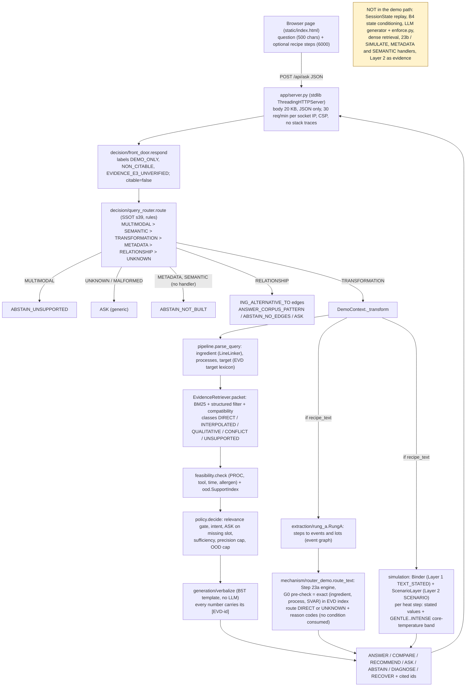

# CulinaryState: deployment, demo and presentation plan (lane DEPLOY, S176, 2026-11-08)

Status: **PROPOSED / AI_DRAFTED.** Written by the coding agent (lane DEPLOY, orchestration S176) for Kush and Parv. Nothing was
deployed, installed, signed or published. Every decision below is a recommendation with a default; humans decide (D-071 applies
only to the AI personas, never to accounts, keys, licences or signatures). Talk: 25-26 Nov 2026 (which day, slot length and
room are UNVERIFIED; Kush to confirm).

How this was checked. (a) Read the code and registries named in section 1 and 2. (b) Ran 70 demo-related unit tests in
`.venv312` on manjot-server (pass). (c) Ran the real `DemoContext.load()` and 30 real questions through `respond()` under an
`open()` audit hook, read-only, from `~/kush_work/culinarystate/.orch` (worktree `max/s176-orchestration`, HEAD `1924c6f`).
**The probe needed a stub for `lxml` because `.venv312` has no `lxml` (finding G1); the stub is in the scratchpad, not in the
repo, and the demo path never calls an lxml function.** (d) Fetched Hugging Face, Render, Fly and Cloudflare documentation
on 2026-11-08 for hosting facts (section 3.1); prices and limits there are dated and must be re-checked when an account is
created. Anything not run or not opened is marked UNVERIFIED.

---

## 0. One-page summary

### 0.1 Recommendation

| Question | Recommendation (default) | Why in one line |
|---|---|---|
| Live demo on stage | **Local server on Kush's Mac, template-only (no LLM), started from a slim data bundle** | It is the only path that needs no account, no key, no VPN and no network; it is the path the code was tested on |
| Public link | **A static cached page** (about 20 pre-computed answers + the same UI) on a free static host, plus an optional **Cloudflare quick tunnel to the live Mac demo only during the talk window** | Bounded, reviewable content (no third-party text can leak); the live demo is not exposed for days |
| Free "Hugging Face Space" | **Not possible as planned**: HF now charges for Docker and Gradio Spaces (only Static Spaces are free), per its docs fetched today | Section 3.1 |
| Free Render / Fly | **No**: Render free is 512 MB RAM and 0.1 CPU, the demo needs 1.2 GB RSS and about 60 CPU-seconds to load; Fly has no free allowance for new accounts | Sections 1.4 and 3.1 |
| vinayak | **Not a demo host** (VPN-only, shared institutional server). Use it only for Ollama runs of the D5 ladder | Single point of failure; policy unknown |
| LLM backend | **None in the demo** (template verbaliser B5T). Optional later: Ollama on vinayak behind the existing SSH tunnel, with `enforce.py` and template fallback | B5T had 0 unsupported claims on the 20-question silver ladder and no LLM variant beat it; an LLM adds risk without a measured gain |
| Offline fallback | **Single-file `demo_offline.html` (cached answers embedded) + the laptop-local server + screen recording + PNG screenshots + backup slides** | Works with Wi-Fi off |

### 0.2 What Kush must decide or supply (nothing here needs a paid account in the default plan)

| # | Item | Default | Needed by | Time |
|---|---|---|---|---|
| H-1 | Approve "local live + static cached page + optional quick tunnel" (record as a D-number) | approve | Tue 10 Nov | 5 min |
| H-2 | Licence calls for anything leaving the Mac (section 2): exclude Phenol-Explorer rows; exclude SU-EATABLE carbon; keep the OFF taxonomy local; accept bare BBC-derived aggregates (counts and scores, no ids) for the **local** demo only, but use **no BBC-derived example** on slides or the static page | accept | Tue 10 Nov | 10 min |
| H-3 | Send the supervisor email (REV-B G-02) and add three questions: Food.com licence, BBC course use, Phenol-Explorer redistribution | send | Mon 9 Nov | 10 min |
| H-4 | Name the machine that runs the demo on the day and confirm that `import lxml, pandas, scipy, jsonschema` works in its Python (`/opt/anaconda3/bin/python`) | Mac | Fri 13 Nov | 5 min |
| H-5 | A place for the static page, optional: a Hugging Face **Static** Space (free per docs) or GitHub Pages on a public repo; or skip and ship the offline HTML inside the report archive | skip until 21 Nov | Sat 21 Nov | 15 min |
| H-6 | `brew install cloudflared` on the Mac if the tunnel is wanted (the agent may not install) | optional | Fri 20 Nov | 5 min |
| H-7 | Talk length, which day (25 or 26 Nov), slot, projector connector, whether Q&A is shared | confirm | Fri 13 Nov | 5 min |
| H-8 | A 20-minute screen recording of the four demo queries on 22-23 Nov (macOS `Shift-Cmd-5`) | record | Mon 23 Nov | 20 min |
| H-9 | Only if a true always-on live host is wanted: payment method and a budget cap (section 3.2 options D, E, F) | **no** | n/a | n/a |

No API key is needed. If Kush later wants an LLM paraphrase layer, the key goes into an environment variable on the Mac, never into
the tree (REV-B G-14), with a hard spend cap set in the provider console.

### 0.3 Findings that change the plan (each verified in this session)

1. **Hugging Face Docker/Gradio Spaces are paid** (docs: "Gradio and Docker Spaces run on compute and require a paid plan to create"; Static Spaces are free). The FINISH_PLAN M6 wording "free host such as Hugging Face Spaces" no longer holds.
2. **The demo cannot start in `.venv312`**: `culinarystate.vocab.foodon` imports `lxml` at module top and `pipeline` imports it through `line_link`. `lxml` is missing there. `pyproject.toml` lists no runtime dependencies and there is no requirements file, Dockerfile or lock.
3. **Load cost**: 644.8 s wall in probe 1 and 282.8 s in probe 2 (load average about 185 on this shared server; about 60 CPU-seconds), 1,216-1,242 MB peak RSS, 173 MB of JSON parsed (EVD 88.8 MB, KGE 60.4 MB, `_ids.jsonl` 24.2 MB). The S171 test measured 38 s on the Mac. A slim bundle (section 2.4) should cut the parse volume about six-fold (estimate, UNVERIFIED until built).
4. **The demo is stateless**: `SessionState`, event replay and B4 state conditioning (`use_state=True`) are not wired into the server. "Current state" and "next action" questions (the H1 task types) cannot be demonstrated; they end as an ASK. The per-step timeline is Rung A events routed one by one, not a replayed state vector.
5. **A shipped example is BBC-derived**: the page's "Swap buttermilk" button returns "natural yogurt (co-occurrence score 0.004)", an edge supported only by BBC recipes (6 recipes, `corpus_ids = [BBCGF-A1]`). REV-B Q36 and G-14 say no BBC-derived example in the hosted demo or on slides.
6. **Router recall gaps seen in real output**: "How much thiamin does fried okra keep?" and "How much vitamin C does fried potato keep?" end as the generic ASK "I couldn't tell what you're asking" although food, process and target are named: the process pattern `fry\w*` does not match "fried" (nor "stir-fried" or "deep-fried"), so the TRANSFORMATION cue never fires. "What is the next instruction?" also ends as a generic ASK (by design: no session). Router accuracy is unmeasured until T8-C01-R1 (17-19 Nov); never tune on the frozen questions.
7. **A misleading badge**: the page shows the green "Answered from data" badge for every `ANSWER` mode, including `BROAD_QUALITATIVE` answers built from unrelated foods ("steamed saffron" is answered from shellfish, flour and fish rows, labelled "relation to yours unknown"). That is by design in the D4 rule (RGU change, `reports/del4/graph_expansion_v1_analysis.md`) but the badge hides it. Fix before any public exposure; do not demo it live.
8. **Layer 2 numbers rest on recalled defaults**: all 27 rows of `registry/scenario_defaults_v1.csv` carry `SOURCE_UNVERIFIED_AGENT_RECALLED`. The heat strip prints them as "(estimate)", without the ASSUMED_DEFAULT / NON_CITABLE chips that D-077 requires on each claim (T0-C06-R3).
9. **No food-safety refusal exists** (REV-B G-13). Router check on 8 Nov: "Is chicken safe to eat if boiled for 5 minutes?" goes to UNKNOWN (generic ASK); "Can I get salmonella from undercooked eggs?" goes to TRANSFORMATION via the FAILURE cue and ends as ASK "Which process do you mean?" (probe 2). A public demo needs an explicit refusal rule first (task T-D7).
10. **`reports/final/FINAL_REPORT_DRAFT_S168.md` is stale** for this plan (it says D4 not started, no demo, D5 not run). Its slide outline needs the changes in section 5.

---

## 1. Runtime architecture of the demo as it exists

### 1.1 Diagram (verified by reading `server.py`, `front_door.py`, `query_router.py`, `demo_context.py`, `pipeline.py`, `policy.py`, `verbalize.py`, `router_demo.py`)



**Difference from the chain in the task brief (front door, router, state engine/replay, router gates, evidence packets, answer or abstain).** In the code the order is: front door, query router (SSOT s39), then for TRANSFORMATION questions the slot parse, evidence packets, feasibility and OOD gates, policy and template answer; the "state engine" appears only in the optional recipe branch, where Rung A turns pasted steps into an event and lot graph that the 23a router gates score per event. The Step 18 transactional replay (`state_graph.replay`), `SessionState` (C18) and B4 state conditioning exist and are tested, but nothing in `server.py`, `demo_context.py` or `router_demo.py` calls them (grep on 8 Nov: no `replay` in `extraction/rung_a.py`, `demo_context.py`, `router_demo.py`; `answer()` is called without `session`).

### 1.2 Stage table

| Stage | Module (line references are from this tree) | What it does | Tests |
|---|---|---|---|
| HTTP | `src/culinarystate/app/server.py` | GET `/`, GET `/api/health` (`{"status":"ok"}`), POST `/api/ask`; `validate`, `RateLimiter(30/min)`, CSP, `nosniff`, `Referrer-Policy: no-referrer`, `Cache-Control: no-store`; 500 returns a fixed message; default bind `127.0.0.1:8765` | `tests/unit/test_s173_app_server.py` |
| Front door | `decision/front_door.py` | Injects handlers; no handler becomes `ABSTAIN_NOT_BUILT`; handler exception becomes `ABSTAIN_ERROR` with the class name only | `test_s171_front_door.py` |
| Router | `decision/query_router.py` (`query_router_rules@0.1`) | Rule cues in fixed order; no cue is UNKNOWN, never a guess | `test_s171_query_router.py` |
| Slots | `decision/pipeline.py: parse_query` | first lexicon mention = ingredient; affirmed process verbs; target from the EVD target names then NUTRIENT patterns | `test_pipeline.py` |
| Evidence packets | `retrieval/retriever.py` | `0.35 * bm25_norm + 0.65 * compatibility`; hard mismatch x 0.3; best row per (cell, independence group); R4 graph expansion (ING parents + OFF parents) | `test_retrieval.py` |
| Gates | `decision/policy.py`, `relevance.py`, `confidence.py`, `ood.py`, `feasibility.py` | relevance gate, intent, ASK when ingredient/process/target missing, feasibility before utility, sufficiency to precision (QUANTITATIVE / INTERVAL / QUALITATIVE / REPORT_CONFLICT / ABSTAIN), OOD cap | `test_policy.py`, `test_ood.py`, `test_feasibility.py` |
| Answer | `generation/verbalize.py` (`verbalize@0.2`) | template baseline B5T: only packet numbers, each with its id; names other-process rows | `test_generation.py` |
| Recipe steps | `mechanism/router_demo.py` (`router-demo-0.1.0-draft`) | Rung A events, 23a engine with an evidence pre-check; labels `NON_CITABLE`, `DEMO_ONLY`, `NO_CONDITIONS_CONSUMED`; `assert_citable` raises `DemoRefused` | `test_s170_router_demo.py` |
| Physics | `decision/demo_context.py: physics_summary` | per heat step: Layer 1 stated values with basis; Layer 2 TYPICAL value and GENTLE..INTENSE band; labels `TEXT_STATED, SCENARIO, MODEL_DERIVED, NON_CITABLE` | `test_s171_demo_context.py` |
| Substitution | `demo_context.relationship_answer` | corpus pattern, "not a tested equivalence" | `test_s171_demo_context.py` |

Run on 8 Nov in `.venv312`: `pytest -q tests/unit/test_s173_app_server.py test_s171_front_door.py test_s171_query_router.py test_s171_demo_context.py test_policy.py test_enforce.py test_generation.py` gave **70 passed, 1 deselected** (the deselected one is the real-ledger test, marker `ledgers`, which needs `lxml`).

### 1.3 Branch to outcome map (real answers from 8 Nov, section 4.4 has the full smoke table)

| Branch | Outcome in the demo |
|---|---|
| MULTIMODAL | `ABSTAIN_UNSUPPORTED` (photo, video, sound) |
| UNKNOWN, MALFORMED | generic `ASK` |
| METADATA ("how many calories"), SEMANTIC ("find me a recipe") | `ABSTAIN_NOT_BUILT` (decision T8-C02-R2: keep explicit abstention for 25 Nov) |
| RELATIONSHIP | corpus pattern or `ABSTAIN_NO_EDGES` or `ASK` |
| TRANSFORMATION | `ANSWER` (DIRECT, near rows, or qualitative direction), `COMPARE`, `RECOMMEND`, `ASK` (missing ingredient, process or target), `ABSTAIN` (no evidence, OOD, no corroborated cause), `DIAGNOSE`, `RECOVER` |

### 1.4 Data files the demo loads (measured with an `open()` audit hook; paths relative to the repo root)

Load: **644.8 s wall (probe 1) and 282.8 s (probe 2) under a load average of about 185 (about 60 CPU-seconds), peak RSS 1,216 and 1,242 MB; the 32 questions did not raise the peak.** 30-40 s on the Mac (S171 test, not re-measured).
Third-party Python packages imported: numpy 1.26.4, pandas 2.1.4, pyarrow 14.0.2, scipy 1.17.1, jsonschema 4.19.2 (+ attrs, referencing, rpds, jsonschema_specifications, typing_extensions), python-dateutil, pytz, and **lxml (missing in `.venv312`, not called)**. Versions are those of `.venv312` (Python 3.12.3); the Mac's anaconda versions are UNVERIFIED.

| File | Bytes | sha256 (full tree, 8 Nov) | Used for |
|---|---|---|---|
| `ledgers/data/EVD.jsonl` | 88,833,782 | `5b3b1939c7993283dd3ee9083a5e418b4aa550fdebf10d982f297d39d0fc2c56` | evidence rows (57,280 lines, 18,156 ids, 17,978 ACTIVE) |
| `ledgers/data/KGE.jsonl` | 60,375,503 | `1c9ffda0d74dcaaa71b9f45c0667489a4e5268759e9e1810067e54502cf39bd8` | edges: 6 predicates are read (`ING_PROCESSED_BY`, `ING_ALTERNATIVE_TO`, `ING_CARBON_FOOTPRINT`, `PROC_TYPICAL_DURATION`, `PROC_USES_TOOL`, `PROC_FOLLOWED_BY`: 7,715 rows, 6.06 MB) |
| `ledgers/data/_ids.jsonl` | 24,212,115 | not hashed | read by `IdMinter` at `LedgerStore()` init; never written in the demo path |
| `ledgers/data/ING.jsonl` | 4,377,528 | `ef439951982b98efa9a21787f7b646a162c3c4912718405cdae6ed56dc1cd574` | ingredient registry and names |
| `ledgers/data/COND.jsonl` | 3,233,686 | `e9a1827a4a648a876adfe8b22aa6b5de8243100c279fb4bbce92422850598ccf` | evidence conditions for compatibility |
| `ledgers/data/ALIAS.jsonl` | 2,510,017 | `65d89c0dfe164a5c2955c7e874c93e6f8b76bddc30fc9f3639997d9430c3278c` | ingredient aliases (linker) |
| `ledgers/data/PROC.jsonl` | 404,969 | `b9248bf2b4069572b9b38a624fb83799c6634075466e25848dbf574f98f6f644` | processes and families |
| `ledgers/data/TOOL.jsonl` | 174,023 | `897243c7c02e0b7657ae564d797d3e4757efb4ce9c2e82b985d1ec0593492c02` | Rung A lexicon |
| `ledgers/data/UNIT.jsonl` | 40,768 | `c7b317ae32c6c03bada10f381ef5a3e657acabd00bd0424882ffe2548dfe18c7` | Rung A units |
| `ledgers/data/ALLERGEN.jsonl` | 21,424 | `cf976097a030250daf3257359203a66d8797c3c29451c097c557769e67e3fe2a` | feasibility |
| `registry/kg/troubleshooting_candidates_v1.csv` | 271,198 | `aa60aba7813d934eb8e0641662c7c2d778c93bbf15c8bbe6fcbf2d4dbdaf276a` | diagnosis, recovery, prevention |
| `registry/state_variable_registry_v1.csv` | 212,573 | `ee446a23b29f804681e55a66d2356625b391c8963c7a8f1612d2fc9cd3b00fd6` | target to SVAR |
| `registry/processes/process_hierarchy_v1_DRAFT.csv` | 132,274 | `4765f73ba68413df4b334f03561198a4b1dedbb43469ba1717d4d32c9aadbf2b` | router hierarchy |
| `registry/recipe_process_surface_forms_v1.csv` | 1,039,738 | `e406ebeb8a2556dd2fd3bc2dad99a11f7aa7664dfb3b76585e9c66ac344442ff` | Rung A surface forms |
| `registry/scenario_defaults_v1.csv` | 3,943 | `f6e82d80e942ae0d11adaf1dbc337c687b00e5cbdf5e87e31c59b1847187cce0` | Layer 2 defaults (27 rows, all `SOURCE_UNVERIFIED_AGENT_RECALLED`) |
| `registry/process_medium_map_v1.csv` | 2,696 | `5014c27d553ca8fb8691fe5633b053344fe2281128138dba2b39da819402a953` | Layer 1 medium |
| `registry/recipe_tool_structural_class_map_v1.csv` | 12,567 | `829647c5387e147bfe694606122e0c8b164c96ad7b664e0608156cee5d0e91ee` | Rung A |
| `registry/mechanisms/applicability_reason_code_registry_v1_DRAFT.csv` | 8,461 | `0b199abfb319d7641d885b3712799ebf50190c5163c0c01f05269b9c155398ff` | reason codes |
| `reports/step16/schema_drafts/QNT.draft_v2.schema.json` | 52,802 | `02be26be679a70fd90d806cc05017cd02924a4342ae01c8d7d42812ec2136465` | quantity schema |
| `data/raw/off/ingredients_a1ce1d36.txt` | 3,077,013 | `164787528f99f07ec9923dcafd252e9d8977967a8c7d4505e8e01e931e8a96f5` (pinned OFF commit) | R4 parents; optional (missing file: ING parents only) |

Total opened: about 189 MB. **Not opened**: `REC.jsonl`, `recipe_base`/`recipe_identity` parquet, anything under `data/raw` except the OFF taxonomy, `data/derived`, annotation sheets, signatures, seeds. So no recipe text, from any family, is read by the demo process. (`EVD.jsonl` and `KGE.jsonl` are tracked in git; the paths resolve through the repo root: `ROOT = parents[3]` of `demo_context.py`, so a bundle must reproduce the layout.)

### 1.5 What "NON_CITABLE demo mode" is

- `front_door._out` stamps every response `labels = [DEMO_ONLY, NON_CITABLE, EVIDENCE_E3_UNVERIFIED]` and `citable = false`.
- `router_demo.route_text` output carries `NON_CITABLE, DEMO_ONLY, EVIDENCE_E3_UNVERIFIED, NO_REVIEWED_MECHANISM, NO_CONDITIONS_CONSUMED`, `citable = false`, `conditions_consumed = false`; `assert_citable` raises `DemoRefused`. The Step 23a engine runs unchanged; `23b` stays BLOCKED (07.A FAIL; D-075).
- `physics_summary` carries `TEXT_STATED, SCENARIO, MODEL_DERIVED, NON_CITABLE`.
- EVD rows are tier E3 and UNVERIFIED (0 hand-verified literature rows, D1).
- **What a viewer actually sees**: only the footer sentence "Demo for a course project. Evidence rows come from public food-composition tables and are not yet checked by hand. The heat ranges are model estimates ... Nothing here is advice you can cite." The labels are in the JSON but not rendered (gap G6).

### 1.6 Gaps found (G1-G14)

| ID | Gap | Evidence | Severity for 25 Nov | Fix (task) |
|---|---|---|---|---|
| G1 | `lxml` hard import; no runtime requirements, lock, Dockerfile; `.venv312` cannot start the demo | first probe: `ModuleNotFoundError: lxml` at `vocab/foodon.py:14` | blocker on manjot, unknown on Mac | T-D4 `requirements-demo.txt`; make the lxml import lazy (1 line) |
| G2 | Stateless: no session, no replay, no B4; H1-type questions cannot be shown | `answer()` called without `session`; `Rung A` does not call `state_graph.replay` | scope limit; say it on the slide | none before 25 Nov (T8-C18-R3 COULD); state it |
| G3 | Listener opens only after the load; `/api/health` has no readiness; no `PORT` env var; default host 127.0.0.1 | `main()` loads then `make_server` | matters only for a hosted container | T-D2 |
| G4 | Rate limit keyed on the socket peer: behind a tunnel or proxy all visitors share 30 per minute; no `X-Forwarded-For` option; hit dict never evicts; no concurrency cap; thread safety of the shared `DemoContext` under `ThreadingHTTPServer` is untested | `server.py` `RateLimiter`, `ThreadingHTTPServer` | medium (tunnel) | T-D2: `--trust-proxy`, eviction, `Semaphore(4)`, one concurrent-request test |
| G5 | Badge hides evidence class: `BROAD_QUALITATIVE` and `INTERPOLATED` answers show "Answered from data" | `index.html` `known` map | high for a public page | T-D3: badge text by `options` class ("Measured for this food", "Similar foods only", "Direction only, relation unknown") |
| G6 | No persistent DEMO ONLY / NOT CITABLE banner; no per-claim chip (EVD / Layer 2 / ASSUMED) | `index.html` | high | T-D3 (T0-C06-R3) |
| G7 | Google Fonts `<link>` (visitor IPs go to Google; fails offline, falls back to `system-ui`); CSP allows `unsafe-inline` for script and style | `index.html`, `server.CSP` | low (works offline) | T-D3: drop the font link for the offline and hosted builds |
| G8 | No safety refusal; no X-block safety items | router check on 8 Nov (item 9 in 0.3) | high before any public link | T-D7 |
| G9 | Access log prints client IPs; questions and recipe text are not logged (good); no notice | `log_message` uses `address_string()` | medium (G-14) | T-D2: `--no-ip-log`, one footer line "questions are not stored" |
| G10 | Repo-relative layout; `_ids.jsonl` read at init | `ROOT = parents[3]`, `LedgerStore.__init__` | bundle spec only | T-D1 |
| G11 | The curated examples are weak: the page example "Boiled cabbage" returns near-evidence and four UNKNOWN steps; "Swap buttermilk" is BBC-derived; census says DIRECT is 0.754 % of checks (the S173 reason for stopping) | probe outputs | high for the talk | replace examples (section 5.5) |
| G12 | Unauthenticated public endpoint if tunnelled | `server.py` | medium | tunnel only for the talk window; or Cloudflare protected quick tunnel (email restriction, changelog dated 2026-10-02; UNVERIFIED detail) |
| G13 | Cited ids differ between the answer text and the step chips (the answer cites min and max rows; the chip lists the first three rows by id) | potato probe: answer `EVD-002271`, `EVD-002297`; chip `EVD-002167`, `EVD-002193`, `EVD-002219` | low | label the chip "rows found" in T-D3 |
| G14 | Docs disagree: FINISH_PLAN says "FastAPI + UI"; the code is stdlib; report draft S168 says no demo | `FINISH_PLAN` M6 row; `FINAL_REPORT_DRAFT_S168` s2 | low | orchestrator to fix wording; report refresh in M8 |

---

## 2. What may be shipped publicly under the licences

### 2.1 Rules (from `DECISIONS.md` D-003, D-005, D-026, `registry/recipe_source_usage_registry_v1.csv`, `registry/recipe_usage_owner_decision_v1.csv`, `SRC.jsonl`, REV-B Q30, Q36, G-14)

1. **No BBC Good Food text, ever**, and no BBC recipe id, ingredient list, NER span or per-recipe output leaves the Mac (D-003; registry `LOCAL_RESEARCH_ONLY`, raw redistribution NO). BBC runs stay "Mac only" in the compute log.
2. **Food.com** is uploader-declared CC0, **unverified** (`FOODCOM`: `LICENCE_UNVERIFIED`, `NO_SRC_ROW`, raw redistribution NO). D-026 is an owner assertion for *project use* only; redistribution was never asserted.
3. Public artefacts show **counts, aggregates and registries only**; per-recipe outputs stay under `data/derived/` (git-ignored).
4. Public text sources: Gutenberg (public domain in the US; non-US not assessed) and Wikibooks (CC BY-SA 4.0: attribute page and revision, share-alike).
5. EVD sources keep their own storage rules (`SRC.jsonl`): USDA R6 `COMMIT_OK`; Bognar and Phenol-Explorer `DERIVED_ONLY`.
6. No API key, nonce, salt, seed, signature or review sheet in any bundle (REV-B G-14).
7. User-pasted recipe text is processed in memory and not stored or logged (verified: the server logs no request body).

### 2.2 Asset classification

| Asset | Licence / rule (source) | Local live demo | Tunnel or hosted live | Static cached page |
|---|---|---|---|---|
| Recipe text, all families (REC, parquet, `data/raw`) | BBC no; Food.com unverified; TASTEset unverified (MIT vs unverified inconsistency, D-026 "Open"); Wikibooks CC BY-SA; Gutenberg PD | not loaded | **never** | never |
| EVD, USDA R6 (7,018 ACTIVE rows) | US government, public domain, `COMMIT_OK` | yes | yes | yes |
| EVD, Bognar 2002 (7,090) | "open access in KIT repository; values cited, text not redistributed", `DERIVED_ONLY` | yes | yes, as cited derived values with the source line | yes, cited values only |
| EVD, Phenol-Explorer 3.6 (3,870) | "commercial use/redistribution requires authors' permission; cite", `DERIVED_ONLY` (D-005) | yes (project use) | **exclude** until permission | **exclude** |
| KGE, 6 demo predicates (7,715 rows; counts, lift, PMI, scores; no recipe ids; built from BBC + Wikibooks + Gutenberg, **no Food.com**) | BBC-derived aggregates: derived redistribution UNKNOWN; REV-B Q36: aggregates are low risk, possession terms unseen | yes | only after H-2; strip `corpus_ids`, `provenance`, `support`; or drop `ING_ALTERNATIVE_TO` | answers only; no BBC-only example |
| KGE `ING_CARBON_FOOTPRINT` (134 rows, SU-EATABLE, SRC-000488) | permission by Prof. Bagler (D-015); upstream licence "U..." unknown; `DERIVED_ONLY` | not needed (no effect on any answer shown) | **exclude** | exclude |
| ING / ALIAS (ingredient names, `corpus_frequency`, FoodOn crosswalk ids) | vocabulary and counts; FoodOn CC BY 4.0 (attribution) | yes | yes, drop `corpus_frequency` and `provenance`; add attribution | not applicable |
| `troubleshooting_candidates_v1.csv` (1,644 rows; 1,402 carry a verbatim sentence of at most 160 characters from Gutenberg; 242 Wikibooks rows carry only a normalised key) | Gutenberg PD (US); Wikibooks CC BY-SA | yes | yes with attribution footer | yes with attribution |
| OFF taxonomy (`ingredients_a1ce1d36.txt`) | ODbL + DbCL, share-alike (`XS-B03`) | yes | **no** (ING parents only; changes R4 coverage) | not applicable |
| Scenario defaults (27 rows) | recalled, unverified | yes, labelled | yes, labelled `ASSUMED_DEFAULT`, `SOURCE_UNVERIFIED_AGENT_RECALLED` | yes, labelled |
| Demo recipe examples | must be user text, synthetic, Gutenberg or Wikibooks | n/a | n/a | synthetic only |
| Code | repo licence UNVERIFIED (no LICENSE file read); GitHub visibility UNVERIFIED | yes | yes if the repo is public | n/a |

### 2.3 Food.com: recommendation

Treat Food.com as **analysis and counts only**. Specifically: (a) nothing from Food.com is in the demo path today (KGE demo predicates have no Food.com family; the S174 layers and NER counts are census files); (b) slides may quote Food.com **counts** (522,517 recipes; 4.13 M lines tagged; heat events) labelled "licence UNVERIFIED"; (c) no Food.com text or example on any slide, screenshot, cache file or hosted page; (d) no model trained on Food.com is shown as a result or released (REV-B Q30); (e) Kush checks the Kaggle licence field and the upstream site terms, and asks the supervisor in writing (H-3). An uploader's CC0 label cannot grant rights the uploader may not hold in user-submitted recipes; I have not opened the Kaggle page, so this is a risk statement, not a finding.

### 2.4 Data-bundle spec for a hosted (or tunnelled) demo, `demo_bundle_v1`

Layout (mirrors the repo because the code resolves paths from the repo root):

```
demo_bundle_v1/
  MANIFEST.sha256              sha256 + bytes of every file below (written by the builder)
  BUNDLE_INFO.json             built_at, source git commit, source file hashes, row counts, excluded source ids, builder version
  LICENCES_AND_ATTRIBUTION.md  text of section 2.6
  requirements-demo.txt
  src/culinarystate/...        code subset: app, decision, retrieval, generation, extraction, mechanism, state_graph, quantity, simulation, ledgers, vocab, process, eda, kg, transition, ...
  ledgers/data/{EVD,KGE,ING,ALIAS,COND,PROC,TOOL,UNIT,ALLERGEN}.jsonl
  registry/... (the 8 registry CSVs + schema file in the table of section 1.4)
```

Build rules (task T-D1, `tools/build_demo_bundle.py`, to be written test-first):

| File | Rule | Size from the full tree | Expected bundle size |
|---|---|---|---|
| `EVD.jsonl` | latest version per id, `status == ACTIVE`, drop `source_id == SRC-000012` (Phenol-Explorer); keep `id, version, status, source_id, independence_group, matrix, process, target, derived, tier, verification, censored, record_type`; drop `provenance`, `applicability`, `design`, `study_ids` unless the equivalence test fails | 88.8 MB (latest ACTIVE: 28.1 MB: USDA 9.7, Phenol-Explorer 7.9, Bognar 10.5) | about 20 MB (about 12 MB slim fields; 14,108 rows) |
| `KGE.jsonl` | keep only the 5 non-carbon demo predicates; strip `corpus_ids`, `provenance`, `support`, `created_by`; decision H-2 may drop `ING_ALTERNATIVE_TO` | 60.4 MB | under 6 MB (7,581 rows before stripping) |
| `ING.jsonl`, `ALIAS.jsonl` | latest ACTIVE; drop `corpus_frequency`, `provenance`, `created_by`, `notes` | 4.4 MB, 2.5 MB | about 3 MB, 1.5 MB (estimate) |
| `COND.jsonl` | latest version only | 3.2 MB | under 3 MB |
| `PROC, TOOL, UNIT, ALLERGEN` | copy | 0.64 MB | 0.64 MB |
| `_ids.jsonl` | **omit** (`IdMinter` treats a missing file as empty; demo never mints) | 24.2 MB | 0 |
| registries and schema | copy unchanged (hashes in section 1.4) | about 1.5 MB | about 1.5 MB |
| OFF taxonomy | omit from the public bundle; keep in the Mac-local bundle | 3.1 MB | 0 or 3.1 MB |
| `reports/`, `tools/`, `tests/`, `docs/`, `annotation/`, `data/` | omit | n/a | 0 |

**Estimated bundle: 25-35 MB** (versus about 189 MB opened today). Load time and RSS for the bundle are **UNVERIFIED** until built; the builder must print both. Accept the bundle only if the **equivalence test** passes: the 30 smoke questions in section 4.4 give identical `mode`, `answer` text and `cited` ids from the full tree and from the bundle, except questions whose evidence is Phenol-Explorer only (expected: the bundle abstains where the full tree answers; list them in `BUNDLE_INFO.json`). Vitamin C evidence is entirely USDA (SVAR-000009, 270 rows) and Bognar (SVAR-000215, 153 rows), so the four demo questions are unaffected by dropping Phenol-Explorer.

Exclude list (never copy): `ledgers/data/REC.jsonl` (94 MB), `IMAP`, `MOL`, `DOC`, `STUDY`, `SRC*`, `SNAP`, `MEAS`, `EXP`, `DATASET`, `ledgers/recipe_*`, `data/raw`, `data/derived`, `annotation/`, `registry/freezes/`, `registry/*queue*`, any `.env`, any `*.pem`, key or token file, `reports/orchestration`, git history. The tunnel or host process is started **from the bundle directory**, so BBC raw data on the Mac is outside the served process's tree.

### 2.5 What the static cached page contains

About 20 pre-computed `respond()` JSONs (the curated list in section 5.5, plus 6 refusals and abstentions), the same UI in read-only mode (a question picker, no free typing; a banner "Cached answers computed on <date> from bundle <hash>"), the attribution footer, and a link to the report. No ledger, no code, no recipe text. Output review: grep every cached string against the third-party text hashes (T9-C28-R2) and read each answer once by eye.

### 2.6 Attribution footer (draft, for the page, the deck backup slide and the bundle)

"Evidence: USDA Table of Nutrient Retention Factors, Release 6 (public domain); Bognar A. (2002), BFE-R--02-03, Karlsruhe (values cited from the KIT repository copy). Recipe-corpus patterns derived from public cookbook text: Project Gutenberg (public domain in the US), Wikibooks Cookbook (CC BY-SA 4.0, attributed per page and revision in the project registry). Ingredient identifiers cross-reference FoodOn (CC BY 4.0). Demo only; every row is tier E3 and not hand-verified; physical estimates use unverified assumed defaults; nothing here is citable or food-safety advice." Wording to be checked by Kush against each licence text before publication (UNVERIFIED).

---

## 3. Hosting and LLM options

### 3.1 Facts checked on 2026-11-08 (re-verify when an account is created)

| Service | Fact | Source |
|---|---|---|
| Hugging Face Spaces | "Static Spaces are free for everyone. Gradio and Docker Spaces run on compute and require a paid plan to create: PRO for personal accounts, Team or Enterprise for organizations." Default hardware CPU Basic: 2 vCPU, 16 GB RAM, 50 GB non-persistent disk. Free hardware sleeps when unused. Public Spaces are cloneable; "protected" visibility needs a paid plan; private Spaces are not reachable by the public | huggingface.co/docs/hub/spaces-overview |
| Render | Free web service: 512 MB RAM and 0.1 CPU (compute-plans table; Starter 512 MB / 0.5 CPU, Standard 2 GB / 1 CPU, Pro 4 GB / 2 CPU); spins down after 15 minutes without traffic; waking takes about one minute; 750 free instance hours per month; ephemeral filesystem | render.com/docs/free; render.com/docs/compute-plans (search result, secondary sites agree) |
| Fly.io | Legacy free allowance (3 shared 256 MB machines) applies to older organisations; new accounts report a short trial or pay from the first second; a 2 GB shared machine is about 10-13 USD per month (secondary sources, price list changed 1 Oct) | fly.io/docs/about/pricing and third-party posts; UNVERIFIED |
| Cloudflare quick tunnel | `cloudflared tunnel --url http://localhost:PORT` gives a temporary `trycloudflare.com` URL, no account or domain; testing use, no uptime guarantee; reported cap of 200 in-flight requests; on 2026-10-02 Cloudflare added email restriction for Quick Tunnels | developers.cloudflare.com (quick tunnels and changelog); detail UNVERIFIED |

### 3.2 Hosting options compared

Demo needs (measured): 1.2 GB RAM; about 60 CPU-seconds to load the full tree (slim bundle: UNVERIFIED, expected 10-20 s); one Python process; no GPU; no outbound network.

| Option | Cost | What Kush supplies | Risks | Fit | Verdict |
|---|---|---|---|---|---|
| **A. Local Mac, no network** | 0 | the laptop, the bundle | laptop failure; if the Mac has 8 GB (the report draft says full runs swap on it) the demo's 1.2 GB still fits; RAM UNVERIFIED | cold start 30-40 s, start 10 min before | **primary for the talk** |
| **B. Local Mac + Cloudflare quick tunnel** | 0 | `cloudflared` install (H-6) | random URL changes on each start; no SLA; all visitors share one rate-limit key (G4); public exposure of the live API while the tunnel is up; home Wi-Fi at the venue | works with one command; audience can follow on phones | **optional, talk window only, behind `--public` (CS_DEMO_PUBLIC=1), `--per-minute 120` and the safety rule** |
| **C. Static cached page** on HF Static Space or GitHub Pages | 0 | an account on one of them (H-5); GitHub Pages on a private repo needs a paid plan (UNVERIFIED) | cached answers can look stale; free typing disabled (stated on the page) | content bounded and reviewable; always on; no cold start | **recommended public link** |
| D. HF Docker Space | PRO plan (price UNVERIFIED) | paid plan, token | repo of a public Space exposes the bundle; sleeps after idle (minutes to wake with a 60 s load); needs `PORT` 7860 handling (G3) | 16 GB RAM is plenty | only if Kush wants a live public URL and accepts the data exposure; use a protected/private Space |
| E. Render | free impossible (512 MB, 0.1 CPU); Standard 2 GB about 25 USD per month (UNVERIFIED) | card | load alone about 10 minutes at 0.1 CPU; spin-down every 15 minutes | poor | **no** |
| F. Fly.io | about 10-13 USD per month for 2 GB (UNVERIFIED) | card, `flyctl` | new Dockerfile to write and test; cost; no benefit over B for a two-day event | adequate | **no** |
| G. manjot-server | 0 | n/a | shared, load average about 185 today; no public ingress; hosting a public service from an institutional server likely breaks policy (UNVERIFIED) | poor | **no** |
| H. vinayak (A100 behind FortiClient VPN) | 0 | VPN | VPN-only; one SSH tunnel is a single point of failure; shared server | n/a | **never a demo host**; Ollama only |

**Recommendation: A for the stage, C for the public link, B only if Kush wants the audience to try it live.** Reasons: nothing in the plan needs a paid account; the only things that can leak (third-party text, BBC-derived examples, Phenol-Explorer rows) are bounded in C and excluded from the process in B; and A is the one path with no moving parts. If Kush decides he wants an always-on live site anyway (H-9), choose D with a protected Space and the `demo_bundle_v1` without Phenol-Explorer, SU-EATABLE and OFF, after the T-D2, T-D3 and T-D7 fixes.

### 3.3 LLM backend options

| Option | What it is | Cost | Needs | Risks | Status in code |
|---|---|---|---|---|---|
| **1. Template only (B5T)** | `generation/verbalize.py`; deterministic, no model | 0 | nothing | plain wording; cannot paraphrase | **wired and tested**; promoted C16 generator; 0 unsupported of 24 numeric claims on the 20-question silver ladder (by construction: every number is a packet row's value) |
| 2. Ollama on vinayak via SSH tunnel | `generation/llm.py` (`OLLAMA_URL` default `localhost:11435`; `qwen2.5:7b-instruct`, temperature 0, seed 7, `num_predict 200`) then `enforce.py` (drops unsupported or fabricated sentences, falls back to the template) | 0 | VPN, tunnel `ssh -f -N -L 11435:localhost:11434 vinayak-server`, Ollama running | VPN and tunnel are a single point of failure on stage; B5F+E never beat the template on the silver ladder (7B: 0 of 16 unsupported, 4 of 20 answers fell back to the template, 16 sentences removed); GPU decoding not guaranteed deterministic; model digest not pinned (T8-C15-R3) | `llm.py`, `prompts.b5f_prompt`, `enforce.py` exist; **not wired into the server** (about 2 h: `--llm ollama` flag, template fallback on any error or timeout, show both answers) |
| 3. Hosted API with Kush's key | same prompt and `enforce` as option 2, provider API instead of Ollama | per-query cost is a fraction of a cent for about 300 input and 80 output tokens (arithmetic; check the provider's price page) | account, key in an environment variable, spend cap | user text leaves the Mac (G-14 notice needed); key leak; outage on stage; no measured benefit | not built; same wiring effort as option 2 plus a client |

**Recommendation: option 1 for the talk.** The honest story is that the template verbaliser is the strongest simpler baseline an LLM must beat, and no run has shown an LLM beating it (reports/del5/generator_c16_v1.md). If the D5 ladder runs on 17-19 Nov (vinayak, option 2 for the rungs), the talk reports those numbers; the demo does not need the model. Offer option 2 as a clearly labelled "paraphrase (experimental)" toggle only if it is wired, tested and rehearsed by 21 Nov; otherwise drop it. Never put a key in the tree.

### 3.4 Offline fallback (works with no network)

Layers, from most to least interactive; rehearse each on 24 Nov with Wi-Fi off:

1. **Local server from the bundle** (option A): needs no network at all (the server makes no outbound call; the page's font link fails and falls back to the system font, G7).
2. **`demo_offline.html`**: one file with the UI and about 20 cached answers embedded as JSON (task T-D5). Opens from `file://`. Free typing is replaced by a picker plus the sentence "cached answers".
3. **Screen recording** (about 3 minutes, H-8) and **PNG screenshots** of the four demo states, stored in the report archive and on a USB stick; hash both in the links index.
4. **Backup slides** with the same four answers as text (section 5.2, slide B3).

Failure ladder on stage: live Mac server fails to answer in 10 s, then reload once, then switch to `demo_offline.html`, then recording, then backup slide. Say in one sentence what happened; do not debug in front of the room.

---

## 4. Deployment runbook

Task list first (owners: A = agent, K = Kush). Dates follow `CONSENSUS_PLAN_2026-11-08.md` s4.1 (21 Nov code and result freeze; 24 Nov rehearsal).

| Task | What | Owner | Effort | By |
|---|---|---|---|---|
| T-D4 | `requirements-demo.txt` (numpy 1.26.4, pandas 2.1.4, pyarrow 14.0.2, scipy 1.17.1, jsonschema 4.19.2, lxml: version to pin on the Mac); make the `lxml` import lazy in `vocab/foodon.py` | A | 0.5 h | Wed 11 Nov |
| T-D2 | server hardening, test-first: readiness (`/api/health` returns `{"status":"loading"}` until the context is ready, listener starts first), `PORT` env, `--trust-proxy`, bounded rate-limit dict, `Semaphore(4)`, `--no-ip-log`, one concurrent-request test | A | 2-3 h | Fri 13 Nov |
| T-D7 | safety refusal rule in the front door ("safe to eat", pathogen names, raw poultry/eggs/seafood doneness): mode `ABSTAIN_SAFETY`, fixed text, 3 X-block questions with gold REFUSE | A | 1-2 h | Fri 13 Nov |
| T-D3 | UI: persistent banner, badge by evidence class, per-claim chips (EVD / TEXT_STATED / SCENARIO ASSUMED_DEFAULT), "rows found" label, offline and cached modes, new examples, attribution footer, no font link | A | 3-4 h | Sat 14 Nov |
| T-D1 | `tools/build_demo_bundle.py` + equivalence test + `MANIFEST.sha256` | A | 3-4 h | Sat 14 Nov |
| T-D6 | `tools/demo_smoke.py` (HTTP-level smoke from 4.4) | A | 1-2 h | Sun 15 Nov |
| T-D5 | `tools/export_demo_cache.py` (curated queries to `demo_cache.json`) + `demo_offline.html` | A | 2-3 h | Sat 21 Nov (needs frozen code) |
| (T9-C28-R2) | leakage grep of bundle, cache, screenshots | A | 1 h | Sat 21 Nov |
| (T9-C21-R2) | screenshots and recording | A (shots), K (recording) | 1 h, 20 min | Sun 22 to Mon 23 Nov |

Total agent effort about 15-20 h, which includes T8-C18-R2 (3-5 h) in the ledger plus the gaps found here. The bundle must be built and run on the Mac by Sat 14 Nov (dry run, 20 minutes of Kush's time), because the same day is the D5 runner dry run.

### 4.1 Commands (what exists today is marked `exists`; the rest is `TO BUILD`)

All commands run on Kush's Mac with `/opt/anaconda3/bin/python` (written `py`), from the repo root unless stated.

```bash
# 0. Preflight (exists)
py -c "import lxml, pandas, numpy, scipy, jsonschema; print('deps ok')"
py -m pytest -q tests/unit/test_s173_app_server.py tests/unit/test_s171_front_door.py \
   tests/unit/test_s171_query_router.py tests/unit/test_s171_demo_context.py      # 8 Nov, .venv312: 70 passed with the generation/policy/enforce files
py -m pytest -q -m ledgers tests/unit/test_s171_demo_context.py -k real_transformation   # real ledgers, about 40 s on the Mac

# 1. Run from the full tree, development only (exists)
PYTHONPATH=src py -m culinarystate.app.server --host 127.0.0.1 --port 8765        # log: "serving on http://127.0.0.1:8765" after 30-40 s
curl -s http://127.0.0.1:8765/api/health                                             # {"status": "ok", "mode": {"mode": "local", ...}}

# 2. Build and verify the bundle (TO BUILD: T-D1)
py tools/build_demo_bundle.py --out ~/demo_bundle_v1 --exclude-source SRC-000012 --strip-provenance --verify-against .
( cd ~/demo_bundle_v1 && shasum -a 256 -c MANIFEST.sha256 )                          # every line OK
du -sh ~/demo_bundle_v1                                                              # expect 25-35 MB

# 3. Run the demo from the bundle (exists, after step 2; the server code is unchanged by the bundle)
#    Own machine only (local mode: BBC-derived patterns included; never tunnel this one):
cd ~/demo_bundle_v1 && PYTHONPATH=src py -m culinarystate.app.server --host 127.0.0.1 --port 8765 --per-minute 60
#    If the tunnel of step 5 will be used, start PUBLIC mode instead (BBC-derived edges, durations and carbon figures left out, D-003):
cd ~/demo_bundle_v1 && CS_DEMO_PUBLIC=1 PYTHONPATH=src py -m culinarystate.app.server --host 127.0.0.1 --port 8765 --per-minute 120 --public
#    note the time to "serving on": record it in the links index

# 4. Smoke test (TO BUILD: T-D6)
py tools/demo_smoke.py --base http://127.0.0.1:8765 --expect tests/fixtures/demo_smoke_expected.json

# 5. Optional tunnel for the talk window only (Kush; needs cloudflared). ONLY with the public-mode server of step 3:
curl -s http://127.0.0.1:8765/api/health | grep -q '"public": true' && cloudflared tunnel --url http://127.0.0.1:8765
#    prints https://<random>.trycloudflare.com ; paste into the links index. A local-mode server answers every tunnelled
#    request with 503 LOCAL_MODE_NOT_PUBLIC (server.py, S178 GOV-4), so a wrong start fails closed instead of leaking.
#    all visitors reach the server from 127.0.0.1, so the limit is shared: --per-minute 120 (or --trust-proxy after T-D2)
curl -s https://<random>.trycloudflare.com/api/health      # must show "mode": "public"

# 6. Cached page and offline file (TO BUILD: T-D5)
py tools/export_demo_cache.py --bundle ~/demo_bundle_v1 --queries registry/demo_queries_v1.csv --out ~/demo_static/
shasum -a 256 ~/demo_static/*

# 7. Stop (exists): find the PID and kill that PID only
pgrep -af "culinarystate.app.server"; kill <PID>
```

Health checks while running: `GET /api/health` returns ok (after T-D2 also `ready: true`); one canary `POST /api/ask` ("How much vitamin C do potatoes keep when boiled?") returns `mode: ANSWER` with `cited` containing `EVD-002271`; `ps -o rss -p <PID>` stays below 2 GB; the log shows no `respond failed`.

### 4.2 Controls: present today versus missing

| Control | Today | Missing |
|---|---|---|
| Body, question and recipe caps | present (20 KB, 500, 6,000) with tests | none |
| JSON only, content validation | present | none |
| Rate limit | present, 30 per minute per socket IP, `--per-minute` flag, test | proxy-aware key, eviction (G4) |
| CSP and headers | present: CSP with `default-src 'self'`, `frame-ancestors 'none'`, `base-uri 'none'`, `form-action 'self'`, `nosniff`, `no-referrer`, `no-store` | `unsafe-inline` remains (inline script); external font origins allowed (G7) |
| No stack traces to the client | present, tested (`test_handler_error_is_500_without_detail`) | none |
| Text rendered with `textContent` | present | none |
| Concurrency cap, timeouts | none | `Semaphore`, request timeout (G4) |
| Readiness, `PORT` | none | G3 |
| Auth | none | G12 |
| Logging policy | questions not logged; IPs logged | `--no-ip-log` and notice (G9) |
| Safety refusal | none | G8 |
| Banner and chips | footer only | G5, G6 |

### 4.3 Smoke-test list (expected results are from real runs on 8 Nov unless marked TO VERIFY; same code, full tree, lxml stub)

| # | Request | Expected | Checks |
|---|---|---|---|
| S1 | GET `/api/health` | 200 `{"status":"ok"}` | liveness |
| S2 | GET `/` | 200 HTML, `Content-Security-Policy` header present | CSP |
| S3 | POST "How much vitamin C do potatoes keep when boiled?" | `ANSWER`, `reason DIRECT`, `precision QUANTITATIVE`, cited `EVD-002271`, `EVD-002297`; text "retention factor from 0.25 ... to 0.85 ... across 6 rows from 1 independent source" | DIRECT path |
| S4 | POST "Does boiling destroy vitamin C?" | `ASK`, `CRITICAL_SLOT_MISSING`, "Which ingredient do you mean?" | ASK |
| S5 | POST "Will boiling change the texture of spinach?" | `ABSTAIN`, `INSUFFICIENT_EVIDENCE`, "There is not enough evidence to answer this reliably." | ABSTAIN |
| S6 | POST "Is steaming or boiling better for keeping vitamin C in broccoli?" | `COMPARE`; both options "similar foods only"; verdict "Too few independent sources to compare the options." | cannot separate |
| S7 | POST "Here is a photo of my bread, is it proofed?" | `ABSTAIN_UNSUPPORTED` | MULTIMODAL |
| S8 | POST "How many calories in a banana?" | `ABSTAIN_NOT_BUILT` (metadata) | explicit not-built |
| S9 | POST potato question with the 4-line recipe (dice, boil 20 min, preheat 200C, roast 25 min) | `detail.recipe.routes` = `{DIRECT:1, UNKNOWN:3}`; Boil `DIRECT` with `EVIDENCE_PREEMPTS`; physics: boil bath 100 C `PHYSICAL_DEFINITION`, time 20 `TEXT_STATED`, centre 97.5-100 C; roast bath 200 C `CARRIED_SETPOINT`, centre 101.9-199.0 C, typical 173.0 | process awareness; labels |
| S10 | POST body of 20,001 bytes | 413 | cap |
| S11 | POST 501-character question | 400 with message | cap |
| S12 | POST invalid JSON | 400 "Send valid JSON." | validation |
| S13 | 31 requests in 60 s from one IP | 429 on the 31st | rate limit |
| S14 | POST that raises inside `respond` (test double) | 500 "Answering failed on the server. Nothing was guessed.", no class or trace in the body | error hygiene |
| S15 | POST "Is chicken safe to eat if boiled for 5 minutes?" | **today**: generic ASK; **after T-D7**: `ABSTAIN_SAFETY` | safety |
| S16 | POST "What can I use instead of potato starch?" | TO VERIFY: `ANSWER_CORPUS_PATTERN` with cornflour (Wikibooks-only edge, score 0.106, 5 recipes) | non-BBC swap example |
| S17 | Bundle versus full tree on S3-S9 and S16 | identical `mode`, `answer`, `cited` | equivalence |
| S18 | Tunnel URL: S1 and S3 over HTTPS from a phone on mobile data | same as S1 and S3 | tunnel |
| S19 | `demo_offline.html` opened with Wi-Fi off | all cached answers render; no network request | offline |

Further real outputs from the second probe (8 Nov, same code; use them as regression expectations in `demo_smoke_expected.json`, and note which ones expose a weakness):

| # | Request | Real output | Reading |
|---|---|---|---|
| S20 | "What happens to folate in spinach if I steam instead of boiling?" | `COMPARE`; steam: "similar foods only: leafy vegetables ... Folate retention factor 0.60 [EVD-017029]"; boil: "0.50 [EVD-017027] to 0.70 [EVD-017031] across 3 rows from 1 independent source"; "Too few independent sources to compare the options." | a second honest "cannot separate" |
| S21 | "How much vitamin C does boiled spinach keep?" or boiled cabbage | `ANSWER`, `NEAR_PARTIAL`, `INTERVAL`: "No measurement for this exact food and process." then leafy-vegetable rows, 0.40 [EVD-017045] to 0.60 [EVD-017049], "measured for other processes (stew, steam), not boil" | near evidence labelled as near; the green "Answered from data" badge overstates it (G5) |
| S22 | "How much anthocyanin does boiled red cabbage keep?" | `ASK`, `TARGET_MISSING`: "Which target do you mean? For example: polyphenols, total, anthocyanins, total, amino acids, biotin, calcium." | the options come from the EVD target lexicon, which includes Phenol-Explorer targets: **in the bundle without Phenol-Explorer this list changes** (expected equivalence difference) |
| S23 | "What can I use instead of butter?" and "...instead of saffron?" | `ABSTAIN_NO_EDGES`: "I have no substitution pattern for butter in the recipe corpus, so I won't guess." | clean abstention on the substitution branch |
| S24 | "How much vitamin C does fried potato keep?" | generic `ASK` (branch UNKNOWN) | router recall gap: `fried` is not matched (`fry\w*`); re-baseline after the router is measured (T8-C01-R1) |
| S25 | "Can I get salmonella from undercooked eggs?" | `ASK` "Which process do you mean?" (branch TRANSFORMATION via the FAILURE cue) | not a refusal and not an unsafe claim; a safety rule is still needed (G8) |
| S26 | "I accidentally boiled the carrots too long; how can I recover?" | `RECOVER`: "No recovery evidence was found for this. What the cooking step does here: boil (similar foods only: Carrot, raw): sources disagree on Kaempferol (decrease vs increase) [EVD-008091][EVD-008489][EVD-009782]." | off-target (a polyphenol, not what was asked); do not demo; this row depends on Phenol-Explorer evidence and will change in the bundle |
| S27 | "How should I cook broccoli to keep vitamin C?" | `RECOMMEND` (not ranked): steam, stir-fry, char, all "similar foods only" with the other-process wording | honest but long; do not demo |
| S28 | Potato question with the steps "Boil the potatoes in boiling water for 20 minutes, covered." / "Preheat the oven to gas mark 6." / "Roast the potatoes for 25 minutes." | `DIRECT:1, UNKNOWN:4`; two heat events for one boil ("Boil" and "boiling": the phrase "boiling water" is read as a second event); no cut size, so no centre-temperature band | write steps as in the demo script (a verb, a cut, a time); avoid "in boiling water" |

### 4.4 Rollback

- Keep two bundle directories: `~/demo_bundle_v1` (current) and `~/demo_bundle_prev` (last known good), with the live one reached through a symlink `~/demo_bundle_live`. Rollback = stop the PID, repoint the symlink, restart (30-40 s), run S1, S3, S9.
- The static page and `demo_offline.html` are immutable files with hashes in the links index; rollback = re-upload the previous hash.
- A quick tunnel URL is ephemeral: after a restart, update the links index and the QR code; never print the URL on a slide, print the static page URL instead.
- **Abort criteria** (switch to the offline layers without discussion): any smoke failure on S3, S4, S5 or S9 after 21 Nov; any third-party text found by the leakage grep; a response that cites an id missing from the bundle; memory above 2 GB.
- After 21 Nov only text and bug fixes with a re-run of the smoke list and a new hash; no logic change (consensus s4.1 code freeze).

---

## 5. Presentation plan

### 5.1 Storyline (four acts)

1. **Problem (about 2 min).** Cooking assistants built on text RAG treat a recipe as text; they do not track the state of the food, do not know what a process does under given conditions, and answer without evidence. Question: can explicit state plus evidence-bounded reasoning help, and can the system know when it does not know?
2. **System (about 2.5 min).** Front door, router, evidence packets, decision policy, template answer; two physical layers kept apart; what is built and what is not (state replay in the demo, SIMULATE, METADATA and SEMANTIC branches). **Live demo (3 min)** sits here.
3. **Honest results (about 3.5 min).** Router census (measured evidence is rare), physical-layer coverage, D4 retrieval with abstention, H1, H3 as far as the frozen benchmark was run, each with its label (MEASURED, PILOT, DIAGNOSTIC, SILVER, NOT_RUN).
4. **Limits (about 2 min).** What failed (07.A, G08-3, D-074 R1, DEL-2 D7 = D1, unit drop, S1 circularity), what we do not claim, who did what (AI versus human), what comes next.

### 5.2 Slide list (main deck 14 slides about 11.5 min; talk length UNVERIFIED, H-7)

Minutes sum: 0:15 + 0:45 + 0:45 + 0:45 + 3:00 + 0:40 + 0:40 + 0:45 + 0:45 + 0:45 + 1:00 + 0:45 + 0:20 + 0:30 = 11:30. For a 10-minute slot cut slide 6 and merge slides 8-10 into one results slide; for 15 minutes add backups B1 and B5.

| # | Slide | Content | Result files it rests on | Waits on (date) | Fallback by level |
|---|---|---|---|---|---|
| 1 | Title and one claim: "A cooking assistant that says what it does not know" (no claim words: no "validated", "calibrated", "supported", "beats") | names, course, date | none | none | none |
| 2 | Question, H1-H4, proposed versus achieved (updated table) | D1 partial (0 of 40 hand-verified rows); D3 engine built, rule-based; D4 core built; D5 drafted; H1 and H3 tested or NOT_RUN; H2 diagnostic; H4 not started | `reports/final/FINAL_REPORT_DRAFT_S168.md` s2 (stale), `reports/del5/d5_benchmark_preregistration_DRAFT.md`, `FINISH_PLAN` M4-M6 | 21 Nov freeze (statuses of H1, H3) | L0: H1 and H3 "pilot, tested"; L1: H1 tested, H3 NOT_RUN; L2: both "design frozen, NOT_RUN"; L3: both "not tested" |
| 3 | System in one picture | the figure of section 1.1 with built versus not built shaded | this plan s1; SSOT fig1 (T9-C20-R2) | figure drawn 18-21 Nov | same at every level |
| 4 | Data and evidence | 612,782 recipes in 5 families with licence status; EVD 17,978 rows from 3 sources, tier E3; counts only; no BBC text; Food.com licence unverified | `registry/recipe_source_usage_registry_v1.csv`, `registry/recipe_usage_owner_decision_v1.csv`, `reports/DEL1_data_card.md`, EVD counts above | 19-21 Nov (T2-C21-R1 D1 section) | same |
| 5 | **Live demo**, four queries (section 5.5) | DIRECT, ASK, ABSTAIN, process awareness | the demo bundle hash | bundle freeze Sat 21 Nov | if the demo fails: recording, then slide B3 |
| 6 | How often does measured evidence exist? | router census: 36,359,902 checks, DIRECT 274,058 (0.754 %), 172,350 recipes with at least one DIRECT, 0 exceptions; every UNKNOWN names its missing piece; family-wise table with a reproducible non-BBC subtotal (REV-B Q36) | `reports/step23/router_demo_census_vitc_full_corpus_S171.json`; figure to make (`fig4_router_routes.png`) | non-BBC subtotal to compute (orchestrator); optional re-run after the AA fit (17 Nov) | if the AA fit is not frozen: "SIMULATE = 0, by construction (no PARAM rows)" |
| 7 | Physical layers (D-077) | 612,782 recipes, 1,746,405 heat events, 810,951 (46 %) with Layer 2 drivers; Step 26g census: 14,594,812 engine events, SIMULATE 0; Layer 1 TEXT_STATED versus Layer 2 SCENARIO (27 recalled defaults, unverified); NON_CITABLE | `reports/step26/binding_census_L1_*`, `scenario_L2_*`, `simulability_census_full_corpus_S169.json`, `reports/final/figures/fig2_census_funnel.png` (exists) | physical-layer figures 18-20 Nov (T4-C25-R1); AA fit freeze 16 Nov, SIM-VAL 17-18 Nov | L0 with a verified SIMULATE count: add one line, label RESEARCH_ONLY; else keep "SIMULATE = 0" |
| 8 | D4: evidence-aware retrieval with abstention | silver dev study (templated queries): R2 RRF BM25 + e5-large-v2 MRR@10 0.7616 [0.7311, 0.7879] versus BM25 0.5965 [0.5621, 0.6273]; graph expansion coverage 7.1 % to 20.3 %; plus frozen-benchmark P/C retrieval metrics when run | `reports/del4/retrieval_silver_v1.md`, `graph_expansion_v1_analysis.md`, `rq1603_pilot_v1.md`; results file from T8-C06-R1 (to be created) | frozen benchmark results 17-19 Nov | L0, L1: show both silver and frozen; L2, L3: silver only, labelled "SILVER, not a benchmark" |
| 9 | H1: state-aware versus text RAG (pilot) | McNemar with Newcombe interval on S1 and S2; minimum detectable gap stated (at n = 30 only gaps of 0.25 or more show, REV-B); circularity caveat and the engine-versus-human-gold agreement figure | results file from T8-C21-R1 (to be created); `reports/del5/d5_benchmark_preregistration_DRAFT.md` | benchmark freeze 16 Nov, runs 17-19 Nov, agreement figure 19-20 Nov | L1: shown; L2: "benchmark frozen, not run, H1 NOT_RUN"; L3: "H1 not tested" |
| 10 | H3: rule-based evidence-sufficiency abstention (uncalibrated) | unsupported-claim rate B2 versus B7 and B5T; false-abstention on P1, P2; 30-claim human audit; the silver ladder (B5T 0 of 24, B5F+E 0 of 16 on 20 AI-written questions) only as a development diagnostic, "zero by construction" | results file from T8-C22-R1 (to be created); `reports/del5/ladder_v2_qwen7b.md` (silver) | runs 17-19 Nov; human audit 19-20 Nov | L0: shown; L1 and below: "H3 specified, NOT_RUN" plus the silver table labelled SILVER |
| 11 | What failed and what is unproven | 07.A FAIL (kappa paradox); G08-3 FAIL; D-074 R1 4 of 60; DEL-2 D7 = D1 shortcut suspicion; Food.com UNIT tags far below QUANTITY; H1 S1 circularity found in review; 07.A-R1 status | `registry/negative_results_register_v1.csv`, `reports/step07/step07_v4_adjudication_result.md`, D-034, D-074; claims register (REV-B G-09) | 07.A-R1 labels 13 Nov, score 20 Nov | 07.A-R1 not done: "second attempt pre-registered, labels pending" |
| 12 | Limits: what we do not claim | SP-002 (29.8 % of ingredient lines carry U+2044), owner-asserted licences, AI-drafted gold and one model family, P1 is 7 pairs, D2, H2, H4 and SIMULATE not delivered, demo stateless | `FINAL_REPORT_DRAFT_S168.md` s8 and s2; the "cannot claim" Q&A sheet (T9-C26-R3, 23 Nov) | 23 Nov | same |
| 13 | Governance: who did what | D-045 AI verdict first, D-071 delegation to personas ksh and prv, what AI cannot supply (nonce, signature, licence), contributions | `FINAL_REPORT_DRAFT_S168.md` s7 and s10; script output of gate counts (T9-C07-R3) | authors read 22-23 Nov | same |
| 14 | Next | SP-002 fix, P1b, independent annotation, PARAM to SIMULATE, session state in the demo, METADATA and SEMANTIC branches | `FINAL_REPORT_DRAFT_S168.md` s9 | 22-23 Nov | same |
| B1 | Backup: P1 panel | `fig3_p1_panel.png` (exists): 7 pairs, "human-accepted AI drafts, not IAA" | `reports/step19/p1_agreement_counts_S166.json` | none | |
| B2 | Backup: quantity funnel | `fig1_quantity_funnel.png` (exists): 4.28 M lines to 33 k exact mass (0.78 %), SP-002 | `reports/step16/rc2_grounding_dryrun_counts.json` | none | |
| B3 | Backup: four demo answers as screenshots with the same text | screenshots | cached JSON hashes | 21-23 Nov | |
| B4 | Backup: reason codes of the router (NO_FORM, PARAM_UNCONFIRMABLE, NO_CANDIDATE_MECHANISM, SAFETY_UNKNOWN) | table | census JSON | none | |
| B5 | Backup: licence table and attribution | section 2 | registries | none | |
| B6 | Backup: ladder (silver) and generator choice | B5T promoted | `reports/del5/generator_c16_v1.md` | none | |

Fallback levels (consensus `T9-C26-R2`, s4.1): **L0** full plan (benchmark reviewed and frozen by 16 Nov, H1 and H3 run 17-19 Nov); **L1** H1 only; **L2** benchmark frozen but not run (trigger: vinayak unreachable on 17 Nov or runs fail; the deterministic rungs B0, B1, B2, B4, B5T may still run on manjot CPU, LLM rungs NOT_RUN); **L3** results are the router census plus the gate table only (trigger: no results by 19 Nov, or fewer than 40 reviewed questions, REV-B D.3). Decision rule for the deck: on Thu 19 Nov evening the agent writes which level holds; slides 2 and 8-10 are pre-written for every level so the swap is a copy of text, not a redesign. A level never changes the demo.

### 5.3 Figures

Existing (light surface `#fcfcfb`, made by `tools/make_final_figures.py`, which needs matplotlib and refuses to overwrite; `.venv312` has no matplotlib, so run it on the Mac): `fig1_quantity_funnel.png` (S161 counts plus the S168 U+2044 count), `fig2_census_funnel.png` (26g census, 14,594,812 events, SIMULATE 0), `fig3_p1_panel.png` (P1 agreement and handbook gate). They date from S161-S169 and must be re-read against the current numbers before use.

To make (agent on Mac, 18-21 Nov): `fig0_architecture` (section 1.1 redrawn, built versus not built), `fig4_router_routes` (route histogram from the census JSON, with the non-BBC subtotal), `fig5_physical_layers` (T4-C25-R1: coverage funnel, bracket spread, UNKNOWN reasons), `fig6_results_<level>` (H1 and H3 or the NOT_RUN panel), demo screenshots after the leakage grep. Give each figure a new filename (the script refuses to overwrite).

### 5.4 Wording discipline for slides

No "validated", "calibrated", "supported", "beats" without a gate (consensus s4.4). Label every number with its class (EVD E3 unverified, TEXT_STATED, SCENARIO ASSUMED_DEFAULT, MEASURED, PILOT, SILVER, DIAGNOSTIC, FAILED). The abstention rule is "rule-based evidence-sufficiency abstention (uncalibrated)" (T8-C12-R1). The generator is the template verbaliser; "unsupported claims 0" is by construction and must say so. The router census mixes BBC and non-BBC; show the non-BBC subtotal too.

### 5.5 Live-demo script (3 minutes, four queries; all outputs below are real, from 8 Nov)

Set-up: bundle server running, page open at 125 % zoom, banner visible, network not required. Type the text; do not paste from notes.

| # | Say | Type (question; recipe steps) | What appears | The honest point |
|---|---|---|---|---|
| 1 DIRECT | "When a measured row exists for this exact food and process, it answers and cites it." | `How much vitamin C do potatoes keep when boiled?` | `ANSWER`, DIRECT: "boil: Vitamin C, total ascorbic acid retention factor from 0.25 [EVD-002271] to 0.85 [EVD-002297] across 6 rows from 1 independent source." | the range is wide and comes from one source; "answered from data" is not "validated" (tier E3, unverified) |
| 2 ASK | "If a slot that changes which evidence applies is missing, it asks instead of guessing." | `Does boiling destroy vitamin C?` | `ASK`: "Which ingredient do you mean?" (then retype with "potatoes") | the demo has no memory: it is one turn at a time (G2) |
| 3 ABSTAIN | "When there is no evidence, it says so, and it does not make up a number." | `Will boiling change the texture of spinach?` | `ABSTAIN`: "There is not enough evidence to answer this reliably." | this refusal is rule-based; whether the threshold is right is exactly what H3 asks, and it is uncalibrated |
| 4 Process awareness | "Paste recipe steps and it walks through them, step by step, and says for each whether measured data exists." | question `How much vitamin C do potatoes keep when boiled?`; steps `Dice the potatoes.` `Boil the potatoes for 20 minutes.` `Preheat the oven to 200C.` `Roast for 25 minutes.` | four steps: Boil = measured data; Dice, Preheat, Roast = no measured data. Heat strip: boil, 100 C (boiling point, a physical definition), 20 min (stated in the text), centre 97.5-100 C; roast, 200 C (oven setting), 25 min (stated), centre 102-199 C, typical 173 C, "estimate" | the roast band is Layer 2: an assumed-default scenario, not a measurement and not citable; only the boil step has evidence; seven of eight inputs of the simulator are still unknown for most events (census) |

Backups if one query misbehaves: `Is steaming or boiling better for keeping vitamin C in broccoli?` (COMPARE: "Too few independent sources to compare the options." Both options are answered from similar foods only, and the verdict is "cannot separate": show it as the system declining to rank); `Here is a photo of my bread, is it proofed?` (`ABSTAIN_UNSUPPORTED`).

**Do not demo** (real outputs that mislead or expose a weakness): `How much vitamin C does steamed saffron keep?` (green badge, answer from shellfish, flour and fish rows, "relation unknown"); `How should I cook spinach to keep vitamin C?` (microwave option built from cereal and rice rows); `How much thiamin does fried okra keep?` and `What is the next instruction?` (generic ASK: router recall gap); `What can I use instead of buttermilk?` (BBC-derived edge); any safety question (no refusal rule yet); free-typed audience questions unless the cached page is the fallback. If the audience insists on a free question, type it, read the badge and the evidence class aloud, and say what the system did.

Also avoid: `I accidentally boiled the carrots too long; how can I recover?` (off-target Kaempferol line); phrasing a step as "in boiling water" (duplicate heat event); steps without a cut size when the heat strip is the point (no centre band is drawn, the page says so).

### 5.6 Timed rehearsal checklist, Tuesday 24 Nov (about 90 minutes, both presenters)

Before: bundle frozen and hashed (21 Nov); smoke S1-S19 green on the Mac; recording and screenshots stored; Q&A "cannot claim" sheet printed.

| T- | Check |
|---|---|
| 60 min | Boot the demo from `~/demo_bundle_live`; time to "serving" (expected 30-40 s full tree; record the bundle value); S1, S3, S9; open page at projector resolution (check the banner and the heat strip are legible from the back; font at least 24 pt equivalent) |
| 45 min | Run 1, full talk with the live demo, stopwatch on; target 11:30 of 12:00 (or the confirmed slot); note any slide above its minute budget |
| 30 min | Run 2, Wi-Fi off: demo from the local server (must work), then `demo_offline.html`, then the recording, then slide B3; each switch under 15 s |
| 20 min | Failure drills: kill the server mid-talk; return HTTP 429 (30 questions in a minute); wrong answer on query 3 (say what to say); tunnel URL dead (do not mention the tunnel) |
| 10 min | Q&A drills from the "cannot claim" sheet: "Is the retention number reliable?" (E3 unverified, one source); "Does it simulate vitamin C loss?" (SIMULATE = 0, no PARAM rows); "Is it better than ChatGPT?" (H1 and H3 pilots, level L, n and MDE; no claim beyond them); "Is the data licensed?" (counts only, BBC never shown, Food.com unverified); "What did the AI do and what did you do?" (D-045, D-071) |
| 5 min | Run 3 of the four demo queries only, 3:00 |
| 0 | Freeze: no code change; copy `demo_offline.html`, the recording and the deck to a USB stick and to a second laptop; screenshot of the smoke list with hashes into the links index |

Day-of: start the server 15 minutes before; open the offline HTML in a second tab; keep the recording on the desktop; hotspot ready; battery and charger; set "Do not disturb"; a printed copy of slides 1-14 and B3.

### 5.7 Calendar for this lane

| Date | Item |
|---|---|
| Sun 8 | this plan |
| Mon 9 - Tue 10 | Kush: H-1, H-2, H-3, H-7. Agent: T-D4 |
| Wed 11 - Fri 13 | T-D2, T-D7, T-D3 (start), T-D1 (start) |
| Sat 14 | bundle built and run on the Mac, 20-minute dry run by Kush (same day as the D5 runner dry run) |
| Sun 15 - Fri 20 | T-D6; bug fixes only; slides drafted against the level that holds; figures 18-20 |
| Thu 19 | level L0-L3 declared |
| Sat 21 | code and result freeze: bundle hash, cache export (T-D5), leakage grep, smoke S1-S19 |
| Sun 22 - Mon 23 | screenshots, recording (H-8); authors edit report and deck (3 h each); Q&A sheet |
| Tue 24 | timed rehearsal (5.6) |
| Wed 25 - Thu 26 | talk |

---

## 6. Links index (template; fill on 21 Nov, update on any change; hashes are sha256)

| Item | Path or URL | Status | Owner | Hash or version |
|---|---|---|---|---|
| Final report (draft to final) | `reports/final/FINAL_REPORT_DRAFT_S168.md` (to be superseded) -> `<path>` | `<draft / frozen>` | agent, authors edit | `<sha256>` |
| Slide deck | `<path or URL>` | `<draft / frozen>` | agent draft, authors edit | `<sha256>` |
| Backup slides B1-B6 | `<path>` | | | |
| Figures | `reports/final/figures/` and `<new figures>` | | | `<sha256 per file>` |
| GitHub repository | `https://github.com/kushiiitd05/culinarystate` (remote `github`; visibility UNVERIFIED) | | Kush | |
| GitHub branch with the work | `<branch>` (latest known GitHub branch: `kush/s169-seal-p1b`; orchestration branch `max/s176-orchestration` is local until pushed) | | orchestrator | `<commit sha>` |
| Pull request | `<PR URL>` | `<open / merged>` | Kush | `<PR number>` |
| Demo, live (Mac) | `http://127.0.0.1:8765` | `<running / stopped>` | Kush | bundle `<sha256 of MANIFEST.sha256>` |
| Demo, quick tunnel | `https://<random>.trycloudflare.com` | `<ephemeral; fill on the day>` | Kush | n/a |
| Demo, static cached page | `<URL>` | `<published / not>` | Kush | `<sha256 of demo_cache.json>` |
| Demo, offline file | `<path>/demo_offline.html` | | agent | `<sha256>` |
| Demo, recording | `<path>/demo_recording.mp4` | | Kush | `<sha256>` |
| Demo, screenshots | `<path>/demo_*.png` | | agent | `<sha256 per file>` |
| Demo bundle | `~/demo_bundle_v1` | | agent | `MANIFEST.sha256` and `BUNDLE_INFO.json` |
| Smoke-test result | `<path>/demo_smoke_result.json` | `<green / red>` | agent | `<sha256>` |
| D5 benchmark (frozen) | `annotation/d5_review/` (git-ignored) and the freeze record | `<frozen / not>` | Kush, Parv | `<sha256 of the freeze>` |
| H1 and H3 results | `<reports/del5/...>` | `<L0-L3>` | agent | `<sha256>` |
| Router census | `reports/step23/router_demo_census_vitc_full_corpus_S171.json` | DONE (S171) | agent | `<sha256>` |
| Physical-layer censuses | `reports/step26/binding_census_L1_*`, `scenario_L2_*`, `simulability_census_full_corpus_S169.json` | DONE (S169-S174) | agent | `<sha256>` |
| Claims register (REV-B G-09) | `<path>` | `<draft / frozen>` | agent | `<sha256>` |
| Negative results register | `registry/negative_results_register_v1.csv` | | agent | `<sha256>` |
| Compute run log | `registry/compute_runs_v1.csv` | | orchestrator | `<sha256>` |
| Licence note and attribution | section 2.6 of this plan -> `<path>` | `<approved by Kush>` | Kush | |
| Supervisor reply (licences, AI workflow) | `<path or "pending">` | | Kush | |
| "Cannot claim" Q&A sheet | `<path>` | | agent | `<sha256>` |
| Decision record for H-1 and H-2 | `DECISIONS.md` `D-<number>` | | scribe agent | |

---

## Appendix A. Verification log (this session, 2026-11-08)

| What | Result |
|---|---|
| Read | `app/server.py`, `static/index.html`, `decision/{front_door,query_router,demo_context,pipeline,policy,relevance,confidence,session_state,diagnosis,ood}.py`, `retrieval/retriever.py`, `generation/{verbalize,llm,enforce,prompts}.py`, `mechanism/router_demo.py`, `simulation/{scenario_layer,condition_binding}.py`, `ledgers/store.py`, `tools/ask.py`, `tools/make_final_figures.py`, `FINISH_PLAN` M4-M8, `FINAL_REPORT_DRAFT_S168`, `CONSENSUS_PLAN` s4, `S176_REV-B`, `T8` topic, D-003, D-005, D-026, D-075, the usage and source registries |
| Tests | 70 passed, 1 deselected in 26.7 s (`.venv312`, nice 10) |
| Demo load probe | `DemoContext.load()` 644.8 s wall, peak RSS 1,216 MB, 20 repo files opened (section 1.4); needed an lxml stub (`.venv312` has none) |
| Real questions | 16 (probe 1, output sha256 `7ee0782727fbb007c54a29f6cf3d795068e916825ba4d241214f8f61f6c5a9f4`, load 644.8 s, peak RSS 1,216 MB) and 16 more (probe 2, output sha256 `f0ab8912fcdb4839126c03543f25811928da20d2a2ec190af49250837c5ba41b`, load 282.8 s, peak RSS 1,242 MB); both under a load average of about 185, so latencies (0 ms to 5.8 s per question) are inflated; outputs are in the scratchpad `deploy/` folder, not in the repo |
| Router-only checks | 17 questions through `query_router.route` (no ledger) |
| Ledger counts | EVD 57,280 lines, 18,156 ids, 17,978 ACTIVE (USDA 7,018, Phenol-Explorer 3,870, Bognar 7,090); vitamin C rows: SVAR-000009 270 (USDA), SVAR-000215 153 (Bognar); KGE demo predicates 7,715 rows (0 with a Food.com family) |
| Web | HF Spaces overview, Render free docs, plus searches on Render plans, Fly pricing, Cloudflare quick tunnels |
| Not done by design | no install, no deployment, no account, no git write, no edit outside this file and the lane report |

## Appendix B. Open questions and UNVERIFIED items

1. Talk length, day, slot, equipment (H-7). 2. Python environment on the Mac (lxml, pandas versions) and whether Mac RAM is 8 GB (the final report draft says so). 3. GitHub repo visibility and a LICENSE file. 4. Whether hosting a public service from IIITD servers is allowed (not recommended in any case). 5. Slim-bundle load time and RSS (expected well below the full tree; build and measure). 6. Whether dropping `provenance`, `applicability`, `design` from EVD rows changes any answer (the equivalence test decides). 7. Phenol-Explorer permission and the Food.com licence (supervisor email). 8. Concurrency safety of the shared `DemoContext` under `ThreadingHTTPServer`. 9. Quick-tunnel behaviour at the venue (venue Wi-Fi may block it): the plan never depends on it. 10. The deck itself: the finish plan says "deck started, paused at the cover"; no deck file exists on the servers (it may be on the Mac).
