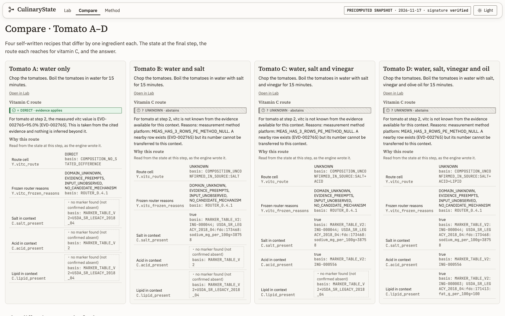

# CulinaryState

**From recipe text to evidence-grounded cooking state**

Group 17 · Kush Tokas and Parv Goyal · Computational Gastronomy · IIIT Delhi

Submission package prepared 20 November 2026. Scientific and human review limitations remain explicit.

## Problem and contribution

A measurement taken in one pot can be irrelevant in another. Cooking changes food identity, composition, physical context and what the evidence permits an assistant to say. CulinaryState compiles recipe text into events, replays those events into a cooking-state trace and builds a question-specific evidence packet. A deterministic compatibility check selects the route. The claim packet bounds the final answer and records the reasons for UNKNOWN.

The contribution is the integration of event-sourced state, condition-sensitive evidence and restricted answering. The system state is `S_t=(G,C,Q,Y,P)`, for lineage, composition, physical conditions, analyte/evidence and provenance. Its Typed Event IR carries the source spans and distinguishes alternative ingredients from simultaneous ingredients. The architecture inventory and invariants are in `docs/final/FINAL_STATE_SCHEMA.md` and `docs/EVENT_IR_CONTRACT.md`.

## Data and sources

| Recipe family | Recipe-base records | Use boundary |
|---|---:|---|
| Food.com | 522,517 | Local analysis and aggregate reporting. Raw recipe text is excluded from distribution and hosted model calls. |
| BBC Good Food | 11,934 | Local analysis under D-003. Raw recipes and derived association rows stay outside the deployed application. |
| Project Gutenberg | 73,955 | Public-domain source collection in the US. The local console may show title references. |
| Wikibooks | 3,676 | CC BY-SA conditions apply. Eligible references carry their source. |
| TASTEset | 700 | Local use pending licence verification. |

The recipe-base inventory totals **612,782** records. The full-corpus compiler census found **611,902** recipe texts with steps. The lineage differential ran on that compiler population. The local similar-title index has **612,903** documents. It substitutes the local Wikibooks input of **3,797** records for the recipe-base Wikibooks slice of **3,676**. These are distinct populations.

The process-effect evidence ledger draws from USDA retention tables, Bognár tables and Phenol-Explorer. FDA/CFSAN ingredient pH is a separate reference source used in the evidence compiler. The source registry and release card describe reuse limits. The public application ships only the filtered, signed snapshot and public build assets.

Sources: `registry/recipe_source_usage_registry_v1.csv`, `reports/step26/simulability_census_full_corpus_S166.json`, `reports/final/RELEASE_CARD.md`, `reports/final/REPORT_EVIDENCE_REVIEW_2026-11-20.json`.

## D1. Evidence ledger · PARTIAL

The ledger contains **17,978 active evidence rows**, with explicit source and tier. The active rows are E3. The proposal also requires a human source check.

Forty candidate literature rows (16 kinetics, 24 raw-versus-cooked) were pre-checked by AI personas under D-085: 28 were compared against an opened source and 12 sources could not be opened. No row has been verified by a human, so the ≥40 hand-verified rows required by the proposal are not met; the ledger records 0 human-verified rows.

The CAL AI comparisons matched **16 numeric spans** and retained metadata qualifications. They provide an audit trail for review. The original type, source values and frozen fit remain in their historical artifacts.

Sources: `reports/final/DELIVERABLE_COMPLIANCE_MATRIX_2026-11-16.md`, `reports/s181/human_audit/D1_literature_rows_precheck.csv`, `reports/s179/CAL_paired_AI_closeout_2026-11-13.json`.

## D2. Sparse process-effect learning · PARTIAL

The cold-split and paired diagnostics measure performance under differing food, pair and study partitions. The paired comparison includes Phenol-Explorer contrasts where rungs often fare worse than D0. Full proposal H2 and some prescribed treatments remain outside the demonstrated results. The retained pairing is labelled prior-exposure reanalysis.

The ascorbic-acid pilot provides a frozen research fit. No available SIM-VAL row qualifies for a validated retention prediction. Missing assay specificity, basis and raw time courses constrain model and calibration claims.

Sources: `reports/step29/diag/paired_vs_d0_S179_2026-11-13.json`, `reports/step29/technical_scope_and_contrast_boundary_2026-11-13.md`, `reports/step10/aa_pilot_model_a_fit_D085.json`, `reports/step10/aa_SIMVAL_diagnostic_2026-11-11_v2.json`.

## D3. State tracking · PARTIAL

The engine represents ingredient lots and their event history and was exercised in **30 scripted sessions**. Replay outcomes and field comparison measure different things. The development set and pilot use different labelling bases.

D3 was evaluated on 40 development gold recipes (20 BBC Good Food, 20 Food.com) and 7 pilot recipes. This gold was drafted by an AI. The development gold was accepted by the authors; it is not independent, not blind and not held out, and the engine was developed with part of it in view. On it the rule compiler matched 11–20 % of final state fields, reached merge/split F1 0.36–0.47, and replayed without issue. These are diagnostic figures, not an accuracy claim.

The qualification about author acceptance applies to the development comparison. The P1-A acceptance records disagree, so the pilot remains separately labelled and the human spot-audit is still pending. Lineage vNext is diagnostic with no regression gold. Simulation scenarios are engineering estimates, and mixture pH, salt fraction and fat fraction stay UNKNOWN without grounded inputs.

Sources: `reports/del3/compiler_vs_gold_pooled_S179.md`, `reports/s181/human_audit/D3_gold_status.md`, `reports/final/DELIVERABLE_COMPLIANCE_MATRIX_2026-11-16.md`, `reports/s179/state_inventory_FINAL_2026-11-15.md`.

## D4. Evidence retrieval and abstention · PARTIAL

The compatibility registry has **13 axes**. Nine are implemented, two are handled in the evidence compiler and two are schema-only. Geometry is query-only where evidence geometry is unavailable. The evidence compiler can distinguish MATCH, MISMATCH, UNKNOWN_IN_SOURCE and UNKNOWN_IN_QUERY.

The post-hoc D4 diagnostic accounts for all four requested metrics:

| Metric | Observed result | Limit |
|---|---|---|
| Condition-compatible recall | B2 recall **0.375** at the stored top **5** over **20** questions | No question in scope states the requisite conditions. The value equals ordinary recall. |
| Risk–coverage | B7 partial AURC **0.0977** over coverage **0.45–1.00**, **40** questions | Observed span only, with model-assisted gold. |
| Unsupported claims | B7 **4/34** and B2 **24/43** | Machine scoring. Outputs and denominators differ by rung. |
| Calibration error | NOT_COMPUTABLE | The system emits categorical precision classes. |

Sources: `registry/rag/compatibility_axes_v1.csv`, `reports/s181/d4_contract_metrics.json`, `reports/s181/d4_contract_metrics.md`.

## D5. End-to-end answering and demonstration · PARTIAL

The frozen benchmark has **74 questions across eight task types**. H1 and H3 are **RULE_NOT_MET**. H1 uses model-assisted labels and its separate supplement records the result under D-092. H3's sign test and abstention condition are separate, and the P3 abstention requirement fails.

The proposal specified a Streamlit demo. The Explorer provides a web interface, a signed set of **nine** authored snapshot scenarios and **eight** contractual ask outputs. Unsupported tasks and missing evidence are visible as refusals with reasons. The local console adds a same-model comparison, the pipeline view and a similar-recipe reference.

The eight scenarios were pre-reviewed by three AI personas (structure, food science, working cook) under D-085. This is not the chef/peer review named in the proposal, which was not performed.

Sources: `reports/del5/d5_score_v1_D085/d5_scoring_result.json`, `reports/s181/snapshot_findings.md`, `web/public/snapshot/manifest.json`, `reports/s181/human_audit/D5_peer_review_packet.md`.

## Models and comparisons

DeBERTa-base with a CRF attained macro F1 **0.9545 ± 0.0037** on the grouped RecipeDB3 split, against **0.9504 ± 0.0034** for the reproduced grouped baseline. The recorded comparison shows no meaningful win over the reproduced baseline. The original random protocol exposed **13.6%** masked-family overlap and **5.4%** duplicate test rows. E5 is the dense retrieval component. The records distinguish retrieval ranking from verified transfer.

Layer-1 licenses one field, `alternative_group`, on one trigger, `VNEXT_ALTERNATIVE_SKIPPED`. The earlier arms accepted offsets that fell within the source document without licensing the proposal. Asking the model for the quote and locating it deterministically led to **21 grounded proposals** from the 72B v3 arm on **60** cases. The final run contains one repaired call. The governing AI review classified **17** as well-formed alternative groups. Gold for correctness and recall is absent.

Sources: `reports/ner/culinaryner_kf_final_report.md`, `reports/s180/step7_FINAL_COMPARISON_2026-11-16.md`, `reports/final/sections/S180_freeze_results_DRAFT.md`.

## Demo stories

The signed comparison shows the state and route change when a recipe adds salt, acid or oil. Tomato's ingredient band **4.3–4.9** crosses **4.6**. This crosswalk is AI-drafted. The mixture pH is unknown. Sources: `web/public/snapshot/scenarios/tomato-a.json` through `tomato-d.json`, `reports/s180/step7_FINAL_COMPARISON_2026-11-16.md`, D-136.

<!-- STORY_PANELS -->

## Negative results and remaining review

The frozen H1/H3 rules were not met. The NER comparison provides a protocol-leakage finding. Diagnostic changes to lineage and agreement between AI reviews carry limited evidence. The live claim verifier checks wording and numbers against a claim packet. It can flag a cooking time or reject a cautious answer whose wording lacks an explicit uncertainty phrase. For cooking advice, it checks state citations against the trace. Unverified advice, including inferred chemistry, can remain.

The source-title ranker uses word overlap and can return a superficially similar title. The potato and safety examples were run locally with hosted sending disabled. The plain arm can run on a safety question when the checkbox is selected. The system arm still refuses. The local simulation adapter guards the duration-range tuple crash on the interactive path. The JSON batch path receives lists (D-140). Mixture pH and salt and fat fractions remain unknown without grounded inputs.

The literature review, chef/peer review, independent gold checks and proposal disagreement review remain open in their human packets. AI-delegated decisions D-134–D-137 retain their recorded scope and concurrence. See `reports/s181/human_audit/REPORT_WORDING.md` and `reports/s180/HUMAN_CONCURRENCE_2026-11-16.md`.

## Demo and reproducibility

- Public Explorer. <!-- PUBLIC_URL -->
- Local console. Run `./tools/live_demo.sh` and open `http://localhost:3000/live`. This uses the presenter's configured NVIDIA NIM key. The model receives only the permitted authored or public recipe inputs.
- Fallback. Use the signed Compare and Lab pages and the recorded screenshots. The recording shot list is in `handoff/REHEARSAL_SCRIPT_2026-11-24.md`.

Technical freeze `freeze-2026-11-20` points to `0a41d62`. The freeze suite recorded **8,578 passed, five skipped, zero failed and 44 deselected**. The credential-free preflight passed **28/28**. The snapshot was verified and its in-memory rebuild matched disk. Snapshot manifest SHA256: `bf0f80611429552b1a8264bdedf56b03fef1323630e41b896b1e3cfd81a24025`. Sources: the freeze entry in `STATUS.md`, S264 in `WORKLOG.md` and `web/public/snapshot/manifest.json`.

The screenshot manifest records the frozen commit, capture time and hashes. The evidence review maps each reported numeric result to a source version and its SHA256. Full historical report sections are available at the freeze tag. The presentation files and package use the provenance and check records supplied alongside them.

## Reproducibility index

| Evidence | Artifact |
|---|---|
| Scope and human review | `reports/final/DELIVERABLE_COMPLIANCE_MATRIX_2026-11-16.md`, `reports/s181/human_audit/` |
| Corpus populations | `reports/final/REPORT_EVIDENCE_REVIEW_2026-11-20.json` |
| Evidence, calibration and routing | `reports/s181/d4_contract_metrics.json`, `reports/del5/d5_score_v1_D085/` |
| Compiler and state | `reports/del3/compiler_vs_gold_pooled_S179.md`, `docs/final/FINAL_STATE_SCHEMA.md` |
| Study and model limits | `reports/final/sections/S180_freeze_results_DRAFT.md`, `reports/ner/culinaryner_kf_final_report.md` |
| Demo observations | `reports/final/screens/MANIFEST.json`, `reports/final/screens/runs/` |
| Freeze and execution | `STATUS.md`, `WORKLOG.md`, `DECISIONS.md` |

## Author contributions

**PENDING — to be written by Kush and Parv from their own contribution facts.** No effort allocation or
individual scientific contribution is inferred from commit authorship, delegated AI personas or this session.

## Appendix. Business proposal

<!-- BUSINESS_PROPOSAL -->
