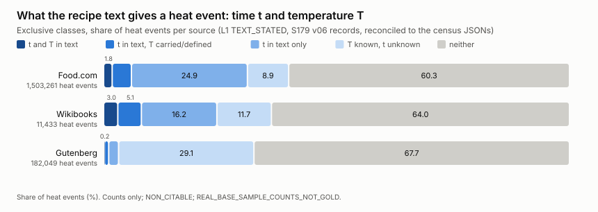
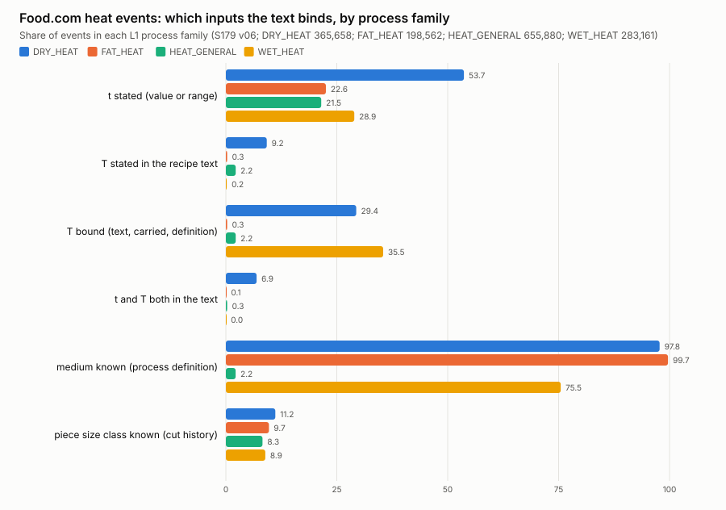
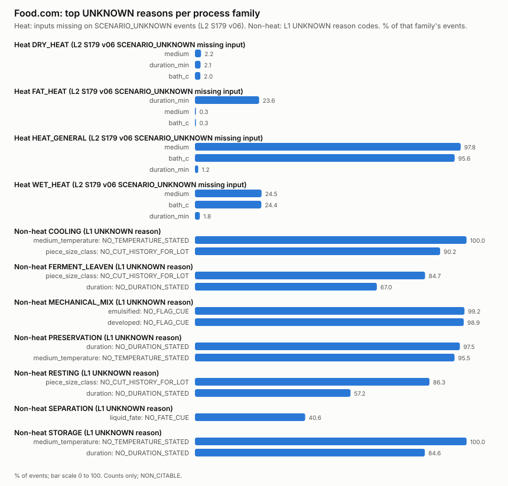

# What the corpus can say: stated time, temperature, size, medium (S178, T4-C04-R1)

Status: AI_DRAFTED / PROPOSED, counts only, NON_CITABLE, REAL_BASE_SAMPLE_COUNTS_NOT_GOLD. Layer 1 TEXT_STATED unless a table says L2.
Every number below is either a field of a committed census JSON (path given) or a cross-tab of the per-event records those censuses wrote (reconciled to the same JSONs: **PASS**, alignment errors heat L1/L2 {'FOODCOM': 0, 'GUTENBERG_SEGMENT': 0, 'TASTESET': 0, 'WIKIBOOKS': 0}).

t = stated time (value or range). T = temperature; **text** = stated in the recipe sentence, **bound** = text + a carried oven setting + a physical definition (boil = 100 C).

## 1. Heat events by source (committed census JSON fields)

| source | census file | heat events | t stated | T text-stated | T bound | t and T both text | t stated and T bound | ranges (t / T) | gas-mark only | medium | size class |
|---|---|---:|---:|---:|---:|---:|---:|---:|---:|---:|---:|
| Food.com | `binding_census_L1_FOODCOM_full_S179_v06.json` | 1,503,261 | 30.87 % | 3.29 % | 14.84 % | 1.83 % | 5.98 % | 9.94 / 0.08 % | 218 | 52.12 % | 9.27 % |
| Wikibooks | `binding_census_L1_WIKIBOOKS_full_S179_v06.json` | 11,433 | 24.31 % | 5.32 % | 19.81 % | 3.04 % | 8.1 % | 8.28 / 0.31 % | 1 | 50.41 % | 11.1 % |
| Gutenberg | `binding_census_L1_GUTENBERG_SEGMENT_full_S179_v06.json` | 182,049 | 3.21 % | 0.52 % | 30.15 % | 0.18 % | 1.09 % | 0.55 / 0.02 % | 0 | 72.0 % | 13.49 % |

TASTEset: 0 heat events (no step lists). BBC: v06 censuses exist only on the Mac (D-003), not on this server. Medium is bound on most events only through the process definition; size class only through the cut history.

## 2. Joint time and temperature (exclusive classes, % of heat events; figure 1)

| source | t and T in text | t in text, T carried or defined | t only | T known, t unknown | neither |
|---|---:|---:|---:|---:|---:|
| Food.com (1,503,261) | 1.83 | 4.14 | 24.89 | 8.86 | 60.28 |
| Wikibooks (11,433) | 3.04 | 5.06 | 16.21 | 11.71 | 63.98 |
| Gutenberg (182,049) | 0.18 | 0.91 | 2.12 | 29.06 | 67.73 |

## 3. Heat events by source and process family (L1 families; % of the family's events)

| source | family | events | t stated | T text | T bound | t and T text | medium | size class | lid | start mode |
|---|---|---:|---:|---:|---:|---:|---:|---:|---:|---:|
| Food.com | DRY_HEAT | 365,658 | 53.66 | 9.22 | 29.39 | 6.93 | 97.76 | 11.15 | 8.19 | 0.04 |
| Food.com | FAT_HEAT | 198,562 | 22.55 | 0.3 | 0.3 | 0.07 | 99.66 | 9.7 | 1.86 | 0.09 |
| Food.com | HEAT_GENERAL | 655,880 | 21.5 | 2.22 | 2.22 | 0.3 | 2.2 | 8.26 | 6.96 | 1.71 |
| Food.com | WET_HEAT | 283,161 | 28.95 | 0.2 | 35.45 | 0.04 | 75.48 | 8.89 | 20.52 | 6.22 |
| Gutenberg | DRY_HEAT | 34,382 | 6.28 | 1.87 | 2.01 | 0.93 | 96.15 | 16.17 | 6.02 | 0.73 |
| Gutenberg | FAT_HEAT | 24,763 | 0.65 | 0.09 | 0.09 | 0.02 | 96.93 | 16.36 | 4.76 | 2.39 |
| Gutenberg | HEAT_GENERAL | 46,245 | 2.09 | 0.34 | 0.34 | 0.02 | 0.0 | 12.62 | 5.3 | 4.88 |
| Gutenberg | WET_HEAT | 76,659 | 3.35 | 0.16 | 70.46 | 0.0 | 96.54 | 11.88 | 7.76 | 9.48 |
| Wikibooks | DRY_HEAT | 1,792 | 45.87 | 23.6 | 51.34 | 17.97 | 94.31 | 9.04 | 3.68 | 0.0 |
| Wikibooks | FAT_HEAT | 1,810 | 13.98 | 0.99 | 0.99 | 0.28 | 99.72 | 16.19 | 0.61 | 0.22 |
| Wikibooks | HEAT_GENERAL | 5,115 | 17.22 | 2.99 | 2.99 | 0.35 | 1.51 | 9.7 | 4.75 | 0.61 |
| Wikibooks | WET_HEAT | 2,716 | 30.3 | 0.52 | 43.23 | 0.07 | 80.67 | 11.71 | 15.06 | 3.35 |

## 4. Food.com heat events by process (top 15 PROC by events)

| PROC | name | L1 family | events | t stated | T text | T bound | t and T text | gas mark | size class |
|---|---|---|---:|---:|---:|---:|---:|---:|---:|
| PROC-000031 | cook | HEAT_GENERAL | 354,073 | 34.55 | 0.81 | 0.81 | 0.4 | 0 | 10.24 |
| PROC-000001 | bake | DRY_HEAT | 278,044 | 62.02 | 11.31 | 34.18 | 8.71 | 193 | 10.71 |
| PROC-000032 | heat | HEAT_GENERAL | 199,757 | 4.11 | 5.51 | 5.51 | 0.19 | 0 | 6.16 |
| PROC-000020 | simmer | WET_HEAT | 104,978 | 55.0 | 0.06 | 0.06 | 0.02 | 0 | 10.43 |
| PROC-000019 | boil | WET_HEAT | 87,700 | 17.84 | 0.27 | 100.0 | 0.04 | 0 | 6.57 |
| PROC-000016 | brown | FAT_HEAT | 83,816 | 7.41 | 0.21 | 0.21 | 0.05 | 0 | 8.43 |
| PROC-000034 | melt | HEAT_GENERAL | 79,050 | 1.88 | 0.48 | 0.48 | 0.04 | 0 | 4.18 |
| PROC-000014 | saute | FAT_HEAT | 67,586 | 37.73 | 0.01 | 0.01 | 0.0 | 0 | 9.5 |
| PROC-000028 | reduce | WET_HEAT | 63,895 | 4.06 | 0.36 | 0.36 | 0.06 | 0 | 9.55 |
| PROC-000003 | grill | DRY_HEAT | 37,699 | 35.08 | 1.11 | 4.93 | 0.44 | 1 | 14.39 |
| PROC-000009 | fry | FAT_HEAT | 33,302 | 21.09 | 1.05 | 1.05 | 0.2 | 0 | 12.23 |
| PROC-000002 | roast | DRY_HEAT | 26,888 | 29.66 | 5.34 | 29.05 | 2.92 | 20 | 11.66 |
| PROC-000004 | toast | DRY_HEAT | 14,765 | 12.6 | 2.06 | 12.6 | 1.1 | 0 | 10.38 |
| PROC-000007 | microwave | HEAT_GENERAL | 14,410 | 58.5 | 0.17 | 0.17 | 0.11 | 0 | 7.7 |
| PROC-000022 | steam | WET_HEAT | 11,821 | 25.4 | 0.09 | 100.0 | 0.03 | 0 | 8.87 |

All sources and all processes are in `corpus_can_say_v2.json` under `heat.derived_by_process`.

## 5. Non-heat families (Food.com, S179 v06 L1 records; % of the family's events)

| family | events | t stated (value, range, bound) | t value or range | events with a temperature input | T stated (of those) | t and T both (of those) | size class known (of applicable) |
|---|---:|---:|---:|---:|---:|---:|---:|
| COOLING | 297,413 | 24.9 | 18.26 | 297,413 | 0.05 | 0.01 | 9.75 |
| FERMENT_LEAVEN | 50,942 | 26.73 | 20.82 | 50,942 | 0.16 | 0.05 | 8.39 |
| MECHANICAL_CUT | 541,273 | 0.0 | 0.0 | 0 | n/a | n/a | n/a |
| MECHANICAL_MIX | 1,447,067 | 5.12 | 5.07 | 0 | n/a | n/a | n/a |
| PRESERVATION | 66,675 | 2.22 | 1.88 | 66,675 | 0.25 | 0.1 | 7.05 |
| RESTING | 14,232 | 40.72 | 37.82 | 0 | n/a | n/a | 13.67 |
| SEPARATION | 269,657 | 1.06 | 1.01 | 0 | n/a | n/a | n/a |
| STORAGE | 24,170 | 14.17 | 3.0 | 24,170 | 0.02 | 0.0 | n/a |

Other sources are in `corpus_can_say_v2.json` under `nonheat.derived_by_source_and_family`. n/a = the family has no such input (cut, mix, separate, rest carry no medium temperature; size class is not defined for mixing, separating or storing).

## 6. Per-family top UNKNOWN reasons (Food.com; figure 3)

Heat families, Layer 2 S179 v06 (`data/derived/physical_L2_full_S179v06`, status counts equal `scenario_L2_FOODCOM_full_S179_v06.json`): the inputs missing on SCENARIO_UNKNOWN events.

| family | events | SCENARIO_COMPUTED | SCENARIO_UNKNOWN | UNSUPPORTED_MEDIUM | top missing inputs (events, % of family events) |
|---|---:|---:|---:|---:|---|
| DRY_HEAT | 365,658 | 304,999 | 8,195 | 52,464 | medium 8,173 (2.24 %); duration_min 7,552 (2.07 %); bath_c 7,310 (2.0 %) |
| FAT_HEAT | 198,562 | 151,578 | 46,984 | 0 | duration_min 46,936 (23.64 %); medium 670 (0.34 %); bath_c 668 (0.34 %) |
| HEAT_GENERAL | 655,880 | 0 | 641,470 | 14,410 | medium 641,470 (97.8 %); bath_c 626,934 (95.59 %); duration_min 8,018 (1.22 %) |
| WET_HEAT | 283,161 | 211,057 | 72,104 | 0 | medium 69,430 (24.52 %); bath_c 69,200 (24.44 %); duration_min 5,102 (1.8 %) |

Non-heat families, Layer 1 UNKNOWN reason codes (`reports/step26/nonheat_L1_FOODCOM_full_S179_v06.json`, key `unknown_reasons`):

| family | events | top UNKNOWN reasons (input: code, events, % of family events) |
|---|---:|---|
| COOLING | 297,413 | medium_temperature: NO_TEMPERATURE_STATED 297,263 (99.95 %); piece_size_class: NO_CUT_HISTORY_FOR_LOT 268,430 (90.25 %); duration: NO_DURATION_STATED 193,867 (65.18 %) |
| FERMENT_LEAVEN | 50,942 | piece_size_class: NO_CUT_HISTORY_FOR_LOT 43,148 (84.7 %); duration: NO_DURATION_STATED 34,109 (66.96 %) |
| MECHANICAL_CUT | 541,273 | (no UNKNOWN reason code in the L1 file; see the L2 missing reasons below) |
| MECHANICAL_MIX | 1,447,067 | emulsified: NO_FLAG_CUE 1,435,414 (99.19 %); developed: NO_FLAG_CUE 1,431,623 (98.93 %); aerated: NO_FLAG_CUE 1,214,404 (83.92 %) |
| PRESERVATION | 66,675 | duration: NO_DURATION_STATED 65,006 (97.5 %); medium_temperature: NO_TEMPERATURE_STATED 63,700 (95.54 %); environment: NO_ENVIRONMENT_CUE 55,297 (82.94 %) |
| RESTING | 14,232 | piece_size_class: NO_CUT_HISTORY_FOR_LOT 12,286 (86.33 %); duration: NO_DURATION_STATED 8,148 (57.25 %); prior_heat_link: NO_PRIOR_HEAT_LINK 6,875 (48.31 %) |
| SEPARATION | 269,657 | liquid_fate: NO_FATE_CUE 109,391 (40.57 %) |
| STORAGE | 24,170 | medium_temperature: NO_TEMPERATURE_STATED 24,165 (99.98 %); duration: NO_DURATION_STATED 20,447 (84.6 %); environment: NO_ENVIRONMENT_CUE 12,094 (50.04 %) |

Non-heat Layer 2 S179 v06 missing reasons (committed `nonheat_L2_FOODCOM_full_S179_v06.json`, `counts.missing_reasons`):

- COOLING: half_thickness 273,361, MEDIUM_NOT_BELOW_FREEZING_POINT 18, MEDIUM_NOT_ABOVE_FREEZING_POINT 10
- FERMENT_LEAVEN: half_thickness 26,483
- MECHANICAL_CUT: cut_class 132,826
- PRESERVATION: environment 55,297, medium 1,560, medium_temperature 1,378, half_thickness 1,012
- RESTING: prior_heat_link 6,875, half_thickness 5,888, prior_heat_h 3,166, prior_heat_bath_c 3,054
- STORAGE: storage_temperature 12,092

## 7. What the corpus can say, in one paragraph per layer

- **Heat, Food.com (1,503,261 events).** The text states a time on 30.87 % of heat events and a temperature on 3.29 %; both in the text on 1.83 %. Counting a carried oven setting and the physical definition of boiling, a temperature is bound on 14.84 % and time and temperature together on 5.98 %. 60.28 % of heat events have neither.
- **Layer 2** (scenario defaults) turns a bound event into a physically_possible trajectory only; it adds no stated value. In Food.com the largest block of UNKNOWN is the generic verbs (HEAT_GENERAL, 655,880 events: cook, heat, melt and the like): 2.2 % of them have a medium and 0 reach SCENARIO_COMPUTED; 97.8 % are SCENARIO_UNKNOWN, missing medium (97.8 %), bath_c (95.59 %).
- **Non-heat (Food.com).** A duration (value, range or bound) is stated on 0.0 % (MECHANICAL_CUT) to 40.72 % (RESTING) of events by family; where a family has a medium or target temperature input, it is stated on at most 0.25 % of events. So these families can carry duration-keyed flags and qualitative states; the text gives almost no temperature to key a number on.

## 8. Notes

- t = stated time (duration MEASURED or RANGE, basis TEXT_STATED). T = temperature; 'text-stated' means basis TEXT_STATED; CARRIED_SETPOINT is an oven setting stated earlier and carried to the event; PHYSICAL_DEFINITION is a physical definition (water boils at 100 C at 1 atm).
- Gas mark: an event whose L1 record keeps an oven_setpoint_code with no converted temperature (the L1 layer does not convert a gas mark; every such event has T UNKNOWN).
- Medium is bound mostly from the process definition (basis PROCESS_DEFINITION: a verb such as fry or simmer implies it), not from a medium named in the recipe text; see the input_basis block of each census file.
- Piece size class comes from the cut history of the food (CUT_HISTORY), not from a size stated at the heat step.
- TASTEset has no step lists (0 heat events). BBC is not in these tables: its v06 censuses (binding_census_L1_A1_full_S179_v06.json and siblings) and records exist only on the Mac (D-003); this tool runs where the non-BBC records are.
- Inputs: every census file is S179 v06 (FIX-GOV repoint; the first build of this table read the superseded S176 v02 / S176 / S177 v03 files) and no input is listed in registry/superseded_outputs_S176.csv (checked before reading).
- The Layer-2 columns are SCENARIO values (ASSUMED_DEFAULT, MODEL_DERIVED, NON_CITABLE); they are shown only for their UNKNOWN reasons.
- Reconciliation: derived totals equal the committed census totals for every source (heat events, duration, temperature, medium, size, lid, start mode, water ratio, matrix class, gas mark, driver-bounded, L2 status; non-heat events).

## 9. Provenance

- Tool `s178-corpus-can-say-0.3.0-draft`; derived aggregate sha256 `291d49cc75f19301f67506b24caa803f3afb9da0f92de628d5b4eb43b5bc970a`.
- Committed census inputs (sha256):
  - `reports/step26/binding_census_L1_FOODCOM_full_S179_v06.json` `4f6215bcde5acb6d`
  - `reports/step26/binding_census_L1_GUTENBERG_SEGMENT_full_S179_v06.json` `fb0faa4fe2ba28e2`
  - `reports/step26/binding_census_L1_TASTESET_full_S179_v06.json` `320e145a0d7c8143`
  - `reports/step26/binding_census_L1_WIKIBOOKS_full_S179_v06.json` `a29c2cd470c075aa`
  - `reports/step26/nonheat_L1_FOODCOM_full_S179_v06.json` `88ec8df2d8fdc2c9`
  - `reports/step26/nonheat_L1_GUTENBERG_SEGMENT_full_S179_v06.json` `ff3237ceca68a316`
  - `reports/step26/nonheat_L1_TASTESET_full_S179_v06.json` `70bcca5a6d42e651`
  - `reports/step26/nonheat_L1_WIKIBOOKS_full_S179_v06.json` `723a6ece96dcb754`
  - `reports/step26/nonheat_L2_FOODCOM_full_S179_v06.json` `4cafb3bc7ea7a152`
  - `reports/step26/nonheat_L2_GUTENBERG_SEGMENT_full_S179_v06.json` `86533afc3b1153ba`
  - `reports/step26/nonheat_L2_TASTESET_full_S179_v06.json` `b7b4cbd52374fdea`
  - `reports/step26/nonheat_L2_WIKIBOOKS_full_S179_v06.json` `7aa17628c9ec1950`
  - `reports/step26/scenario_L2_FOODCOM_full_S179_v06.json` `14d4675f5f1d1831`
  - `reports/step26/scenario_L2_GUTENBERG_SEGMENT_full_S179_v06.json` `83e337c61972304c`
  - `reports/step26/scenario_L2_TASTESET_full_S179_v06.json` `0932c618418df052`
  - `reports/step26/scenario_L2_WIKIBOOKS_full_S179_v06.json` `bc07d9d8adc73a70`
