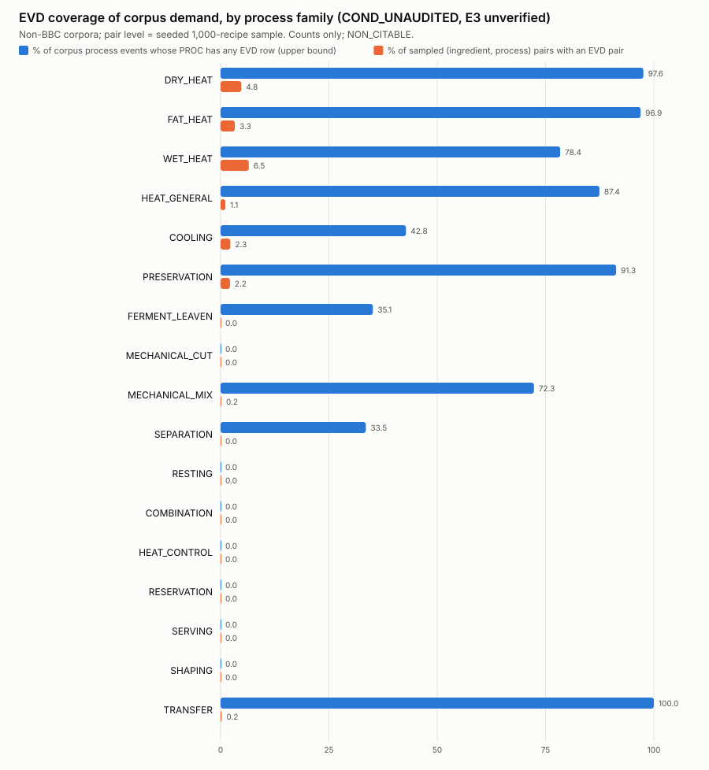

# EVD coverage against corpus demand, per process family (S178, T2-C13-R1)

Status: AI_DRAFTED / PROPOSED, NON_CITABLE, counts only. **Tags: COND_UNAUDITED** (the 07.A condition-audit gate has not passed), E3_UNVERIFIED, BOOTSTRAP_UNVERIFIED. Reproduce with one command: `python tools/s178_evd_coverage.py` (s178-evd-coverage-0.3.0-draft).

## Statement for the talk (counts only)

EVD holds 338 routable (ingredient, process) pairs over 98 ingredients and 36 processes (17,978 ACTIVE rows, all tier E3, UNVERIFIED, COND_UNAUDITED). A seeded 1,000-recipe non-BBC sample asks about 12,501 distinct (ingredient, process) pairs; 111 (0.89 %) have any EVD pair. At process level 63.47 % of 4,724,493 corpus process events (non-BBC, full) are for a process that has some EVD row: an upper bound that ignores the ingredient. For vitamin C the full non-BBC census saw 102 of EVD's 115 pairs among 125,172 distinct pairs (0.08 %).

## Table

Columns: corpus events = process events in the full non-BBC corpora (committed census aggregate); % events with EVD PROC = share whose process has any EVD row (**upper bound**, ingredient ignored); EVD rows / PROC ids / routable pairs = ACTIVE EVD supply by PROC family (pair = (ING, PROC) with a MEASURED or CENSORED value, any target); sample pairs = distinct (ING, PROC) pairs asked in the seeded 1,000-recipe non-BBC sample, and how many hold an EVD pair; last column = vitamin-C DIRECT items in the committed full non-BBC router census (gated).

| process family | corpus events | % events with EVD PROC | EVD rows | EVD PROC ids | EVD pairs | sample pairs | sample pairs with EVD | % sample pairs with EVD | vit-C DIRECT (router) |
|---|---:|---:|---:|---:|---:|---:|---:|---:|---:|
| DRY_HEAT | 401,832 | 97.59 | 3,081 | 4 | 47 | 522 | 25 | 4.79 | 8,234 |
| FAT_HEAT | 225,135 | 96.94 | 3,915 | 6 | 49 | 364 | 12 | 3.30 | 7,518 |
| WET_HEAT | 362,536 | 78.38 | 6,678 | 8 | 116 | 677 | 44 | 6.50 | 6,557 |
| HEAT_GENERAL | 707,240 | 87.44 | 1,320 | 5 | 45 | 629 | 7 | 1.11 | 6,811 |
| COOLING | 310,762 | 42.79 | 1,219 | 2 | 37 | 531 | 12 | 2.26 | 68 |
| PRESERVATION | 81,813 | 91.30 | 179 | 3 | 13 | 139 | 3 | 2.16 | 255 |
| FERMENT_LEAVEN | 58,613 | 35.15 | 68 | 1 | 4 | 115 | 0 | 0.00 | 0 |
| MECHANICAL_CUT | 656,204 | 0.00 | 0 | 0 | 0 | 1,153 | 0 | 0.00 | 0 |
| MECHANICAL_MIX | 1,552,674 | 72.32 | 93 | 4 | 4 | 1,698 | 3 | 0.18 | 777 |
| SEPARATION | 325,389 | 33.53 | 78 | 1 | 2 | 634 | 0 | 0.00 | 0 |
| RESTING | 16,898 | 0.00 | 0 | 0 | 0 | 41 | 0 | 0.00 | 0 |
| COMBINATION | 0 |  | 0 | 0 | 0 | 2,590 | 0 | 0.00 | 0 |
| HEAT_CONTROL | 0 |  | 0 | 0 | 0 | 158 | 0 | 0.00 | 0 |
| NO_PROC_FAMILY | 0 |  | 157 | 0 | 0 |  |  |  | 0 |
| RESERVATION | 0 |  | 0 | 0 | 0 | 172 | 0 | 0.00 | 0 |
| SERVING | 0 |  | 0 | 0 | 0 | 355 | 0 | 0.00 | 0 |
| SHAPING | 0 |  | 32 | 1 | 1 | 723 | 0 | 0.00 | 0 |
| TRANSFER | 25,397 | 100.00 | 1,158 | 1 | 20 | 2,000 | 5 | 0.25 | 0 |
| **all** | 4,724,493 | 63.47 | 17,978 | 36 | 338 | 12,501 | 111 | 0.89 | 30,220 |

## Reconciliation to the router census and the EVD ledger

- EVD vitamin-C (SVAR-000009) routable pairs: ledger 115 = full non-BBC census 115 = 1,000-sample census 115; ingredients 25 = 25 = 25. Equal: **True**.
- Heat events read from the can-say aggregate (1,696,743) equal the committed heat censuses of the three non-BBC sources (1,696,743): **True**.
- Full non-BBC census (reports/step23/router_demo_census_vitc_nonBBC_full_S179b.json): 600,848 recipes, 35,256,601 items, 125,172 distinct pairs, vitamin-C pairs seen 102 (0.08 % of distinct pairs); census_version router-demo-census-0.4.1-draft.
- Sample re-run (1000 of 600,848 recipes; 57,511 items; 15,326 events; 0 exceptions) vs the committed 1,000-recipe census (router_demo_census_vitc_nonBBC_1000_S179b.json) (items, events, recipes seen, distinct pairs, distinct ingredients, vitamin-C pairs seen): **reproduces: True** {'items': [57511, 57511], 'events': [15326, 15326], 'recipes_seen': [600848, 600848], 'recipes_sampled': [1000, 1000], 'distinct_pairs': [12501, 12501], 'distinct_ingredients': [618, 618], 'vitc_pairs_seen': [51, 51]}.
- Sample ingredients with any EVD row: 112 of 618.

## How to read it

- process-level share is an upper bound on coverage (ingredient ignored)
- pair-level numbers are a 1,000-recipe sample, not the corpus
- EVD rows are tier E3, UNVERIFIED and COND_UNAUDITED: coverage is not evidence quality
- TASTEset has no step lists: no process events
